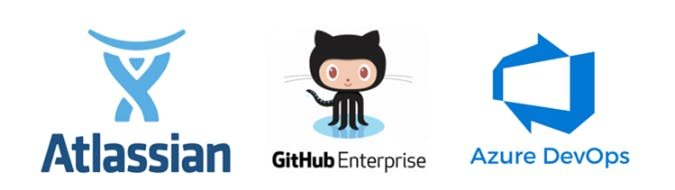
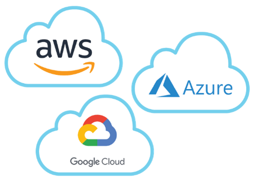
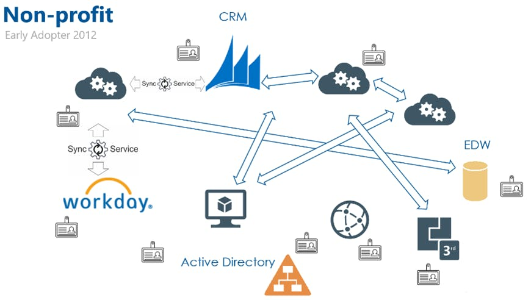
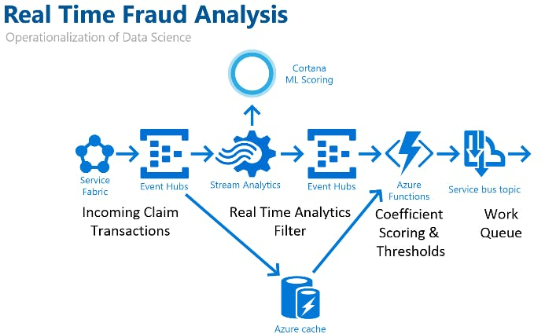
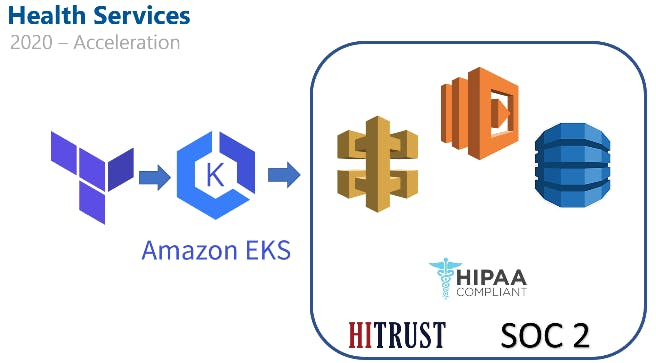

The world has changed! Onsite is dead; everything is going digital!

How many times has this been shouted on articles, news feeds, and social media in the past 18 months? The very idea seems to have simultaneously lost its meaning and become more true to IT. Rather than make a statement where the world will land on working from home, return to the office, or any of those great click-bait headlines, we will attempt to reduce the pain of change to come.

As each organization approaches the prospect of change, there can be fear, uncertainty, and doubt. We have participated in great successes and stunted failures in digital transformation and cloud migration. There are pitfalls and traps around many corners on the path of change. Hopefully, the knowledge and lessons here will act as a reliable guide helping you avoid those troubles while reaching the benefits.

In reading the article, you may have the question of who is “we”? Is there a group of people typing on a single keyboard? In spirit, yes. Improving has over 1000 Improvers, and each has dozens of hard-learned lessons. A group of us got together to share those stories, and this article is the output of that effort. “We” is all the folks that felt the pain of early adoption, stumbled through implementation without documentation, walked down paths that failed, or navigated changing platforms to find sustainable success.

#### **"*****In reading the article, you may have the question of who is “we”? Is there a group of people typing on a single keyboard? In spirit, yes. Improving has over 1000 Improvers, and each has dozens of hard-learned lessons...."***

## **The Cloud**

This concept seemed so easy to understand looking back 20 years. It was simply someone else’s servers, although we didn’t think about it that way at the time. We could manage them just the way we managed our own, and it was just another way to approach virtualization. That seems like such a far cry from where we are today. We have so many ____-as-a-service (_aaS) offerings from twice as many providers. It is confusing! It seems like new providers and offerings are brought to the table each day, building a large pack of jargon ready to pounce on anyone who tries to understand its scope. As we map out the path to change, we can also avoid the jargon. We will attempt to put the jargon in parathesis after the plain text explanation.

The foundation of cloud platforms, like those to the right, is that running virtual environments at scale is more efficient (read cheaper) than doing it at a smaller scale. This idea has grown from offering companies a platform to run their virtual servers into more specialized offerings. However, it is important to keep in mind that this core idea is at the root of all cloud platforms. We will explore a few of the major offering areas that make up the bulk of the modern cloud and a few emerging areas that are going to be pivotal in the years to come.

The foundation of cloud platforms, like those to the right, is that running virtual environments at scale is more efficient (read cheaper) than doing it at a smaller scale. This idea has grown from offering companies a platform to run their virtual servers into more specialized offerings. However, it is important to keep in mind that this core idea is at the root of all the cloud platforms. We will explore a few of the major offering areas that make up the bulk of the modern cloud and a few emerging areas that are going to be pivotal in the years to come.

## Office Productivity and the Digital Workspace

Offering a packaged solution as a hosted service is an old idea. Do you remember the days of the mail hosting wars (Hotmail, Gmail, AOL mail, Yahoo mail, etc.)? Back then, they were simply providing a mail server and access portal as a service. This idea has now expanded into office productivity and the ever-expanding area of a digital workspace. The number of tools that most people use each day has dramatically expanded. We use file sharing, document editing, spreadsheets, presentation tools, video conferencing, chat, and collaboration areas. If done correctly, each of these can now talk to each other, creating a tangled web of interactions we have come to rely on. The overarching value proposition in this space is that instead of trying to host and coordinate a dozen different systems, we can purchase an integrated platform as a solution (or for the more adventurous, we can purchase services from 2-6 places and wire it together ourselves.)

## Application Development and Deployment

With application development continuing to move faster and expected to tackle more, there is space for companies trying to optimize the working platforms of the development teams. It shows up with tools like Atlassian, GitHub Enterprise, and Azure DevOps. While each brings a different flavor to the table, they are all trying to make developers' days more enjoyable, easier, and ultimately more productive. That is where the value proposition lives for this type of cloud adoption. The integrated platform argument is just as strong here, but often developers chase best-of-breed solutions for these types of tools. That combination makes this a minefield of potential problems that we will dive into shortly.

## Infrastructure, good ol’Infrastructure

Servers, networks, and infrastructure have been through the “remote to local to remote cycle,” the most times of any of the offerings we explore here. It would be easy to assume these cloud migrations go the smoothest because of industry experience like that. Unfortunately for infrastructure folks everywhere, that is not the case. The technologies that have sparked each cycle are significantly different. “Server virtualization is to containerized infrastructure, as edge/serverless infrastructure is like a 6th-grade genetics introduction is to mapping the human genome.” They are both working with and describing the same problem, but one is massively more nuanced and complex. In this case, the argument is typically one of how to approach the cloud, “Do we insulate ourselves from the cloud host so that we have an easier change in the future? (cloud agnostic) or “Do we leverage the cloud-specific technologies making the work easier, but future change to another provider harder? (<cloud platform> native i.e. Azure native)

## Data Analytics and Artificial Intelligence

The data analytics space has been incrementally innovating for 20+ years, and the cloud offerings try to distill that innovation to an easily approachable set of tools. That span from data storage, analysis (more on that in a second), and visualization/reporting. In each case, the value proposition is that integration makes the speed increase and the cost to develop decrease.

***Caution – traditional AI hype incoming*** In the very near future (1) we will have a fully functioning (2) AI to assist with everything (3). It will provide great insights (4) to our businesses and world, that no human could have seen (5). ***End Caution – Added footnotes for translation***

*1 In the next 2-200 years. 2 Functioning on something new, but not fully built out. 3 Everything we ask it to do, and it doesn’t fail horribly on. 4 That may be incredibly valuable, or naïve as the observations of a 3-year-old seeing a plane for the first time. 5 Without a huge amount of effort and perfect memory.*

The machine learning, deep learning, and artificial intelligence space is full of innovation, and the value cases for it are becoming more robust than previously available. The primary value proposition for the consumer of these services is not having to develop your own infrastructure. That saves a significant cost of investment in analysis systems, infrastructure, and expertise. There is also value for the producers of these tools because with more data comes better systems in the data analytics space.

***The well-worn paths to the cloud and digital migration failures***

As we price replacements and maintenance of an owned data center, many companies start to look at the cloud as a potential alternative. Similarly, looking at application development often includes a conversation around cloud technologies. Evaluating the move to the cloud is complex, and some pitfalls can cause this evaluation to lead to mistakes. Let’s tackle a few of these because they are the well-traveled paths to failure in migration.

Most often, the one that we hear is “The cloud is cheaper in cost of service and cost of management.” That can be true if you only look at a portion of the numbers involved. Looking only at that portion is easy to do because there are costs and considerations in cloud management that are not typical with data center management. The total cost and management of your infrastructure's cloud version will depend heavily on how you approach your migration (and that approach will change your cost to migrate).

We often hear the typical approach of a physical to virtual cloud migration as the “fastest path to the cloud.” While it is faster to migrate this way, we are trading the speed of migration for the cost of operations and ease of management. The cloud can run your virtual servers exactly as they are in your infrastructure, but it is not typically structured for the cloud environment. Remember, the cloud provider's value proposition is to run more efficiently at scale, so having your servers, dedicated CPU, Ram, and storage is expensive. Virtualization can help with some of this, but ultimately it is the least optimized for the goals of the platform. If we are going to implement against the grain of the platform, we will need to manage our servers, network, and workloads more directly; treating this as leased data center space rather than a platform.

More complexity and opportunity for cost and management savings come when we approach the mixture of our current applications and platform services like authentication, security, scale on-demand adjustments, and many other features. To leverage these, we need to break down our infrastructure into its component pieces. Data storage, messaging, applications, and many others will need to be pulled apart to set up those services. This work will need to be front-loaded on the migration. However, it can significantly save the management and cost of the cloud infrastructure.

We can take a full containerized approach to our applications, leveraging Docker and technologies like Kubernetes to compartmentalize our infrastructure. Allowing flexibility in our infrastructure deployment and managing those pieces through the platform is automated on the “Big 3” platforms (AWS, Azure, GCP). It can start as an effort by infrastructure, but long-term maintenance will need to include the application development teams. Changing mindsets that infrastructure is everyone’s concern will take significant change management work. Infrastructure as Code (versioned, checked into a repository, and automated) is a great goal line. Still, many organizations fall short of these because of the hidden work (and a lot of it) that the infrastructure teams do each day.

Lastly, we can build our applications and internal tools to take the fullest advantage of packaged offerings in the cloud platform that we chose (cloud-native). Typically, this has the highest conversion cost due to the changes required in applications and internal company tools. The flip side of that cost is that it also has the greatest efficiency on the platform because we are implementing it directly in line with the platform’s optimization.

In the end, the approach that each company will take is going to be determined by their needs, budgets, and internal skills. We have come to believe that there is no golden answer to changing the technology and processes inside a company. There are, however, some common tools, frameworks, and practices that help to find that approach.

## Mapping the Risks and How to Navigate Them?

There is no golden recipe for finding success in cloud migration, but often we get asked, “how do we find success?” We continually look at the solutions of the past and how to make them better. This includes knowing where the risks are and navigating them well. We are going to dive into a few example cases for cloud adoption, digital transformation, and infrastructure change. We are going to travel from early cloud adopters into more recent implementations.

In 2012, we worked with a non-profit to adopt a cloud infrastructure and wire together multiple different parts of their operational systems. The primary risk for them was an unmaintainable system, and the risk for us was trying to do so much it would destroy the Return on Investment (ROI) of the migration. When the work was completed, the system successfully replaced their on-premise infrastructure, which was a mixture between moving existing applications to integrate with the cloud and leveraging some platform services. As you can see from the diagram to the left, this system relies on multiple interactions between those components. Those connections must be maintained and updated, but so far, the maintenance cost hasn’t justified adjusting the underlying platform. Even as an early adopter in the cloud space, they have been able to find a middle ground of management and value from the conversion.

In the cloud-native space, we worked to operationalize data analytics and machine learning to detect fraud as a part of claim processing. The client's risks were invalid conclusions and too slow to change, while the risk for us was not having a robust enough data engineering solution. The analysis previously was a less robust and more manual process, and in moving this to a digital process, we can apply several cloud services. The implementation was cloud-native to deeply integrate multiple tools and save the cost in both building and maintaining the platform. The overall outcome was a more accurate detection and prevention of fraud through the application of this system.

In the past year, we have worked with many companies in the health and life sciences space to update infrastructure to deal with the increased volume caused by the COVID-19 pandemic. The largest risk to health-related clients we saw last year was a failure to scale to massive demand while meeting changing needs. The largest risk for us was a rush to meet deadlines and client demands, potentially creating security and privacy problems. One example is working with a telehealth group to deal with an over 8x increase in volume for their services. We were able to accelerate a roadmap and accomplish the platform migration in half the initially planned time by leveraging a mixture of platform-specific infrastructure and containerization. We were able to do all of this while maintaining HIPAA and SOC 2 compliance and HITRUST certification. Beyond the security and data protection needed for this type of information, we also were able to manage the platform migration within strict SLAs for downtime.

## **Looking for More?**

We hope that exploring these 3 examples from very different times, technologies, and cloud providers have helped frame the evaluation of cloud and digital tools and approaches. If you read through this and found yourself with a couple more questions, we understand, it’s a big space and many ways to find both success and failure. A single article is not going to navigate the sea of possibility.

Please feel free to reach out, and we will answer those questions. Our team frequently does cloud migration assessments. For anyone in the US that emails [Sales@improving.com](mailto:Sales@improving.com) and mentions this article, we will provide a 90-minute assessment/planning session for your organization, free of charge.
