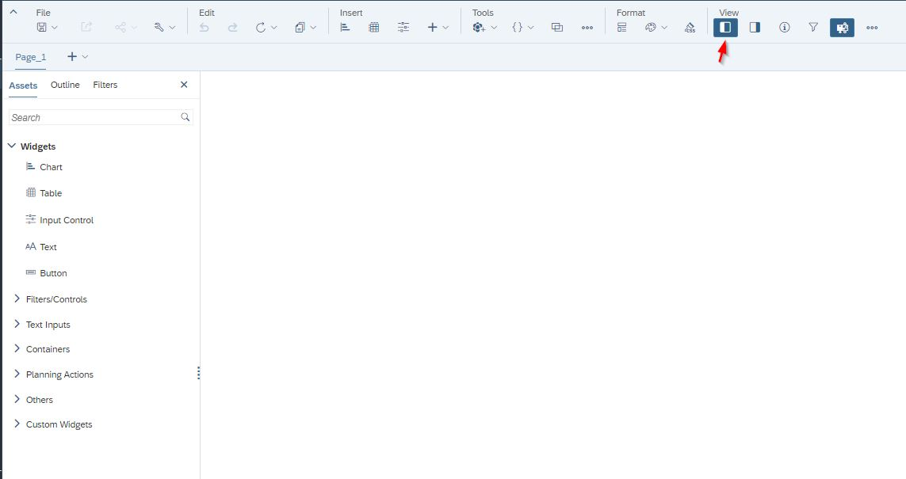
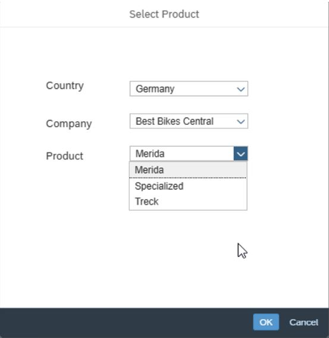
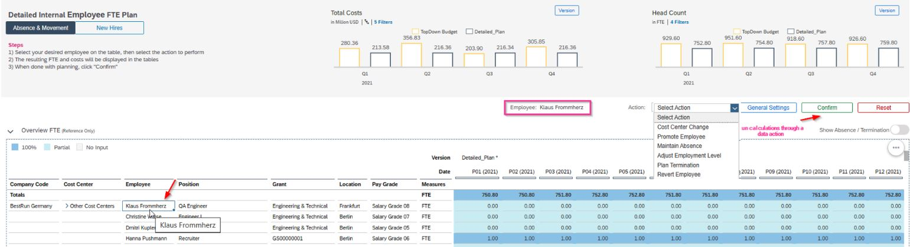

Analytics Designer has been fully integrated into the optimized design experience at the time of creating a new story. Users can obtain different interface capabilities such as widgets, buttons, and text inputs or containers that enhance the flow and organization structure of the story, like a tab strip or flow layout panel within a story. Here you will find a few new updates and some usage scenarios of analytical applications.

SAC has designed a new Left Side Panel divided into “Assets”, “Outline and “Filters”. In the Assets section, you can drag and drop widgets, filters/controls, text inputs, containers, planning actions, and others. In Outline, you can find all the items used in the canvas, and this is the place where you can create and edit the scripts. The scripting section has an improved look and feel, with the ability to choose between various options to add to your outline. Moreover, in this section, users can include all the items from different pages in the story. Story filters were grouped into “Filters” into this panel section. However, you have the option to pin the filters to the top as it was before.

With these updates, here are some common scenarios:

**1: Cascading Dropdowns**

This scenario usually consists of having the capability to select and filter the options from one drop-down to the next drop-down.

As an example, let’s say that we want to select just the products available from a specific country and company. This can be achieved by calling the properties of the product. Meaning, the product dimension will have ” Country” and “Company” as properties.

The first drop-down will display all the countries available from the product dimension and the second drop-down. The same concept exists for the companies available for the product dimension but filtering these options depending on the first selected drop-down country.

**2: Use Data Actions Triggered in the Background**

Usually, data actions ask for the parameters required in a secondary standard window. However, this can be achieved without the user setting the parameters manually and directly. The parameters could be fed through variables already used or calculated within the story. Therefore, these variables can be used directly in the function “setParameterValue”.

**3: Visualize or Update Dimension Members Selected From a Table **

Often, users are required to be able to visualize the property from the member dimension selected as a first-stage process by using “getSelections/ getResults” functions. Depending on the requirements, these properties could be changed by users, and as mentioned above, this could use a parameter to trigger a data action. For example, selecting an employee and showing it within the table or through text boxes. What’s their position? Which type of employee is this? Where is this employee located? Which company does this employee belong to?*** and any other properties that this dimension can provide. As previously discussed, instead of a text box this could be input fields and could be ***updated after clicking a button to run several planning calculations.

These three functionalities together provide tremendous flexibility to create an interactive planning user interface. In the end, it can always add more visual and interactive charts with linked analysis and other types of widgets like comments to add value.

Ready to start your journey with SAP Analytics? [Reach out to us.](https://www.improving.com/contact/)
