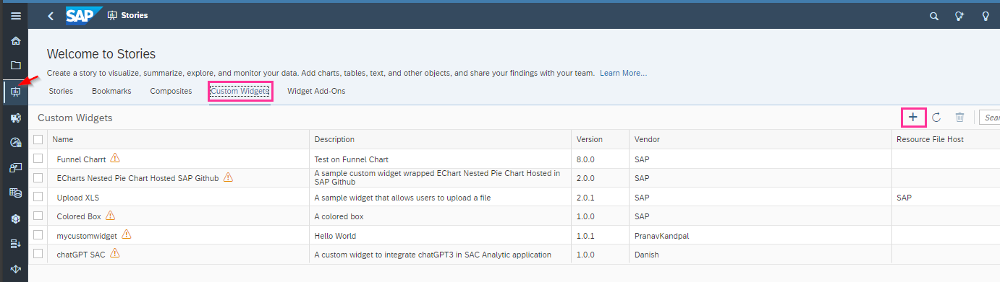
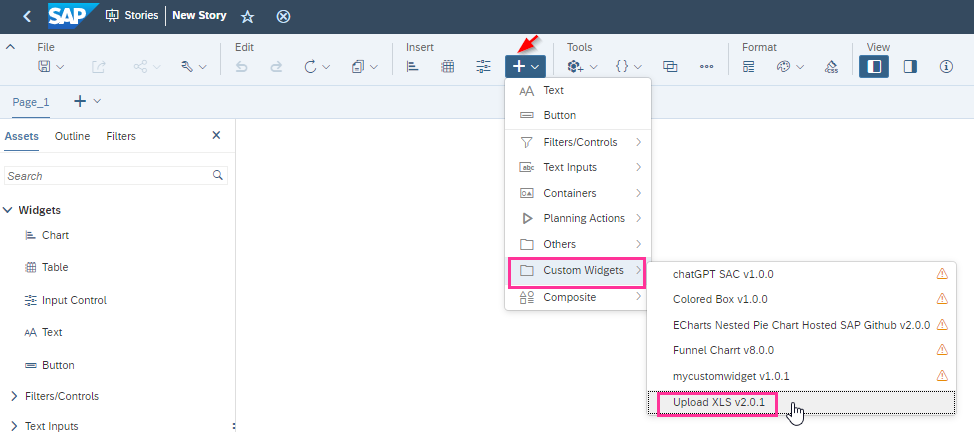

SAP Analytics Cloud (SAC) has opened the door to expand the possibilities of creating custom widgets by embedding analytics design elements into standard stories. The framework enables users to design specific functionality, user interface element or unique visualization of data not available using standard widgets.

To understand how to create a custom widget, we need to understand what elements are required. Since SAC lives in a web browser it requires the use of HTML, Cascading Style Sheets (CSS) and JavaScript (JS) code to interpret and display dashboards.

To create a custom widget, you will be required to supply:

- The logic for the widget using a JS file.
- The defined widget appearance using a CSS file.

SAC will use a JSON file to provide more detail, such as using the JavaScript function and supplying necessary parameters, variables, or triggers.

To use a custom widget, you need to add the JS and CSS files to the web page. [Github](https://github.com/SAP-samples/analytics-cloud-custom-widget/tree/main/Custom-Widget-Samples) is a common platform for locating the required code for SAC custom widgets.

If you locate a custom widget code that you would like to use, navigate to the “Stories” icon in your SAP Analytics Cloud tenant and click on the menu “Custom Widget” and click on “+”.

Select your JSON file (which contains the web components to call JS from web host URL) and upload it.

Once the widget is uploaded, we will call it in the story.

And from here the next steps, could be to calling the functions created on JS through different events and add the parameters needed for the logic created on JS.

Custom widgets in SAC are powerful tools, requiring minimal effort and can provide maximum return for users in terms of specific functionality and user experience. For more information, please refer to the [SAP Analytics Cloud Custom Widget Developer Guide](https://help.sap.com/docs/SAP_ANALYTICS_CLOUD/0ac8c6754ff84605a4372468d002f2bf/75311f67527c41638ceb89af9cd8af3e.html) or [reach out to us](https://www.improving.com/contact) today.
