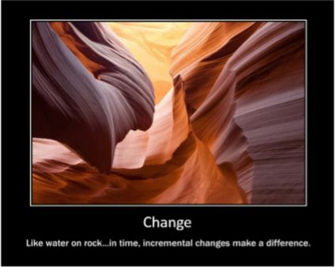

I am not a patient person. Additionally, I tend to be solution-oriented. While I do my due diligence to understand the desired outcomes and current state of the team(s) I am engaging with when I start a coaching engagement, I start to imagine what the future could look like once they have transformed their way of working. I foresee that beautiful state where the team is tightly knit, focusing on delivering value, and looking for ways to improve on their own. While I know to not boil the ocean, boiling off the smaller segments of the ocean as fast as possible is sure exciting! This is where the challenges begin.

Most of the time, when rushing headlong into solving problems and making perceived improvement after perceived improvement, the team, division, and/or company simply is not prepared. The team has not stopped their production for you to make a change. They still have work to do, usually a lot, and are behind. Additionally, the culture around the team is, most likely, such that they cannot pivot quickly or absorb new ideas in rapid succession. Most teams need time to understand and experience why the proposed changes to their way of working will help.

You can craft an ideal incremental plan to help with the adoption of key practices, build the team of change champions, and ensure they are fully enabled to help with the change. In the excitement to see progress, marching the team through education, experience, and adoption of multiple practices will result in overwhelmed and frustrated teams that, in the end, will revert to what they know. The beautiful dream will turn into a nightmare, all thanks to impatience and drive.

My own personal experiences like this drew me to create the following “inspirational” poster:

Water is powerful. It has the capability to carve deep, beautiful canyons into solid rock. But here is the thing: this is a process that takes a lot of time, and if you were to look at the direction of a river before the birth of the canyon, the results years later would not align with expectations.

Yes, the outcome of a canyon would be there, but how it was cut, the twists and turns, and the resulting direction may be completely different. Like water carving a canyon, change and transformation takes time and dedication, especially when cultural and behavioral change is involved. The process of transformation may not be done in the timing you expect, or even during your tenure as a coach, but when it is moved forward in a paced, intentional way, change will always come.

## So Where Does One Start?

First, understand your audience and their needs. Take the time to interview the team members, leaders, and stakeholders to learn their pain points as well as the path they have been on to get where they are. While you are in the process of understanding, do not even think about change. Many of the people you will be interviewing have seen attempts at change fail and have gone back to tried and true. Others have never tried to change from what they have been taught to do. Still, others may have a healthy fear of change. Spend time learning the current flow of the river and look for opportunities to start to wear away the rock.

Culture is one of the hardest things to change. Belief systems, are even more so. Investing in the people you are working with and understanding how and why they work the way they do will go a long way to working into the rock. Trust acts are like small cracks that will erode and widen faster than the surface. Walk a mile with them and earn that trust that will go a long way to bring needed change.

Patience is your friend, but so are persistence and intention. Unless the water is stopped, it will always continue to work its way into and through the rock. If stopped, water will continue to work and find its way around the blockage. When you create your plan for the team, ensure clear outcomes, how to measure, and how much change is enough. This will allow you to show how the team can move along the path toward “better.”

We do not always know how to get to the end goal, but we know the direction and what is just ahead. As you persist with your plan for the next steps, let old ways erode and reshape into new ones that align with the teams’ ways of delivering value. If we run into blockers and challenges, look for innovative ways to continue the plan. Where the team came from will shape where they go. New practices and habits will gradually replace old, and enable a more efficient and effective way to achieve goals.

Habits will gradually replace old and enable a more efficient and effective way to achieve goals.

From a practical point of view, there are ways to start this process while you wait for the fissures and cracks to show:

- Make work visible. A team that can see what they are doing can see how better to work together.
- Make work measurable in practical and enabling ways. The adage “you can’t change what you don’t measure” still holds true.
- Get the team talking about work as a team by identifying how they work together and how they deliver value.
- Shift the focus from “I” to “we.” Create a working agreement. Talk about goals rather than getting work done.
- Challenge the team to identify their customers, the value they need, and why they need it.
- Solve problems with the team to learn their team dynamics.

One thing to note is that none of the above suggestions have anything to do with process changes, but rather, the culture around how the team works. Through applying them, you will be making small, incremental changes that will lead to larger wins and openness to change. Regarding process:

- Start a simple daily stand-up. Talk about team goals for the day and how they are progressing.
- Work with the team to break work down into smaller, measurable, and deliverable units of value.
- Begin a cadence of planning to encourage the team to build a sustainable backlog as well as look ahead to what is next.
- Help the team identify simple ways to deliver faster through DevOps practices.
- Run a fledgling retro to introduce techniques to identify areas of improvement.
- Help deliver value as a team member. Do not be an outsider coach.

None of this is ground-breaking, hard, or even exciting, but it will start to build the trust that is desperately needed when you start to bring more significant changes and cut deeper into the rock.

While what is described here is a slow process, remember, as water wears on the rock, sometimes large pieces of rock can fall off and accelerate the carving of the canyon. As the team starts to recognize where they can improve and learn to start their own process of change, the transformation will accelerate. Additionally, do not just look ahead to the next change, but make sure you can see behind. Slow change can feel like no change unless you can reflect on where you started and the journey to where you are now.

In the end, through small incremental changes, the team will get to where they need to be in order to deliver value in an efficient and effective way. The same target outcome identified at the start, but along a journey that did not follow the path you thought you would. Be the water.

Need help getting started? [Reach out to us.](https://improving.com/contact)
