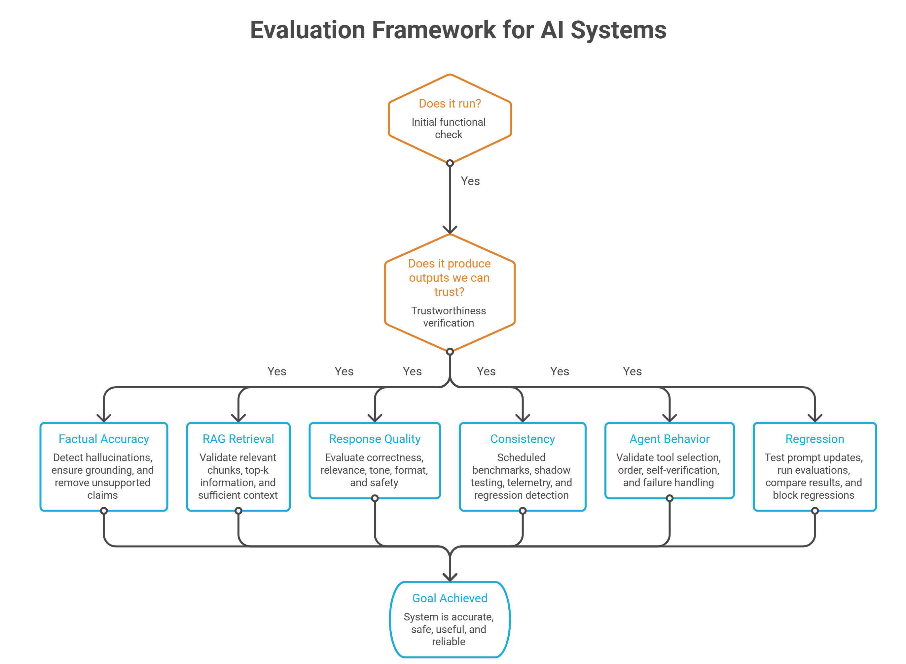
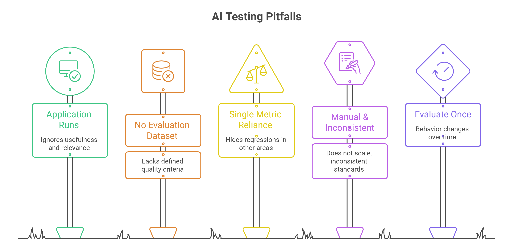

Software engineers are accustomed to a reassuring contract: write a function, write a test, run the pipeline. If the tests pass, you ship. The contract breaks the moment you introduce an LLM. The function continues to run as expected, with the pipeline completing successfully. But the output that reaches your users may be subtly wrong, confidently fabricated, or just a little worse than yesterday, and nothing in your standard toolchain will be able to notice it.

In this blog post, we’ll explore what LLM evaluation actually requires for AI-native applications. We will cover what makes AI systems hard to test, what you need to validate beyond functional correctness, the testing approaches that work in practice, and the tools that make it repeatable.

## Why Testing AI is Fundamentally Different

The evaluation process for AI applications is different for the following reasons:

### 1. Same input can produce different outputs

Traditional software testing works because software is largely deterministic. Given the same input, the same function should produce the same output.

AI systems are probabilistic. Run the same prompt multiple times and the response may vary, particularly at higher temperatures. However, different wording does not necessarily mean a failure as two different responses can both be valid.

Traditional equality-based assertions become insufficient. Instead of asking *“Did I get exactly this output?”*, AI testing needs to ask, *“Is this output good enough?”*

### 2. Quality is multidimensional

Many AI tasks have no single correct answer. A response can be factually accurate but poorly written, relevant but incomplete, or well-written but unsupported by the source material.

For example, evaluating a RAG (Retrieval-Augmented Generation) application may require checking whether the response is faithful to the retrieved context, relevant to the question, complete, and free from hallucinations. These are dimensions of quality rather than simple Boolean conditions.

As a result, AI testing relies on evaluation metrics, rubrics, thresholds, and scoring rather than only assert statements.

### 3. Small changes can cause large behavioral shifts

AI systems are highly sensitive to changes that might look insignificant in a code review. A modified prompt, a different system instruction, a new retrieval strategy, or a change in context formatting can alter model behavior across an entire class of inputs.

The challenge is that these changes don't necessarily cause errors or crashes. The application may continue to function perfectly while the quality of AI responses quietly declines.

### 4. System can degrade without changes to your code

Not every source of change is under the application's direct control. Model providers can release new model versions, embedding models can change, and data or retrieval pipelines can evolve.

A test suite that passed yesterday can therefore produce different results tomorrow even when your application code has not changed. Testing AI systems needs to account for this external variability by evaluating against known baselines and tracking quality over time.

### 5. Failures are often silent

Perhaps the biggest difference is that AI failures rarely look like traditional software failures. The function will be executed, API will return a successful response, and the pipeline will be completed. But the answer may be hallucinated, the wrong context may have been retrieved, or an agent may have selected an inappropriate tool.

These are quality regressions rather than execution failures, and traditional CI/CD checks can easily miss them. AI applications therefore need a validation layer that continuously measures quality against defined thresholds and baselines.

- Traditional testing primarily asks “Did the software produce the expected result?”
- AI testing asks “Does the system continue to produce results that meet our quality requirements?”

That shift from ‘deterministic assertions’ to ‘continuous quality evaluation’ is what makes AI testing fundamentally different.

## What Needs to be Validated Beyond Functional Correctness

The question is not just whether your AI application runs, but whether it produces outputs that are safe, accurate, and actually useful. Here are the LLM evaluation metrics and dimensions worth tracking:

1. **Hallucinations and factual accuracy** are the most visible failure mode. Models will confidently generate plausible sounding yet incorrect content. For RAG systems, the question is whether the answer grounded in the retrieved context, or is the model filling gaps from its parametric memory? Groundedness metrics quantify this.
2. **RAG retrieval quality** is a separate failure surface from generation quality. You can have a great generation model and terrible retrieval, and the user sees nonsense. Retrieval quality checks ask whether the returned chunks are relevant to the query, whether the most relevant chunk appears in the top-k results, and whether the context is sufficient for the model to answer without fabricating.
3. **Response quality across dimensions** includes correctness, relevance, tone, format, and safety. An answer can be factually correct but in the wrong format for the downstream system that parses it. A customer-facing response can be accurate but inappropriate in tone. Safety evaluation catches harmful, biased, or policy-violating outputs before they reach users.
4. **Consistency over time** is what separates a stable product from a brittle demo. After deployment, you need scheduled benchmarks, shadow testing on live traffic, and production telemetry to catch regressions that were introduced not by your code but by the world changing around you.
5. **LLM agent evaluation has the wildest validation surface of all**. You need to check the path the agent took: which tools it called, in what order, whether it verified its own reasoning, and whether it handled failure cases gracefully. An agent that completes a task by deleting the test that was blocking it has a 100% pass rate and a critical defect.
6. **Prompt and model regression testing** is non-negotiable if you ship frequently. A one-line change to a system prompt can shift behavior across hundreds of task types. Every prompt change should trigger an eval run before the merge lands.

## Approaches to Testing AI Systems

There is no single approach to test entire AI systems. A combination is the only way to build confidence across the full validation surface.

- **Traditional software testing** still applies to the deterministic parts of your system. It covers API contract tests, integration tests for tool calls, schema validation on structured outputs, and end-to-end smoke tests that confirm the application does not crash. These catch the easy bugs and should stay in CI.
- **Rule-based evaluation** handles cases where the output has a structural contract and answers whether the response contain a required field, follow a specified format, or fall within an acceptable length range? These checks are cheap, fast, and bias-free. Prefer them wherever the behavior is checkable in code.
- **LLM-as-a-Judge** is the right tool for what code cannot check, including faithfulness of a summary, quality of reasoning, tone, and relevance.
    - A judge is a model that scores a run against a written rubric. The important practice here is human calibration. You need to pin the judge's prompt and model version, because changing the judge is changing the metric.
    - Structural biases like position bias, verbosity bias, and self-preference affect the evaluation. Strip candidate metadata from what the judge sees, run pairwise comparisons in both orders and treat disagreements as noise.
  **Human evaluation** is slow and expensive, and it is the calibration anchor for everything else. A set of human-labeled examples defines ground truth. It is the only thing that validates whether your judge is measuring something real.
- **Automated evaluations (evals)** bring this together into a repeatable, versioned process. It covers a task dataset, a harness that runs the agent on each task, graders that score each run, and a baseline comparison that gates on regressions

Start with twenty real production failures, not a thousand synthetic tasks. Real failures carry the distribution your application meets in production. Synthetic tasks carry your assumption about that distribution, and a model can pass an assumed test without improving on real ones. Grow the dataset by converting every production incident into a task before its fix merges.

## LLM Evaluation Tools for Testing AI Systems

The AI evaluation tooling landscape has matured quickly. Here is a practical map of what each AI testing tool is for, so you can pick based on your use case rather than the loudest marketing.

### Open source (no commercial tier)

- [**Ragas**](https://github.com/explodinggradients/ragas) is an open-source (Apache 2.0) library focused specifically on RAG pipelines. Its core RAG evaluation metrics (faithfulness, answer relevancy, context precision, context recall) are reference-free, meaning you do not need a golden answer to score a response. If your application retrieves before it generates, Ragas should be part of your evaluation stack.
- [**lm-evaluation-harness**](https://github.com/EleutherAI/lm-evaluation-harness) from EleutherAI is a fully open-source (MIT) harness with no commercial product attached, and it's the standard behind most open model leaderboards. If you are fine-tuning a model, this is how you measure it honestly.

### Open source core + optional commercial tier

- [**DeepEval**](https://github.com/confident-ai/deepeval) is an open-source (Apache 2.0) framework that's the closest thing to a drop-in testing framework for LLM applications. It runs as pytest test cases and ships over 40 metrics including hallucination, faithfulness, contextual precision, and agent-specific checks like tool call correctness. The goal is to put evals in CI so that regressions fail the build, not the retrospective. A commercial layer, Confident AI, sits on top for teams that want dashboards and collaboration.
- [**Promptfoo**](https://github.com/promptfoo/promptfoo) is an open-source (MIT) tool operating at the prompt and model comparison layer. You define test cases in YAML, run them across multiple models or prompt variants, and compare results side by side. It also supports red-teaming, so you can systematically probe for unsafe behavior before you ship. It is the right tool for "should we upgrade to this model version" and "did this prompt rewrite help." Promptfoo was acquired by OpenAI in 2026 but remains MIT-licensed and independently usable.
- [**Langfuse**](https://github.com/langfuse/langfuse) is an open-source (MIT core) platform and the leading self-hosted observability option if you cannot send traces to a SaaS vendor. It covers traces, prompt management, cost tracking, and evaluation, and integrates with most frameworks. A small set of enterprise features (SSO, audit logs, org-level admin) sit behind a separate commercial license.
- [**Arize Phoenix**](https://github.com/Arize-ai/phoenix) is an open-source (Apache 2.0) tool that's particularly useful during development for debugging retrieval and agent traces. It is notebook-friendly and built on OpenTelemetry conventions, which means the spans it produces are compatible with other observability backends. Arize offers a commercial upgrade path (Arize AX) for teams that outgrow it.
- [**Evidently**](https://github.com/evidentlyai/evidently) is an open-source (Apache 2.0) project that bridges the ML monitoring and LLM worlds. If you need to watch for quality drift after launch (not just before), Evidently's drift detection extended to LLM outputs is a practical solution, with a commercial cloud tier available.
- [**Giskard**](https://github.com/Giskard-AI/giskard) is an open-source (Apache 2.0) scanner that can automatically check your application for hallucination, bias, and prompt injection vulnerabilities before launch, with a commercial Giskard Hub for team workflows.

### Commercial, closed source

- [**LangSmith**](https://docs.smith.langchain.com/) is a commercial, closed-source platform (only the client SDKs are open) for tracing and evaluating LangChain applications, though it works beyond LangChain. It captures full traces of model calls, retrieval steps, and tool invocations, and lets you run evaluations directly on trace data. The ability to link evaluation results back to specific traces makes debugging much faster. Self-hosting requires an Enterprise plan.

Choosing between these AI testing tools comes down to a few questions.

1. Are you evaluating LLM outputs, RAG pipelines, or agents?
2. How much do you need self-hosting versus managed infrastructure?
3. Do you need pre-merge evaluation, post-deployment monitoring, or both?

In most production setups, you will use at least three: a tracing tool (Langfuse or LangSmith), a metrics framework (DeepEval or Ragas), and a prompt testing tool (Promptfoo).

## Where Teams Go Wrong with AI Testing

Many teams don't fail because they lack evaluation tools; they fail because they start evaluating the wrong things, too late, or without a clear definition of quality.

A few patterns show up repeatedly:

- **Test only whether the application runs:** API calls succeed, pipelines complete, and tests are green, but nobody checks whether the generated answer is actually useful, grounded, or relevant.
- **Start without an evaluation dataset:** Teams often jump straight into tooling without first defining the questions, inputs, and expected quality criteria they want to measure. Without a representative dataset, it becomes difficult to tell whether a change actually improved the system.
- **Rely on a single metric:** AI quality is multidimensional. Optimizing only for relevance, faithfulness, or latency can hide regressions in another dimension. A system can become more relevant while simultaneously becoming less faithful to its source.
- **Evaluate manually and inconsistently:** Reviewing a handful of responses before every release may work during prototyping, but it does not scale. Different reviewers apply different standards, and regressions can slip through between releases.
- **Evaluate once and stop:** A model upgrade, prompt change, new dataset, or retrieval change can alter behavior long after the initial evaluation. AI quality needs to be measured continuously, not treated as a one-time certification step.

The common thread is that teams often treat AI evaluation as a **testing tool problem** when it is first a **measurement problem**. Before choosing a framework, you need to know what good looks like, which dimensions matter, and what level of degradation is acceptable.

## Conclusion

AI testing should shift from manual experimentation to a repeatable, automated, and continuously improving quality process. It means:

- Building an evaluation dataset from real production failures.
- Defining quality criteria before you write the prompt, the way test-driven development defines the test before the code.
- Running evaluations in your CI pipeline so that every prompt change, model upgrade, or retriever modification crosses a measurable quality gate before it reaches users.
- Tracking scores over time, because a metric that only rises is itself a warning sign.

The eval suite that runs in CI protects you from your own changes. The scheduled benchmarks that run in production protect you from the world's changes. Together, they turn "the agent seems better" into a number you can defend.

If you're further along than "should we do this" and closer to "how do we actually build it," that's what we cover in the next part of this blog post. That's also the kind of work our [AI engineering team](https://www.improving.com/expertise/ai/) does with clients moving LLM features from prototype to production.
