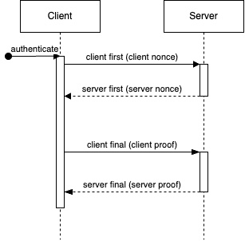

MongoDB’s support for various authentication mechanisms ensures that you are able to choose the mechanism that best fits your application. SCRAM SHA-256 is a great choice but it can be a little challenging to understand so we’re going to take a look at what’s going on under the hood. Let’s consider an application that acts as both a [MongoDB](https://www.mongodb.com/) client and server. One of the interesting challenges that I faced creating this application is what happens when users are authenticated. The application needs to both authenticate clients connecting to it and authenticate with MongoDB servers.

Using secure mechanisms to authenticate users is very important since MongoDB databases may contain sensitive information. MongoDB supports a variety of authentication mechanisms, one of which is called [SCRAM](https://en.wikipedia.org/wiki/Salted_Challenge_Response_Authentication_Mechanism) [SHA-256](https://en.wikipedia.org/wiki/SHA-2). SCRAM SHA-256 is the default in MongoDB. It is a powerful authentication mechanism with features to prevent common types of attacks. The client and server are able to prove that they know the user’s password without exposing it to each other. It is also to prevent replay attacks.

This guide will provide you with insights into how SCRAM SHA-256 authentication works in MongoDB. It will cover the message flow between a client and a server. Further, it will explain each message and what is needed to construct them.

The authentication flow involves four messages.



1. Client first – the client sends the username and a random value to the server.

2. Server first – the server sends the salt, number of iterations, and a random value to the client.

3. Client final – the client calculates its proof of the password and sends it to the server. If the client proof was accepted by the server, then the server will consider the client authenticated for future requests.

4. Server final – if the client’s proof is valid, then the server calculates its proof of the password and sends it to the client.

#### Definitions

- Client nonce – a [Base64](https://en.wikipedia.org/wiki/Base64) encoded string of 24 random bytes chosen by the client
- Server nonce – a [Base64](https://en.wikipedia.org/wiki/Base64) encoded string of 24 random bytes chosen by the server
- Salt – a [Base64](https://en.wikipedia.org/wiki/Base64) encoded string of the bytes used for hashing the user’s password
- Iterations – the number of iterations to use for hashing the user’s password
- Client Proof – a value calculated by the client to show possession of the user’s password
- Server Proof – a value calculated by the client to show possession of the user’s password (or a hash of it)
- h(v) – a [SHA-256](https://en.wikipedia.org/wiki/SHA-2) hash of the byte array (v)
- hmac(k, v) – an [HMAC](https://en.wikipedia.org/wiki/HMAC) [SHA-256](https://en.wikipedia.org/wiki/SHA-2) hash of the byte array (v) using the key (k)

#### Client First Message

The client-first message is used to tell the server to start the authentication process. This message will include a *speculativeAuthenticate* object with a *payload* value. The *payload* value is of the format:

`n,,n=<username>,r=<client nonce> `

- username – the username of the user to authenticate

The client needs to keep the client nonce for use later.

The value to use for *the payload* is the UTF-8 binary bytes of the string above.

#### Server First Message

The server uses the server's first message to send server-generated parameters to the client. As with the Client First Message, the message will include a *speculativeAuthenticate* object with a *payload* value. The *payload* value is of the format:

`r=<client nonce><server nonce>,s=<salt>,i=<iterations> `

The server needs to keep these values for the user later.

The value to use for the payload is the UTF-8 binary bytes of the string above.

#### Client Final Message

The client generates the client proof of the password and sends it to the server. The message will include a *payload* value. The *payload* is of the format:

`c=biws,r=<client nonce><server nonce>,p=<client proof> `

- c=biws – biws is the Base64 encoding of the string “n,,”. This value never changes.

#### Calculating the Client-Proof

This can be broken down into several different values that are calculated and used to produce the client-proof. The Auth Message is also needed later to verify that the server possesses the user’s password.

#### *Salted Password Hash*

1. Create an HMAC SHA-256 secret key from the UTF-8 bytes of the user’s password

2. Base64 decodes the value of the salt to get a byte array

3. Calculate the salted hash of the password. Need to do this *iterations* times. ` `

```markup
iv = salt_bytes + [0, 0, 0, 1]
result = hmac(secret_key, iv)
previous = null
for (i = 1; i < iterations; i++) { 
    if (previous == null) { 
        previous = hmac(secret_key, result) 

    } else { 
        previous = hmac(secret_key, previous) 
    } 
    result = result ^ previous 
} 
```

4. Base64 encodes the value of the result to get the salted password hash

The server can store the salted password hash rather than the raw password.

#### *Client Key*

1. Create an HMAC SHA-256 secret key from the salted password hash

2. Calculate the hash of the fixed string (“Client Key”) using the key to get the client key

`client_key = hmac(secret_key, "Client Key ".getBytes())`

#### *Auth Message*

Create a string of the authentication parameters. This will be called the auth message. This string is all one line.

```markup
n=<username>, 
r=<client nonce>, 
r=<client nonce><server nonce>, 
s=<salt>, 
i=<iterations>, 
c=ibws, 
r=<client nonce><server nonce> 
```

#### *Stored Key*

Calculate the SHA-256 hash of the client key. This will be called the stored key.

`stored_key = h(client_key)`

#### *Client Signature*

1. Create an HMAC SHA-256 secret key from the stored key

2. Calculate the hash of the auth message to get the client's signature

`client_signature = hmac(secret_key, auth_message) `

#### *Client Proof*

1. Calculate the exclusive OR of the client key and the client signature. Both byte arrays are the same size.

`client_proof = client_key ^ client_signature `

2. Base64 encodes the client proof to get the value to send to the server.

#### Server Final Message

The server verifies the client proof and calculates the server proof. The message will include a *payload* value. The *payload* is of the format:

`v=<server proof> `

1. Create an HMAC SHA-256 secret key from the salted password hash

2. Calculate the hash of the fixed string (“Server Key”) using the key to get the server key

`server_key = hmac(secret_key, "Server Key ".getBytes())`

3. Calculate the hash of the auth message to get the server signature

`server_signature = hmac(server_key, auth_message) `

4. Base64 encodes the server signature to get the server-proof

Now you have a view of the details of SCRAM SHA-256 authentication in MongoDB. You have the knowledge needed to implement SCRAM SHA-256 authentication in your MongoDB compatible clients and servers.

MongoDB’s support for various authentication mechanisms ensures that you are able to choose the mechanism that best fits your application. SCRAM SHA-256 is a great choice with its ability to protect the user’s password and its protection against message replay attacks.

As you continue your development journey, a deeper understanding of SCRAM SHA-256 can serve as a useful base for designing authentication mechanisms in your applications. Happy Coding!

Ready to start your coding journey with Improving? [Learn more here.](https://www.improving.com/careers/)
