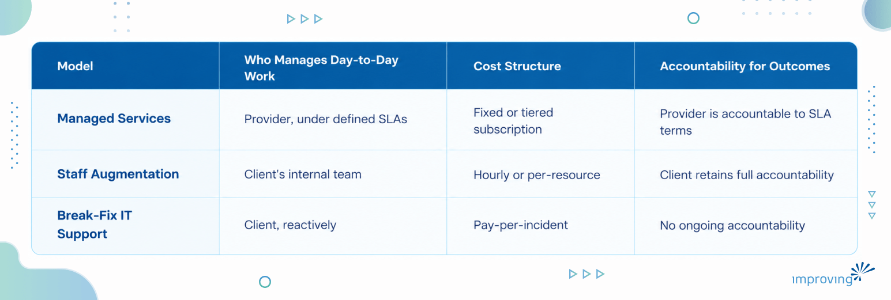
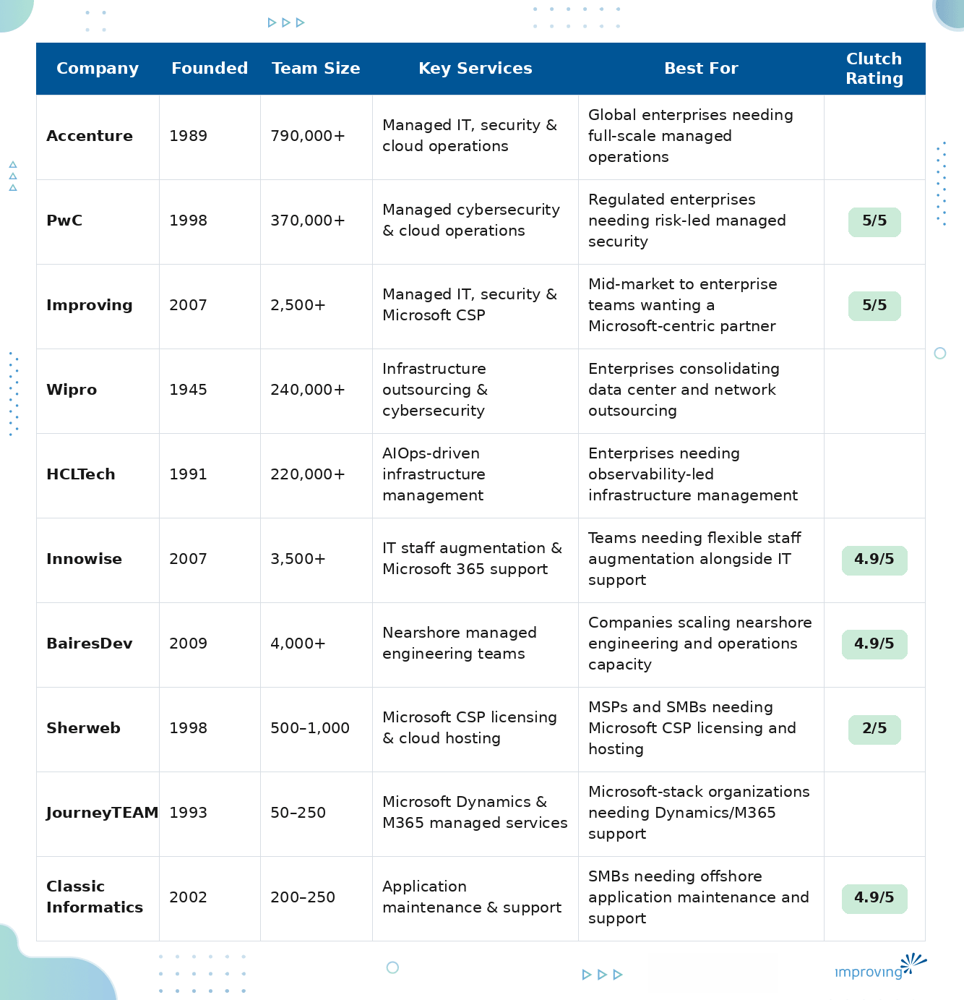

Choosing a managed services partner means handing over responsibility for the systems your business runs on every day, so the wrong fit shows up fast in downtime, security gaps, and frustrated internal teams. The [global managed services market is projected to grow from USD 437.3 billion in 2026 to USD 847.4 billion by 2033](https://www.grandviewresearch.com/press-release/global-managed-services-market), according to Grand View Research, as organizations shift routine IT operations to specialized partners. This guide profiles ten leading managed services companies and breaks down exactly what to evaluate before signing a contract.

## **Executive Summary**

Managed services shift the day-to-day burden of running IT, from monitoring and patching to security operations and cloud licensing, onto a specialized partner operating under defined service levels. Done well, this frees internal teams from constant firefighting and gives leadership predictable costs, measurable uptime, and a partner accountable for outcomes.

This guide profiles 10 leading managed services companies and outlines how to assess partners based on service level commitments, security maturity, delivery model, and reporting transparency. It also covers how managed IT, managed security, and cloud licensing services differ from adjacent models like staff augmentation and traditional break-fix support. The goal is a repeatable framework for choosing a partner who stabilizes your environment today and scales with you tomorrow.

## **Who Is This Guide For?**

- **CIOs and CTOs** evaluating whether to outsource IT operations, security monitoring, or cloud administration to free internal teams for strategic work.
- **VPs of IT Operations** who need a partner capable of meeting defined SLAs across infrastructure, endpoints, and applications.
- **IT Directors and Managers** comparing managed services providers against the cost and risk of building an equivalent capability in-house.
- **Security and Compliance Leads** assessing a provider's ability to strengthen threat monitoring and maintain regulatory alignment.
- **Procurement and Sourcing Leads** building a shortlist and needing a consistent framework to compare vendors on cost, coverage, and delivery model.

*Each of these roles shares the same underlying goal: reducing operational risk while making IT spend more predictable.*

## **What Is Managed Services & How Does It Work?**

Managed services is an arrangement where an external provider takes ongoing, contractual responsibility for specific IT functions, such as infrastructure monitoring, endpoint management, cybersecurity operations, or cloud licensing, in exchange for a recurring fee tied to defined service levels. Organizations get continuous monitoring, proactive maintenance, and a documented escalation path when issues occur, so support no longer waits for something to break first. The provider typically supplies the tooling, staffing, and processes, while the client retains oversight through regular reporting and governance meetings. This model shifts IT from a reactive cost center to a managed, measurable function.

**Common delivery models include:**

- **Fully managed IT operations**, where the provider owns end-to-end monitoring, patching, and helpdesk support for an environment.
- **Managed security services (MSSP/MDR)**, focused on continuous threat monitoring, detection, and incident response.
- **Cloud Solution Provider (CSP) and licensing management**, where the partner manages Microsoft 365 or Azure subscriptions, cost optimization, and configuration.
- **Co-managed IT**, where the provider supplements an existing internal IT team without replacing it.
- **Application and platform production support**, where the provider maintains uptime and performance for one specific system, narrower in scope than whole-estate IT operations.

## **Managed Services vs. Staff Augmentation vs. Break-Fix IT Support**

These three models are often confused, but they carry very different accountability structures. Staff augmentation adds individual contractors or engineers under the client's own management and processes, useful for filling a skills gap but offering no service-level guarantee. Break-fix support means paying for help only when something fails, with no proactive monitoring and unpredictable costs. Managed services sits apart from both by combining ongoing, proactive operation of an environment with contractual SLAs the provider is accountable for meeting.

> *The bottom line: if predictable costs and proactive coverage matter more than direct day-to-day control, managed services is the model built for that trade-off.*

## **How To Choose the Best Managed Services Partner?**

1. **Defined SLAs and escalation paths:** Insist on specific, written commitments on response and resolution times; vague language like "prompt support" should be a red flag. Ask how missed SLAs are tracked and remediated.
2. **24/7 monitoring and incident response coverage:** Confirm whether monitoring is truly around-the-clock or only during business hours, and who actually responds when an alert fires at 2 a.m.
3. **Security maturity and compliance alignment:** A partner should be able to show how its monitoring and incident response practices map to frameworks relevant to your industry, and this matters more every year as the [managed security services market grows at a 16.4% CAGR](https://www.researchandmarkets.com/reports/5767539/managed-security-services-market-report), according to Research and Markets.
4. **Onboarding and discovery process:** A rigorous onboarding phase that documents your environment, priorities, and risks reduces the chance of blind spots once the contract starts.
5. **Reporting transparency and governance cadence:** The best partners provide regular, readable reporting and scheduled governance meetings that give real strategic context, beyond a raw support ticket log.
6. **Licensing and cloud cost optimization:** For organizations running Microsoft 365 or Azure, ask whether the partner actively audits and rightsizes licensing on an ongoing basis, beyond simply processing renewals.
7. **Delivery model and cultural fit:** Understand whether support is onshore, nearshore, offshore, or blended, and whether that model matches your internal team's working hours and communication style.
8. **SLA accountability:** Ask what happens if the partner misses an SLA, and expect a specific, contractual answer with defined remedies.
9. **After-hours incident handling:** Ask how the partner handles a security incident outside business hours, since the answer reveals whether "24/7 coverage" is real or marketing language.

> *The bottom line: judge the right managed services partner on documented SLAs and a proven incident track record.*

## **Managed Services Companies Compared**

## **Top 10 Managed Services Companies**

### **1. Accenture**

Accenture delivers managed IT, security, and cloud operations at global scale, spanning infrastructure monitoring, cybersecurity operations, and application support for large, complex environments. Its managed services practice sits alongside a broad consulting arm covering digital transformation, AI and data, and cybersecurity, letting clients pair operational support with strategic technology initiatives under one contract.

**Quick Facts**

- Headquartered: Dublin, Ireland
- Team Size: 790,000+
- Key verticals: Financial services, healthcare, manufacturing, public sector
- Key platforms/technologies: Multi-cloud (AWS, Azure, Google Cloud), SAP, cybersecurity operations centers
- Relevant strengths: Global delivery scale, deep vertical accelerators, integrated consulting-plus-operations model

**Why Consider Accenture?** Accenture suits large, multinational organizations that need a single managed services partner capable of covering every region and technology stack they operate in, backed by consulting depth for longer-term modernization planning.

**Talent Pool Access:** Accenture draws on delivery centers and consultants across every major region, giving clients follow-the-sun coverage for monitoring and incident response regardless of time zone.

**Proven Track Record:** Accenture's managed services and security operations work is widely referenced across industry analyst evaluations of large-scale IT outsourcing and cybersecurity operations, reflecting decades of enterprise-scale delivery experience across regulated industries.

### **2. PwC**

PwC delivers managed cybersecurity and cloud operations services that extend its risk and regulatory consulting heritage into hands-on operational delivery. Its Cyber, Risk and Regulatory Managed Services practice includes an AI-driven detection and response service built through a multi-year collaboration with Google Cloud, alongside cloud operations services covering infrastructure, network, security, and application support.

**Quick Facts**

- Headquartered: London, United Kingdom
- Team Size: 370,000+
- Key verticals: Financial services, risk and regulatory, technology, public sector
- Key platforms/technologies: Google Cloud Security Operations, multi-cloud security management, cloud operations tooling
- Relevant strengths: Deep risk and regulatory heritage, AI-driven detection and response, standardized multitenant delivery model

**Why Consider PwC?** Few managed security providers can point to a multi-year, $400 million Google Cloud investment the way PwC can, which is why it fits large enterprises in regulated industries that want managed cybersecurity built on deep risk, audit, and regulatory consulting expertise.

**Talent Pool Access:** PwC operates through its global network of member firms, giving clients access to consultants and delivery teams across major financial and regulatory hubs worldwide.

**Proven Track Record:** PwC was named a Leader in The Forrester Wave for Cybersecurity Consulting Services (Q1 2026) and an IDC MarketScape Leader for Worldwide Cybersecurity Governance, Risk, and Compliance Consulting Services, and its managed security practice now runs on a standardized service built through its collaboration with Google Cloud.

### **3. Improving**

Improving Enterprises delivers Managed Services across three core areas: [Managed IT](https://www.improving.com/services/managed-services/managed-it/), [Managed Security](https://www.improving.com/services/managed-services/managed-security/), and [CSP Services](https://www.improving.com/services/csp/), run as an ongoing partnership with defined SLAs and a governance cadence built in from day one. As a Proven Microsoft Solutions Partner with expertise spanning modern workplace, cloud, and security, teams get standardized playbooks refined across real client environments. Every engagement can also draw on Improving's broader data, AI, and application development capabilities, so a managed environment becomes a platform for modernization instead of a fixed cost line.

#### **Why Is Improving the Best Managed Services Partner?**

We structure our Managed Services around defined SLAs, documented onboarding, and standardized incident playbooks, giving clients delivery maturity typically reserved for much larger providers without the overhead of a single, monolithic contract. Our governance meetings and clear reporting dashboards keep clients informed of trends and risk areas in plain, readable terms.

- **NPS 90+:** among the highest in modern enterprise technology services
- **7.5-year average partnership length:** built around long-term relationships that compound over time
- **Global footprint:** 7+ countries, 3 continents, 21 offices, and 2,500+ consultants
- **Key verticals:** manufacturing, financial services, government, and logistics
- **Platform stack:** Microsoft 365, Azure, Check Point, and Pax8
- **Relevant strengths:** 24/7 proactive monitoring and incident response, Microsoft CSP licensing optimization, standardized managed services playbooks

**Global Delivery Access**

Improving's Managed Services work includes production support delivered out of its Ottawa team, which supports 24/7 operations for one of Canada's largest logistics networks. That regional delivery hub sits alongside Improving's broader global bench, giving clients continuity of support without depending on a single office or time zone.

**Proven Track Record**

[Canada Post](https://www.improving.com/case-studies/canada-post-application-production-support), Canada's primary postal operator, saw its internal IT team overwhelmed by seasonal parcel volume spikes that caused downtime and slow incident response across its Track and Trace platform. Improving's managed services team implemented 24/7 monitoring, automated incident response, and proactive system health checks, resulting in a 95% reduction in unscheduled downtime and cutting Mean Time to Acknowledgment from 10.3 minutes to 5.11 minutes.

*Looking to achieve similar results with a trusted partner? Connect with our *[*Managed Services experts*](https://www.improving.com/services/managed-services/)* to explore how we can accelerate your IT operations.*

**Strategic Advantage**

Improving's Managed Services practice is grounded in its status as a Proven Microsoft Solutions Partner with expertise across modern workplace, cloud, and security, paired with direct partnerships including Pax8 and Check Point that support its CSP and managed security offerings. That combination of Microsoft-aligned certifications, named technology partnerships, and standardized playbooks built from real client environments gives organizations a managed services partner that can grow with them into broader cloud, data, and AI initiatives.

### **4. Wipro**

Wipro delivers managed infrastructure outsourcing, cloud, and cybersecurity services for global enterprises, with a portfolio spanning data center management, network operations, and security monitoring. Founded nearly eight decades ago, Wipro pairs long-standing IT services experience with ongoing investment in automation and AI-driven operations.

**Quick Facts**

- Headquartered: Bengaluru, Karnataka, India
- Team Size: 240,000+
- Key verticals: Manufacturing, financial services, technology, healthcare
- Key platforms/technologies: Hybrid cloud, data center outsourcing, managed network and security services
- Relevant strengths: Long-tenured infrastructure outsourcing practice, broad industry coverage, established security operations

**Why Consider Wipro?** Wipro fits enterprises that want to consolidate data center, network, and cybersecurity outsourcing under a single, long-established global provider.

**Talent Pool Access:** Wipro operates through a global workforce spanning delivery centers across multiple continents, supporting infrastructure and security operations at scale.

**Proven Track Record:** Wipro's managed network and managed security services are reviewed on Gartner Peer Insights, reflecting an established base of enterprise clients running critical infrastructure through its outsourcing practice.

### **5. HCLTech**

HCLTech provides AIOps-driven infrastructure management spanning observability, unified service management, hybrid cloud, digital workplace, and enterprise network operations. Its managed services portfolio includes data center outsourcing and network management built to reduce operational noise through automation and AIOps-driven insight.

**Quick Facts**

- Headquartered: Noida, Uttar Pradesh, India
- Team Size: 220,000+
- Key verticals: Technology, financial services, telecom, manufacturing
- Key platforms/technologies: AIOps, hybrid cloud, digital workplace platforms, enterprise networking
- Relevant strengths: Observability-led operations, data center outsourcing depth, presence across 60 countries

**Why Consider HCLTech?** For enterprises that want automation and AIOps insight driving infrastructure decisions at scale, HCLTech's approach is a strong match.

**Talent Pool Access:** HCLTech operates in 60 countries, giving clients access to a large, geographically distributed delivery bench for infrastructure and network management.

**Proven Track Record:** HCLTech's managed security, managed network, and data center outsourcing services are each reviewed on Gartner Peer Insights, reflecting an established enterprise client base for its infrastructure management practice.

### **6. Innowise**

Innowise supports ongoing technology operations through IT staff augmentation, IT network services, and Microsoft 365 managed services, extending client teams with dedicated professionals for ongoing technical work. Founded in 2007, the company has built a large delivery bench spanning custom software development, DevOps, and infrastructure support work.

**Quick Facts**

- Headquartered: Warsaw, Poland
- Team Size: 3,500+
- Key verticals: Healthcare, fintech, e-commerce, logistics
- Key platforms/technologies: Microsoft 365, Azure, network and DevOps tooling
- Relevant strengths: Flexible staff augmentation model, Microsoft 365 environment management, low attrition delivery teams
- Clutch Rating: 4.9/5

**Why Consider Innowise?** Organizations that want to extend an existing technology operation with flexible, dedicated staff will find Innowise's staff augmentation model a good fit.

**Talent Pool Access:** Innowise maintains offices in the USA, UK, Germany, and the UAE alongside its Warsaw headquarters, supporting distributed delivery across time zones.

**Proven Track Record:** Innowise has earned international industry awards for its delivery work, and its service portfolio includes dedicated Microsoft 365 environment management and IT network support engagements for clients beyond its core software development practice.

### **7. BairesDev**

BairesDev extends client operations and engineering teams through nearshore staff augmentation and fully managed engineering pods, drawing on senior technical talent based primarily in Latin America and aligned to US working hours. The company positions itself around long-term engagements, with delivery managers actively tracking performance across each one.

**Quick Facts**

- Headquartered: San Francisco, California
- Team Size: 4,000+
- Key verticals: Technology, e-commerce, media, financial services
- Key platforms/technologies: Cloud computing, DevOps, data engineering
- Relevant strengths: Nearshore, US-timezone-aligned delivery, senior engineering talent, managed-team engagement option
- Clutch Rating: 4.9/5

**Why Consider BairesDev?** Companies that need to scale ongoing engineering or operations capacity quickly, with nearshore talent overlapping US business hours in real time, are BairesDev's core market.

**Talent Pool Access:** BairesDev draws from a pool of 4,000+ engineers across more than 50 countries, concentrated in Latin America, giving clients nearshore delivery without the time zone gap of offshore models.

**Proven Track Record:** BairesDev ranked among the top 1% of B2B service providers on the 2025 Clutch 1000 list, and its client roster has included Google, Pinterest, Adobe, and Johnson & Johnson.

### **8. Sherweb**

Sherweb is a Microsoft cloud distributor and CSP enablement partner supporting managed service providers and enterprises with Microsoft 365 and Azure licensing, hosting, and billing infrastructure. Founded in 1998, the company has built its practice specifically around helping MSPs and IT teams navigate Microsoft's Cloud Solution Provider program.

**Quick Facts**

- Headquartered: Sherbrooke, Quebec, Canada
- Team Size: 500-1,000
- Key verticals: MSPs, SMBs, ISPs and IT consultants
- Key platforms/technologies: Microsoft 365, Azure, CSP billing and provisioning platforms
- Relevant strengths: Deep Microsoft CSP specialization, all six Microsoft Solutions Partner designations, large partner network

**Why Consider Sherweb?** Sherweb is well suited to MSPs and SMBs that need a Microsoft-focused CSP partner to manage licensing, billing, and cloud hosting without building that specialization in-house.

**Talent Pool Access:** Sherweb operates from offices across Canada, the United States, Hungary, and the United Kingdom, supporting more than 7,500 partners and 100,000+ end-client organizations.

**Proven Track Record:** Sherweb holds all six Microsoft Solutions Partner designations and 198 certifications, reflecting nearly three decades of specialization in Microsoft cloud licensing and hosting since its founding in 1998.

### **9. JourneyTEAM**

JourneyTEAM is a Microsoft Solutions Partner delivering managed services alongside Dynamics 365, Power Platform, and Microsoft 365 implementations for organizations standardized on the Microsoft stack. The company has been recognized five times as Microsoft Partner of the Year and holds membership in Microsoft's Inner Circle, representing the top one percent of Microsoft partners globally.

**Quick Facts**

- Headquartered: Draper, Utah
- Team Size: 50-250
- Key verticals: Manufacturing, financial services, education, non-profit
- Key platforms/technologies: Microsoft Dynamics 365, Power Platform, Microsoft 365, Azure
- Relevant strengths: Deep Microsoft Dynamics expertise, structured "Proven Process" adoption methodology, long-term client relationships

**Why Consider JourneyTEAM?** Mid-market and enterprise organizations that want a single partner covering both Microsoft implementation work and ongoing managed administration of that same environment should look closely at JourneyTEAM.

**Talent Pool Access:** JourneyTEAM operates as a US-based team out of Draper, Utah, holding all Microsoft Solution Partner designations and multiple Advanced Specializations across its practice areas.

**Proven Track Record:** JourneyTEAM has earned five Microsoft Partner of the Year awards and Inner Circle membership over more than 30 years in business, reflecting sustained recognition from Microsoft for its implementation and managed services work.

### **10. Classic Informatics**

Classic Informatics is a software outsourcing company offering managed application support, maintenance, and modernization services alongside custom development for SMB and enterprise clients worldwide. Founded in 2002, the company has built a large project portfolio focused on keeping existing web and mobile applications secure, current, and performing well over time.

**Quick Facts**

- Headquartered: Gurugram, Haryana, India
- Team Size: 200-250
- Key verticals: Healthcare, SaaS, retail and e-commerce, logistics, fintech
- Key platforms/technologies: ASP.NET, PHP, WordPress, Drupal, mobile app platforms
- Relevant strengths: High client retention, application maintenance specialization, Microsoft Gold Certified delivery
- Clutch Rating: 4.9/5

**Why Consider Classic Informatics?** SMBs and mid-market organizations that need an offshore partner focused on ongoing application maintenance and enhancement, more than infrastructure-heavy managed IT, will find a strong fit with Classic Informatics.

**Talent Pool Access:** Classic Informatics delivers from offices in Gurugram and Chandigarh, India, with additional locations in Sydney and London supporting clients across more than 30 countries.

**Proven Track Record:** Classic Informatics reports 23+ years of delivery experience across 1,000+ clients in 30+ countries, with a 95% client retention rate.

## **Building a Managed Services Partnership That Scales With You**

We believe managed services only deliver value when a partner treats your environment as an ongoing responsibility. Our approach centers on defined SLAs, continuous monitoring, and transparent reporting that turn IT from a source of surprises into a predictable, measurable function. That shift matters most under pressure, when volume spikes or security incidents test whether proactive processes actually hold up.

We have seen this play out directly: our managed services team helped one of Canada's largest logistics operators cut unscheduled downtime by up to 95% during its highest-volume periods, using the same proactive monitoring and incident response approach we bring to every engagement.

If you are ready to evaluate what a Managed Services partnership could look like for your organization, [explore Improving's Managed Services offerings](https://www.improving.com/services/managed-services/) and talk to our experts through your environment.

## **Frequently Asked Questions**

**1) What is the difference between managed services and outsourcing?**

Managed services is a specific type of outsourcing focused on ongoing, proactive operation of defined IT functions under service level agreements. Broader outsourcing can include one-time projects or staff augmentation, which carry no continuous, SLA-bound structure.

**2) How much do managed services typically cost?**

Pricing ranges from per-user or per-device monthly fees for managed IT support to larger fixed contracts for enterprise-wide infrastructure and security operations. Look closely at what each pricing tier actually includes; the headline price alone rarely tells the full story.

**3) Can a managed services provider work alongside our existing internal IT team?**

Yes. Co-managed IT is a common model where the provider takes on specific functions, such as security monitoring or after-hours support, while the internal team retains ownership of the rest.

**4) How do I know if a provider's security coverage is strong enough?**

Ask for specifics on monitoring tools, incident response times, and how their practices align with frameworks relevant to your industry. A provider that only speaks in general terms, without concrete SLAs and escalation processes, is a warning sign.

**5) What happens if we want to switch providers later?**

A well-structured contract should include clear terms for transition support and documentation handover. Ask how a prospective partner handles offboarding before signing the contract.

**6) Is managed services only for large enterprises?**

No. It scales down effectively for small and mid-sized organizations, particularly for functions like Microsoft 365 licensing management and basic security monitoring that would otherwise require a full-time hire.

**7) How long does onboarding a new provider typically take?**

Timelines vary with environment complexity, but a thorough discovery phase documenting systems and risks typically takes several weeks before full SLA coverage begins. Providers that skip this step often create blind spots later.
