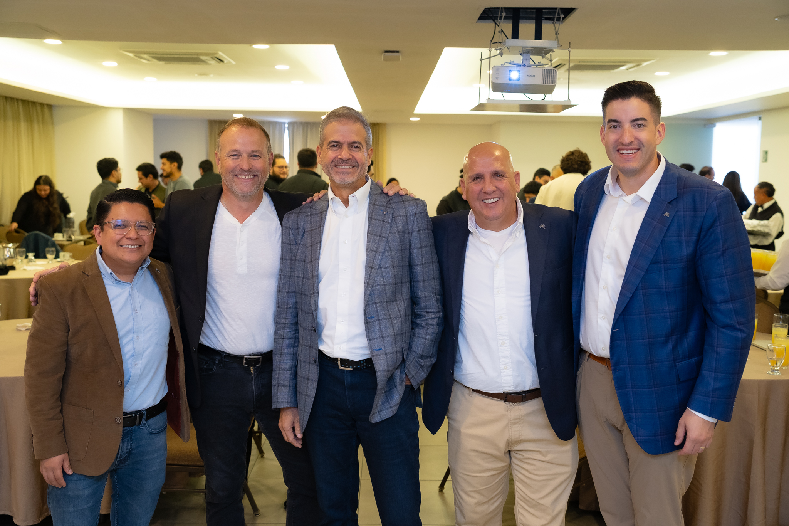

**DALLAS, September 9, 2025** – [Improving](https://www.improving.com/), a modern digital services organization, has acquired [MangoChango](https://www.mangochango.com/), a Dallas-based technology consulting and custom software development company specializing in architecture, infrastructure, and product delivery. With its primary developer workforce based in Guatemala, this acquisition enables Improving to leverage the expertise of an expanded LATAM presence. The transaction is expected to increase Improving's annualized revenue to exceed $300 million and expand its development capabilities.

By adopting Improving's innovative "Enterprise Strategy," which unites technology service firms with a shared dedication to trust, excellence, and a thriving work culture, the MangoChango leadership team will stay in place. They will continue to lead and grow the business while benefiting from the diverse services available through Improving's extensive portfolio.

“We’re delighted to welcome MangoChango and their exceptional development team in Guatemala to the Improving brand,” shares Curtis Hite, CEO of Improving. “Their technical expertise and agile delivery model are a perfect fit for our vision of building scalable, high-impact solutions with global reach.”

MangoChango’s Guatemala-based delivery model combines top-tier engineering talent with seamless team integration, while its Dallas-based sales and client operations ensure close alignment with customer needs. Together, this structure enables clients to accelerate digital transformation, scale flexibly, and achieve lasting business impact through stable, high-performing teams.

“Becoming part of Improving is a tremendous opportunity for MangoChango. Our team in Guatemala is proud to contribute our passion for solving complex technology problems and delivering high-quality software. Together, we’re excited to expand our impact and help clients achieve meaningful outcomes through innovation and collaboration,” states Rene Larrave, Chairman and Founder of MangoChango.

## **About MangoChango**

Founded in 2019, MangoChango is a technology consulting and software development firm with deep expertise in architecture, infrastructure, and cloud-native solutions. Based in Guatemala, their high-performing teams integrate seamlessly with clients to deliver scalable, impactful results. For more information, visit [https://www.mangochango.com/](https://www.mangochango.com/)

*For the official press release on this news, please visit: *[*https://www.prnewswire.com/news-releases/improving-adds-guatemala-development-hub-with-mangochango-acquisition-302549682.html*](https://www.prnewswire.com/news-releases/improving-adds-guatemala-development-hub-with-mangochango-acquisition-302549682.html)
