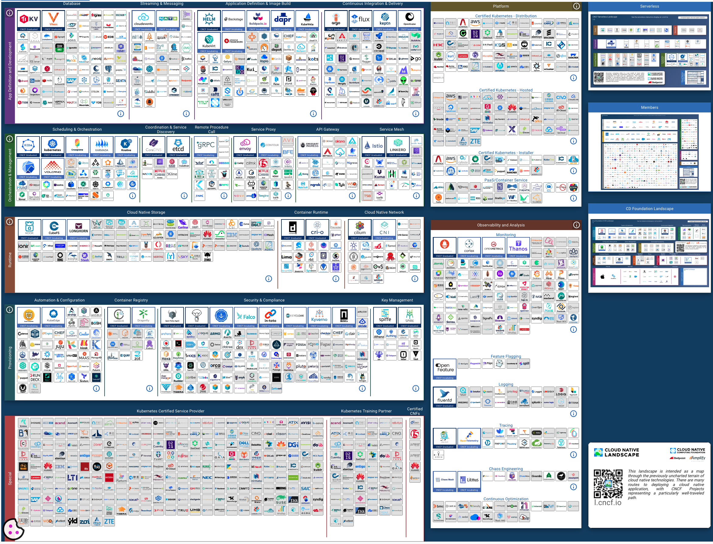

In today’s digital-first world, businesses are under growing pressure to deliver applications that are faster, more dependable, and capable of scaling effortlessly to meet rising customer expectations. Our industry has been steadily evolving the management of infrastructure and code deployment. We continue to see massive leaps in innovation in this space, both with the rise of cloud computing and the offerings made available by the major hyperscalers and independent software vendors. As we learn and mature, so do the needs in space.

For years, DevOps and Site Reliability Engineering (SRE) have been the go-to solutions for enhancing application delivery and operational efficiency. However, as systems become more complex and development cycles more demanding, a new approach—**Platform Engineering**—is gaining traction as the next evolution of modern application delivery.

In this blog, we’ll explore what platform engineering is, why it’s trending, and why it’s becoming essential for application modernization and development. I’ll also provide insights into how platform engineering complements and enhances traditional DevOps and SRE approaches, supported by industry statistics that demonstrate why investing in platform engineering is crucial for future success.

## What is Platform Engineering?

Platform engineering focuses on building and managing Internal Developer Platforms (IDPs) that simplify infrastructure, allowing developers to concentrate on coding and innovation. These platforms provide self-service, standardized environments with built-in automation, security, and compliance, enabling rapid, efficient application deployment without handling the underlying infrastructure. This approach builds upon DevOps and SRE practices but goes a step further by providing consistent, reusable environments. It aligns with Infrastructure as Code (IaC), ensuring infrastructure is both scalable and automated.

Platform Engineers are responsible for selecting, standardizing, configuring, and managing tools and products to deliver a suite of services to other teams. [The CNCF landscape](https://landscape.cncf.io/?group=projects-and-products) illustrates the breadth and diversity of available solutions:

## Why Platform Engineering is Trending

Platform engineering has seen a massive uptick in interest due to the increasing complexity of cloud-native architectures, the push for faster software delivery, and the need for greater developer autonomy. Let’s look at the statistics:

- Gartner predicts that by 2025, 80% of enterprises will have adopted platform engineering as a way to accelerate application delivery and improve operational efficiency.
- According to [Puppet's State of DevOps Report](https://www.puppet.com/blog/state-devops-report-2024), organizations using internal developer platforms experience 20-25% faster time to market and up to 75% fewer incidents related to infrastructure misconfigurations.
- [A 2023 report by Humanitec](https://humanitec.com/blog/platform-engineering-trends-in-2023) revealed that 51% of CTOs are actively investing in platform engineering as part of their long-term IT strategy, largely to combat rising development and operational costs.

The growing reliance on microservices, containerized environments, and multi-cloud strategies has made traditional DevOps and SRE approaches insufficient in managing the scale and complexity. Platform engineering bridges the gap by providing a centralized platform that removes infrastructure bottlenecks and boosts developer productivity.

## Why does Platform Engineering Complement and Enhance Traditional DevOps and SRE Approaches?

While DevOps and SRE practices have brought significant improvements to application development and operations, they often leave development teams grappling with complex infrastructure and operational overhead. Platform engineering builds upon these disciplines, offering several distinct advantages:

1. **Simplification of Infrastructure Management**: Traditional DevOps practices typically require development teams to manage the complexity of infrastructure, often leading to delays and bottlenecks. Platform engineering, on the other hand, creates an abstraction layer between developers and infrastructure, enabling them to deploy, test, and scale applications without worrying about infrastructure management. According to Forrester, companies that adopt platform engineering experience 45% fewer incidents related to manual infrastructure management.
2. **Improved Developer Autonomy and Productivity**: DevOps and SRE can sometimes result in “DevOps fatigue” due to the cognitive load placed on developers to manage multiple tools, environments, and operational concerns. Platform engineering removes this burden by providing pre-configured, self-service environments. This allows developers to focus on writing code rather than troubleshooting infrastructure. Red Hat’s State of Kubernetes report found that 47% of developers are more satisfied in companies that offer internal developer platforms, with 62% reporting increased productivity due to the elimination of infrastructure-related tasks.
3. **Consistency Across Teams**: In a DevOps-only environment, the lack of standardization can lead to inconsistencies in tooling, processes, and security practices across teams. Platform engineering enforces standardized processes and environments, ensuring uniformity in how applications are developed, tested, and deployed. This results in fewer errors and a 35% reduction in rework due to infrastructure discrepancies, according to Gartner.
4. **Faster Time to Market**: Platform engineering integrates automation, monitoring, and CI/CD pipelines into a unified platform, allowing teams to move faster. By reducing operational friction, companies can cut down deployment times significantly. Studies show that organizations using platform engineering reduce their software development lifecycle (SDLC) by 50% on average.
5. **Seamless Security and Compliance**: Security and compliance are often afterthoughts in DevOps pipelines, leading to vulnerabilities. Platform engineering allows for security to be integrated into the platform, with pre-configured policies and monitoring that ensure compliance from the start. This proactive approach can lead to 40% fewer security incidents and faster resolution times.

## Why Companies are Investing in Platform Engineering

Investing in platform engineering is a strategic move that many organizations are making to future-proof their development processes. Here’s why:

- **Cost Reduction and Efficiency**: As cloud infrastructure costs continue to rise, companies are seeking ways to improve resource utilization. Platform engineering optimizes cloud resource consumption by providing reusable infrastructure components, automated scaling, and a streamlined approach to application deployment. According to a 2023 IDC report, companies adopting platform engineering can save 25-30% on cloud infrastructure costs by reducing redundancy and automating infrastructure provisioning.
- **Developer Satisfaction and Retention**: A better developer experience leads to happier, more productive teams. By investing in platform engineering, companies can reduce developer burnout, increase satisfaction, and improve retention. Puppet’s DevOps Report indicates that organizations with platform engineering experience 15-20% lower developer turnover, primarily due to enhanced developer autonomy and reduced operational burden.
- **Scalability and Flexibility**: With platform engineering, companies can easily scale applications as needed without requiring manual interventions. This is particularly important for businesses experiencing rapid growth or dealing with fluctuating workloads. The ability to automate scaling based on real-time demands is a key advantage of platform engineering, allowing businesses to grow efficiently without overburdening their teams.
- **Future-Proofing Application Modernization**: In the age of digital transformation, modernizing legacy systems is critical. Platform engineering helps companies adopt microservices, containers, and serverless architectures while providing the flexibility to migrate legacy applications to the cloud. This makes platform engineering an essential part of any modernization strategy.

## The Case for Platform Engineering in Application Development

The value of Platform Engineering extends beyond modernization—it also plays a pivotal role in the development of new applications. Here’s how it impacts application development:

- **Rapid Prototyping**: Developers can spin up environments in minutes rather than days, accelerating time-to-market for new features.
- **Improved Collaboration**: Platform engineering creates standardized environments that reduce miscommunication and errors between development, operations, and product management teams.
- **Enhanced Innovation**: By automating repetitive tasks, platform engineering frees up developers to focus on innovation, leading to more creative solutions and better overall product quality.

## The Bottom Line: Why Your Business Needs Platform Engineering

Platform engineering is transforming the way companies develop, deploy, and manage applications. It’s more than just a trend—it’s the future of software delivery. Companies that adopt platform engineering see faster time to market, reduced operational costs, and happier developers.

**If your company is looking to:**

- Modernize legacy applications
- Accelerate new application development
- Reduce infrastructure costs
- Improve developer experience and productivity
- Enhance scalability and security

Then platform engineering is a critical part of the answer. Ready to Transform Your Application Development? Our platform engineering solutions are designed to help businesses such as yours modernize applications and create a scalable, resilient infrastructure. [Contact us today](https://www.improving.com/contact) to learn how we can help your business thrive in today’s competitive landscape.
