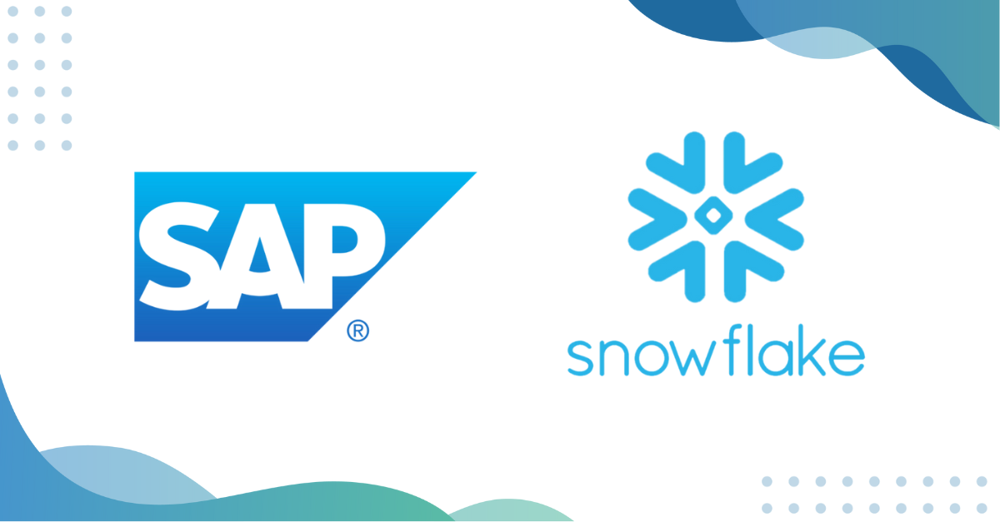

Digital transformation is no longer optional—it's essential. Ensuring that tech investments drive real business impact is crucial for any organization. One of the significant challenges many companies face is the consolidation of multiple ERP systems into a unified platform. Let's explore how leveraging Snowflake and SAP can streamline multi-ERP consolidation, enhance business efficiency, and set the stage for future IT initiatives.

### **The Challenge of Multi-ERP Systems**

Many organizations operate with multiple ERP systems, each serving different divisions or business functions. These systems can range from legacy ERPs that are difficult to retire, to heavily customized ERPs tailored to specific business processes, and specialized ERPs acquired through mergers and acquisitions. This diversity leads to several challenges:

1. **Data Duplication**: Different ERPs may contain the same customer data but with different IDs or representations, complicating master data management.
2. **Reporting Inefficiencies**: Consolidating reports from multiple ERPs often requires manual work, leading to misaligned reporting and lost time.
3. **Operational Bottlenecks**: Manual processes bog down workflows, making it difficult to keep up with seasonal demands or timely payments.
4. **Fragmented Data**: Inconsistent data formats and siloed platforms limit visibility and coordination across the business.

### **The Solution: Unified Finance Function in SAP**

To address these challenges, organizations can unify their finance functions using SAP's Central Finance (CFIN) module. This approach involves consolidating ledger payables, receivables, and other financial data into a single SAP system. The process includes several key steps:

1. **Data Extraction**: Data is pulled from various ERPs using batch and change data capture (CDC) methods. Tools like HPR handle both types of data extraction.
2. **Data Processing in Snowflake**: Extracted data is ingested into Snowflake, where it undergoes a layered curation process. Raw data is enriched with metadata, and processed data is staged to preserve its state at the time of processing.
3. **Modeling and Integration**: Complex business rules are applied to the staged data, creating unified tables that meet SAP's data contract requirements. The data is then served through views, allowing for separate orchestration and troubleshooting.
4. **Reverse ETL with HITOUCH**: HITOUCH integrates the curated data from Snowflake into SAP, ensuring that the data contract is consistently met across all ERPs.

### **Partnership and Collaboration**

Successful multi-ERP consolidation requires a strong partnership and collaboration between technical teams and business stakeholders. Key aspects of this collaboration include:

1. **Problem Solving**: Tackling complex accounting rules, legacy data, and developing logic that aligns with business requirements.
2. **Data Management Expertise**: Efficiently handling data volumes, incremental loading, and best practices for data processing.
3. **Modularity and Observability**: Implementing modular code to reduce the risk of breaking other parts of the system during updates.
4. **CICD Automation**: Automating testing, deployments, and code movement to streamline delivery and efficiency.

### **Outcomes and Benefits**

The consolidation of multiple ERPs into SAP's CFIN module offers several benefits:

1. **Improved Reporting**: Faster, more accurate reporting with reduced manual work.
2. **Unified Data**: A single source of financial data enables better decision-making and access to SAP's advanced analytics and monitoring features.
3. **Future-Ready System**: The modern ERP platform can scale for growth and accommodate new business strategies, reducing the complexity of managing multiple ERPs.

### **Embracing Unified ERP Systems for a Future-Ready Business**

Multi-ERP consolidation is a complex but essential process for organizations looking to maximize their tech investments and drive real business impact. By leveraging Snowflake and SAP, companies can transform fragmented systems into a unified, efficient platform that supports future growth and innovation. Strong partnership and collaboration between technical and business teams are crucial to achieving this transformation and unlocking the full value of digital investments.

Our team of experts is here to help you navigate the complexities of ERP consolidation and achieve your digital transformation goals. [Contact us to learn more and start your journey towards a future-ready business. ](https://www.improving.com/contact)
