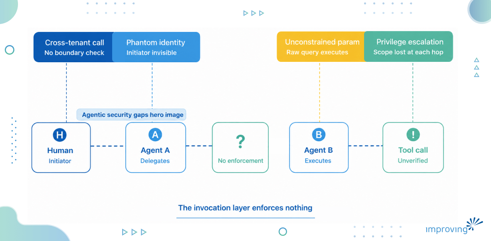
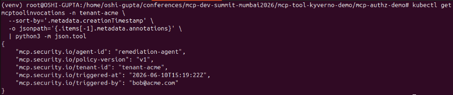

## MCP Changed How Agents Talk to the World, But Not Who Controls It

With over 17,000 MCP servers available to use, according to the Zuplo’s report, [momentum around MCP is quite real](https://www.improving.com/thoughts/best-mcp-servers-for-software-developers-and-engineers/), and it is becoming the de-facto standard for how AI agents connect to external services. It functions like a USB cable for AI to eliminate the need for developers to write custom integrations for every single [AI application](https://www.improving.com/expertise/applications/).

The same [Zuplo report](https://zuplo.com/mcp-report) shows that 50% professionals find MCP security or access-control a big challenge. MCP queries AI model with the help of agents for tool discovery, invocation and response handling. It lacks a native mechanism to control who invokes which tool, with what parameters and in whose context. Authorization at the invocation layer is still a problem.

## What the Auth Model Covers Today and What it Doesn't

MCP’s current authorization model covers connectivity and authentication. Servers can require OAuth 2.0 tokens, validate that agent has valid identity and restrict which clients can connect. It becomes very useful as one cannot impersonate as an agent and connect to your MCP server.

What it does not cover is authorization at the tool invocation layer. Once an agent is authenticated to the MCP server, there is no native spec primitive that controls which tools it can call, what parameters it can pass.

What happens at invocation reflects this gap directly. The agent resolves the tool from the server and makes a call with parameters. The MCP server executes downstream resources like a database, an internal API, etc.

The runtime does not ask: is this agent allowed to call this tool? Are these parameters acceptable? Does the tenant context and agent context match?

## Where Security Breaks Down

In single tenant environments, teams rely on application-level checks or custom middleware that inspects calls before they reach the server. These approaches break down as the tool surface grows - checks drift out of sync with tool updates and need to be maintained per tool, per team. Neither scale across a shared platform serving multiple agent teams.

In multi-tenant environments, the stakes are even higher. The threat surface looks like this:

1. **Cross-tenant tool calls**: Agent A running in Tenant’s A context, invokes a tool that operates on Tenant’s B data. There is no enforcement at the invocation layer to catch it before the call is executed.
2. **Phantom agent identity**: Your audit trail shows a service account, but the human who triggered the agent chain – the person who typed the prompt that started everything is invisible by the time tool call lands in your logs.
3. **Unconstrained parameters**: A tool calling a production database accepts query parameters. Nothing gets validated at the invocation layer.
4. **Privilege escalation chains**: Agent A calls Agent B, which invokes a tool. Each hop loses context and permission. By the time the tool is called, nobody can trace whose authority it is actually acting under.



What makes these more interesting is that the agent is not doing anything unauthorized in a traditional sense. It has permission and it uses it. The platform has no vocabulary for the fine-grained question: should this specific agent call this specific tool with these specific parameters right now or not?

## Why Kubernetes RBAC has No Answer Here

Most of the platform teams have Kubernetes RBAC as its solution; it's already there and mature enough as well. But RBAC has a hard limit. It only controls access to Kubernetes' API resources. You can control whether a “service account can list pods in this namespace or not”. But you can’t control “this agent” can call the create_*record tool and not the delete_*record tool.

RBAC operates on resource-verb pairs at the Kubernetes API surface whereas MCP tool calls live at the application layer. They carry semantic context: which tool, which agent, which tenant, which parameters, what time. There is no medium between the two without something that understands the nature of tool invocation and can make policy-based decisions against runtime. It can be achieved by policy-as-a-code.

## Policy-as-a-code as the Enforcement Layer

The solution is to model your MCP tool invocations as Kubernetes custom resources and put a policy engine in the admission path. Enforce rules on every invocation before it is executed. The tool call becomes a first-class object that the platform can inspect, validate, mutate, and audit.

Kyverno is the strong option for this as it already sits in the Kubernetes admission path. It can inspect any arbitrary JSON structure in any custom resource. It supports both validating webhook that can accept or block a call and mutating webhooks that can annotate a call before it proceeds.

This enforcement model has three layers, and each one solves a different problem related to your platform.

### Three Patterns that Close the Gap

**Tool allowlisting per agent identity:** A validating Policy that restricts which tools a given agent Service Account can invoke. It is denied by default and allows explicitly per agent-tool pair. If the agent's identity isn't in the allowlist for that tool, the call is blocked at admission before it ever reaches the MCP server.

```yaml
spec: 

  validationActions: 

    - Deny 

  matchConstraints: 

    resourceRules: 

      - apiGroups:   ["mcp.security.io"] 

        apiVersions: ["v1alpha1"] 

        operations:  ["CREATE"] 

        resources:   ["mcptoolinvocations"] 

  validations: 

 

    - expression: >- 

        has(object.spec.agentId) && object.spec.agentId != "" 

      message: >- 

        MCPToolInvocation must include a non-empty agentId in spec 

 

    - expression: >- 

        !(object.spec.agentId == "sre-agent") || 

        object.spec.toolName in [ 

          "pods_list", 

          "pods_list_in_namespace", 

          "pods_get", 

          "pods_log", 

          "pods_top", 

          "events_list", 

          "namespaces_list", 

          "nodes_top", 

          "configuration_view" 

        ] 

      messageExpression: >- 

        "sre-agent is not permitted to invoke '" + object.spec.toolName + "'. " + 

        "Allowed tools: pods_list, pods_list_in_namespace, pods_get, pods_log, " + 

        "pods_top, events_list, namespaces_list, nodes_top, configuration_view"
```

**Multi-tenant isolation:** A validating Policy that checks whether the tenant context **in** the invocation matches the agent's namespace or annotation. If they don't match, the call is denied. Cross-tenant invocations are blocked structurally, not by trusting the agent to behave correctly.

```yaml
spec: 

  validationActions: 

    - Deny 

  matchConstraints: 

    resourceRules: 

      - apiGroups:   ["mcp.security.io"] 

        apiVersions: ["v1alpha1"] 

        operations:  ["CREATE"] 

        resources:   ["mcptoolinvocations"] 

  validations: 

    # ── Require tenantId to be present and non-empty ────────────────────────── 

    - expression: >- 

        has(object.spec.tenantId) && object.spec.tenantId != "" 

      message: >- 

        MCPToolInvocation must include a non-empty tenantId in spec. 

        Invocations without tenant context are rejected. 
```

**Human identity injection:** A mutating Policy that annotates every tool invocation with the identity of the human who triggered the agent chain, the timestamp, and the agent chain ID. The audit trail always has a person attached to it, not just a service account.

```yaml
spec: 

  matchConstraints: 

    resourceRules: 

      - apiGroups:   ["mcp.security.io"] 

        apiVersions: ["v1alpha1"] 

        operations:  ["CREATE"] 

        resources:   ["mcptoolinvocations"] 

  mutations: 

    - patchType: ApplyConfiguration 

      applyConfiguration: 

        expression: >- 

          Object{ 

            metadata: Object.metadata{ 

              annotations: { 

                "mcp.security.io/triggered-by": 

                  has(object.spec.triggeredBy) && object.spec.triggeredBy != "" 

                    ? object.spec.triggeredBy 

                    : request.userInfo.username, 

                "mcp.security.io/triggered-at": 

                  string(now()), 

                "mcp.security.io/agent-id": 

                  has(object.spec.agentId) ? object.spec.agentId : request.userInfo.username, 

                "mcp.security.io/tenant-id": 

                  has(object.spec.tenantId) ? object.spec.tenantId : object.metadata.namespace, 

                "mcp.security.io/policy-version": "v1" 

              } 

            } 

          } 
```

## Seeing the Policies in Action

The patterns described above are not theoretical. Here is what enforcement looks like against a real **MCPToolInvocation** custom resource, with [kubernetes-mcp-server](https://github.com/containers/kubernetes-mcp-server) running in a Kubernetes cluster and Kyverno evaluating admission.

### Before: No Mutating Policy

A remediation agent scales a deployment. The CR lands in etcd with no audit context.

```yaml
# kubectl get mcptoolinvocation proxy-resources-scale-3a7a61 -n tenant-acme -o yaml 
 
metadata: 

  name: proxy-resources-scale-3a7a61 

  namespace: tenant-acme 

  # no annotations 

spec: 

  agentId: remediation-agent 

  toolName: resources_scale 

  triggeredBy: bob@acme.com   # agent-supplied - can be forged or omitted 

  tenantId: tenant-acme
```

**triggeredBy **lives only in **spec - it is what the agent chooses to send. **Nothing confirms** ***when* this happened or which policy evaluated it.

### After: mcp-inject-human-identity Mutating Policy applied

Same call, same CR structure. Kyverno writes five annotations at admission time before the object reaches etcd

```yaml
metadata: 

  name: proxy-resources-scale-9f2c84 

  namespace: tenant-acme 

  annotations: 

    mcp.security.io/triggered-by:   "bob@acme.com"          # from spec.triggeredBy 

    mcp.security.io/triggered-at:   "2026-06-10T14:32:01Z"   # Kyverno did it 

    mcp.security.io/agent-id:       "remediation-agent" 

    mcp.security.io/tenant-id:      "tenant-acme" 

    mcp.security.io/policy-version: "v1" 

spec: 

  agentId: remediation-agent 

  toolName: resources_scale 

  triggeredBy: bob@acme.com 

  tenantId: tenant-acme
```

These annotations are written by Kyverno – neither by the agent nor by proxy. The agent cannot set or alter them after admission. Even if the CR is later deleted, the Kubernetes audit log retains the creation record with the full annotation set.



You can view the repository with [complete code on GitHub](https://github.com/infracloudio/mcp-authz-kyerno-demo).

## How to Get Started

The right approach is to build incrementally, instrument first, enforce second, and tighten over time. Below is the practical sequence that works without breaking production agents.

1. A**udit what your agents are actually calling**: Before writing a single policy, spend a week in observation. Enable Kyverno in **Audit mode** and let it log every tool invocation. You will find tools being called that nobody knew about, parameters that nobody intended to allow, and service accounts with scope far wider than their function requires.
2. **Model your MCPToolInvocation CRD deliberately: **The shape of your custom resource determines what Kyverno can inspect. Put toolName, tenantId, and agentId in spec, not in labels or annotations. Policy JMESPath expressions are cleaner and easier to read in audit events when the fields live in spec.
3. **Start with human identity propagation, not blocking:** The mutating webhook that injects the triggering human identity has lower risk than a validating webhook that can deny invocations. Deploy the mutation pattern first. Get your audit trail working and verified. Compliance teams will often sign off on shared MCP infrastructure once they can answer "who triggered this" - give them that before you move to enforcement.
4. **Flip one policy to Enforce at a time:** Use the audit log data from step 1 to build your allowlists. Flip **validationFailureAction** to **Enforce **for one agent, one tool category at a time. Agent chains fail in surprising ways when a mid-chain call is denied - give yourself at least two weeks of audit coverage per policy before enforcing.
5. **Propagate human context at the orchestration layer, not as an afterthought:** The agent framework including LangGraph and AutoGen must stamp the triggering human identity onto the invocation before it reaches the admission webhook. This is an architectural decision that cannot be retrofitted cleanly. Make it a requirement before any agent gets write access to production tools.

## Wrap Up

The AuthZ [gap in MCP](https://www.improving.com/thoughts/when-mcp-is-not-the-right-choice/) is a gap in the adoption curve. The spec is moving, the ecosystem is maturing, and native authorization primitives will come. But production agents are running right now, and the enforcement layer has to exist today.

In this blog post, we have described how MCP changed the way agents talk to the world, but not who controls it. The MCP’s current authorization model ensures connectivity and authentication but not the authorization at the tool invocation layer.

Policy-as-code gives platform teams a concrete, uniform, auditable answer to the question: who authorized that tool call?

Kyverno's Policy model is one strong path to that answer, as it is forkable, framework-agnostic, and compliance-ready out of the box. However, using it in practice in production comes with its own set of challenges, which our [Improving team is experienced in solving](https://www.improving.com/contact/).

If you would like to discuss this article and have any suggestions, you can connect with [Oshi Gupta](https://www.linkedin.com/in/oshi-gupta-512716178/) and [Sonali Srivastava](https://www.linkedin.com/in/sonali-srivastava-530782ab/) on LinkedIn.
