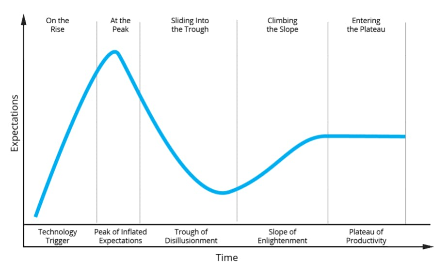

Technology has progressed significantly in the past 15 years and rarely does a week go by without some technology news headline. During this time, a quieter revolution has been brewing in the life sciences space. We have seen this on the global stage through the world's concerted effort these past 15 months in the research, development, manufacture, and deployment of a COVID-19 vaccine. That effort would have taken much longer, been less effective, and ultimately extended the pandemic without the efforts of teams leveraging great technology toward the goal.

Research hubs, innovation labs, incubation co-ops, and more support systems have been built out around the nation years before this event. More projects, investments, and start-up companies have been pushing overall healthcare modernization to new heights. We pulled together some of Improving's expertise from Healthcare, Medical, and Life sciences teams. We will explore how companies have been able to leverage new technologies to make a difference for patient care and outcomes.

## Medical Modernization Innovation Targets

The medical and life sciences space is bursting at the seams with innovation, but often it is quiet and not talked about because of the Hype curve problem. If you are thinking to yourself, "What is a Hype curve" take a look.

Gartner originally developed the hype curve to help communicate the complexity and business viability of emerging technologies. This is important to balance expectations with Medical Modernization due to the impact of inflated expectations for providers and patients. Often this gets summarized by generic, banal platitudes like "Raising patient care while lowering costs," and those are easily dismissed because of the lack of detail. Unfortunately, those statements hide huge complexity, effort, and honest wins for the quality of life. Let's take a look, starting at the end of the hype curve.

### OzSystems

When we look at the overall view of technology in healthcare, we are often looking at digital transformation that has already reached the Plateau of Productivity. These are the systems that we have come to expect in our healthcare platforms and interactions. Innovation in these areas is more about incremental gains realized over time than earth-shattering changes.

An easy example of a solid foundation built on technical innovation we can point to is a company called OzSystems; they lead the way in pioneering newborn screening and reporting. The goal was early detection and intervention for all issues that disproportionally impact newborns and present quality of life impacts. They broadly pushed the technology envelope and regulators to mandate this type of tracking. The result: a drastic reduction of untreated early childhood issues across many states and countries.

That may sound like an odd example of technological innovation due to the inclusion of regulatory updates. In the medical platform space, the addition of regulatory mandates becomes the hallmark of innovation that has successfully reached pervasive implementation and traversed this phase.

Living on the "Slope of Enlightenment" is a great place for companies that are leading the market. Adoption is growing, and the market is updating to understand the new best practices. This type of innovation is driven by both for-profit and non-profit companies. A couple of examples in this show up in raising the standard of care through the application of technology.

### Next Wave Connect

The first is a company called NextWave Connect. They are bringing the idea of secure communities to the providers of different healthcare associations. They are creating a platform for communities that can safely, securely, and privately share best practices and lessons learned. This type of social media combined with cybersecurity allows for a more open discussion of practices and protocols. Seeing the standard of care inch up over time and the creation of space to innovate collaboratively has been great. Helping to build that platform in partnership with NextWave Connect, we have heard the stories of impact and better outcomes from their most active communities.

### Southeast Texas Regional Advisory Council (SETRAC)

The second example is the non-profit Southeast Texas Regional Advisory Council ([SETRAC](https://www.setrac.org/)). They have been building analytics for healthcare institutions to compare data between each other, breaking down several industry walls by allowing a non-marketing-driven comparison of care in certain spaces. While they focus on cardiac, stroke, trauma, and neo-natal, the potential for data-driven analysis of care is huge. Some of the biggest barriers to this have been both technical and organizational. The technology has to be good enough to find the solution in the data, and the organization has to be trusted to handle the multiple hospital system data. SETRAC has threaded that needle and continues to expand into more pattern recognition and likely into machine learning soon.

These tools and companies, along with the trust in each of them, have been pivotal in the past year. NextWave Connect provided a platform for groups of healthcare workers to seek community and ease the burden of stress that COVID-19 cases were causing. Similarly, SETRAC provided the system-wide analysis of bed usage and capacity analysis for the Houston hospital environment across all the systems. The trust in each of these was built on solid technology understood and applied well. That trust-building and broad adoption is the epitome of the slope of enlightenment.

##### ***These tools and companies, along with the trust in each of them, have been pivotal in the past year.***

As we continue to move earlier on the curve, we see technologies that have "fallen from grace" like Virtual Reality and Augmented Reality. When technology falls into the Trough of Disillusionment, it is tough! Staying the course requires more realism and targeting of specific outcomes.

If we look at sustained investment in technology because of the persistent belief that better is possible, we have a couple of models that show up. One is the start-up that is pushing, hustling, and continuing to shape the market (through the end of broad hype), and the other is large company innovation investments. The most prominent players in the healthcare innovation space like Johnson and Johnson, Optum, and Pfizer are pouring significant resources into changing the future of healthcare. They believe that better outcomes and more sustained business results are behind those investments.

The peak of inflated expectations is great for growing public awareness, gaining investment into new technology, and generating a collective vision of great possibility. It grabs attention and sets up the eventual market, which can get dangerous if we start believing it will all come true. Unfortunately, technological advancement doesn't work this way.

Let us consider the recent race to mRNA vaccines for COVID. This wasn't a path chosen in February of 2020 because someone thought it would be cool to check out a new technology. In 1990 scientists were able to use mRNA to get mouse cells to produce a protein using mRNA, and in 1992-1993 it was theorized that we could get living cells to create proteins that the immune system would react to. This was long before the early 2000s and 2010s brought the surge of personalized or precision medicine hype. We heard stories about how the future of medicine would be customized medicine for each of us individually. The rub is that they may be right but creating something new requires perseverance and hubris. You must believe that you can succeed where many others have failed. In economics, this is called the "Greater Fool." What I find is that so much of our world was created by "Greater Fools".

When we look at the explosion of telemedicine in the past 10 years and support the overall health system got from it during the height of the pandemic. Large swaths of treatments, ailments, and doctor visits were carried out without adding patient flow to already stressed hospitals and treatment facilities. We have multiple clients in this space, and their volume went up by 5-15x due to this surge. Without the technologies to support this (multiple inter-connected disciplines like Cloud Platform, Cyber-Security, Tele-conferencing, mobile development, and web development), the patient outcomes would have been significantly worse.

One of our favorite realizations in working the medical innovation space is that the pioneers are looking for the next peak, almost constantly. Several great innovation groups stand out when we look at the investments into new technologies, applications, and platforms to changing the face of healthcare.

Johnson & Johnson launched their innovation and incubation labs across the world to invest in next-generation healthcare. They have been investing in start-ups, helping to build systems of support, and internally exploring data science and AI to progress patient care.

The Texas Medical Center is the largest medical city in the world focused on advancing life sciences and cross-institutional collaboration that underpins the push for innovation. With over $4 billion in funding raised, they are continuing to push the boundaries of what we currently consider as possible.
