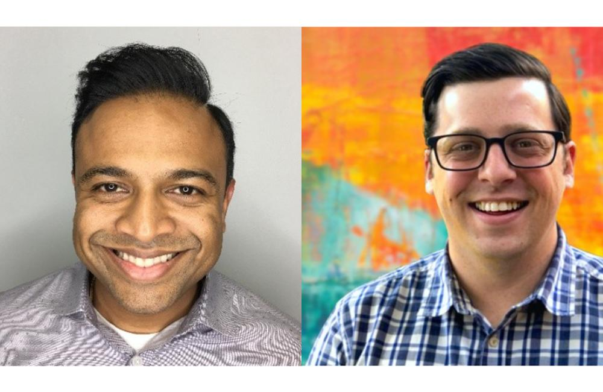

It is impossible to walk into an Improving office and not notice the outward flow of experience, knowledge, love, and support. Passing through the glass doors of our Houston office, you are greeted by a giant wall calendar with appointments for local user groups that use our office space. Countless movie posters signed by Improvers, their families, clients, and community members, are hanging on the walls from premier nights. And if you peek into a conference room there is often someone coaching or helping another Improver.

A global pandemic required us not to leave our homes. That does not make for ideal conditions to mentor others. However, a rose can grow from concrete, and I wanted to share one of my unexpected silver linings of the pandemic.

These past few years have been challenging to people in different ways. It caused many to socialize and interact far less than they normally would, almost doing the minimum to get their work done. I found myself particularly guilty of this. I would throw on my consultant’s smile to match my pressed polo, combed hair, and be as uplifting and supportive to my teams as I could through video calls. However, the moment my last call ended, the smile faded away, the polo was tossed in the hamper, and the only people I communicated with were in my loving family. I was living within the pandemic; however, I did not feel I was living the most joyful life I could.

One day, I received a LinkedIn message from a name I didn’t recognize. My initial thought was, “Here it comes. The overconfident recruiter who is going to ask me to leave a job that I love to take a 3-month gig in Midland”. However, that was not the nature of the message at all. It was actually a very kind and polite message from a Scrum Master named Cale Ownby who had graduated from my alma mater, The University of Texas at Austin. He was reaching out to Texas Exes seeking knowledge in Scrum and Agility.

At first, I tried to simply send answers to his questions and avoid the video call he had requested. I was glad that he was persistent and asked again about connecting. We eventually scheduled a 30-minute video call where we would speak about his career in Scrum and Agility. That 30-minute timebox easily was exceeded and we ended up speaking for close to 90 minutes. Looking back, I can say it was easily one of the top three conversations I have had during the pandemic.

Cale and I would meet a few more times over video calls and we texted quite often. We talked about Scrum, Agility being a mindset, retrospectives, fake Agility vs truly being Agile, and often just about family, friends, and life. We worked on his resume, discussed career goals, and came up with a plan that would lead not only to a new position as a Scrum Master, but to a position he would enjoy, thrive in, and be proud of.

One of the happiest moments I have experienced during the past two years came on September 17th when Cale texted me that had accepted an offer to be a Scrum Master. Not only was it a great position, but it was at a company I knew would line up with everything Cale had hoped for.

I have always been a believer in mentorship. I look up to many people, seeking knowledge and expertise from them regularly. However, it wasn’t until I joined Improving that I realized the importance of being an actual mentor to others and paying forward the investments others had made with me. With some encouragement from the leadership at Improving, I have done my best to mentor and support as many people as I could during the past three years in any domain I have experience in.

Mentorship is a two-way street, and it is important to spend time on both sides of it. It may be years before you feel comfortable crossing over to the other side where the roles are reversed and you are actively listening, extending empathy, giving advice, speaking about your struggles, and sharing knowledge, rather than being the one with needs. This can seem like a scary and unfamiliar place, and imposter syndrome can show up and make you want to run away as fast as you can. I have yet to find a user guide on how to be a perfect mentor, even so, I encourage you to be brave with your endeavor. Remember to be kind to yourself about what you know; we can be our own worst enemy to progress. Start small but put your entire effort into it. You will be amazed at what you can do in support of someone else.

Meeting Cale, a person who used to be a peer but is now truly my friend, reminded me that I have something valuable I can share with others even when a global pandemic and imposter syndrome are doing their best to limit my social interactions. I feel very fortunate to work for a company that actively promotes mentorship and involvement. Even if you do not work at a place like Improving, it does not mean you should wait to be a mentor. I encourage you to seek out those who need support, give freely and often, consciously make time for others, and most importantly, do not let a catastrophe cause you to hide the light you have inside you, and reduce the amount of joy you create in the world.

To learn more about Improving’s culture and what we do, [reach out](https://improving.com/contact).
