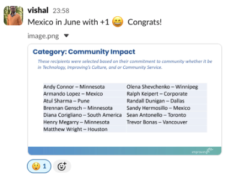
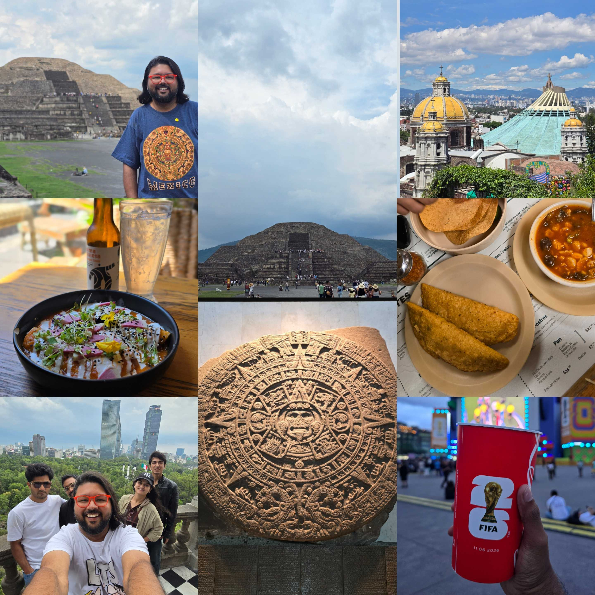
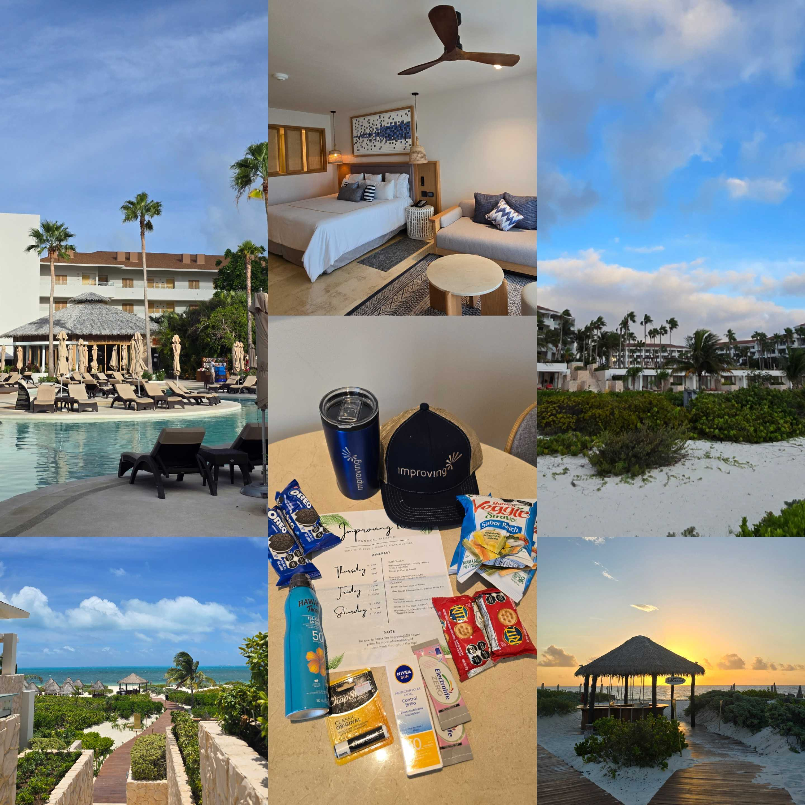
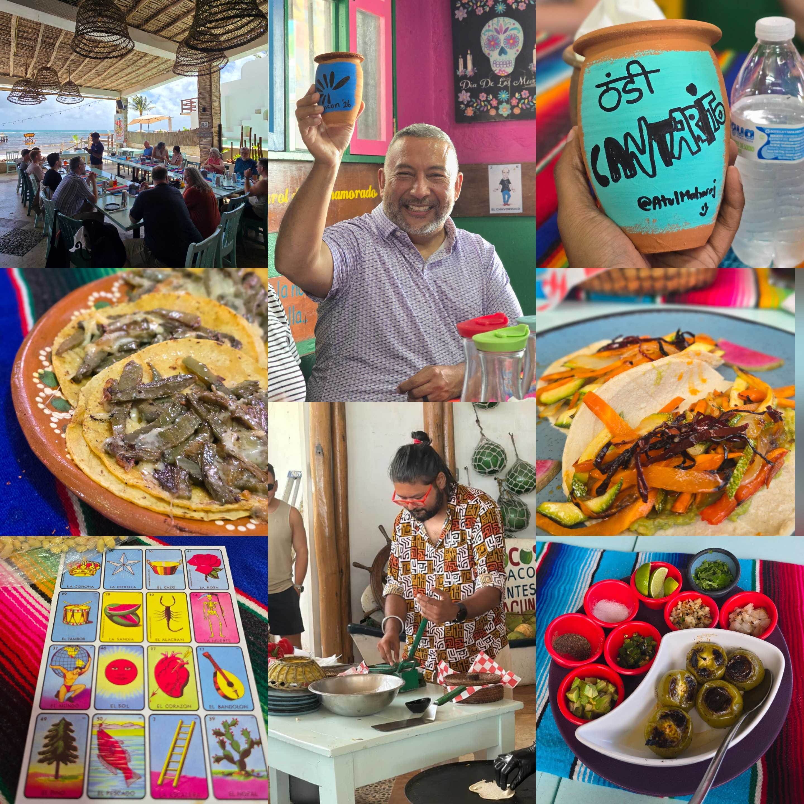
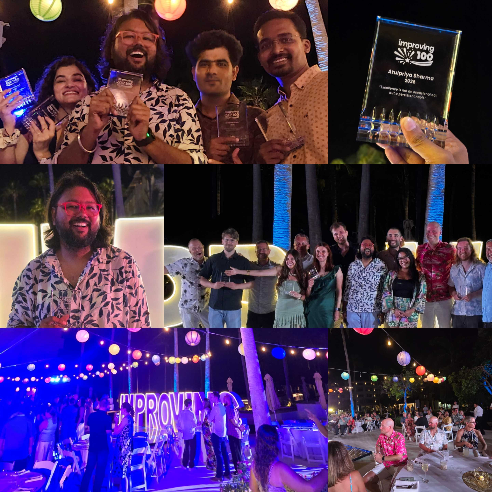

*“Mexico in June with +1 😄 Congrats!” *

That was the message my manager sent me at midnight back in February after an All-Hands Meeting concluded. I remember I had a late-night client call that day and was planning to catch up on the AHM the next morning.

Well, I didn’t know that I had missed something really important in the AHM. Turns out I was selected as one of the **winners for the Improving 100 award** under community impact category - *first one from Improving India*. And the reward was an **all-expense paid trip to Cancun** - *I had to open Google Maps to find where it was!*

While finding a +1 was the most challenging task (*spoiler, I went solo*), the travel blogger in me was already planning the itinerary to Teotihuacan and Chichen Itza!

## Improving100 - What is it?

Improving100 is Improving’s employee recognition program where they select and reward best performing individuals for the year across 22+ offices around the globe in the following categories:

- Community Impact
- Business Growth
- Delivery Excellence, and
- Technical Innovation

One of the highlights of this program is that employees nominate their peers - *so anyone can nominate anyone* - and the decision comes from leadership, who does the due diligence. That makes the recognition even more special.

## India to Mexico - My 18th Country

I’ve been fortunate that my work has provided me opportunities to travel across the world - *USA, France, Netherlands, UK and Sri Lanka *- to name a few. Mexico was never in the cards, so, I was super excited for this trip.

There are no direct flights from India to Mexico, so you either do a stop-over in the US or Europe. I chose to go via US and did a stopover in New York - *where I facilitated a *[*round table on Platform Engineering at Kubernetes Community Days New York*](https://www.linkedin.com/posts/atulpriyasharma_kcdnewyork-kcd-platformengineering-ugcPost-7470655041188835328-6kkB) - before heading to Mexico City.

That’s where I was joined by my other teammates from Improving India - *Bhavin Gandhi, Deeksha Sharma, Shehbaz Pathan and Aman Juneja* - who had also won the Improving100 award.

We all spent a few days in Mexico City exploring the pyramids at Teotihuacan, tasting some Tequila, eating some authentic Tacos and Enchiladas and soaking in the 2026 Fifa world cup fever before heading to Cancun for the retreat.

## Improving100 Gathering - The Best One Can Ask For

We work remotely here at Improving India, which means we see most of our colleagues on our 15inch displays on a Teams call. So, this opportunity to meet people in person was exciting. For most of us from Improving India, it was our first time in the country, and also the first-time meeting Improvers from across the globe.

We were put up in one the fanciest resorts that I had ever been to. A sea facing room with plush amenities, anyone would want to work hard to earn that luxury. There was a dedicated check-in only for Improvers as it was a massive group coming in. We were handed over our goody bags that - *snacks, electrolytes, sunscreen and a cap* - everything that one would need for Cancun.

Later in the evening, we had the welcome reception hosted by our US Managing Director Scott McMichael and CEO Curtis Hite. I was fortunate to have met Scott earlier in Atlanta, and he has an infectious energy! I also go to meet so many people during the welcome reception, some of them who I was meeting for the first time and a few who I had already interacted with virtually.

### Excursions - Mexican Cooking Experience

One of the best things about the Improving100 outing was the excursion activities that each Improver had to choose from. These included deep sea fishing, sailing, golfing and Mexican cooking to name a few. For those of you who don’t know, I love cooking and the moment I got the list to choose my activity, I opted for Mexican Cooking.

We were about 20 of us for this activity, some of them familiar faces while some new who I interacted with during the day. The activity started by Margarita making and me being a teetotaller, made a non-alcoholic one. That was followed by group salsa making activity which was super fun! The ingredients and utensils used were very Indian, so I’m going to make one at home soon! I also learned to make tortillas, which is very similar to the Indian Roti, but with a different dough.

Later, we hopped on a bus to go on a taco tour. We headed to one of the popular taco places in downtown. We started with a Cantarito making session followed by taco tasting. Being a vegetarian, I was served a cactus taco, and these were delicious! It was my first time have cactus, and it felt so much like *Ivy Gourd, Tindora or Dondakaya *that we have back in India. We completed the tour by playing a game of Loteria, which is the Mexican variant of Bingo.

### Award Night - Sky Full of Stars

It was the last day and the most important one, as it was the award night. We had Improvers coming in their best outfits for the ultimate night of the outing. The stage was set in the beautiful resort with [A Sky Full of Stars](https://www.youtube.com/watch?v=VPRjCeoBqrI) - *I saw the setup and had this song playing on loop in my head!*

Scott started the proceedings, followed by the recognitions. It was great to see the energy and genuine appreciation by everyone present there. We had group and individual photos taken post the award session, after which the dance floor was open.

The DJ started with some English music, and we were just stepping around the dance floor. And just then we heard a familiar beat, and our DJ decided to play a popular Hindi song. That’s when us India Improvers all got in the groove and taught some Bollywood moves to other Improvers, some of whom were already fans of Shah Rukh and Aamir Khan!

It was surely one of the best evenings of the event.

## More Than Just a Trip

Looking back, this Mexico experience wasn’t just about the stunning landscapes, vibrant culture, or unforgettable food. It was about what it represented. It stood as a reminder that meaningful recognition goes beyond certificates or awards; it creates memories, builds connections, and leaves a lasting impact. A huge shout out to Emily Rosselle and the larger team for planning such a beautiful event!

Without a doubt, this has been one of the best employee recognition programs I’ve ever experienced.

From exploring new places to stepping outside my everyday routine, this trip gave me a chance to reflect, recharge, and truly appreciate the journey - *both personal and professional* - that led here.

If you’d like to experience Mexico through my lens, I’ve shared highlights and moments from the trip on my [Instagram](https://instagram.com/atulmaharaj). Do check out the highlights - *I’ve tried to capture not just the places, but the energy, the people, and the stories that made this trip unforgettable.*

If you’re interested in following what I’m working on next - *across tech, travel, and everything in between* - let’s connect on [LinkedIn](https://linkedin.com/in/atulpriyasharma). I’d love to stay in touch and share more of the journey.

Here’s to more such experiences, more stories, and more reasons to celebrate the work we do. If you like this, [join our team](https://www.improving.com/careers/open-positions/), as we are always looking for talented, fun folks to join us.
