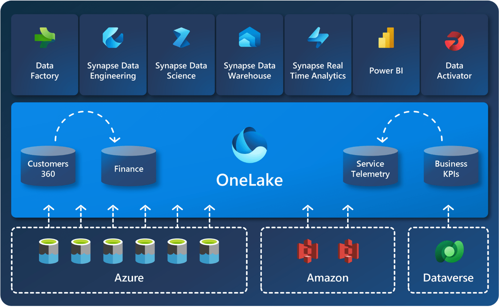
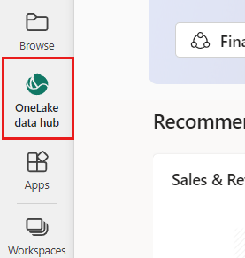
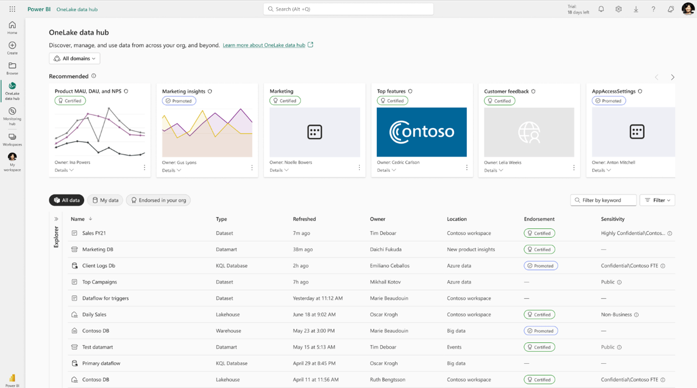

Have you been hearing the buzz about Microsoft Fabric?

The Data Engineering and Business Intelligence team at Imaginet has been watching with interest the development of Fabric since it was announced in March 2023. As data professionals with deep expertise in the Microsoft stack of data analytics products, we’ve already been using many of the pieces of Fabric and we’re excited to see how they are evolving.

Microsoft Fabric brings together several data products into a more unified experience, including Azure Synapse for querying data sources, Azure Data Factory for performing ETL processes (Extract, Transform, Load), and Power BI for showing data in dashboard or paginated forms. These products have been around for a while and have been incorporated into Fabric.

One new piece we are interested in is called [OneLake](https://learn.microsoft.com/en-ca/fabric/onelake/onelake-overview), which implements a unified data lake that brings together files and structured data sources into a data lake with the users who can access it and defines domains of data to organize, manage, and govern this data mesh. OneLake can also contain links to other cloud data lake sources, such as Azure Data Lake, Databricks, and Amazon Web Services (AWS) to virtualize data access and eliminate the need to move data from these other sources into OneLake.

Data lakes are essentially places to store files, similar to how SharePoint, Teams, or OneDrive can store files. Most files in data lakes have structured or semi-structured content that can be used as a data source – comma-separated-values (CSV) files, Excel files, and text files are common file formats that are used (and often generated) by people (rather than computers) but they can be consumed as data (by automated processes). Other types of files in data lakes are more structured and optimized for data use – common formats are Parquet files and DeltaLake file structures (folders and files that mimic data tables). OneDrive gives us a place to store our human-generated files (like Excel or CSV exports) and expose them as data sources and supports DeltaLake and other machine-generated data sources. Bringing these various sources together is known as a data mesh.

OneLake lets us organize these data sources into domains – such as Finance, Sales, Operations, etc. – business concepts that end-users can easily understand. Domains are also a place where governance and security can be applied. Governance means we can define the level of privacy and trust and who is responsible or can respond to questions or requests for access or additional data. Data sources can be endorsed to indicate a level of trust and authority for that data. Without governance, data lakes can easily become chaotic. Imagine what a large public library would be like if there were no librarians to govern the collection – books would be poorly organized, it would be hard to find anything, you couldn’t tell the quality of what you found, and the library would fall into complete disarray. Ultimately, no one would find it useful.

OneLake has a feature called Data Hub, which allows users to find the right data for their needs. In the Power BI web portal (now branded as Fabric), there is a shortcut to the OneLake data hub.

This page makes it easy to find, explore, and use the Fabric data items in your organization that you have access to. It provides information about the items and entry points for working with them.

It’s easy to browse and filter the list, and then get details and sample visuals you can use in your own Power BI reports and dashboards.

[Pricing for Fabric](https://azure.microsoft.com/en-ca/pricing/details/microsoft-fabric/?culture=en-ca&country=ca) is reasonable – it starts at about $292 per month for the smallest capacity and isn’t linked to how many users you have (a Power BI Pro license for each user is still required, if you are using the Power BI features integrated into Fabric.)

There are many benefits to using Fabric, and OneLake is just one of them. Our Data Engineering and Business Intelligence team can help you realize the benefits of Fabric in your organization. Get in touch with us for more information or if you have a project in mind.

Thank you for reading! If you want to find out more about this topic, [reach out.](https://www.improving.com/contact/)
