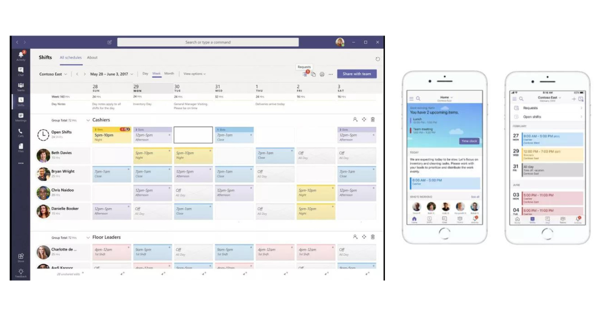

It was announced at the [Microsoft Ignite 2018](https://azure.microsoft.com/en-us/ignite/) conference that the Microsoft Office 365 application StaffHub would be retired on October 1, 2019. Microsoft StaffHub gave organizations a digital platform for managing shifts and schedules for workers. Supervisors can create shifts and push those schedules out to front-line workers, and staff also had the ability to request shift changes from their supervisors and request switches with co-workers.

Inside of Microsoft StaffHub, there was a social and collaboration feature set that aligned with [Microsoft Teams](https://imaginet.com/microsoft-teams-consulting-services/)‘ current functionality. By retiring StaffHub and merging with Microsoft Teams, which is already a great communication and collaboration tool, Microsoft is reducing the spread of similar solutions across the Office 365 platform. This will make for a much better end-user experience by cutting down on the amount of application switching to complete different tasks.

## Merging of StaffHub Features into Teams

The [merging of StaffHub features into Teams](https://support.office.com/en-us/article/microsoft-teams-for-firstline-workers-723d8259-7d17-49f5-9af8-fa9fee2036bd?ui=en-US&rs=en-US&ad=US) will happen on two fronts within the Microsoft Teams application. The **Home** screen will allow workers to see important information for their day, clock in / out, receive alerts, as well as view who else is scheduled on the shift. There will also be a **Shifts** tab where supervisors/managers can create, edit, and push the schedules out to their workers.

## How Do We Create and Manage Shift Schedules in Microsoft Teams?

If you’re ready to get started creating and managing shift schedules in Microsoft Teams, Microsoft has provided a quick tutorial to guide you through the exact steps for both Desktop and Mobile devices. Click [here](https://support.office.com/en-us/article/microsoft-teams-for-firstline-workers-723d8259-7d17-49f5-9af8-fa9fee2036bd?ui=en-US&rs=en-US&ad=US) to view the tutorial.

In this step-by-step guide, you will learn how to:

- Create and publish a shift schedule
- Request time off
- Swap or offer a shift
- Clock in/out
- Pin shifts for quick access on mobile devices

## What Will Happen Once StaffHub is Retired?

According to [Microsoft’s StaffHub Retirement FAQ page](https://support.office.com/en-us/article/microsoft-staffhub-to-be-retired-30ca17f3-5502-4bc9-bb0a-bed04bb362f0), anyone who attempts to open the StaffHub app after its retirement date of October 1, 2019, will be shown a message directing them to download Microsoft Teams. If the user has an active license that includes Teams, their data and the core functionality from StaffHub will be available to them upon their transition to Teams.

## What Should We Do to Prepare for the Transition to Teams?

According to [Microsoft’s StaffHub Retirement FAQ page](https://support.office.com/en-us/article/microsoft-staffhub-to-be-retired-30ca17f3-5502-4bc9-bb0a-bed04bb362f0), IT administrators of tenants with active Microsoft StaffHub users will be notified in the Office 365 Message Center that they need to take action. Even though their StaffHub users will be informed about the app’s retirement through in-app notifications between April 2019 and October 2019, IT Admins will still want to communicate the change to their users and update any internal documentation that refers to Microsoft StaffHub.

## Ready to Start Your Transition to Microsoft Teams?

These exciting new changes from Microsoft are part of their continued goal to empower every employee with Microsoft 365. With capabilities for first-line workers coming to Microsoft Teams, every employee in your organization will be able to leverage Teams to streamline their workday, collaborate with coworkers, and access information and expertise to help them do their best work.

If you are currently using StaffHub and would like help transitioning to Microsoft Teams, [reach out to Improving.](https://www.improving.com/contact/)
