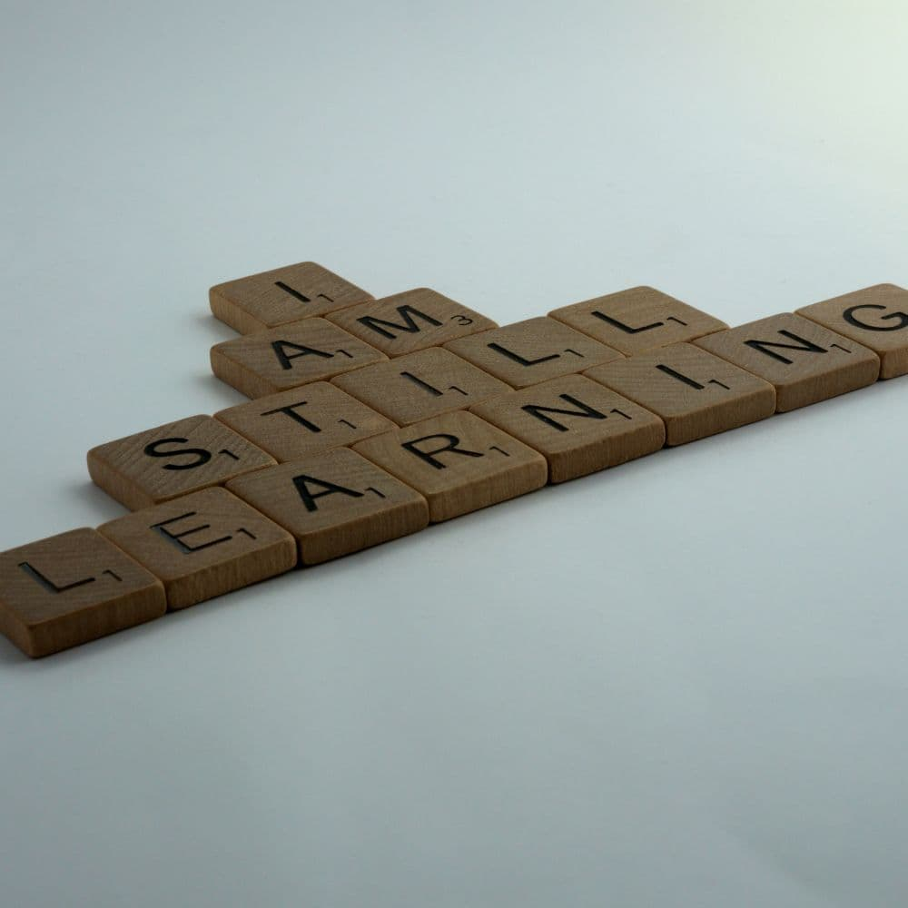
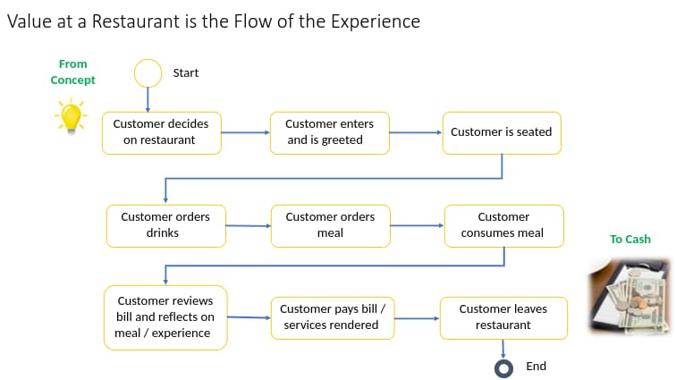
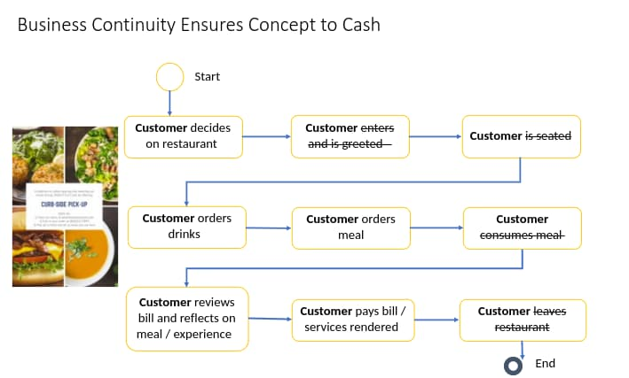

When a company is proactively looking for new ways to do things, either because there’s been a disruption resulting in the need to change or they are looking for new ways to *really* focus on customers’ needs, many people would call the process Agile or Business Agility.** **Others may call it Scrum. Although, another name to consider for this approach is “Modern Ways of Working”. Using this term can be helpful because it allows for the evolution and expectation of continuous learning and improvements along the way.

There is a risk when we use terms like Agile or Business Agility because of the baggage associated with them. Their meanings have been misunderstood over time or they have been a flash in the pan idea at certain companies, which can lead to more issues. However, in order to stay relevant, regardless of the lingo, we need to change our mindset to stay adaptable in the business space.

Continuous learning and improvement cannot be a fad. They both need to be a significant part of the culture and core principles of any business, especially in the digital age. Today we are going to go over seven elements to assist in driving this mindset because it is not a matter of if things will change, it is a matter of when.

## Systems Thinking and Flow

Two important elements of the “modern ways of working” mindset are to be curious and relentless about systems thinking and flow. Here’s a quote that sums it up:

“Systems thinking is, literally, a system of thinking about systems.”

Ross D. Arnold & Jon P. Wade.

In layman’s terms, it is understanding all the inner workings of what makes a business get from concept to cash, and one of the most important outcomes, delighted customers. It is the *flow* of value from the beginning to end, from executives to teams, from products to outcomes.

A good example of an industry that has been lived in this space pretty much since its existence is hospitality, specifically the restaurant business. Their world always has a system of systems.

For example, the flow for a restaurant offering seating for their customers begins when they enter the building and ends when they pay their bill. A restaurant needs to look at the customer journey from being seated to consuming food/beverages to having a great experience to paying for their services.

It is a combination of coordinating the front of the house (hosting, serving, payment) to the back of the house (making of the meal, including the ordering of food/supplies) that contributes to delivering value to their customers. The customer is not concerned (nor should they be) with the different systems and the flow that contributes to their experience. They are expecting it to all work together and deliver an outcome of a great experience, inclusive of good service and good food.

## Lean Thinking and Removing Waste

Systems thinking is critical because, with this approach, we can look at our business as a whole and apply lean thinking to remove bottlenecks and any waste that impacts a continuous flow of information, innovation, and delivery of valuable products and services to customers/stakeholders. By leaning out our business (system of systems), we can be nimble and proactively determine how we want to invest our limited resources (time and money = employees).

**Strategic Planning Using Objectives and Key Results (OKRs) **

Going back to our restaurant example, when the world changed in 2020 the restaurant industry really took a hit. To stay in business, they needed to think strategically and had to change things without knowing how long it was going to last.

The customers’ outcomes didn’t change. It was the customer journey and systems of systems that had to change. And because customers could no longer sit in a restaurant, the business owners still needed a way to provide their products and services. So, supporting a takeout and delivery-only model was the next evolution to stay in business.

This may sound simple because some restaurants already offered these options. But, moving your whole business to scalable, sustainable solutions for obtaining orders both in person and digitally was no easy feat.

This is where *Strategic Planning* comes into play because we need to be thoughtful and purposeful of our customers/stakeholders. Give them what they truly need, not what we think they need. To ensure customers’ needs are met and continue to provide valuable outcomes, businesses need a way to increase engagement and alignment with their customers.

The goal management framework,** ***Objectives and Key Results (OKRs) *bridge the gap between strategy and execution. It assists in moving from outputs to an outcome-based approach, enabling a mindset of customer-centricity and putting the customer at the center of everything.

While businesses have always valued customers, putting the customer at the center of everything we do is also an important element of the “modern way of working” mindset. It changes how we measure and manage what we should invest in, what we should continue to invest in (persevere), or if should we pivot and go to the next priority.

## Lean Portfolio Management

In any industry, the size and complexity of the business determine the need for additional practices to support the alignment of business strategy. It should focus on driving the delivery of value to customers.

Specific to the restaurant example, when there is a larger parent company that operates different kinds of restaurants or they have many of the same restaurants, their portfolio is much larger than “mom-and-pop” businesses. To assist with this, the competency of *Lean Portfolio Management*** **brings all of it together (yes, another systems of systems concept). It is how senior leadership applies lean principles to connect strategy to execution by aligning agile development with business strategy.

This is also where we create a bi-directional feedback loop to really measure value and what the customer is using and needs. The loop also measures what they are not using, which is considered waste. It is through this approach we can make data-driven decisions and incorporate a discovery/innovative mindset, creating small experiments to validate ideas before making investments.

By creating an environment to support the development and delivery of small increments of value, it enables the ability to be nimble and adjust based on the marketplace. Restaurants have an advantage in this space as they can obtain immediate feedback from customers, giving them the opportunity to respond and adapt. This is a goal all businesses should aim for, regardless of the industry or size.

## Transforming Project Management Offices (PMOs)

Our final element for this discussion is about one of the options for who can drive and shepherd all of this, in addition to highlighting another benefit of the “modern way of working” mindset. Once again depending on the size and complexity of your business will determine "the who".

In most larger organizations, there is a team (or collection of teams) responsible for managing and measuring the flow of value being delivered. It is here where we want to proactively drive the new mindset by empowering lean principles, agile tools, and techniques and focusing on customer-centricity.

By transforming Project Management Offices (PMOs) to lead this way of thinking/working, it can assist in driving the cultural change, removing waste in the system, and promoting a continuous flow of delivering value to customers.

## Why the Modern Way of Working Mindset Matters

At the end of the day, we should all be obsessed with the need to delight our customers, engage our employees and provide a culture of creating awesome products and services!

Because…it’s not a matter of if things will change, it’s when.

Businesses that thrive and not just survive know this and are always looking for more modern ways of working! [Reach out to us at Improving](https://improving.com/contact) for assistance in creating a “modern ways of working” mindset in your organization.
