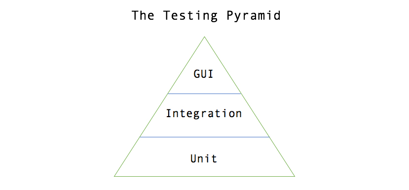

The primary goal of Quality Assurance in the software development lifecycle is to verify that a team is releasing software that is defect free and meets the needs of the business. Releasing software with a bug or two, however, is expected for most development efforts.

## Summary of Multi-Layered Testing

I believe that a well-designed automated testing system and test-first development culture can lead to drastically increased quality and reduced production defects. A test-first, well-structured approach to software development will guarantee that all levels of functionality (from programmatic logic, to functional scenarios, to business rules) are captured in an executable and automated fashion.

Additionally, bugs that make it into production can be diagnosed, wrapped in test, and released so that they do not appear again.

Finally, integrating the automated execution of these tests into the build pipeline will cause them to become fast, readable, and trusted by all members of the organization.

## Layers of Automated Tests

There are many articles online covering the different types of testing in the software development lifecycle, as well as their implementation details and the reasons why to value some types over others.

In this blog, I will attempt to describe the three levels of tests that, when implemented in unison, with the right focus, and in the correct place in the deployment pipeline, can:

- Lead to an increase in overall code quality and design
- Catch bugs before production releases (or classify any sneaky ones that make it to production)
- Serve as documentation from the project
- Increase trust in the development team to release the highest quality product possible.

The lowest level of testing which most developers are familiar with is **Unit Testing**. The second level of testing which is often overlooked is **Integration Testing**. The final level of testing that most people envision when they hear automated testing is System Level **GUI Testing**.

### Unit Testing

Most developers are familiar with unit testing, as it is an integral part of the software development lifecycle today. The primary purpose of these tests is to verify functionality on snippets of code that contain simple or complex logic. The secondary purpose of unit testing is to serve as a regression suite for future modifications to code snippets that could accidentally alter functionality.

Unit tests grow in value in large development efforts as they help developers **document the functionality of the individual units of code** that might not be captured at the feature level or in a user story. In my own experience, writing code that is fully unit tested leads to better-designed units of functionality that are readable and open to extension in the future.

Most build systems automatically pick up and run unit tests that are located in the proper location in the project. Running these tests as **part of the build** is crucial in the software development lifecycle, as it notifies developers to broken pieces of functionality early before the defects make their way to a QA environment.

**Code Coverage tools** are valuable extensions to unit testing tools that all development efforts should take advantage of. These tools show which pieces of code are not covered by unit tests and can greatly help out developers see where additional testing is necessary. While it is not necessary to strive for 100% code coverage with these tools, a company can choose a code coverage threshold that they feel comfortable with. Then, similar to how passing unit tests are required for the build process to finish successfully, the code coverage tools can be integrated into the build process and a certain threshold must be reached for the build to pass.

#### **WHEN AND WHERE TO RUN:**

These tests should be integrated into and ran on each project and a failure in unit tests should fail the build.

### Integration Testing (API Testing)

Integration Testing is an often-overlooked testing level as it is not as widely discussed as unit testing and it is not as intuitive or flashy as GUI Testing. The value of Integration Level Testing, however, cannot be understated. These tests should be used to **capture and fully exercise business requirements in an executable way**.

The purpose of these tests is to exhaust the positive and negative business rules that are being asked of the system. A key piece of creating these tests to maximize their value is **to have the entire team** to create them as a group. Working in a group allows the entire team to understand the scope and coverage of the tests.

Tools such as [Cucumber](https://cucumber.io/docs/reference) that use Gherkin syntax are a great way to express your business rules in an understandable way to the business and requires minimum coding to transform each line into an executable code snippet to perform the testing. If possible, have the BA and QA write the tests together as part of the user story’s requirements, then have Developers write the implementation of the test cases that talk to the system.

Additionally, these tests do not interface with a GUI and communicate through more direct channels, therefore they are much faster to run than GUI tests. Integration tests should **interface with a deployed systems **API in request/response pairs, and this enables Integration tests to run fast enough to provide real-time feedback about the health and validity of the deployed system.

One way to implement this level of testing is write a custom test program that takes the Gherkin test cases, builds a web request based on the test inputs, sends the request to the server and captures the response, then verifies the response against the expected test outputs. Project utilizing tools such as Cucumber for Java or SpecFlow for .NET do this task well. Additionally, there are tools like [SoapUI Pro](https://smartbear.com/product/ready-api/soapui/features/) that have entire program suites to accommodate the level of testing.

Finally, to maximize the value of these tests, integrating them into a CI/CD pipeline is essential. **Standing up an integration testing environment** and executing the tests against this environment before deploying to a QA environment is a powerful way to validate the system's functionality. Deploying a standalone Integration testing environment allows the tests to be run against a production-like environment, deployed as a production-like application, and connected to live services and data sources, all of which **increase the trust in the tests’ results**. This extra environment also allows the deployment to be halted if the integration tests fail.

#### **WHEN AND WHERE TO RUN:**

These tests should be integrated into the build pipeline and run as a prerequisite to deploying to a QA environment. Failures should halt the deployment to the QA environment.

### System Testing (GUI Testing)

From the same interface that a user (person or process) of the system interfaces with, these tests verify that a new piece of business functionality is working as expected. These should include all positive and negative scenarios that the business would want to see, but not all permutations of data that would achieve this scenario. Additionally, if there is any business logic in the presentation layer, then the GUI tests need to cover all scenarios for this as well. Many tools exist to automate this step, such as [WebDriver](https://www.guru99.com/introduction-webdriver-comparison-selenium-rc.html), for testing a browser interface and TestComplete for testing Windows applications.

This step should be integrated with the CI/CD system as well, and the test should be run against the QA environment immediately after deploying. These tests serve to **automate the simple, happy path tests** that prove the business’ new functionality is properly represented in the system all the way to the GUI layer.

Automating these tests and having them execute after every QA environment deployment reinforces that the correct functionality is in place, builds confidence in the regression suite of tests, and frees the manual QA process for an edge case and exploratory testing.

#### **A WORD OF CAUTION:**

Be on the scarce side when writing these tests. Don’t try to exhaustively test the system from the UI due to performance and stability reasons. You do NOT want these tests’ maintenance costs to become a burden.

#### **WHEN AND WHERE TO RUN:**

These tests should be integrated into the build pipeline and run automatically against a freshly deployed QA environment. Reports should be automatically generated and sent to the developers who made code changes.
