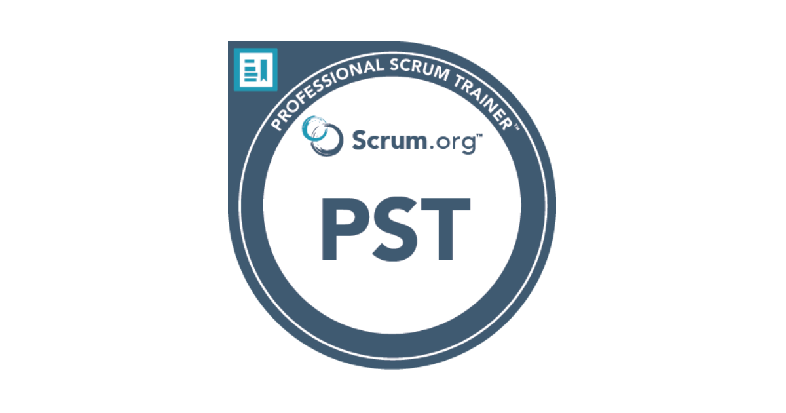

Embarking on my journey towards achieving the Professional Scrum Trainer certification from Scrum.org didn't turn out to be just a pursuit of knowledge; it became a winding journey. This experience unfolded against the backdrop of Scrum.org improvements to their PST path, home renovations being done largely by ourselves, my already demanding career, and the added layer of being among the few women pursuing this high-level certification. Through it all, time management, unwavering determination, and the incredible support of family, colleagues, and mentors were my guiding stars.

##### Shattering Stereotypes, Time Management, and Supportive Network

Effectively managing time became my arsenal during this process. My time working through all of my professional and personal responsibilities really stereotypes about women's roles in the workplace and at home. The unwavering support of my family and colleagues, especially acknowledging the rarity of females pursuing this certification, played a crucial role in my ability to navigate both professional and personal spheres.

##### Resilience in the Face of Challenges

Amid the challenging PSM III assessment and the addition of a few requirements to the PST journey, as well as the items mentioned above, my determination stood resilient, echoing the strength of women who defy norms. Each challenge, instead of being a setback, became an opportunity to challenge biases and redefine expectations. These were not only expectations of myself but also others' expectations of me.

##### Navigating Higher Peaks Through Assessments

The assessments, at the time, were published as some of the most difficult in the field of Agile. The PSM took me two attempts to succeed. As one of the few females pursuing this certification, every test became not just a measure of knowledge but a demonstration of the capabilities of women in challenging fields.

In the end, this 18-month journey wasn't just a personal triumph, *it became a statement*. It showcased that strong career-minded women, too, can navigate the intricate terrain of certifications, breaking through ceilings and paving the way for others. Time management, a supportive network, mentors, and an unyielding determination weren't just tools—they were instruments of empowerment.

##### Advice to Women Professionals

To aspiring female professionals considering a similar odyssey, let this journey be a testament that your family, home and work responsibilities, your gender, and most importantly you, do not limit your ascent. Embrace challenges, lean on your support network, and let your determination redefine expectations.

Certification, in this context, is not just a measure of knowledge but a declaration that barriers are meant to be shattered. As one of the small percentage of women PSTs certified, I carry not just the knowledge and experience but the legacy of challenging stereotypes and inspiring others to follow their own trailblazing paths.

Want to know more about my journey? Feel free to reach out [directly](https://www.linkedin.com/in/lisalueck/). Want to learn about how to become a PST? Visit the [Scrum.org website](https://www.scrum.org/become-professional-scrum-trainer/supporting-women).
