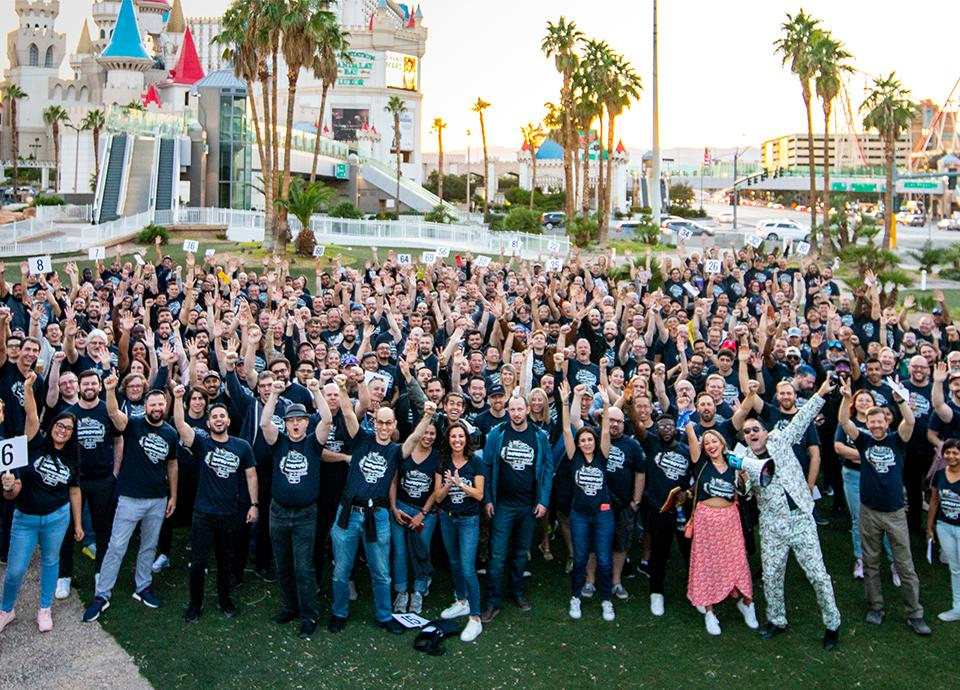
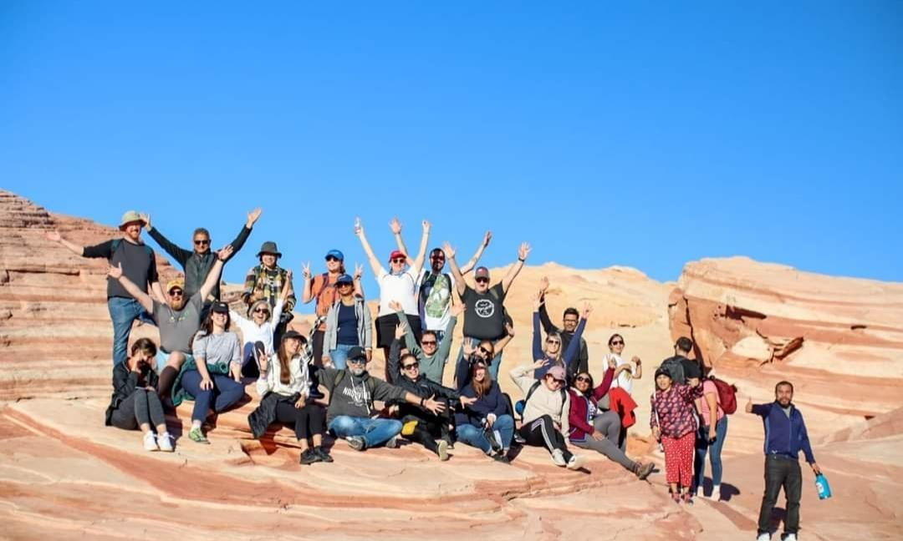
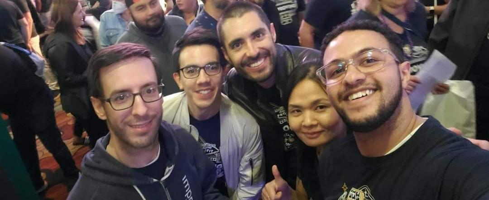

At its core, Improving is about great individuals doing great work together. That is why I’ve always said that Improving’s strength is and has always been its people! If I were to choose my favorite part about working for the company, it’s the Improvers. That has been the case since I joined the company at the start of 2019.

I truly believe that there is no better way to put down roots at a job than to develop meaningful personal and professional relationships. As Improving grows, the company is working hard to ensure the 1,500 Improvers spread out across 3 different countries and 16 sites can experience these relationships.

That is why the annual Corporate Retreats to Las Vegas, Nevada work wonders for everyone. It’s the best opportunity to come together, have a great time, learn more about one another, and most importantly deepen our relationships in a meaningful way! Here is my experience:

This year was my second time being at the retreat, and I can say without a doubt that it surpassed even my wildest expectations. Once we landed in Las Vegas on Thursday, there was a sense of excitement in the air. From the moment we got to the MGM Grand Hotel, I saw people from all enterprises greeting each other, hugging, and saying hello (sometimes for the first time in person).

Once I saw the brochure of events that Improving scheduled for us, I wanted to do EVERYTHING! But alas, it was impossible to do so because they give several choices of activities that run at the same time. From the very beginning, I had to carefully select what I wanted to do and plan accordingly. Being such a social dork, my main objective was to hang out and get to know as many Improvers as possible for the next 3 days.

After getting a late lunch with some friends at the Shake Shack (a first for me, and let me tell you, I’m a big fan now), we headed to the official meet and greet at the lobby’s three bars (yes, we filled three different bars!). It was just insanity. We spent a full hour with everyone before heading out to our selected Thursday activity. Time flew by, and as excited as I was about being surrounded by all of our extended Improving family, I had to leave for my final stop of the night which was The Blue Man Group show.

What a wonderful, joyous show! The sounds, the lights, the atmosphere, just wow! I had a giant grin on my face the whole time and didn’t expect it to be so funny! I had definitely selected the right event for me, hands down.

I was ready to call it a night once we got back to the hotel because the very next day at 6:00 am sharp I was heading out to the Valle of Fire Hiking… again! As anyone to whom I talked about my first year visiting Las Vegas with Improving can attest to (because I wouldn’t shut up about it for a year), this was one of the highlights of my first Corporate Retreat and I was ready to recreate those special moments anew.

Sure enough, it was a magical and even spiritual experience for me again. Being in the middle of the desert surrounded by such beauty with my fellow Improvers is something I will never forget.

Back at the hotel, filled with joy and energy, I was ready to hang out with more people. And also, I was mentally preparing for the main course of the day: Friday’s event at The Hard Rock Café! We enjoyed dinner together, heard from some of our presidents about exciting developments, and even had a very competitive beer pong tournament all while dressed in hilarious costumes!

No, the night was not over after dinner. I went to hang out with some Improvers before deciding to see Steve Aoki at the Hakkasan (the hotel’s nightclub). I had the best time seeing my friends and getting to hang out Vegas-style.

Saying I had the greatest time is an understatement. The whole night, I never stopped dancing and jumping! 5:00 am came by in the blink of an eye and I most definitely needed my beauty sleep because Saturday was arriving way quicker than I had anticipated.

On Saturday, we had the chance to learn about Improving through educational sessions. Then, we headed to the pool. Fun people from México, Canada, and the USA were all together, laughing and soaking up the sun.

The fun continued as the amazing race was next on the docket. I had the best time with my group. We ran up and down the Strip, getting to know each other and completing as many challenges as possible before arriving at our final reunion spot: the Nine Fine Irishman in “New York, New York”.

Once again, the place was full of excited Improvers who were anxious to hear who won the race. Imagine a whole bar filled with your group of friends, from 3 different countries. It was such a great, diverse mix of people. This was my tribe and I did not want to be anywhere else at that precise moment.

As the night was winding down, many of us were starting to say our goodbyes, realizing that this was the last time we were going to see each other in a year. It was definitely a bittersweet moment for me. I had grown attached to many people, meeting and befriending people I had never even met before. Everyone I spent time with made this trip one of the best of my life, and it is sad to know that we have 12 months until we will all be together again.

However, I am thankful to work at a company whose first and foremost goal is for people to feel part of a family. We are not numbers. At Improving we all have a special place, and events like these just go to show that indeed, we are stronger together! Thank you Improving for providing such an outstanding event every year.

Until next time Las Vegas!
