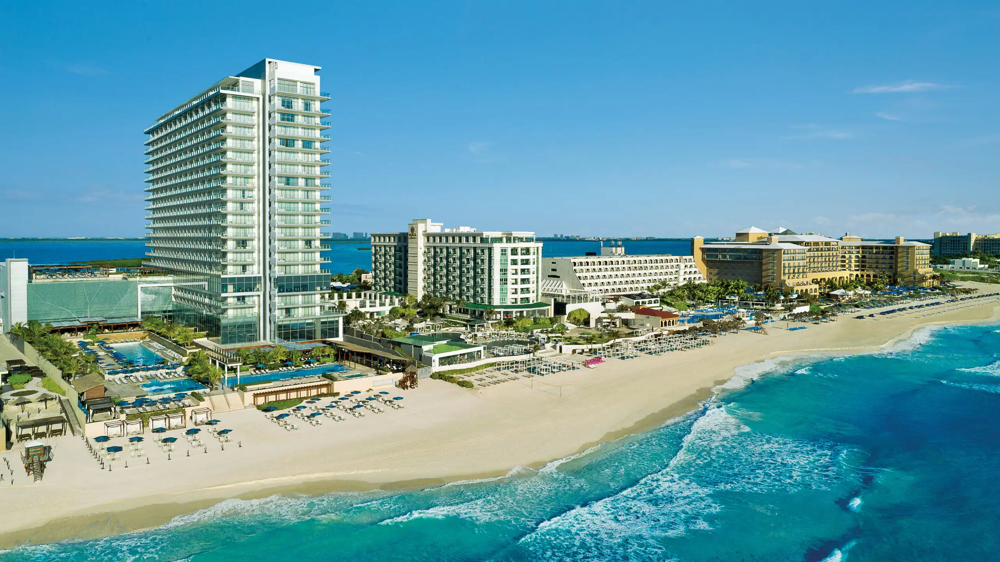
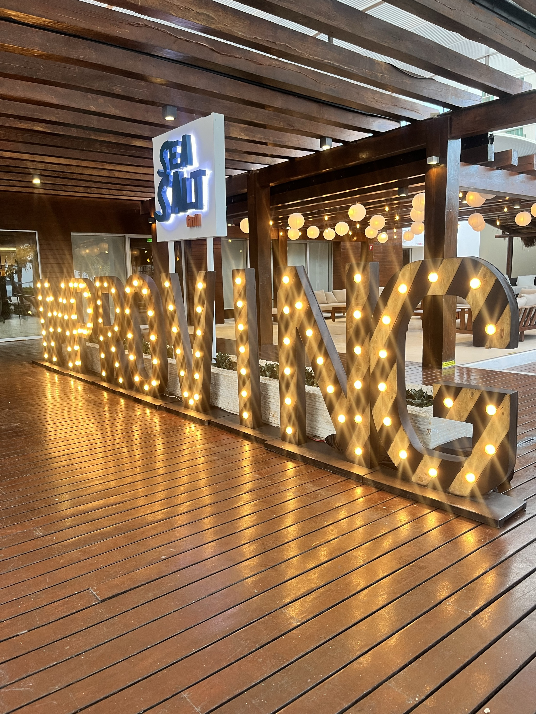
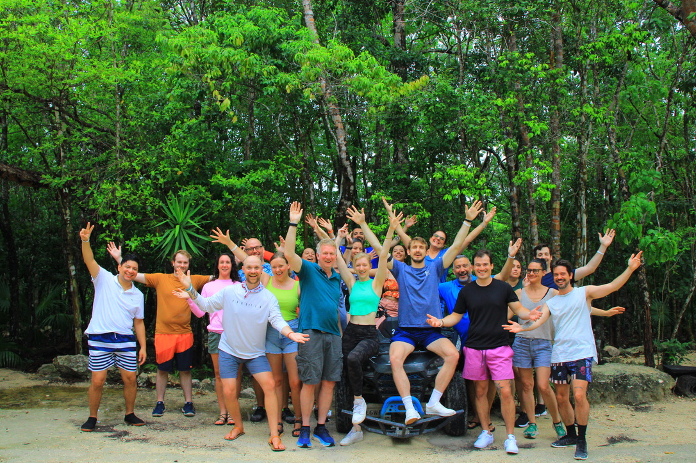
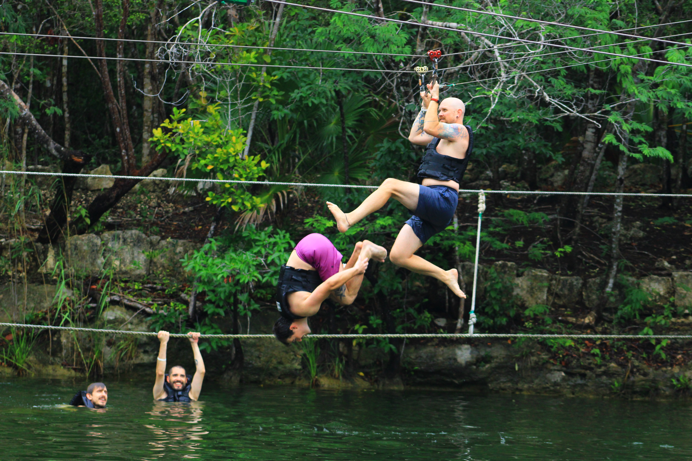
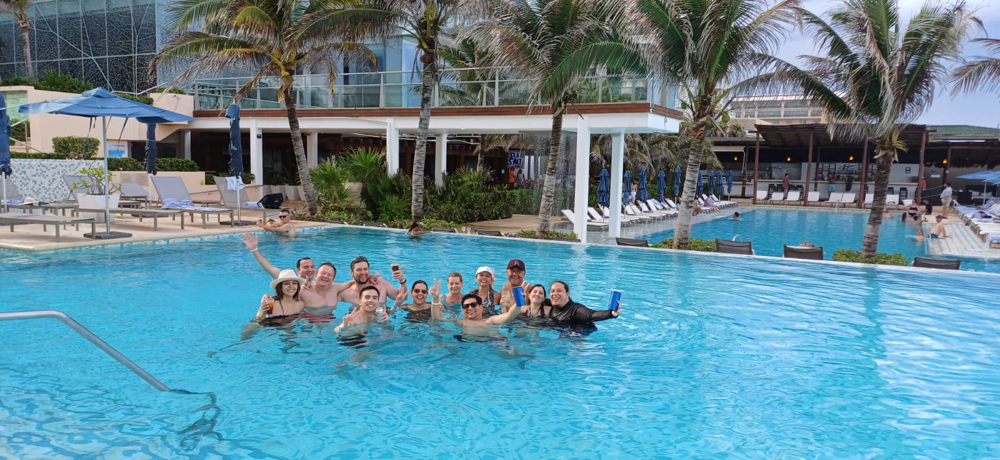
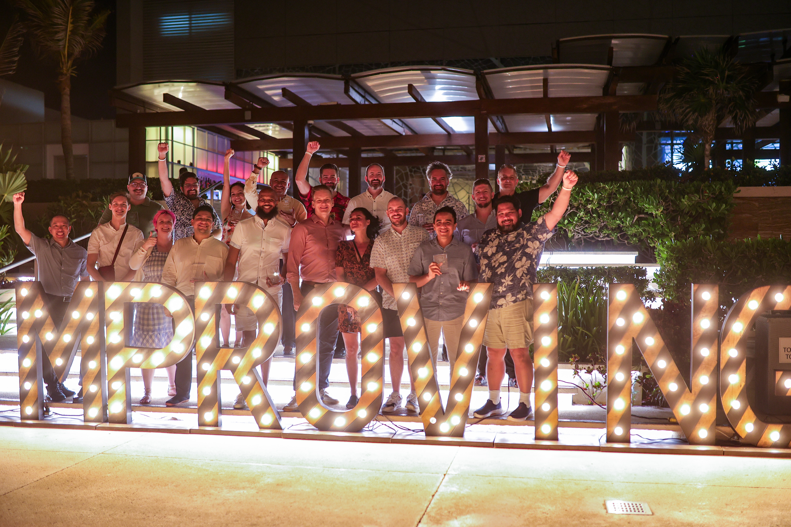
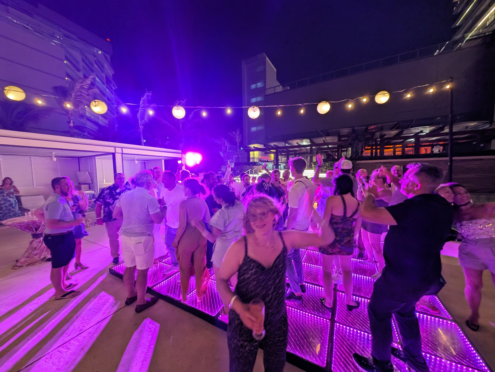

Being a part of a company with a big presence in Mexico, the USA, and Canada can be challenging sometimes. It is nearly impossible to stay in touch (and up to date) with friends from other countries. After all, we are more than 1,500 Improvers and counting. That is why every time we get the chance to come together, network, and have some fun, it feels like precious borrowed time.

One of these incredible opportunities comes with the “Improving 100” employee recognition program. This program celebrates the best performances of the year for excellence in Community Impact, Business Growth, Delivery Excellence, and Technical Innovation. It is especially important and meaningful because employees nominate their own peers, and the final selection comes from leadership after careful consideration of all nominees.

This year, I was fortunate enough to be one of the recipients for 2023. It goes without saying that I felt extremely honored and humbled to be nominated and selected with so many incredible performances in a very rough year.

As if getting this amazing recognition wasn't enough, the prize was an all-inclusive, all-expenses paid trip to Cancun, Mexico at a luxury resort for you and a plus one for 4 days. From June 13th to June 16th of this year, "Secrets: The Vine" hosted 62 honorees and their companions (some people decided to fly solo, others took one of their parents with them, most invited their significant others, etc.) It was truly a great mix of people, and the experience was a once-in-a-lifetime affair!

Getting to meet and befriend our fellow Improvers plus ones was one of the highlights of the trip for me. I felt like I got to know a very important part of them, which in other circumstances I maybe wouldn’t be able to do. It made me feel closer to them in a way, if that makes sense.

Things got to an amazing start with the Welcome Reception at the Sea Salt Terrace. Scott McMichael and Curtis Hite were our hosts for the evening and welcomed us to the trip with very kind words. Many friends, old and new, got together for this event and the atmosphere was electrifying. I got to see many dear Improvers for the first time in months (or years) and I had a big smile on my face running up and down to be with everyone. After this, it was dinner time!

All 3 nights you had the option to visit one of the out-of-this-world restaurants at the Resort with your group. To say that they were incredible is an understatement. Everyone I talked to couldn’t rave enough. Italian, Asian, Seafood, Mediterranean, Steakhouse… we had it all!

On Friday came one of the coolest parts of the trip: your chosen activity for excursion day! This year, we had the option to pick one of the following four: Catamaran Adventure, Mexican Cooking Class, ATV, and Cenote and Adventure Park!

With my pick, I was able to drive one of the most powerful ATVs in Cancun for a wild ride down jungle trails, full speed ahead around curves and over roots and rocks. After all that fun, we were able to cool down and enjoy a swim in an amazing natural cenote, discovering the mystical wonders of the Mayan world! This was extremely fun since we could also zip-line over the open-air cenote or jump in from a very high diving board and swim away to our heart’s content. And as a plus, the temperature of the water was deliciously warm!

During the trip, we had 3 official activities. The rest of the time you were able to plan your day according to your preferences. I enjoyed those down times mostly at pools with people from all over Improving (even those days when there was pouring rain, which made for a very different and fun experience at said pools).

Saturday brought our last official day and also the Improving 100 Celebration at the Pool Terrace. Everyone looked their best and you could sense the excitement in the air. I felt very emotional and happy during the night. I wanted to stretch these last moments together. Also, cheering for everyone and being cheered on once our names got called out was really lovely. I got chills and teary-eyed during certain parts of the ceremony.

And because we ARE Improvers after all, there wasn’t any other way in which this could all end other than a big dance-off (remember last year’s Corporate Retreat?). We were all dancing, singing and having the best time together enjoying those last moments of what turned out to be one the best of trips!

Coming back to my hometown and back to reality after all of this, my feeling of belonging and gratefulness for being a part of this incredible company just is through the roof. Improvers are, after all, my favorite part of working here and being able to be with some of them last week made me heart full.

[**#LifeatImproving**](https://www.instagram.com/lifeatimproving/) is not just a hashtag but a way of living! Until next time…
