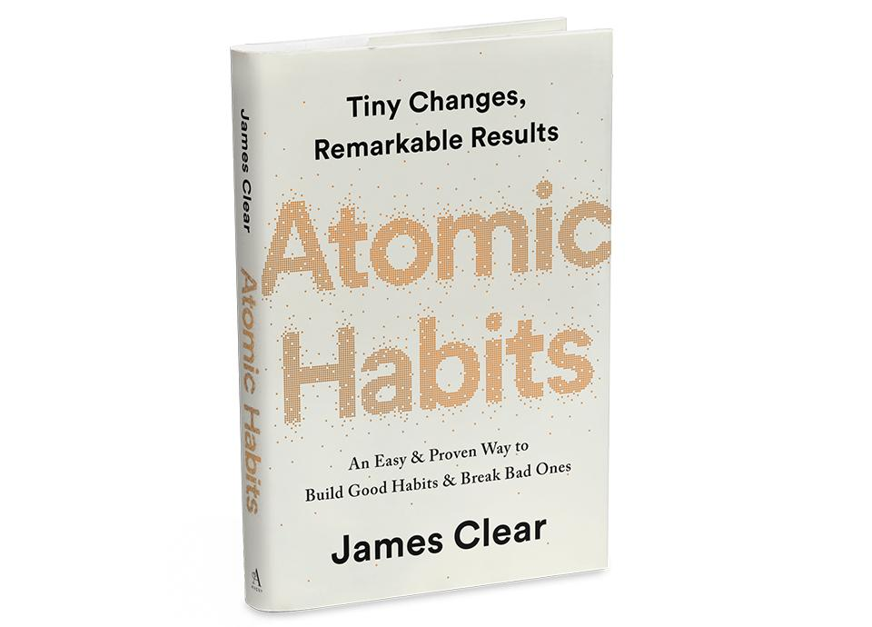

Delivering results seems so simple and straightforward. It almost doesn’t need to be said, right? But like many of the trust behaviors, the reality is more complex. This behavior is about more than just one result, one time. If there is magic dust that you can apply to a career, its consistency of results over long periods of time.

If you explore [Atomic Habits by James Clear](https://jamesclear.com/atomic-habits) or similar books, they boil down to this behavior being applied to growth. There are unfortunately many times when reality and our ambitions differ. In these cases, we have to dig a little deeper.

As we explore this topic, it’s important to take a look at a few myths, and how we can dispel them.

## Myth 1 – Working Hard is Enough!

It would be great if this was true, but results with the least amount of effort are better. There are many economic models and optimization frameworks that try to find this balance point for the least effort, most results. If you are working hard, that is good! But, is it on the wrong things (activity rather than results)?

I have worked with some incredible folks in my career. The ones that I want to be more like are people that see through the chaos to find the right thing to do. They aim and solving the root issues rather than being busy with the symptoms.

The behaviors and side effects of this myth also show up when there is pressure to deliver results but you don’t have any (or enough) to succeed. You may miss a commitment, or struggle to accomplish something. The pull to claim credit for the effort or to show your activity is strong. Avoiding social and career judgment by being “busy” or “working hard” fails over time when the results don’t match the effort.

## Myth 2 – Results are All That Matter.

So many times, I have heard that the results were enough and the rest shouldn’t matter. Unfortunately, that is not the reality of the world that we live in. Not only does the result matter, but how you achieve it also matters.

If I deliver a result by lying, cheating, or stealing then the result is tainted by those actions. We must deliver results in the right way, consistently, to significantly build trust with anyone. Those who are most dependable in our lives build huge trust accounts with us.

## Myth 3 – You Hit a Peak and Should be Promoted for it.

Have you ever seen someone work at an unsustainable pace to achieve a goal? I often see this with my kids. They will find extra chores to do when they want something, and the effort falls off after they get enough to achieve that thing. This is fine in youth, but in the professional world, this creates problems.

I was told early in my career and railed against, that I needed to sustain the level of a role for a while before it was earned. My immediate reaction was that I was delivering the results that earned it, so it should be given immediately. I have learned the folly of this view many times. I have promoted people too early and have had to correct this mistake after those people pulled back.

## Myth 4 – The Need to Deliver Ends at Some Point.

There is no point where the need to deliver results will go away. Never. What about that CEO that has “made it”? They have to deliver to their goals (typically strict), investors, shareholders, or employees. The higher the level of position, typically the higher results are required to be considered “enough”.

Imagine you are a manager at a company that grows to five times the size in three years. Your team doubles. Great news! Did you double your management capacity and delivery during that time? If not, your position’s need for results may have outgrown you.

It is tough to look at the advancing world and admit that we expect more from the world every day. The phones we carry would have been miracles only forty years ago, and today they are near an expectation. That level of results growth also applies to our lives, goals, and careers.

Deliver Results is considered by many as a “common sense” item, but consistency in this behavior will build a lot of trust and career capital. Great teams, companies, and careers are built on the back of doing this behavior well for years! To learn more about Deliver Results and other trust behaviors, [reach out to us](https://improving.com/careers)!
