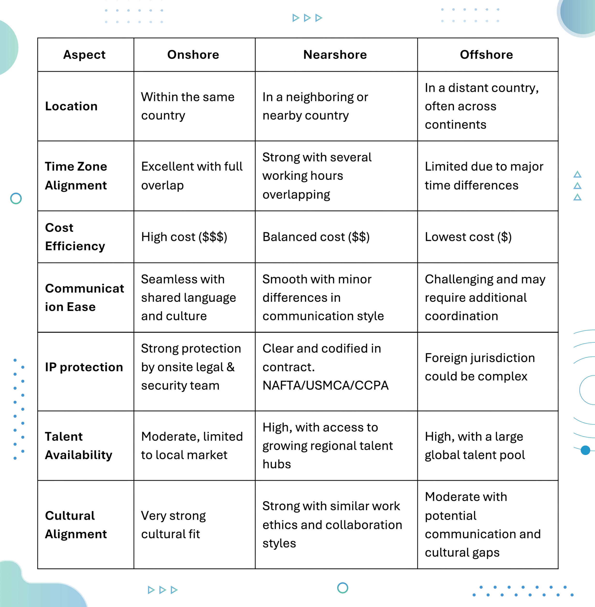

In 2025, nearly every North American enterprise with ambitious technology goals is asking the same question: Should we build in-house, hire locally, outsource to offshore, or lean towards nearshore? The trends are clearly tilting toward nearshore development in Latin America, and for good reason.

Onshore development teams offer proximity and operational control but often come with high costs and limited access to specialized talent. Offshore outsourcing can reduce costs but frequently introduces communication gaps, cultural mismatches, and delays that slow down the development. Nearshore software development, by contrast, provides a balanced approach: cost efficiency, technical expertise, and real-time collaboration with teams in nearby countries.

By partnering with nearshore providers in Latin American hubs, enterprises gain access to highly skilled engineers, shared time zones, and cultural alignment — all of which accelerate development cycles and improve business outcomes. According to Statista, the [nearshore software development market is projected to grow at a CAGR exceeding 12% over the next five years](https://www.statista.com/forecasts/963932/it-outsourcing-services-revenue-in-the-world), reflecting a surge in adoption among companies seeking smarter ways to scale engineering teams. Additionally, Everest Group reports that [North American organizations increasingly prioritize agile delivery, real-time collaboration, and proximity](https://www2.everestgrp.com/report/egr-2025-37-r-7546/), making nearshore models a strategic choice.

Nearshore development is no longer just a cost-saving tactic; it is a [strategic lever for innovation](https://www.improving.com/thoughts/unlocking-the-benefits-of-nearshore-outsourcing/), operational efficiency, and enterprise agility.

## Executive Summary

This guide gives you a practical framework for evaluating nearshore software development companies and building a high-performing distributed engineering model. You’ll learn:

- When nearshore is better than onshore or offshore models
- How nearshore teams improve delivery speed and collaboration
- Key criteria to compare vendors (talent maturity, time zone alignment, delivery capabilities, culture, compliance)
- Strengths and regional presence of top nearshore providers across Latin America
- Best practices to scale nearshore engineering teams successfully
- How to choose the right LATAM country based on talent depth and business needs

By the end, you’ll have a clear, strategic way to assess the top nearshore companies and decide which model and region fits your organization best.

## Who Is This Guide For?

This guide is designed for:

- CTOs and CIOs evaluating global engineering strategy
- VPs of Engineering and Product Leaders scaling tech teams
- Transformation and Innovation Leaders adopting hybrid delivery models
- Enterprises looking for faster delivery cycles and real-time collaboration
- Teams comparing nearshore vs offshore vs onshore options

If you're exploring nearshoring to accelerate digital delivery, reduce risk, and build long-term technical capabilities, this resource gives you a structured way to move forward with confidence.

## What Is Nearshore Software Development & How Does It Work

Nearshore software development involves outsourcing software projects to companies in neighboring or nearby countries, typically within overlapping time zones. Unlike offshore models, nearshore teams work closely with in-house staff, enabling faster communication, iterative development, and better alignment with business goals.

### **Key Advantages of Nearshore Development**

**1. Time-Zone Alignment: **Working in overlapping time zones allows teams to collaborate in real time, participate in live stand-ups, sprint reviews, and milestone meetings. On average, [nearshore teams maintain a 6–8 hour overlap with U.S. business hours](https://www.accelerance.com/blog/successful-communication-in-nearshore-development-projects), enabling faster feedback loops and reduced cycle times (Industry Benchmark, 2024).

**2. Cultural & Business Compatibility: **Similar cultural and business practices foster smoother collaboration, fewer misunderstandings, and faster decision-making.

**3. Cost Efficiency: **Nearshore services typically reduce costs by 20–40% compared to onshore teams, without sacrificing quality. These savings can be reinvested into technology, innovation, or expanded project scope. The Deloitte Global Outsourcing Survey 2023 found that [cost optimization and agility remain the top two reasons enterprises choose nearshore models](https://www.deloitte.com/ce/en/issues/work/global-outsourcing-survey.html), with many reinvesting savings into product innovation.

**4. Access to Specialized Talent: **Nearshore teams provide access to in-demand expertise in AI/ML, cloud-native architectures, microservices, DevOps, mobile and web development frameworks, and more.

**5. Agility & Flexibility: **Nearshore providers can [scale teams up or down quickly](https://www.improving.com/thoughts/growing-software-teams-with-nearshoring/), support iterative development, and adapt to changing market requirements or customer feedback.

## Nearshore vs Offshore vs Onshore: What’s Best for Your Enterprise?

When choosing a software development model, understanding the difference between onshore, nearshore, and offshore approaches is essential to making the right strategic decision. Each model offers unique advantages and challenges, and the best choice depends on factors such as project complexity, timeline, cost constraints, and collaboration needs.

*Takeaway: Nearshore development offers an optimal balance of cost efficiency, access to talent, and operational alignment, making it ideal for enterprises seeking speed, quality, and flexibility.*

## How To Choose the Best Nearshore Software Development Partner

Selecting the right partner goes beyond technical expertise. It’s about strategic fit, operational flexibility, and measurable business outcomes. Key evaluation areas include:

- **Domain & Industry Experience:** Providers familiar with your industry, such as FinTech, Healthcare, SaaS, Logistics, or eCommerce, anticipate challenges and reduce the learning curve to deliver more aligned outcomes. Their services pages and case studies often reveal the industries and client types they specialize in.
- **Cultural Fit: **Cultural alignment plays a major role in how smoothly teams collaborate across borders. Shared work ethics, similar values, and aligned business practices help minimize friction and build trust. Look for indicators such as “Great Place to Work” recognition, employee engagement awards, or consistent positive reviews. These indicate a healthy company culture that translates to better collaboration and retention.
- **Communication and Collaboration:** Clear, consistent communication is essential for managing distributed teams effectively. Strong English proficiency, responsiveness during overlapping hours, and transparent reporting or sprint review practices ensure your nearshore teams stay in sync with your internal processes and project goals.
- **Scalability & Team Flexibility:** Projects evolve. Partners should be able to [scale teams up or down quickly](https://www.improving.com/thoughts/growing-software-teams-with-nearshoring/) to support iterative development and agile delivery.
- **Technical Expertise & Strategic Partnerships:** Ensure the firm has experience with modern technology, such as cloud platforms, AI/ML frameworks, microservices, mobile/web development, DevOps, and automation. Also review their technology partnerships with providers like Microsoft, AWS, Snowflake, Confluent, or SAP, as these often indicate strong technical depth and access to advanced implementation standards. A partner with deep technical knowledge can provide guidance on architecture, best practices, and scalable solutions.
- **Security & Compliance:** Confirm adherence to ISO, SOC2, GDPR, HIPAA, and other relevant standards. Secure practices reduce operational and legal risks.
- **Past Projects & References:** Review case studies, client testimonials, and measurable outcomes such as time-to-market, cost savings, or improved performance.
- **Pricing & Contract Flexibility:** Transparent models (fixed-price, time-and-materials, hybrid) aligned with budgets and risk tolerance are critical.
- **Delivery Methodologies:** Agile, Scrum, Kanban, or hybrid approaches, coupled with clear progress tracking and continuous feedback loops, ensure quality and adaptability.

*Bottom Line: Choosing a nearshore partner is about forming a strategic alliance that accelerates development, reduces risk, and drives tangible results. Providers like Improving, with combined technical expertise, domain knowledge, and consultative guidance, excel in delivering scalable solutions with precision.*

## The Top 12 Nearshore Software Development Companies

Narrowing down on the best nearshore software development company can be daunting. Hundreds of capable providers exist, but not every firm is the right fit for your project, team, or culture.

To help you navigate the options, we’ve compiled a list of the top companies recognized for reliability, technical expertise, and best nearshore delivery capabilities. Some offer dedicated teams you can integrate directly into your workflow, while others provide project-based services or consulting-led engagements. Consider this list as a starting point to find a nearshore partner who not only delivers code, but becomes a trusted extension of your team for a long-term success.

### 1. Improving

Improving is widely recognized as a [leader in nearshore software development](https://www.improving.com/services/outsourcing/nearshore/), particularly for North American enterprises looking to combine agility, speed, and high-quality engineering. Unlike traditional outsourcing models, Improving combines consulting-led engagement with deep engineering expertise, operating as strategic partners rather than transactional vendors. The organization’s embedded LATAM delivery footprint with centers in Mexico, Guatemala, Chile, and Argentina ensures access to a highly skilled, culturally aligned engineering talent pool.

##### **Why is Improving the Best Nearshore Partner?**

Improving bridges strategy and execution through proximity, collaboration, and consulting expertise. With delivery centers across Latin America, the teams work in overlapping time zones with North America, enabling real-time communication, agile sprint alignment, and faster decision-making. This close alignment, combined with shared cultural values, ensures seamless collaboration and a true extension of Improving’s clients’ teams.

Backed by deep expertise in cloud-native architectures, AI/ML, mobile and web development, and enterprise-grade software engineering, the team guide clients through technology choices, architecture design, and scaling strategies that keep business goals at the center of every engagement. Improving also adheres to the highest standards of data security and compliance, maintaining ISO 27001 and SOC 2 certifications and aligning with global regulations like GDPR to ensure every engagement meets enterprise-level security expectations.

##### **LATAM Talent Access**

Latin America is one of the fastest-growing regions for software talent, offering strong English proficiency, cultural alignment with North American business practices, and overlapping time zones that enable real-time collaboration. Improving’s presence in Mexico, Guatemala, Chile, and Argentina ensures rapid team scaling, embedded collaboration, and low communication friction. The engineers are trained in Agile, DevOps, and CI/CD methodologies, making integration with client teams seamless. Learn more about [Mexico’s tech talent revolution](https://www.improving.com/thoughts/mexicos-tech-talent-revolution-why-companies-are-flocking-south/), [Guadalajara’s tech growth](https://www.improving.com/thoughts/guadalajaras-tech-revolution/), and [South America as a strategic IT consulting hub](https://www.improving.com/thoughts/south-america-your-next-strategic-move-for-it-consulting-success/).

##### **Proven Track Record**

With 600+ nearshore developers, 500+ successful outsourcing projects, and experience across 30+ industries, Improving has built a reputation for excellence backed by a 94% client satisfaction score. The firm has also partnered with leading enterprises such as United Healthcare, Honda, American Airlines, Berkshire Hathaway, and Costco across FinTech, Healthcare, SaaS, and Logistics, delivering measurable outcomes like faster time to market, stronger system reliability, and improved user experiences.

Their [case studies](https://www.improving.com/case-studies/) demonstrate tangible business impact, such as reduced deployment cycles, increased platform resilience, and higher product adoption, supported by enterprise-grade delivery and a consultative approach. The teams integrate as extensions of client engineering departments, ensuring continuity and ownership that evolve with business goals, something that traditional outsourcing often lacks.

##### **Strategic Advantage**

What differentiates Improving’s model, according to industry analysts, is its integration of enterprise-grade processes with nearshore agility, creating seamless cross-border collaboration. Through the strategic acquisitions of [iTexico](https://www.improving.com/thoughts/improving-acquires-nearshore-model-company-itexico/), [Leniolabs](https://www.improving.com/thoughts/improving-expands-footprint-with-leniolabs-acquisition/), [Zigatta](https://www.improving.com/thoughts/improving-acquires-zigatta/), and [MangoChango,](https://www.improving.com/thoughts/newsroom/mangochango-acquisition/) Improving has deepened the Latin American presence and unified delivery under a single, integrated model. This enables the clients to access top-tier talent, consistent quality, and seamless collaboration across multiple LATAM regions.

Decision-makers gain not only skilled talent but also actionable insights, architectural guidance, and a partner who understands how software impacts business outcomes. For companies exploring nearshore strategy, Improving's model demonstrates that embedded, consulting-led LATAM teams can accelerate innovation while maintaining operational control. Learn more about why Fortune 500 and growing organizations alike trust [Improving’s Nearshore Services](https://www.improving.com/services/outsourcing/nearshore/) as one of the best nearshore software development companies.

### 2. TCS

Tata Consultancy Services (TCS) brings its global IT legacy to the nearshore model with delivery centers across Latin America, including Mexico, Colombia, and Brazil. By combining decades of enterprise experience with regional presence, TCS helps North American clients accelerate transformation through cloud, AI/ML, and modern application services tailored for time-zone compatibility and cultural alignment.

**Why Consider TCS:** Offers deep enterprise consulting expertise coupled with the scalability to support large, complex programs. Their nearshore delivery teams ensure real-time collaboration while maintaining global delivery standards, making them ideal for companies seeking a partner that can handle end-to-end transformation projects.

**Talent Pool Access:** Maintains one of the largest technology workforces in the region, with highly skilled developers and consultants fluent in English and Agile practices. Their structured learning ecosystem ensures access to continuously upskilled engineering talent.

**Proven Track Record:** Trusted by Fortune 500 firms, TCS has executed large-scale modernization, cloud, and AI programs that have improved operational efficiency and customer experience for clients worldwide.

### 3. Accenture

Accenture brings its global consulting power to nearshore delivery through its Latin American innovation hubs in Argentina, Brazil, and Mexico. The company integrates technology, strategy, and operations to help clients modernize legacy systems, migrate to cloud, and embed AI capabilities — all within overlapping time zones for North American collaboration.

**Why Consider Accenture:** Accenture’s nearshore advantage lies in its ability to merge advisory and execution seamlessly. Clients benefit from rapid scalability, advanced architecture guidance, and strong governance frameworks to ensure predictable, high-quality outcomes.

**Talent Pool Access:** Their multidisciplinary teams blend software engineers, data scientists, and design experts with deep domain knowledge across financial services, retail, energy, and telecom sectors.

**Proven Track Record:** Accenture has a long-standing record of delivering measurable transformation outcomes, helping global enterprises reduce technical debt and accelerate innovation cycles across industries.

### 4. Wipro

Wipro’s nearshore network in Mexico and Brazil supports enterprise clients seeking agile and secure delivery close to the U.S. market. Their expertise spans full-stack development, cloud-native applications, automation, and AI/ML, all delivered through integrated teams that work closely with client stakeholders.

**Why Consider Wipro:** Wipro’s strength lies in combining scalability with governance. Their nearshore model offers flexibility for growing enterprises while adhering to global compliance and cybersecurity standards like ISO 27001 and SOC 2.

**Talent Pool Access:** Backed by thousands of engineers across LATAM, Wipro provides specialized resources for product engineering, DevOps, and emerging technologies.

**Proven Track Record:** Recognized by global analysts for its enterprise resilience, Wipro has delivered mission-critical systems for BFSI, manufacturing, and healthcare sectors with strong uptime and efficiency metrics.

### 5. ThoughtWorks

ThoughtWorks is known for its engineering excellence, innovation-driven culture, and nearshore delivery model designed for high collaboration. With offices across Latin America, ThoughtWorks helps enterprises adopt cloud-native architectures, improve product design, and implement agile transformation programs.

**Why Consider ThoughtWorks:** Their teams are ideal for organizations seeking a partner that values technical craftsmanship and creative problem-solving. ThoughtWorks also brings a strong focus on continuous delivery, DevOps maturity, and product-led innovation.

**Talent Pool Access:** Their LATAM engineers are among the most experienced Agile practitioners, working within cross-functional teams that embed directly into client environments.

**Proven Track Record:** With a client portfolio spanning fintech, logistics, e-commerce, and public sector organizations, ThoughtWorks has delivered complex, distributed systems that balance innovation with reliability. Their track record demonstrates measurable results such as faster release cycles, improved developer productivity, and greater alignment between IT and business outcomes.

### 6. EPAM Systems

EPAM Systems offers engineering-driven nearshore delivery from its LATAM hubs, blending technical precision with enterprise consulting depth. Its services cover digital product engineering, platform development, cloud enablement, and AI-driven analytics.

**Why Consider EPAM:** EPAM stands out for its ability to manage complex, mission-critical technology ecosystems. The company’s delivery maturity and architecture expertise make it a preferred partner for enterprises seeking robust and scalable solutions.

**Talent Pool Access:** EPAM’s LATAM engineers are trained in high-performance software design, with strong emphasis on cloud, security, and automation standards.

**Proven Track Record:** Fortune 500 companies rely on EPAM for enterprise-grade implementations that balance quality, scalability, and long-term maintainability.

### 7. Persistent Systems

Persistent Systems integrates its nearshore LATAM capabilities with deep product engineering roots. Their focus areas include digital platforms, cloud-native software, data engineering, and embedded AI solutions for enterprise transformation.

**Why Consider Persistent Systems:** Persistent brings the advantage of flexible team models and product-focused delivery. They work closely with clients to define architecture, scale engineering capacity, and improve time-to-market efficiency.

**Talent Pool Access:** The company’s nearshore engineers combine technical specialization with familiarity in regulated industries like BFSI and healthcare.

**Proven Track Record:** Persistent has delivered complex digital systems for technology leaders globally, ensuring quality and speed through DevOps and Agile best practices.

### 8. Slalom

Slalom combines strategy, technology, and innovation to help enterprises achieve digital excellence. While best known for its consulting heritage in North America, Slalom has rapidly expanded its nearshore delivery capabilities across Latin America to meet growing demand for agile, co-located development teams. These teams operate in overlapping time zones and align seamlessly with client teams, supporting initiatives from cloud modernization to data analytics and enterprise application development.

**Why Consider Slalom:** Slalom’s consulting-first DNA makes it an ideal choice for organizations seeking not just delivery, but partnership. They bridge strategic planning and execution by offering tailored delivery models that combine technical expertise with strong business understanding. Their nearshore approach emphasizes governance, transparency, and adaptability — ensuring enterprises scale engineering capacity without losing control or cultural cohesion.

**Talent Pool Access:** Slalom’s nearshore professionals bring cross-functional skills spanning software engineering, UX, and data architecture. With continuous collaboration and shared working hours, their teams integrate seamlessly with client environments, driving faster decision-making and stronger alignment on goals.

**Proven Track Record:** Slalom has helped global brands modernize technology ecosystems and reimagine customer experiences. Their success stories include enterprise cloud migrations, data-driven transformations, and digital product rollouts that improved business agility and time-to-market. Clients often cite Slalom’s collaborative culture and transparency as key differentiators in long-term partnerships.

### 9. Globant

Globant positions itself as a digital-first nearshore partner with strong creative and technical capabilities. With delivery centers throughout Latin America, Globant focuses on next-generation digital experiences powered by AI, cloud, and product engineering.

**Why Consider Globant:** Globant’s strength lies in its ability to deliver cutting-edge digital solutions that combine technical depth with human-centered design. For enterprises exploring nearshore partnerships, Globant brings the rare mix of creative agility and enterprise discipline. Their teams help organizations modernize legacy platforms, implement AI-driven automation, and adopt sustainable engineering practices — all while maintaining close cultural alignment and fluid communication with North American stakeholders.

**Talent Pool Access:** Their LATAM teams are well-versed in cross-domain engineering, from frontend design to AI analytics, offering flexible scaling for fast-moving projects.

**Proven Track Record:** Globant has partnered with Fortune 500 companies in industries such as finance, retail, and media to build scalable, experience-driven software solutions. Their proven success in delivering large-scale digital transformation projects has earned them recognition as a trusted innovation partner for organizations aiming to stay ahead in rapidly evolving markets.

### 10. Endava

Endava is a global technology services company that has built a strong nearshore presence across Latin America, including delivery centers in Mexico, Colombia, and Uruguay. The company focuses on helping enterprises accelerate digital transformation through agile product engineering, intelligent automation, and cloud-native development. Endava’s nearshore model emphasizes proximity, shared culture, and real-time collaboration, making it a preferred choice for North American organizations seeking high-performing distributed teams without the complexity of offshore management.

**Why Consider Endava:** Endava combines nearshore proximity with strong process discipline, ensuring faster communication, reduced delivery risk, and scalable operations.

**Talent Pool Access: **Endava’s LATAM delivery network comprises highly skilled software engineers, solution architects, and data specialists who operate within the same or similar time zones as their North American clients. Their talent strategy emphasizes local empowerment, ongoing learning, and long-term client integration, enabling sustainable and scalable partnerships.

**Proven Track Record:** Endava has executed digital modernization programs for financial services, retail, and logistics firms with measurable efficiency gains.

### 11. SoftServe

SoftServe delivers nearshore software engineering with a strong focus on innovation, UX, and cloud platforms. Their LATAM centers help enterprises accelerate digital initiatives and improve user-centric experiences.

**Why Consider SoftServe:** SoftServe’s approach balances creativity with engineering discipline. Their teams provide deep architecture, DevOps, and AI guidance tailored to each client’s maturity level.

**Talent Pool Access:** Their LATAM engineers specialize in cloud-native development and agile delivery, ensuring speed and scalability.

**Proven Track Record:** SoftServe has enabled enterprise clients across multiple industries to adopt modern digital platforms, improve performance, and enhance CX.

### 12. Nagarro

Nagarro has built a strong reputation as a modern engineering partner for enterprises looking to blend agility with scale. With nearshore centers across Mexico, Costa Rica, and Colombia, Nagarro’s LATAM delivery model enables clients in North America to benefit from time-zone overlap, faster delivery cycles, and transparent communication. Their services span digital platforms, AI/ML, cloud modernization, and enterprise software engineering — all grounded in a culture of innovation and quality.

**Why Consider Nagarro:** Nagarro stands out for its “thinking breakthroughs” approach, where strategy and execution go hand in hand. They focus on designing resilient, scalable systems while fostering long-term collaboration. Enterprises choose Nagarro for their strong engineering depth, flexible engagement models, and ability to embed into client ecosystems as true technology partners. Their nearshore presence provides the agility of local teams with the process rigor of a global delivery network.

**Talent Pool Access:** Nagarro’s Latin American teams combine technical excellence with strong communication and domain expertise across multiple industries. Their engineers are experienced in agile methodologies, DevOps, and emerging technologies like AI, IoT, and cloud-native development.

**Proven Track Record:** Nagarro has delivered digital transformation initiatives for clients in BFSI, healthcare, retail, and automotive sectors, helping them scale efficiently and reduce operational bottlenecks. Their long-term partnerships are built on measurable business outcomes, from accelerated product releases to improved system reliability and customer satisfaction.

**

*If you're evaluating nearshore models or building a distributed engineering capability, we're happy to share benchmarks, lessons learned, and team-building frameworks — whether you work with us or not.* [*Talk to our LATAM delivery advisors*](https://www.improving.com/services/outsourcing/nearshore/)*.*

## Choosing the Right Nearshore Hub for Your Software Teams

Choosing the right nearshore location is critical for maximizing collaboration, cost efficiency, and access to specialized talent. While regions like Eastern Europe (Poland, Ukraine, Romania) and the Caribbean (Puerto Rico, Dominican Republic) offer skilled engineers and strategic advantages, Latin America stands out for North American enterprises seeking high-quality nearshore software development.

### Why Latin America is the Prime Nearshore Destination

Countries such as Mexico, Argentina, Colombia, Brazil, and Costa Rica have become hubs for nearshore software services. Key advantages include:

- **Skilled Engineering Talent:** LATAM offers a rich pool of professionals experienced in cloud-native architectures, AI/ML, mobile and web development, and enterprise software solutions.
- **Time-Zone Alignment:** Overlapping hours with the U.S. enable real-time collaboration, sprint reviews, and faster decision-making.
- **Cultural and Business Compatibility:** Teams are culturally aligned with North American practices, reducing communication friction and accelerating project delivery.

Improving leverages these advantages through its [strong LATAM delivery footprint](https://www.improving.com/case-studies/leveraging-nearshore-services-to-optimize-development-team/), with centers in Mexico, Guatemala, Chile, and Argentina. By combining local engineering talent with enterprise-grade processes, [Improving delivers agile, cloud-native, and AI/ML solutions that scale seamlessly with client needs](https://www.improving.com/thoughts/beyond-cost-savings-how-mexico-talent-drives-innovation/). Its embedded presence, strengthened by the strategic LATAM acquisitions, allows teams to integrate fully with client organizations, acting as an extension of internal development squads rather than an external vendor.

Through a consultative approach, Improving not only executes technical projects but also provides guidance on architecture, best practices, and emerging technologies helping clients accelerate innovation while mitigating risk. Enterprises benefit from measurable outcomes such as faster time-to-market, improved system performance, and reduced operational overhead. Learn more about [Guadalajara’s tech growth](https://www.improving.com/thoughts/guadalajaras-tech-revolution/) and [why South America is a strategic move for IT consulting](https://www.improving.com/thoughts/south-america-your-next-strategic-move-for-it-consulting-success/).

## Final Thoughts

Many companies start with nearshore development speed, quickly scaling teams to ship features and meet deadlines. A top vendor with mature LATAM delivery centers and skilled engineering teams can help you build a long-term nearshore capability that integrates smoothly with U.S. teams. For instance, with a 94% client satisfaction score and an average launch time of less than two weeks to assemble a dedicated team, Improving delivers both speed and quality that help enterprises accelerate outcomes without compromising on excellence.

For product-driven organizations, the most successful nearshore engagements involve teams that act as true extensions of internal squads, sharing ownership and accountability for outcomes. Improving’s engineers collaborate in real time, contribute to long-term outcomes, and align with your processes and goals.

Rather than simply renting talent, you [build embedded LATAM engineering teams](https://www.improving.com/thoughts/growing-software-teams-with-nearshoring/) that provide continuity, accountability, and innovation, blending nearshore efficiency with the mindset of full-time teammates.

If you’re exploring a nearshore strategy or want to understand how to scale your Latin American delivery capabilities, our team would be happy to share what’s worked for others. Explore how [Improving can help you scale your LATAM team](https://www.improving.com/services/outsourcing/nearshore/) or schedule a consultation to see the benefits in action.

## Frequently Asked Questions

##### **1. Why choose nearshore for software development outsourcing? **

Nearshore outsourcing offers the best of both worlds - cost savings and close collaboration. Working with teams in nearby regions ensures overlapping time zones, cultural alignment, and faster communication. It’s a smarter alternative to offshore models for companies seeking agility, transparency, and engineering quality without sacrificing proximity.

##### **2. How to choose the right software development partner? **

Selecting the right partner starts with understanding your goals. Evaluate their track record, technical expertise, communication practices, and ability to scale. A great partner doesn’t just deliver code; they align with your business outcomes and act as an extension of your in-house team.

##### **3. How skilled and experienced are their engineering teams? **

Ask about the team’s seniority mix, certifications, and past project experience. Companies that invest in continuous learning and maintain low attrition rates typically deliver higher quality and consistency across engagements.

##### **4. How established is their presence in nearshore locations, and what’s their talent model? **

The strength of a nearshore company depends on its regional footprint and ability to attract top talent. Established delivery centers in key Latin American or Central European hubs ensure access to skilled engineers and faster scalability.

##### **5. How do they manage communication and collaboration across teams? **

Smooth collaboration is key to nearshore success. Ensure they operate within overlapping hours, use modern communication tools, and follow agile delivery practices. Frequent check-ins and transparent reporting build trust and accountability.

##### **6. How quickly can I hire nearshore software developers, and what cost savings can I expect? **

Hiring nearshore developers is typically faster than building an onshore team or managing offshore vendors. Top providers typically can assemble skilled teams within a few weeks due to pre-vetted talent pools and streamlined onboarding (For instance, Improving mentions less than 2 weeks to launch a team). In terms of cost, nearshore engagement often provides significant savings - usually 20–40% lower than onshore rates; without compromising quality, communication, or delivery speed.

##### **7. How do they handle data security, compliance, and IP protection? **

Security should be non-negotiable. Choose companies certified in ISO 27001 or SOC 2 and compliant with regulations like GDPR. Confirm they have clear IP ownership clauses and robust data protection measures in place.

##### **8. How can we build a long-term strategic partnership, not just a vendor relationship? **

The strongest partnerships go beyond delivery. Seek a partner who brings consulting insight, helps shape your technology roadmap, and grows with you over time. Strategic alignment, not just execution, defines real nearshore success.
