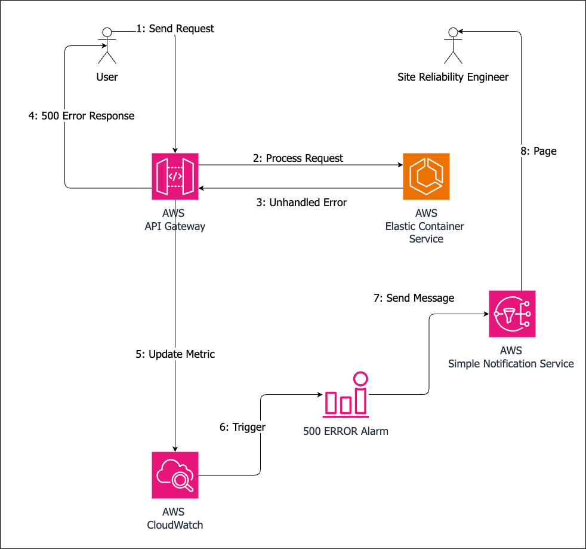

It’s the middle of the night, PST. A user gets an internal server error – HTTP error 500 – from a REST API service. Somewhere, a site reliability engineer gets a page. How did we get here? What can we do about it? Let’s discuss.

This overview uses Amazon Web Services as a concrete example, but the principles presented are high-level and apply to any cloud platform.

Here’s a representative diagram. Each step is numbered to show the sequence of events.

What caused the notification? A message to an *Amazon Simple Notification Service* topic.

What sent the message? A *CloudWatch* alarm. *Amazon CloudWatch* supports defining an alarm and an action to execute when an alarm is triggered, such as publishing an SNS message.

The number of HTTP 500 errors per hour is a metric available for several AWS services, like *API Gateway*. An alarm could be set up to fire if this metric is non-zero.

### **Exceptions **

What caused the request processing pipeline to return status code 500? Could be several reasons, but all of them result in an unhandled exception or, in some cases, crash the request processor.

HTTP service frameworks have a default error handler that generates 500 responses if an exception arises and is not handled by the request processor. So, if an exception is raised and not handled explicitly by the request processor, the user sees an internal server error.

Another possibility is that the request processor crashed, and the default error handler did not run. API Gateway returns 502 in this case.

The causes can be from mundane to esoteric. Let’s look at some of them.

A common one is null reference exceptions – using an object reference without validating it is not null.

A similar type of error is not validating API parameters. For example, using a string provided by the user as an S3 bucket name without validation could cause the create bucket operation to fail and raise an exception.

Which brings us to the next type of error: not validating responses from other services. Creating an S3 bucket can fail for a multitude of reasons – invalid name or other parameters, name already in use, lack of permissions, or a service outage. The request processor must be prepared to deal with such errors.

### **Mitigations**

Keeping pagers silent at night requires multiple layers of defense. A lot can be done before a service (or an update) is released, but it’s also imperative to prepare for unforeseen circumstances.

### **Pre-release Mitigations**

##### **Design**

It starts at design time – how will the service handle a bad state? Consider what dependencies the service will have and how they can fail. What’s required to keep this failure localized to only one request or one user? How will this affect the user? How can they recover?

Security impacts deserve separate considerations – how can a malicious user misuse planned features? How should the service safeguard against them?

##### **Unit Tests**

During implementation, unit tests are the first line of defense – keep test coverage high from the start. In addition, create unit tests that replicate specific scenarios identified during design.

Unit tests are cheap to run and the quickest to provide feedback.

##### **Integration Tests**

Next up are integration tests to verify service behavior end-to-end.

Once they exist, make them part of the build pipeline – reject changes that fail integration tests. This ensures that code quality does not deteriorate.

### **Post-release Mitigations**

Even with our best efforts, unforeseen situations arise that can cause service errors. Equip site reliability engineers with tools to recover from errors efficiently. These tools are canary tests, runbooks, and operations API.

##### **Canary Tests**

Once the service is running, canary tests can be used to confirm it’s operating normally. Canary tests are integration tests that are run periodically against production deployments. Their failure is an early warning that users will be impacted.

Metrics and alarms should be derived from canary test results to ensure that the canary tests are run and passing.

##### **Runbooks**

Runbooks document processes to recover user data and services to a good state. They include steps to investigate errors and to recover user or service data.

##### **Operations API**

Operations API helps by automating any common or complicated steps. For example, a useful API would be to restore user data from backups or to bulk delete stale or bad data.

They must be restricted to specific users and, depending on severity, include an approval step as part of their workflow.

##### **Game Days**

It is impossible to anticipate at design time different failure modes of a cloud service. Game Days are a process to observe how the service responds to errors. They are like civil war re-enactments –the team draws up a list of error scenarios, comes up with a process to induce them, then causes the errors and deals with them as if they were real.

For example, what happens if the S3 service is unavailable? How does the service behave? How does the organization respond? Are the correct alarms triggered? Are the right people notified? Do they have the tools to mitigate the issue and communicate to all stakeholders?

### **Building for Operational Excellence**

Implementation-wise, operational tools like runbooks, game days, and operations API rely on two things: feature flags and observability.

##### **Feature Flags**

Feature flags are applicable in several ways:

- A way to implement service outage simulation for game days,
- A way to turn off features for customers or service-wide in case of transient errors.

##### **Observability**

Observability is an umbrella term for practices and techniques to enable understanding of a service’s internal state using external outputs. In practice, it means ensuring the service generates sufficient metrics, logs, and traces to notice that something went wrong and understand how it happened.

For example, if processing a request failed due to an S3 service error, is the S3 error logged? What about S3 request parameters? Based on service logs, can the on-call engineer understand why handling this request required this S3 call at this particular time?

Having high observability coverage makes it easy to determine the root cause of an error and helps in writing unit, integration, or canary tests to ensure the error scenario is handled better in the future.

### **For Software Consultants**

Internal server errors indicate a critical gap in the service team’s understanding of their product. The severity of their impact can vary wildly. Their occurrence can kick off corrective processes that eat up people’s time and revenue. So, it’s imperative that our deliverables are not the source of them and that we give our customers the tools and knowledge to avoid them, detect them, and manage their fallout.

[Contact Improving](https://www.improving.com/contact) to enhance your REST API services with robust error handling strategies and operational excellence practices.
