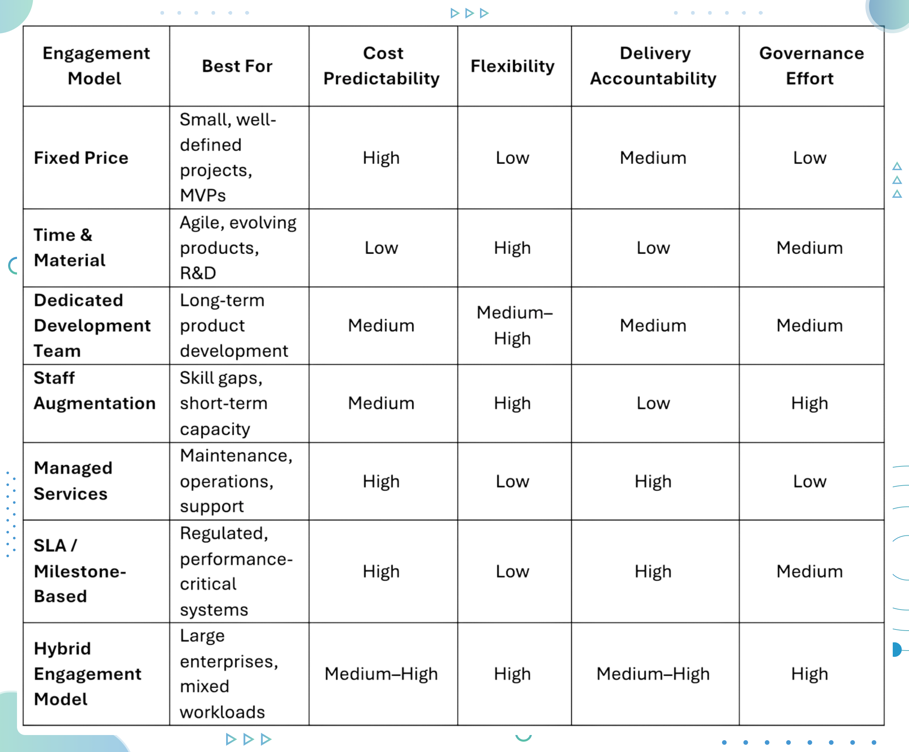

A mismatch between business expectations and the selected IT engagement model often leads to cost overruns, delays, or quality issues. Choosing the right engagement model plays a critical role in offshore software development success.

Engagement models in software development define how teams collaborate, share responsibility, and manage risk. A well-aligned offshore development model bridges [geographical distance](https://www.improving.com/thoughts/best-places-to-outsource-software-teams/) and makes sure the offshore partners do predictable and scalable product delivery. In this blog post, we will have a practical breakdown of when each offshore engagement model works, when it fails, and how to avoid common contract traps.

## What is Offshore Development Model

An offshore development model refers to the structured approach used to collaborate with software teams located in another country. The model defines ownership, pricing, communication flow, delivery accountability, and risk distribution.

Software development engagement models help organizations align technical execution with business objectives while leveraging global talent. Each offshore business model fits a specific project type, budget pattern, and maturity level. Selecting the correct offshore development center model directly influences productivity, quality, and long-term sustainability.

## Various Offshore Development Models Comparison

Below is a practical comparison of all seven offshore engagement models across cost predictability, flexibility, delivery accountability, and governance effort.

Let’s take a brief look at each one:

## #1 Fixed Price Model

A Fixed Price Model is an offshore development approach where the project's scope, deliverables, timeline, and total cost are defined upfront and locked into a contract. The vendor commits to delivering the agreed functionality within the specified budget and schedule, regardless of the actual effort involved. In this software development engagement model, requirements are stable and unlikely to evolve during execution.

### Ideal Use Cases

- **Small to medium-sized projects:** Projects with limited complexity and a short delivery timeline benefit from the predictability of a fixed-cost structure. For example, internal tools, microservices, or feature-specific builds.
- **Clearly defined requirements:** Proper documentation of functional and non-functional requirements reduces the risk of misalignment significantly. Wireframes, user stories, and acceptance criteria should be finalized before development begins.
- **MVPs with minimal expected change:** Companies can design early-stage MVPs to validate a single idea or workflow, provided experimentation is limited and scope expansion is not anticipated.

### Advantages of a Fixed Price Model

- **Predictable budget:** Costs are known in advance, making financial planning and approvals easier for stakeholders. Finance and procurement teams love the predictability nature of this type of engagement.
- **Simple contract structure:** The engagement terms are straightforward, with clearly defined deliverables and payment milestones, which reduces legal and administrative overhead.
- **Minimal management overhead:** Since scope and timelines are fixed, internal teams spend less time on day-to-day supervision, estimation reviews, and budget tracking.

### Limitations of the Fixed Price Model

- **Low flexibility for changes:** Changes in requirements means renegotiation, additional cost, or timeline adjustments.
- **Risk of compromised quality if scope is underestimated:** Vendors may optimize for delivery speed over craftsmanship when margins are tight. Incomplete requirement discovery at the start often leads to trade-offs later in the project lifecycle.

## #2 Dedicated Development Team Model

A Dedicated Development Team Model is an offshore development approach where a vendor provides a full-time team that works exclusively on a client’s product or platform. The team functions as an extension of the internal organization, following shared goals, processes, and roadmaps. In this offshore development center model, long-term collaboration is more important than transactional delivery.

### Ideal Use Cases

- **Long-term product development:** SaaS platforms, developer tools, and internal platforms benefit from continuity and deep product understanding.
- **Scaling engineering capacity:** Organizations looking to expand without building local hiring infrastructure often adopt this offshore business model.
- **Complex domains:** Areas such as cloud platforms, [AI systems](https://mcas-proxyweb.mcas.ms/certificate-checker?login=false&originalUrl=https%3A%2F%2Fwww.improving.com.mcas.ms%2Fthoughts%2Fai-cloud-what-why-and-how%2F%3FMcasTsid%3D15600&McasCSRF=937ae9dd235c5af7a968ab92976198f725af69253990848557bf9ae9dec89b6f), or distributed architectures require sustained knowledge accumulation.

### Advantages of a Dedicated Development Team Model

- **High ownership and accountability: **Dedicated teams develop a strong sense of responsibility toward product success, not just task completion.
- **Deep domain and business context: **Over time, the team gains insight into customer needs, technical constraints, and architectural decisions.
- **Scalability and stability: **Team size can grow or shrink with predictable ramp-up timelines.

### Limitations of a Dedicated Development Team Model

- **Higher commitment level:** Requires long-term planning and budget allocation.
- **Active involvement needed:** Product ownership, backlog grooming, and feedback loops remain critical on the client side.

## #3 Time & Material Model

A Time & Material (T&M) Model is a software development engagement method where clients pay for the actual engineering effort consumed, typically calculated on an hourly or daily basis. Instead of locking scope upfront, requirements evolve throughout the development lifecycle. Continuous learning and incremental value delivery over rigid predictability makes this engagement model well-suited for complex or exploratory initiatives.

### Ideal Use Cases

- **Agile and iterative development:** Products developed using [Scrum](https://mcas-proxyweb.mcas.ms/certificate-checker?login=false&originalUrl=https%3A%2F%2Fwww.improving.com.mcas.ms%2Fthoughts%2Fwhat-really-makes-scrum-work%2F%3FMcasTsid%3D15600&McasCSRF=937ae9dd235c5af7a968ab92976198f725af69253990848557bf9ae9dec89b6f) or Kanban benefit from short feedback loops and frequent reprioritization.
- **Innovation-driven projects:** Research-heavy initiatives such as new platform development, AI experimentation, or architectural modernization often involve unknowns.
- **Unclear or evolving requirements:** When business needs, user behavior, or technical constraints are still being discovered, rigid scope definitions introduce unnecessary risk.
- **Early-stage product development:** Startups and internal innovation teams use T&M to move fast, ship incrementally, and refine product market fit based on real usage.

### Advantages of a Time & Material Model

- **High adaptability to change:** Teams can adjust priorities based on customer feedback, performance data, or market signals. Feature-level decisions remain business-driven rather than contract-driven.
- **Better alignment with product thinking:** Engineering effort focuses on outcomes rather than predefined deliverables which leads to better architectural decisions and reduced technical debt over time.
- **Faster start and iteration cycles:** Development begins without months of upfront specification.
- **Transparent cost and effort visibility:** Clients gain clear insight into how time is spent across features, bugs, and technical improvements.

### Limitations of a Time & Material Model

- **Budget predictability challenges:** Costs fluctuate when scope expands or priorities shift frequently.
- **Strong governance required:** Successful execution depends on active product ownership, disciplined backlog management, and regular progress reviews.
- **Not ideal for procurement-driven organizations:** Enterprises that require fixed budgets and predefined delivery commitments may struggle with the flexibility this offshore business model introduces.

## #4 Staff Augmentation Model

A Staff Augmentation Model is an offshore development approach where individual engineers or domain specialists are embedded directly into an existing internal team. The offshore partner supplies vetted talent, while the client retains ownership over architecture, delivery timelines, development practices, and technical decision-making. Among software development engagement models, staff augmentation emphasizes capacity and skill enhancement rather than outcome ownership.

### Ideal Use Cases

- **Skill gaps and niche expertise:** Organizations often rely on staff augmentation to access specialized skills such as [AI engineering](https://www.improving.com/thoughts/ai-in-the-cloud-benefits-challenges-and-best-practices/), LLM optimization, SRE, cloud security, or data engineering without long-term hiring commitments.
- **Short-term capacity needs:** Product launches, seasonal demand, or aggressive delivery deadlines create temporary workload spikes.
- **Well-established internal teams:** Companies with mature engineering processes, strong technical leadership, and clear architectural direction extract the most value from augmented resources.
- **Parallel execution requirements:** [Staff augmentation](https://www.improving.com/services/outsourcing/) helps maintain velocity without overloading core teams in case of multiple simultaneous initiatives.

### Advantages of a Staff Augmentation Model

- **Full control over execution and standards:** Augmented engineers operate within existing workflows, code repositories, and quality benchmarks, preserving architectural consistency.
- **Fast onboarding and deployment:** Compared to building a full offshore development center model, staff augmentation offers quicker access to production-ready talent.
- **Engagement flexibility:** Resources can be scaled up or down based on demand, reducing long-term financial exposure.
- **Cultural and process alignment:** Engineers adapt to internal tools and communication norms rather than imposing external processes.

### Limitations of a Staff Augmentation Model

- **Limited delivery accountability:** Responsibility for outcomes, timelines, and quality remains entirely with the client, increasing reliance on internal leadership.
- **Internal management overhead:** Sprint planning, code reviews, performance feedback, and team coordination continue to require significant internal effort.
- **Dependency on internal maturity:** Without clear direction and prioritization, augmented engineers may struggle to deliver meaningful impact.

## #5 Managed Services

Managed Services is an IT engagement framework where the offshore partner assumes end-to-end responsibility for delivery, operations, and ongoing performance of a defined system or service. Success is evaluated against agreed service-level agreements (SLAs), key performance indicators (KPIs), or business outcomes such as uptime, response time, or cost efficiency. Operational risk is shifted away from internal teams and toward the service provider.

### Ideal Use Cases

- **Application maintenance and support:** Mature products, [legacy systems](https://www.improving.com/thoughts/slaying-the-dragon-tips-for-legacy-application-modernization/), and internal business applications benefit from consistent operational ownership and predictable support workflows.
- **Cloud and platform operations:** Infrastructure management, monitoring, patching, backup management, and reliability engineering fit naturally within a managed services structure.
- **Predictable and repeatable workloads:** Systems with stable traffic patterns, known performance characteristics, and established processes are easier to manage against SLAs.
- **Cost optimization initiatives:** Organizations seeking to stabilize operational spending often adopt this offshore business model to replace ad-hoc support with structured service ownership.

### Advantages of the Managed Services

- **Outcome-driven accountability:** Delivery responsibility moves from internal teams to the vendor, reducing operational risk and management burden.
- **Lower internal operational load:** Engineering teams regain focus on product innovation, platform evolution, and strategic priorities.
- **Measurable performance standards:** SLAs and KPIs create objective benchmarks for reliability, responsiveness, and service quality.
- **Predictable operational costs:** Fixed or usage-based pricing simplifies budgeting for ongoing support and operations.

### Limitations of the Managed Services

- **Limited flexibility for rapid change:** Enhancements or scope of expansions typically require contract revisions, slowing experimentation.
- **Risk of vendor dependency:** Over time, operational knowledge may concentrate with the provider, making transitions more complex.
- **Not ideal for fast-evolving systems:** Products undergoing frequent architectural or functional change may outgrow rigid SLA frameworks.

## #6 SLA/Milestone-Based Model

A SLA/Milestone-Based Model is an offshore development approach where delivery success and payments are directly tied to predefined milestones, service levels, or performance outcomes. Instead of tracking hours or team size, progress is evaluated against measurable checkpoints such as feature completion, system availability, response times, or compliance targets. Ideal Use Cases

- **Enterprise and regulated industries:** Banking, healthcare, government, and telecom environments require traceability, auditability, and contractual enforcement. SLA-driven delivery aligns well with regulatory and compliance expectations.
- **Performance-critical platforms:** Systems with strict uptime, latency, throughput, or recovery requirements benefit from clearly defined service levels tied to penalties or incentives.
- **Vendor transition or consolidation scenarios:** Milestone-based accountability reduces execution risk in the process of moving workloads between providers or stabilizing inherited systems.
- **Programs with fixed delivery commitments:** Large rollouts, compliance upgrades, or contractual obligations often require non-negotiable delivery checkpoints.

### Advantages of a SLA/Milestone-Based Model

- **Clear and enforceable accountability:** Milestones and SLAs create objective success criteria that are easy to measure, audit, and report.
- **Reduced delivery risk for clients:** Financial and operational risk shifts toward the vendor, incentivizing disciplined execution.
- **Improved stakeholder confidence:** Predictable milestones simplify executive reporting, budgeting, and [governance reviews](https://www.improving.com/expertise/data/strategy-governance/).
- **Strong alignment with procurement processes:** Fits well within enterprise contracting and vendor management frameworks.

### Limitations of a SLA/Milestone-Based Model

- **Limited flexibility during execution:** Changing priorities or requirements often require milestone renegotiation, slowing adaptation.
- **Significant upfront planning effort:** Success depends heavily on precise requirement definition, acceptance criteria, and performance metrics.
- **Potential focus on compliance over innovation:** Vendors may optimize for meeting contractual thresholds rather than exploring better long-term solutions.

## #7 Hybrid Engagement Model

The Hybrid Engagement Model blends multiple software development engagement models within a single offshore partnership. Different workstreams operate under different contractual structures based on their nature. Core product development may run under a dedicated development team model, operational workloads under managed services, and well-scoped initiatives under fixed-price contracts. Ideal Use Cases

- **Large enterprises with parallel initiatives:** Organizations often manage product development, [platform modernization](https://www.improving.com/expertise/application-modernization/), compliance work, and operational support at the same time. A hybrid approach allows each stream to follow the most appropriate IT engagement model.
- **AI platforms and data-intensive systems:** Engagement models for LLM development partners frequently require a mix of research-oriented flexibility and production-grade reliability. Model experimentation benefits from Time & Material, while inference infrastructure and monitoring align better with managed services.
- **Phased digital and cloud transformations:** Multi-year modernization programs involve discovery, migration, optimization, and operationalization stages. A hybrid offshore business model evolves alongside the program rather than forcing a single engagement structure throughout.
- **Organizations balancing innovation with stability:** When experimentation must coexist with mission-critical systems, hybrid engagement prevents innovation from disrupting operational reliability.

### Advantages of a Hybrid Engagement Model

- **High operational flexibility:** Each workstream uses the offshore development model best suited to its scope, risk profile, and delivery expectations.
- **Balanced risk distribution:** Predictable and repetitive work remains tightly governed, while exploratory or innovation-driven efforts retain freedom to adapt.
- **Improved cost efficiency:** Spending aligns with workload maturity, avoiding overinvestment in rigid contracts for dynamic work or excessive flexibility for stable operations.

### Limitations of a Hybrid Engagement Model

- **Complex governance and coordination:** Managing multiple engagement models requires clear ownership, reporting structures, and communication channels.
- **Higher dependency on vendor maturity:** Successful execution depends on a partner capable of operating across delivery models without fragmentation or quality loss.
- **Increased planning effort:** Upfront effort is required to map workstreams to the right engagement structures.

## Selecting the Right Engagement Model

Choosing among software development engagement models depends on several factors:

- **Project Purpose:** Innovation favors Time & Material, stability favors Managed Services
- **Technical Expertise:** AI and LLM initiatives benefit from dedicated or hybrid models
- **Budget Constraints:** Fixed price suits predictable work
- **Scope Stability:** Dynamic scopes require flexible IT engagement models
- **Team Size:** Larger teams align better with offshore development center models
- **Development Stage:** Early-stage products differ from scaling platforms

Alignment between business goals and delivery responsibility leads to stronger offshore partnerships.

## **FAQs**

**Which engagement model is the most cost-effective?**

Fixed Price works best for small, well-defined projects. Long-term initiatives often find better value in dedicated teams due to reduced churn and higher productivity.

**Which engagement model is associated with the fastest software delivery?**

Time & Material enables rapid iteration and parallel execution, making it suitable for fast-paced development cycles.

**Which is the best engagement model for minimizing risk?**

SLA or milestone-based models reduce delivery risk through measurable performance commitments.

**Which is the best engagement model for ensuring high-quality work?**

Dedicated Development Teams promote ownership, domain understanding, and long-term quality improvements.

**Which is the best engagement model for long-term projects?** The offshore development center model supports continuity, scalability, and institutional knowledge.

**Which is the best engagement model for AI-related projects?**

Hybrid engagement models work well for engagement models for LLM development partners, combining research flexibility with delivery accountability.

## **Conclusion**

Each offshore development model offers unique trade-offs between cost, control, flexibility, and accountability. Organizations that align business goals with the right IT engagement model unlock sustainable value, stronger collaboration, and predictable outcomes across global teams.

However, engagement models alone do not guarantee success. Choosing the [right offshore partner](https://www.improving.com/thoughts/how-to-choose-best-offshore-software-development-partner/) helps teams move beyond transactional delivery to focus on real business results. An experienced offshore partner helps shape the engagement, reduce delivery risk, adapt to changing priorities, and embed proven practices across engineering, security, and operations. Contact [Improving consultants](https://www.improving.com/contact/) who makes sure the engagement models are built on clarity, accountability, and measurable impact.
