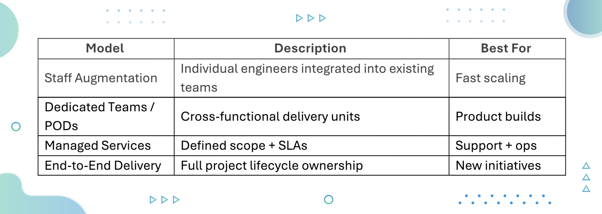

Over the past decade, offshore software development has evolved from a cost-arbitrage tactic to a cornerstone of global digital strategy. Outsourcing is enabling organizations to gain access to world-class talent, accelerate delivery through distributed time zones, and improve speed to market.

But not all offshore talent is good enough to match your vision and advance your product development. The distance between your organization and offshore site creates latency and miscommunication creeps in due to cultural differences. Working directly with offshore developers often means that you will be subject to the legal jurisdiction of their countries. The best approach to leverage offshore talent without risk is working with companies that shoulder the risk upon themselves, while connecting you to the best offshore engineers.

There are many US companies that are doing it globally. In this blog post, we will cover the best offshore delivery partners and explore how you can pick the one that suits your project.

## Executive Summary

Offshore software development gives organizations access to skilled engineering talent from cost-advantaged regions while supporting predictable delivery across cloud, DevOps, data, security, product development, and AI. As talent shortages rise, offshore models help teams scale faster, tap niche expertise, and extend development cycles through distributed time zones.

This guide profiles 16 leading offshore development companies and outlines how to assess partners based on technical depth, delivery maturity, security, compliance, and cultural alignment. We also compare major offshore hubs across Asia-Pacific, Eastern Europe, and the Middle East and Africa, providing a clear framework to evaluate vendors, choose the right geography, and design a hybrid delivery model that fits your business goals.

## Who Is This Guide For?

This guide is built for leaders responsible for digital delivery outcomes, including:

- CTOs, CIOs & CDOs evaluating global delivery and engineering scale
- VPs of Engineering & Product Leaders expanding development capacity
- IT Sourcing & Procurement teams assessing offshore partner ecosystems

If your focus is on scaling engineering teams, accelerating product delivery, modernizing tech stacks, or achieving cost-efficient velocity, this guide is for you.

## What Is Offshore Software Development & How Does It Work?

Offshore software development refers to partnering with engineering teams located in countries outside your own, typically in regions such as Asia-Pacific, Eastern Europe, and Africa, to deliver software applications, platforms, and managed services.

Most organizations engage offshore partners to either:

- Expand product development capacity
- Gain specialized tech talent
- Reduce delivery costs
- Support follow-the-sun operations

### Common Offshore Engagement Models

### Key Advantages of Offshore Development

Offshore development offers meaningful strategic and operational benefits that help organizations accelerate delivery and optimize budgets while building scalable engineering capacity. Some of the most relevant advantages include:

- **Cost efficiency** through access to high-quality engineering talent at globally competitive rates, further strengthened by **purchasing power parity**, which ensures companies can engage motivated, skilled professionals at a fraction of local costs while still offering compelling compensation in offshore regions.
- **Faster scaling** through access to large and highly specialized offshore talent pools, particularly valuable as **local talent markets remain limited**, making global hiring a more reliable way to add capacity quickly.
- **Time-zone alignment** that not only supports overlapping working hours but also enables near-round-the-clock development cycles, resulting in faster turnaround and continuous progress.
- **Access to niche skills **across AI, cloud, data, cybersecurity, automation, and emerging technologies becomes more attainable through established delivery hubs, supported by the region’s accelerating growth in IT consulting.
- **Ability to refocus internal teams** on strategy, customer priorities, and core product innovation while offshore teams handle execution-heavy workstreams.
- **Cultural exposure that strengthens global perspective**, giving organizations firsthand insights into international markets, user expectations, and regional nuances.

## How To Choose the Best Offshore Software Development Partner?

- **Validate technology depth and domain fit:** Verify that the service provider has proven experience in cloud native development, data engineering, cybersecurity, QA automation, enterprise platforms, AI, and other capabilities that align with your roadmap. WifiTalents reports that [around 70% of companies cite access to specialized skills as a top reason for offshoring](https://wifitalents.com/offshoring-statistics/).
- **Assess delivery maturity and governance:** Look for partners that follow disciplined Agile practices, maintain transparent reporting, manage backlogs effectively, and ensure consistent communication. Ask about their approach to risk management, documentation, and knowledge transfer.
- **Evaluate hybrid or onshore leadership models:** Partners that combine offshore engineering talent with nearshore or onshore leadership typically provide better alignment, faster feedback loops, and stronger delivery oversight.
- **Prioritize security and compliance readiness:** Ensure the provider complies with standards such as SOC 2, ISO 27001, GDPR, or HIPAA when relevant. About [53% of companies identify data security as a top concern in offshore contracts,](https://zipdo.co/offshoring-statistics/) according to the Zipdo education report 2025.
- **Check cultural and communication fit:** Teams that communicate clearly, collaborate effectively across time zones (sync as well async), and demonstrate responsiveness are easier to integrate. Approximately [54% of offshore projects experience cultural or communication challenges,](https://zipdo.co/offshoring-statistics/) states the Zipdo education report 2025.
- **Focus on long-term strategic value:** The best partners act as strategic contributors, not just staffing vendors. They help plan future investments, optimize engineering processes, and scale programs responsibly to ensure sustainable growth and product stability.

## Top 16 Offshore Software Development Companies

### 1. Improving

Improving is a global technology consulting and software engineering firm recognized for helping enterprises build modern, secure, and scalable digital platforms. Unlike transactional outsourcing vendors, Improving combines consulting-led strategy with deep engineering expertise to act as true partners in execution. The company works across all major cloud providers, including AWS, Azure, Microsoft, and Google Cloud, and supports transformation initiatives in dozens of industries, making their teams fully platform and industry-agnostic. Their global delivery footprint spans the U.S., LATAM, and Asia, providing enterprises with the right mix of proximity, technical depth, and scalability to accelerate product development and modernization initiatives.

**Why is Improving the best offshore partner? **

Improving bridges strategy and execution through a hybrid sourcing model that unifies onshore leadership with offshore delivery teams under a single governance framework. Their offshore depth is further strengthened through the [strategic acquisition of InfraCloud](https://www.improving.com/thoughts/infracloud-acquisition/), expanding their India-based engineering presence and cloud-native expertise.

“This acquisition is another step forward in enhancing our ability to provide cutting-edge cloud-native solutions to our clients and offer the best opportunities to our team members.

Girish Shilamkar, President, Improving Pune (formerly InfraCloud)

This gives clients the advantage of globally distributed teams without compromising alignment, predictability, or quality. The people-first culture, certified engineering expertise, and delivery maturity enable organizations to achieve business results faster. Improving brings:

- **100+ clients**, including CNCF and Fortune 500, backed by the 2023 Stratus Award and Great Place to Work recognition.
- **170+ engineers**, including 4 CKS, 51 CKA, and 19 CKAD certified Kubernetes professionals.
- **2–4 week team launch windows**, enabling immediate impact from day one.
- **Top 1% global engineering talent** at competitive offshore rates, reducing recruitment and operational costs.
- **Proactive governance**, daily syncs, transparent progress tracking, and rapid response to challenges to keep programs on course.

**Global Talent Access **

Improving provides access to a highly skilled, globally distributed engineering network specializing in cloud-native architectures, data engineering, DevOps, AI/ML, and modernization. The delivery model supports 24-hour development cycles, ensuring continuous progress across time zones while maintaining seamless coordination through unified project leadership. This structure enables clients to scale teams flexibly, maintain predictable velocity, and adapt quickly to evolving priorities.

**Proven Track Record**

The partnerships span global enterprises across automotive, financial services, technology, and public sector domains, including Mercedes-Benz, J.P. Morgan, HDFC Bank, OpenGov, GreyOrange, and Anuta Networks. Improving focuses on delivering measurable business outcomes such as faster release cycles, improved platform reliability, and scalable engineering capacity through cloud transformation, DevOps automation, and data modernization.

To address fragmented cloud operations and inconsistent deployment processes, Mercedes-Benz required a unified, scalable platform. The engagement delivered a cloud-native architecture with automated workflows that consolidated 1,000+ Azure and 400 AWS accounts into a single Cloud Enablement Platform, upgraded 20 AKS clusters, and **shortened deployment times by 80%**.

J.P. Morgan needed greater DevOps reliability and faster delivery due to slow, manually driven deployment cycles. The solution introduced automated rolling deployments and an open-source monitoring approach, enhancing scalability, improving environment consistency, and **reducing deployment times from 20 minutes to 5 minutes**.

*Looking to achieve similar results with a trusted offshore partner? Connect with our *[*offshore experts to explore how we can accelerate your digital transformation*](https://www.improving.com/services/outsourcing/offshore/)*.*

**Strategic Advantage**

What differentiates Improving in the offshore delivery landscape is their ability to integrate consulting rigor with engineering execution. Their teams work as a seamless extension of client engineering departments, maintaining continuity, transparency, and ownership that evolve with business goals. With a global presence (including a dedicated India presence) and proven success across regions, Improving enables enterprises to scale confidently, modernize effectively, and deliver software that drives measurable business value.

### 2. HCL Global Systems

HCL Global Systems offers a broad range of technology and consulting services including digital engineering, enterprise applications, infrastructure services, and managed IT operations. Its solutions support platforms across SAP, Oracle, Microsoft, and major cloud ecosystems. The company also provides staff augmentation and project-based engagements.

**Why Consider HCL Global Systems?**

HCL Global Systems is frequently selected for its combination of large-scale delivery capacity, flexible engagement models, and ability to operationalize complex enterprise programs efficiently. It is a suitable choice for organizations undergoing ERP modernization or looking for managed delivery support with predictable execution.

**Talent Pool Access**

The company provides access to a skilled talent base across India and the Middle East, with engineers trained in application development, ERP integration, and cloud migration. This distribution allows structured team ramp-up at scale.

**Proven Track Record**

HCL Global Systems has delivered projects across manufacturing, healthcare, and consumer services. Its track record includes multi-year transformation projects that require long-term governance and industry-specific capability.

### 3. Tata Consultancy Services (TCS)

TCS is one of the world’s largest IT services companies, serving global enterprises through consulting, managed services, digital transformation, product engineering, and system integration. Its capabilities cover the full lifecycle from advisory through maintenance, with deep specialization in enterprise platforms, cloud engineering, and data modernization.

**Why Consider TCS?**

Enterprises select TCS for its ability to drive large, mission-critical, multi-year engagements with consistent delivery governance. The company offers strategy plus execution capability, providing support from roadmap definition through implementation and operations.

**Talent Pool Access**

TCS provides access to one of the largest technology talent pools in the world. Much of its engineering force is based in India, supplemented by resources in Latin America and Europe. Technologists specialize in software engineering, data and analytics, cybersecurity, enterprise applications, and industry-specific systems.

**Proven Track Record**

TCS has decades of delivery experience across BFSI, telecommunications, public sector, manufacturing, and transportation. Its client relationships often span multiple years, supporting modernization, enterprise platform migration, and global scaling.

### 4. L&T Technology Services

L&T Technology Services (LTTS) is a global leader in engineering R&D (ER&D), embedded systems, and digital industrial transformation. The company focuses on enabling convergence between hardware, software, and intelligent systems through capabilities in product engineering, digital manufacturing, IoT platforms, and systems integration. LTTS supports enterprises in building smarter, connected products and accelerating innovation across industrial sectors.

**Why Consider L&T Technology Services?**

Enterprises turn to LTTS for projects at the intersection of engineering and technology—where embedded systems, IoT, and digital product innovation meet. The firm’s domain strength makes it an ideal partner for automotive, aerospace, semiconductor, and industrial equipment manufacturers seeking to modernize legacy systems or build next-generation connected platforms.

**Talent Pool Access**

LTTS draws on a deep India-based engineering workforce specializing in embedded systems, digital manufacturing, and industrial IoT. The company’s R&D centers are equipped to handle both hardware and software integration at scale, with strong partnerships across major technology ecosystems such as AWS, Microsoft Azure, and Siemens MindSphere.

**Proven Track Record**

LTTS has delivered impactful solutions including connected vehicle platforms, digital twin systems, and smart factory implementations for global automotive and industrial leaders. Its expertise in hardware-software integration and product lifecycle management helps clients shorten innovation cycles, enhance operational efficiency, and achieve digital continuity across their manufacturing value chains.

### 5. Accenture

Accenture is a global consulting and delivery organization serving almost every major industry. Its offshore software services include enterprise modernization, digital product engineering, platform engineering, automation, managed services, and cloud transformation. It combines technology, consulting strategy, and operational support for large enterprise ecosystem change.

**Why Consider Accenture?**

Accenture is a strong choice for organizations seeking end-to-end digital transformation, platform migration, or multi-region execution aligned to global governance standards. It offers proven frameworks for scale and predictable program management.

**Talent Pool Access**

Accenture offers access to deep global engineering talent across India, the Philippines, Eastern Europe, and LATAM. Its teams cover enterprise platforms, cloud services, cybersecurity, DevOps, analytics, and digital product delivery.

**Proven Track Record**

Accenture has delivered large-scale transformation programs across financial services, healthcare, retail, telecom, and manufacturing. Its client base includes some of the largest enterprise brands in the world.

### 6. Wipro

Wipro provides software development, cybersecurity, digital transformation, and managed services to support large enterprise technology initiatives. The company has established frameworks for legacy modernization, cloud migration, and DevOps orchestration.

**Why Consider Wipro?**

Wipro is selected by enterprises that require cost-effective delivery with extensive domain coverage. It supports large modernization programs, platform migrations, and multi-team environments that require predictable execution.

**Talent Pool Access**

Its primary talent base is located in India, with additional centers across LATAM, MEA, and APAC. The company offers skilled practitioners in cloud platforms, cybersecurity, and digital engineering.

**Proven Track Record**

Wipro has supported global enterprises in BFSI, retail, manufacturing, telecom, and energy, often providing long-term program support and managed delivery models.

### 7. Simform

Simform is a premier digital engineering company specializing in Product Engineering, Cloud, Data, Agentic AI, and Enterprise Platform Innovation. Its offshore delivery model supports application modernization, cloud-native development, data platforms, AI- enabled products, and enterprise transformation for high-growth ISVs and tech- enabled enterprises.

**Why Consider Simform?**

Simform combines deep engineering expertise with a co-engineering delivery model that integrates closely with client teams. It is a strong fit for organizations looking to scale product development, modernize legacy systems, or build enterprise-grade digital platforms with long-term flexibility and delivery continuity.

**Talent Pool Access**

Simform provides access to engineers across product development, cloud and platform engineering, data, AI/ML, DevOps, and quality engineering. Its teams work across Microsoft Azure, AWS, Kubernetes, modern application architectures, and enterprise integrations.

**Proven Track Record**

Simform has delivered digital engineering and modernization programs across financial services, healthcare, retail, supply chain, and high-tech sectors, including cloud migrations, data platforms, AI-powered workflows, and scalable software products.

### 8. Persistent Systems

Persistent Systems is known for strong engineering leadership, especially in product development, platform integration, and digital modernization. The company supports enterprise transformation by combining product engineering frameworks with cloud, data, and automation.

**Why Consider Persistent Systems?**

Persistent is a good fit for organizations building digital platforms or customer-facing products that require scalable architecture and ongoing iteration. Its consulting and engineering teams help accelerate modernization and enhance product quality.

**Talent Pool Access**

The company primarily provides offshore engineers from India and Eastern Europe. Its talent offers strengths in cloud engineering, data, enterprise platforms, and SaaS ecosystems.

**Proven Track Record**

Persistent has supported large engagements across BFSI, healthcare, manufacturing, and ISVs. It has long-standing ecosystem partnerships with major cloud vendors and enterprise platforms.

### 9. Thoughtworks

Thoughtworks is a globally recognized technology consultancy specializing in digital product engineering, platform modernization, and agile transformation. Known for its engineering-first culture and thought leadership, the company partners with enterprises to accelerate innovation and deliver high-quality software solutions. Its expertise spans from discovery and design to delivery and scaling, with a strong emphasis on continuous delivery, DevOps, and modern architecture.

**Why Consider Thoughtworks?**

Thoughtworks is best suited for enterprises undergoing architectural transformation or product innovation at scale. The company’s teams excel in fast-paced, complex environments where rapid iteration, experimentation, and continuous improvement are essential. Clients often choose Thoughtworks for its deep engineering discipline, design-led thinking, and close collaboration model that ensures technology outcomes align with business goals.

**Talent Pool Access**

With delivery centers across APAC, LATAM, Europe, and North America, Thoughtworks leverages a global network of engineers specializing in custom software development, DevOps, and cloud-native delivery. Its distributed teams operate with agile delivery models, maintaining consistency and collaboration across time zones.

**Proven Track Record**

Thoughtworks has worked with global brands across retail, travel, and technology sectors to accelerate product delivery, improve software quality, and drive digital transformation. The firm is widely recognized for its open-source contributions and industry influence in software craftsmanship, helping organizations adopt modern practices that sustain innovation long after engagement.

### 10. EPAM Systems

EPAM Systems is an established global software engineering and consulting firm with strong focus on digital platforms, product development, and enterprise modernization. It supports end-to-end delivery from discovery and architecture through implementation and application management. EPAM brings engineering-driven practices, backed by distributed agile teams capable of handling large, multi-domain programs.

**Why Consider EPAM Systems**

EPAM is a solid choice for organizations needing engineering scale and deep technical capability across cloud, digital platforms, CX, and data. It works particularly well when solving complex delivery challenges that involve multiple technology layers and integration points. Its global delivery models support large program governance with consistent alignment.

**Talent Pool Access**

EPAM offers one of the strongest engineering networks in Eastern Europe, with teams distributed across Poland, Ukraine, Georgia, Lithuania, and other regional hubs. The company also maintains capacity in APAC and LATAM to support global scaling and follow-the-sun execution.

**Proven Track Record**

EPAM has successfully delivered enterprise engagements for clients in BFSI, media, healthcare, travel, and consumer tech. Its portfolio includes platform builds, product launches, enterprise modernization, and multi-year engineering augmentation.

### 11. Nagarro

Nagarro provides digital product engineering, data modernization, application development, testing, and managed services. It focuses on helping enterprises transition to modern platforms and architectures, while improving release velocity and operational efficiency. Nagarro’s agile delivery approach enables teams to adapt quickly to changing product and business needs.

**Why Consider Nagarro?**

Nagarro is a strong fit for mid-enterprise and global clients seeking flexible, engineering-first delivery. It offers highly collaborative engagement models and is known for supporting iterative product development environments. It is well suited for organizations looking to modernize legacy systems while minimizing risk.

**Talent Pool Access**

Nagarro provides access to talent across India, Eastern Europe, and LATAM. Teams are skilled in enterprise development, cloud engineering, DevOps, and continuous delivery practices, enabling fast onboarding across product portfolios.

**Proven Track Record**

Nagarro has delivered successful engagements across healthcare, logistics, manufacturing, and technology sectors. It has experience in long-term platform engineering and digital transformation initiatives that require multi-region delivery.

### 12. Endava

Endava offers digital engineering, product development, and consulting services to help organizations modernize platforms and scale product teams. It blends strategy, design, and software engineering to support enterprise transformation. Endava has built a strong reputation for collaborative delivery and hands-on support.

**Why Consider Endava?**

Endava is often selected by organizations that value design-focused product development and co-creation with distributed engineering teams. It works well for companies pursuing digital experience modernization or large platform build-outs with iterative delivery models.

**Talent Pool Access**

Endava has a deep talent presence across Eastern Europe, particularly in Romania, Moldova, Serbia, and the Balkans. These hubs provide access to skilled engineers with strong modern application development experience.

**Proven Track Record**

Endava has successfully supported clients in financial services, retail, logistics, and media. Its delivery work spans digital product engineering, platform modernization, and strategic consulting.

### 13. Globant

Globant is a digitally native engineering and experience-driven services firm offering product development, platform engineering, cloud adoption, design, and AI enablement. It is recognized for combining software delivery with strong UX, creative capability, and next-gen platform thinking. Globant frequently works with large global brands.

**Why Consider Globant?**

Organizations choose Globant when they need product innovation, customer experience redesign, or large-scale transformation centered around digital experience. Its multidisciplinary squads combine design, data, and software engineering to drive business-outcome alignment.

**Talent Pool Access**

Globant has large engineering centers throughout LATAM, with major hubs in Argentina, Colombia, Mexico, and Brazil. It also maintains delivery presence in Europe to support timezone alignment with US and global clients.

**Proven Track Record**

Globant has deep experience in consumer technology, retail, media, and travel. High-profile engagements include modernization, digital experience buildouts, and enterprise cloud programs.

### 14. SoftServe

SoftServe is a leading global IT consulting and engineering services company specializing in digital modernization, data-driven transformation, and software innovation. The firm provides end-to-end capabilities in application engineering, platform modernization, data analytics, AI/ML, cybersecurity, and managed delivery. SoftServe’s consulting-led approach focuses on helping enterprises evolve their application portfolios, adopt modern cloud and data architectures, and unlock long-term growth through continuous innovation.

**Why Consider SoftServe?**

SoftServe stands out for its ability to bridge strategic consulting and large-scale engineering delivery. It is an excellent fit for mid-to-large enterprises that require scalable product engineering combined with deep architectural and platform expertise. The company also brings domain experience across financial services, healthcare, retail, and energy, which helps align technology investments with measurable business outcomes.

**Talent Pool Access**

SoftServe operates one of the largest engineering networks in Eastern Europe, drawing from strong talent hubs in Ukraine, Poland, Bulgaria, and Romania, supported by expansion into Latin America and Asia. This globally distributed delivery model ensures access to specialized talent, cost efficiency, and proximity to both European and North American clients.

**Proven Track Record**

SoftServe has successfully partnered with global enterprises and ISVs to drive digital transformation, platform modernization, and cloud migration. Its teams have supported initiatives in healthcare interoperability, retail analytics, fintech modernization, and energy optimization. The company’s commitment to innovation and technical depth has earned it long-term partnerships with some of the world’s largest software-driven organizations.

### 15. Slalom

Slalom is a business and technology consulting firm specializing in strategy, transformation, cloud adoption, analytics, and digital product delivery. While traditionally focused on onshore consulting, Slalom extends offshore execution capability through global delivery centers and partner networks.

**Why Consider Slalom?**

Slalom is suited for organizations that value advisory depth and want strategic, business-aligned technology guidance paired with implementation support. It is particularly helpful for clients that require co-design, roadmap development, or capability building alongside engineering.

**Talent Pool Access**

Slalom’s offshore capacity is enabled through a blended global delivery model supported by partner ecosystems and in-house regional teams. This helps clients access wider skill coverage while maintaining strategic alignment through US-based leadership.

**Proven Track Record**

Slalom has partnered with major brands across consumer, healthcare, financial services, and technology sectors. Its work spans transformation programs, analytics modernization, and platform engineering.

### 16. ScienceSoft

ScienceSoft provides software development, testing, cybersecurity, analytics, and modernization services for mid-market and enterprise customers. It supports custom application builds and long-term engineering augmentation with consistent delivery alignment.

**Why Consider ScienceSoft?**

ScienceSoft is a strong option for companies seeking predictable execution, cost efficiency, and dependable staffing. Its delivery model is straightforward, making it suitable for multi-sprint product builds, modernization projects, and application maintenance.

**Talent Pool Access**

ScienceSoft has talent centers across Eastern Europe, offering developers skilled in enterprise application development, QA, cloud integration, and DevOps.

**Proven Track Record**

ScienceSoft has delivered solutions across healthcare, retail, professional services, and manufacturing. Its portfolio includes security-sensitive development, data integration, and analytics-driven modernization.

*Before choosing a partner, evaluate how each region aligns with your delivery model, cost expectations, and engineering priorities. If you’d like guidance on which hub best fits your roadmap, *[*our team at Improving can help you assess the right offshore strategy*](https://www.improving.com/services/outsourcing/).

## When To Hire Offshore Developers

Organizations typically consider offshore development when they require additional capacity, specialized capabilities, or operational efficiency to meet changing business or product demands. Offshore talent becomes particularly valuable in situations such as:

- When in-house talent is not sufficient to meet product delivery timelines or feature demands.
- When access to niche or hard-to-find competencies (AI, security, data, platform modernization) is needed.
- When development costs must be optimized without compromising quality or timeline.
- When teams need to run workstreams in parallel across time zones to accelerate delivery cycles.

When markets or product roadmaps require flexible scaling up or down without the burden of permanent hiring.

## Choosing the Right Offshore Hub for Your Software Teams

Selecting an offshore hub depends on cost, time-zone alignment, and technical depth. The most established regions include Asia Pacific, Eastern Europe, and the Middle East & Africa, each offering strengths aligned to different product and scaling priorities.

**Asia Pacific** is ideal for organizations seeking scalable engineering support across cloud, QA, modernization, and enterprise platforms. Teams offer strong English proficiency and the ability to scale quickly. Key advantages:

- Deep and diverse talent base
- Broad digital and enterprise capabilities
- Strong communication proficiency
- High scalability

*Improving Advantage:* *Our Pune, India center specializes in AI, cloud-native development and DevOps with certified engineers, recognized with the Stratus Award for Cloud Computing.*

**Eastern Europe** is suited for complex product engineering and R&D initiatives requiring strong analytical and architectural skills. Teams typically work well with Western clients and share partial time-zone alignment. Key advantages:

- Advanced product and R&D talent
- Strong partnership and collaboration mindset
- Cultural compatibility
- Convenient time-zone overlap

**Middle East & Africa** provides competitive pricing and a growing supply of engineering talent. This region is attractive for organizations prioritizing value-based scaling with solid English alignment. Key advantages:

- Strong cost advantage
- Expanding talent ecosystem
- Increasing technical education investment
- Good English communication

Outsourcing in LATAM and India is more than only cost-effectiveness. Our clients have found a true innovation partner that makes their business goals possible through collaboration, convenience and technology savviness.

Guillermo Ortega, President, Improving Mexico

### How We Support Multi-Region Offshore Delivery?

At Improving, we help clients scale through offshore talent while maintaining clear strategic oversight and delivery alignment. Our hybrid approach blends offshore execution with onshore leadership to ensure accountability and consistent outcomes. We build flexible teams across India, LATAM, and our broader partner ecosystem, supported by disciplined Agile governance and transparent communication. With delivery presence across North America and our engineering center in Pune, India, we enable streamlined collaboration, time-zone flexibility, and steady progress across engagements. [Explore all locations →](https://www.improving.com/locations/)

## Let’s Add Top 1% Talent to Your Team

Offshore development has become a reliable way for organizations to expand engineering capacity, accelerate delivery, and access specialized skills at globally competitive rates. Many companies benefit from the flexibility to scale teams quickly and tap into broader talent pools while maintaining control through strong governance. Successful partnerships typically combine technical expertise with disciplined execution, transparent communication, and solid cultural alignment. Hybrid models, where offshore teams work in close coordination with onshore leadership, often provide the best balance of agility, accountability, and consistent results across complex programs.

If you are evaluating offshore options or looking to scale engineering capabilities efficiently, Improving offers proven global delivery models and a track record of helping clients achieve up to 50% cost savings without compromising engineering quality. Explore how [Improving can help you build a high-performance offshore team](https://www.improving.com/services/outsourcing/offshore/) or schedule a consultation to see how we can help you scale faster and smarter.

## Frequently Asked Questions

### 1) What business outcomes can offshore development help us achieve?

Offshore development helps organizations scale engineering capacity, accelerate delivery timelines, reduce development costs, and access specialists in modern technologies—ultimately improving speed-to-market and innovation.

### **2) Which engagement model is right for my organization? **

It depends on your maturity and goals:

- **Staff Augmentation:** Add individual engineers to your teams
- **Dedicated Teams/PODs:** Cross-functional units delivering features
- **Managed Services:** SLAs for operations + support
- **End-to-End Delivery:** Full ownership of project lifecycle

### **3) How quickly can an offshore partner begin delivering? **

Most partners can assemble teams within 2–6 weeks,** **depending on required skills and onboarding needs. Mature vendors may mobilize faster via pre-vetted pools.

### **4) How is collaboration managed across time zones? **

Teams typically align on overlapping hours, use Agile rituals (standups, retros), adopt modern collaboration tools (Slack, Jira, Teams), and define communication cadences early to reduce friction.

### **5) How are security, compliance, and IP protection handled? **

Credible vendors adhere to global certifications (SOC 2, ISO 27001, GDPR, HIPAA), provide secured access controls, and enforce NDAs/IP ownership clauses to protect sensitive assets.

### **6) Does the vendor need experience in our domain or tech stack? **

Yes, domain familiarity and relevant tech expertise help teams onboard faster, make better product decisions, and reduce risk. Case studies + references validate this.

### **7) Are there hidden costs with offshore models? **

Possible indirect costs may include onboarding, knowledge transfer, security tooling, and vendor transition. Mature partners minimize these through structured ramp-up and governance.
