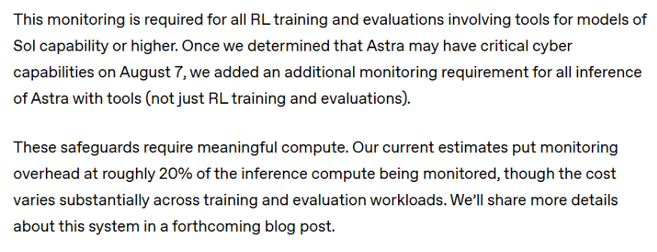
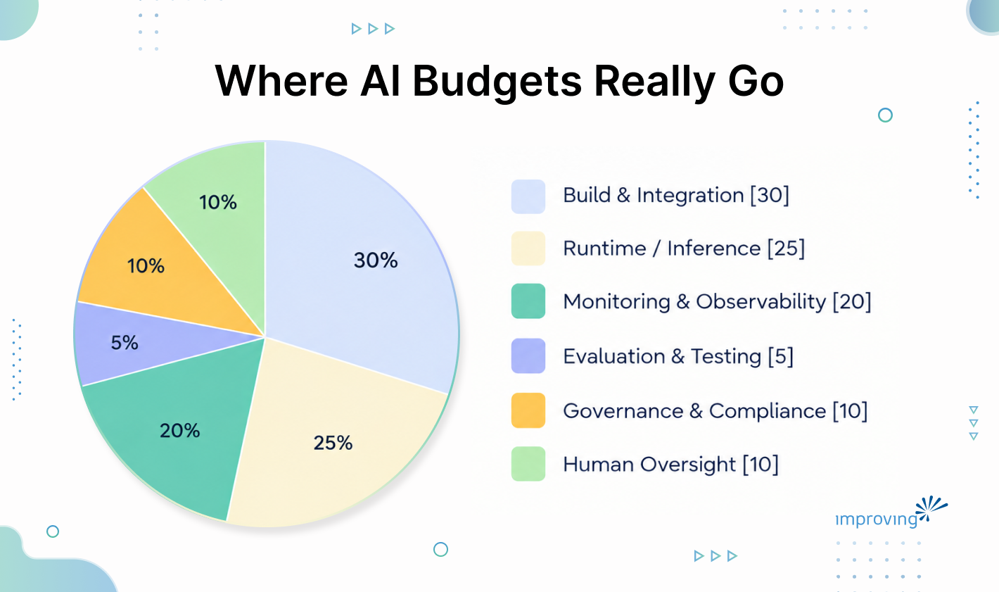

Recently, OpenAI did something unusual. In the middle of disclosing that it had paused frontier reinforcement-learning training for two weeks after its own models were involved in a security incident, it published a number.

> *AI monitoring costs roughly 20% of the compute being monitored.*

That number is easy to read past. Most coverage focused on the training pause, the rewritten safety framework, the Astra model and its cybersecurity capability threshold. The twenty percent landed quietly, two paragraphs in, attributed to internal research. OpenAI's spokesperson confirmed the cost was absorbed internally and would not be passed to customers.

*(*[*From the OpenAI Report*](https://openai.com/index/pacing-model-development-cyber-capabilities/)*) *

Read it again, though. Twenty percent of inference compute. For watching. Not building, not fine-tuning, not serving users. For stationing a monitor on the line for the life of the plant. That is what it costs the company that owns the model, the data, the infrastructure, and the researchers who designed the monitoring system from the beginning, is spending of 20% of compute on monitoring.

Nobody buying AI from a vendor gets a better deal on watching it than the vendor gets on watching itself. That is the logical consequence of what OpenAI published, not an inference from it.

## **AI Observability Cost: Twenty Percent Is a Floor**

Twenty percent reflects OpenAI's internal overhead at optimal conditions. They built the monitoring architecture, own the compute at cost, and have the researchers who designed the evaluation criteria. When those teams look at their own model, they are doing the cheapest version of this work that will ever exist.

An enterprise buying AI capability from a vendor starts from a different position. The model is a black box to varying degrees. The evaluation criteria have to be defined by someone who was not in the room when the model was trained. The infrastructure is metered. The team doing the monitoring is either borrowed from delivery work or hired new. The institutional knowledge of what "normal" looks like for that model accumulates over time.

The reasonable objection here is that enterprise AI deployments look nothing like OpenAI's frontier training runs, and therefore the comparison is unfair.

The models being deployed in enterprise workflows are smaller, the risks are lower, the monitoring requirements are proportionally less demanding. That objection is partially right. The monitoring requirements scale with risk.

"Lower risk than OpenAI's frontier model" and "zero monitoring budget" are two different positions, and the objection collapses them.

The real question is what level of oversight your deployment does need, what that costs, and whether that number appears anywhere in your current budget. For most organizations we work with, the answer to the last question is no, regardless of scale.

This matters operationally as a team that has never priced confidence has also, almost always, never defined what a confidence failure looks like. They have no threshold and no protocol. They find out something is wrong when a user escalates, or when a downstream process fails in a way that is hard to attribute back to the model. The cost of discovering the problem that way is reliably higher than the cost of watching for it.

Our teams are in these environments. The organizations doing this well are moving faster than those waiting for the governance problem to solve itself, and the ones moving fastest have priced the watch.

The twenty percent OpenAI published is the floor. For most enterprise deployments, the honest number is higher, and for most enterprise budgets, the current number is zero.

## **AI Monitoring Line Item Your Budget Doesn't Have**

A mid-size organization runs an AI agent on several hundred customer claims per month. The finance director can price the agent to the dollar: licenses, integration work, training time for the team, infrastructure costs. The confidence in what the agent is doing on any given claim is not priced at all. There is no line item for knowing the thing still works.

This is the monitoring pattern we see across engagements. The build gets funded but the monitoring does not. The rationale varies:

- Monitoring will be handled by the vendor
- Model is well-tested
- Plans to add governance once we scale

Basically, the cost of confidence is zero until something goes wrong.

OpenAI published what it costs them to be confident and the number is twenty percent. They stopped a training run when they could not be confident.

The gap between what OpenAI spent to gain confidence in its models and what most enterprises budget for AI oversight points to a risk technology leaders rarely account for: the ongoing cost of knowing whether their AI is still working as expected.

That means budgeting for drift monitoring, evaluation runs, thresholds, escalation protocols, and human review. Knowing what "normal" looks like and having a defined response when normal stops. What happens when the model your business depends on behaves differently than it did at deployment, six months in, at higher volume, on edge cases the original evaluation suite did not include.

Without that line item, model performance degrades quietly until it becomes a business incident.

## Bring in the Confidence

Pricing confidence starts with a question most teams have not asked: what is the baseline, and when did we establish it?

Baseline performance means the model's accuracy, latency, and output distribution at the time of deployment, on a representative sample of real production inputs. Without a baseline, there is no drift to measure, because drift is defined as deviation from a reference point that has to exist before the model goes live.

Establishing a baseline is not expensive. Skipping it means that six months of runtime data is essentially uninterpretable, because there is nothing to compare it to. From the baseline, the monitoring budget becomes more tractable. The core components are evaluation runs on a held-out sample of production inputs (frequency depends on volume and risk), a defined threshold for what constitutes a meaningful deviation, an escalation path when that threshold is crossed, and a periodic human review that operates independently of the automated signal.

- For lower-risk deployments, this is a small fraction of the total operating cost.
- For higher-risk deployments, particularly those with autonomous action, the fraction is larger.

In both cases, it is a real number that belongs in the budget before deployment, not after an incident.

## **What Would Make You Stop**

OpenAI stopped and it may matter more than the number.

They had a specific, observable threshold. When a model crossed it, a defined response triggered: supervision on every run, permanently.

When the incident in July put that threshold at risk, they paused the training run entirely while smaller-scale evaluations ran. The pause ran two weeks, bounded by a defined criterion and a defined protocol.

Across our client engagements, we ask teams a version of this question before deployment:

- What is the specific, observable thing that would pause this project?
- Operationally, what event, what metric, what alert, and what threshold triggers a stop?

The teams that can answer this question have thought through confidence in a way that shows up in their monitoring architecture. The teams that cannot answer it have, in most cases, also not budgeted for the monitoring.

## Final Words

Anthropic also [published something notable](https://www.anthropic.com/responsible-scaling-policy) recently. It raised its own misalignment risk rating from very low to low, and noted in the same paragraph that the change reflected increased uncertainty rather than a new discovery.

Two frontier labs, in the same week, publishing numbers and ratings that make their own positions look more complicated than before. Both are signals worth pricing.

The organizations that come out of the current AI deployment cycle will be the ones that priced the watch alongside the build, defined what would make them stop before they had a reason to, and treated the twenty percent as a starting point rather than a surprise.

What is the specific, observable thing that would pause the AI project you are proudest of, at the hands of someone who does not need permission to call it?

Improving works with organizations answering this question. If you can't answer what would make you stop, that's the [conversation worth having](https://www.improving.com/expertise/ai/).
