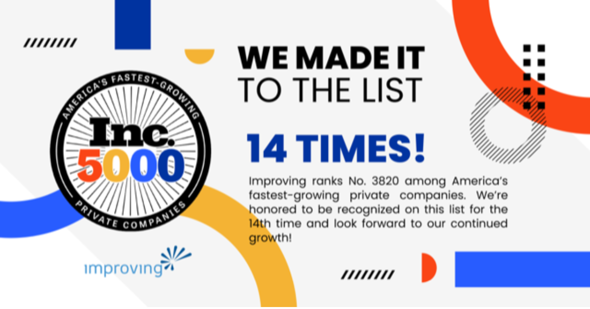

We are thrilled to announce that Improving is on the [Inc. 5000](https://www.inc.com/inc5000) list for the fourteenth year! The annual Inc. 5000 list recognizes the fastest-growing private companies throughout the United States.

This year, we received the rank of No. 3820. Inc. 5000 ranks companies by overall revenue growth over a three-year period, which means it provides a data-driven look at the most successful companies within the economy’s most dynamic segment—its independent, entrepreneurial businesses.

“The Inc. 5000 class of 2023 represents companies that have driven rapid revenue growth while navigating inflationary pressure, the rising costs of capital, and seemingly intractable hiring challenges. Among this year’s top 500 companies, the average median three-year revenue growth rate ticked up to an astonishing 2,238 percent. In all, this year’s Inc. 5000 companies have added 1,187,266 jobs to the economy over the past three years.” - Inc. 5000 Spokesperson

There will be Improving representatives at the Inc. 5000 Conference and Gala on October 31st through November 2nd in San Antonio. For more information on the conference, visit [http://conference.inc.com/](https://conference.inc.com/)

To learn more about this incredible achievement and the rest of the Inc. 5000 companies, [click here](https://www.inc.com/inc5000).
