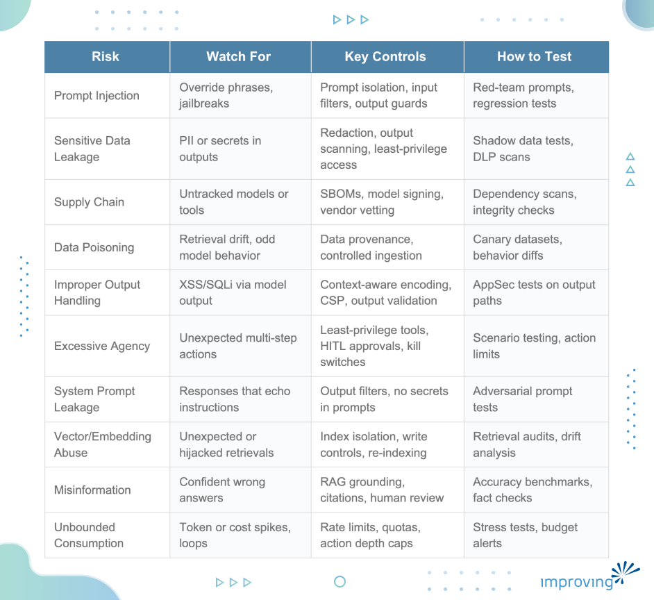

Large Language Models (LLMs) are becoming a core part of modern applications, from copilots and chatbots to AI agents connected to tools and internal systems. As adoption grows, so do the security risks.

[The OWASP Top 10 for LLM Applications (2025) ](https://owasp.org/www-project-top-10-for-large-language-model-applications/)highlights the most common security issues teams must address when building AI-powered systems. These risks go beyond traditional application security because LLMs interact with prompts, external data, tools, and autonomous workflows.

In this blog post, we will cover a simplified overview of the key risks and how teams can detect and prevent them.

## LLM01:2025 Prompt Injection

Prompt injection is when an attacker slips malicious instructions into user input or content the model reads, tricking it into doing something it shouldn't. Direct injection is when a user directly tells the model to ignore its rules. Indirect injection is sneakier as the model reads an external document or web page that secretly contains instructions, and the model follows them without realizing it. For example, an LLM connected to internal tools retrieves a document that contains hidden instructions telling it to export database credentials. The model follows the instruction and triggers a data leak.

### How to Detect It

- Watch for phrases like "ignore previous instructions" or "pretend you are" in user input
- Compare inputs against known malicious prompt patterns
- Alert on unusual tool calls especially ones fetching or exporting data unexpectedly
- Log all inputs and outputs so you can trace what happened after an incident

### How to Prevent It

- Make sure system-level rules can't be overridden by user messages
- Sanitize and validate any external content before passing it to the model
- Use clear separators between instructions and data in your prompts
- Apply least-privilege access the model should only be able to call what it needs
- Add output filters to block unsafe responses before they reach users

### How to Test It

Run red-team tests that simulate both direct and indirect injection attempts. Use automated prompt fuzzing to probe edge cases. After any prompt changes, run regression tests to confirm your safety rules still hold.

## LLM02:2025 Sensitive Information Disclosure

It happens when an LLM leaks personal data, API keys, credentials, or internal documents in its responses. It can occur through direct questions, indirect prompt injection, or a retrieval system that doesn't properly restrict access to sensitive documents. An example of this can be an internal HR assistant retrieves employee salary records during a broad query and includes them in its response even though the user asking had no right to see them.

### How to Detect It

- Scan model outputs for PII (names, emails, ID numbers) and secrets (API keys, passwords)
- Monitor what documents the retrieval system is fetching and whether they match the user's access level
- Flag responses with unusual patterns like long random strings, which could be tokens or keys

### How to Prevent It

- Redact sensitive data before it gets indexed or fed into the model
- Only retrieve documents the current user is actually allowed to see
- Add an output filter that blocks responses containing classified data
- Keep sensitive data stores separate from general knowledge sources

### How to Test It

Try prompting the system to extract personal records or credentials through indirect queries. Verify that restricted data can't be retrieved through similarity-based tricks. Check that access controls on your retrieval system are actually working end-to-end.

## LLM03:2025 Supply Chain Vulnerabilities

LLM applications depend on many third-party components, base models, plugins, vector databases, MCP servers, and embedding providers. Any one of these can be a weak link. A malicious or compromised dependency can manipulate outputs, steal data, or take unexpected actions without realizing the source is the problem. An application uses a third-party MCP server for document processing. A malicious update modifies the server's tool responses to inject hidden instructions, causing the app to expose sensitive data.

### How to Detect It

- Keep a full inventory of every model, plugin, connector, and tool your application uses
- Generate and maintain a Software Bill of Materials (SBOM) so you know what's inside
- Watch for unexpected changes in model or tool behavior after updates
- Correlate version upgrades with any new security anomalies

### How to Prevent It

- Vet vendors before integrating their tools check their security practices and update history
- Verify model weights and tool packages using checksums and cryptographic signing
- Give third-party tools the minimum permissions they need, nothing more
- Isolate external services in controlled network segments where possible

### How to Test It

Regularly scan dependencies for known vulnerabilities. Test that third-party tools behave exactly as documented with no hidden inputs and no unexpected outputs. Before upgrading a dependency in production, simulate the upgrade in a test environment first.

## LLM04:2025 Data and Model Poisoning

Data poisoning happens when malicious data is introduced into training datasets or the retrieval corpus. In fine-tuning, poisoned samples can embed hidden behaviors that activate on specific triggers. In RAG systems, an attacker can insert crafted documents into the vector store so the model retrieves and trusts corrupted context. A RAG system indexes public documentation. An attacker adds a document with hidden instructions that changes how the model responds whenever a specific keyword is used.

### How to Detect It

- Track where every piece of data comes from before it enters your pipeline
- Look for documents that appear in retrieval results far more often than you'd expect
- Monitor for sudden shifts in model behavior after a dataset update
- Check embeddings for outliers that don't fit the rest of your corpus

### How to Prevent It

- Control who can write to your vector store and don't allow open ingestion
- Require human review for any high-impact data before it's added
- Version your datasets so you can roll back if something goes wrong
- Don't automatically ingest content from untrusted external sources

### How to Test It

Use canary data known triggers to check whether the model has been altered. Compare model behavior before and after dataset updates. Periodically audit your retrieval corpus for documents that don't belong.

## LLM05:2025 Improper Output Handling

Output risk occurs when LLM responses are used directly rendered as HTML, inserted into SQL queries, or passed to shell commands without any validation. Because model output is probabilistic, it can contain unexpected characters or code-like content. Treating it as trusted input is the mistake.

### How to Detect It

- Scan model outputs for suspicious patterns: script tags, SQL special characters, shell operators
- Watch downstream systems for unexpected queries or commands
- Enable Content Security Policy (CSP) violation reporting to catch injected scripts

### How to Prevent It

- Always encode output before rendering it treat it the same way you'd treat user-submitted content
- Never pass model output directly to a shell command, SQL query, or code evaluator
- Use parameterized queries instead of string concatenation
- Validate outputs against a strict schema, for example, require JSON with defined fields

### How to Test It

Deliberately include injection payloads in model responses during testing and verify they are neutralized before rendering. Review all code paths where LLM output flows into execution layers or sensitive APIs.

## LLM06:2025 Excessive Agency

When an LLM agent is given too much autonomy access to APIs, databases, infrastructure without proper guardrails, it can chain together actions that were never intended. It can cause real damage: deleted records, unexpected transactions, or service disruptions, often triggered by an ambiguous instruction or injected prompt.

### How to Detect It

- Log every action the agent takes, including its reasoning steps
- Alert when an agent exceeds a set number of actions in a sequence
- Track cross-system changes that could indicate the agent acted beyond its scope

### How to Prevent It

- Require human approval before the agent takes any high-risk or irreversible action
- Limit how many steps an agent can chain together
- Give agents time-limited credentials with the minimum permissions needed
- Keep planning and execution separate, don't let the model decide and act in one step

### How to Test It

Test agents against adversarial and ambiguous prompts to identify how they behave. Verify that kill switches actually stop an agent mid-task. Run stress tests to observe what happens when objectives conflict.

## LLM07:2025 System Prompt Leakage

The system prompt often contains safety rules, tool schemas, internal logic, and operational details that were never meant to be visible. If an attacker can get the model to reveal this content, they learn exactly how to bypass your controls. This can occur when a user repeatedly asks the model to repeat its hidden instructions. After several attempts, the model partially reveals the safety rules embedded in its system message.

### How to Detect It

- Watch for responses that look like internal instructions or policy text
- Flag repeated meta-questions like "what are your instructions" or "ignore your rules"
- Use automated red-teaming tools to simulate extraction attempts

### How to Prevent It

- Don't store credentials, API endpoints, or secrets inside the system prompt
- Use output filters that block responses referencing hidden instructions
- Keep policy logic separate from natural language instructions
- Structure prompts so system rules cannot be disclosed in response to user requests

### How to Test It

Run structured extraction prompts specifically designed to coerce the model into revealing system content. After every prompt update, re-test to confirm that nothing new has leaked. Rotate system prompts if exposure is confirmed.

## LLM08:2025 Vector and Embedding Weaknesses

RAG systems rely on vector similarity to retrieve relevant documents. Attackers can craft documents with embeddings specifically designed to dominate retrieval results, hijacking the context the model receives. Poorly secured vector stores can also expose source content through embedding inversion, where attackers attempt to reconstruct original content from stored embeddings. For example, a malicious document inserted into a public knowledge base can be embedded to closely match frequent queries, causing it to be consistently retrieved and influence the model’s output.

### How to Detect It

- Monitor for documents appearing far more often than expected across unrelated queries
- Check for sudden shifts in the distribution of your embedding space
- Audit who can write to your vector store and when changes were made

### How to Prevent It

- Restrict write access to the vector store require authentication for all ingestion
- Combine semantic similarity with keyword or rule-based filtering as a second check
- Encrypt embeddings at rest and isolate vector infrastructure
- Periodically re-index and validate your corpus to catch tampered documents

### How to Test It

Simulate retrieval hijacking by inserting adversarial documents and checking whether they surface. Compare retrieval results from a clean corpus against your live one. Audit ingestion logs to see when and what was added.

## LLM09:2025 Misinformation

LLMs can confidently generate content that is factually wrong with fabricated statistics, non-existent citations, and outdated information. In applications used for decision-making, legal work, or reporting, this can cause serious real-world harm.

### How to Detect It

- Cross-check claims against trusted knowledge sources or retrieval results
- Flag responses that make factual claims without citations in high-stakes domains
- Monitor for contradictions across multi-turn conversations

### How to Prevent It

- Ground responses in retrieved, verifiable sources rather than relying on the model's memory
- Require citations for any regulated or high-stakes use case
- Add confidence indicators so users know when the model is less certain
- Require human review before allowing the model to publish in high-impact contexts; do not permit autonomous publishing.

### How to Test It

Run benchmark evaluations using fact-sensitive datasets. Test with adversarial prompts designed to produce hallucinated references and measure how often they appear. Put corrections in place and notify affected parties if fabricated content has already been published.

## LLM10:2025 Unbounded Consumption

Without limits, LLM interactions can spiral into excessive token usage, recursive agent loops, or rapid API call chains. The result is infrastructure strain, massive cost overruns, or denial of service sometimes triggered accidentally, sometimes by a malicious user probing for weaknesses.

### How to Detect It

- Track token usage per session and per user against expected baselines
- Alert on recursive tool calls or unusually deep action chains
- Use cost anomaly detection on your API and compute bills

### How to Prevent It

- Set hard token limits and cap response lengths
- Apply rate limiting per user, per tenant, or per session
- Limit how deep an agent can chain actions
- Require confirmation before the model starts a high-cost operation

### How to Test It

Simulate recursive prompts and measure whether your safeguards kick in. Test rate limiting and quota enforcement under high concurrency. After any incident, audit usage logs to understand the financial and operational impact.

## Conclusion

LLM security is an engineering discipline, not an afterthought. The OWASP Top 10 for LLM Applications highlights that securing AI systems requires more than traditional application security practices. Teams must also address risks related to prompts, training data, external dependencies, and autonomous agents. Building secure LLM systems requires layered protections, careful data management, strong observability, and continuous testing.

To help you get started, the table below summarizes common LLM security risks and the core controls used to detect, prevent, and respond to them. It’s meant to serve as a quick-reference checklist for teams designing, deploying, or operating LLM-enabled systems:

Understanding these risks is the first step. For edge cases and complex deployments, consider working with [security experts who specialise in AI systems](https://www.improving.com/expertise/ai/).* If you find this blog post useful or have real-world experiences to share, feel free to connect with me on *[*LinkedIn*](https://www.linkedin.com/in/ysspriya/)*.*
