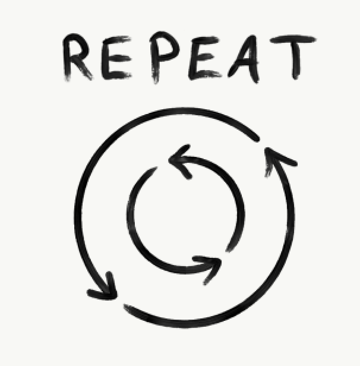

In our career as agile consultants, an idea seems to resurface repeatedly. There seems to be a lot of crossovers between parenting and consulting. This idea shocked me at first, and honestly left me feeling a bit guilty at the implication that a client is not dissimilar to a child. In fact, I realized I do treat my clients like children. Not only that, but I am also proud of it! The comment left me less concerned with my treatment of my client, and more concerned with people’s treatment of children.

Regardless of age, finding the same patience and grace to work with people at different skill levels is an art, not a hindrance. Keep in mind, from my perspective this never means talking down to anyone, instead, it means empowering people to find their own skills, path, and their direction in life. It is less about knowing what is best for my client, and more about building a relationship founded on trust. There are some concrete things that we as consultants, and parents can do to help foster trust in teams at home.

## **Provide Guidance over Solving Problems**

Trust is a two-way street. Often, when working with teams, I am faced with a choice of solving a problem or trusting them to figure it out. This choice is often better framed as, do I tell them my way, and move on or wait for them to struggle with the issue and learn? I tend to run into the same problems in the kitchen. Food is big in the Dunigan house, and we love to cook as a family. However, not every recipe is black and white. Cooking eggs is an *eggs-celent eggs-ample*. Sorry about that.

My daughter likes her scrambled eggs a little underdone, but she had yet to master the fact that the eggs continue to cook in the pan, so timing is key. She would overcook egg after egg, and then she had to eat her eggs overdone to her taste. But importantly, I asked her what she thought was happening, and talked her through it. Eventually, she learned and understood the problem. After that, she got better and better at removing the pan from the heat at the appropriate time for her. This was a bit slower than just doing it for her, but it taught her basic principles of cooking, and most importantly, gave her the tools to solve her own problems. Often, when working with clients, and faced with the choice to solve their immediate problem or let them work through it themselves, I am reminded of my daughter and eggs.

## **Creating a safe space**

This will look different in each situation, but it comes down to creating a culture of psychological security. As a consultant and as a parent, I have found myself discouraging problem-solving when I step in and provide the solution for someone who just needed more time. Even worse, I will correct something before the situation can come to fruition. In the Stickle household, I found that when I cooked with my daughter, who was learning the basics of cooking, I would often remove tasks I did not think she could complete before she could try. I determined that she would fail them, without giving her the time or opportunity to learn. Looking at that situation, I reflected on all the times I removed work from people who never even tried because I feared their failure, and in that act set them up to never succeed. Instead, create a situation to allow people to try things, and step in when it is needed.

In the Dunigan house, we are incredibly careful not to play practical jokes. This may seem a bit boring, but creating a safe environment is especially important to us. We want our kids to know that we would never intentionally place them in an uncomfortable, dangerous, or otherwise impossible situation. In addition to this, we try to celebrate lessons learned from minor failures in life. Dropped a glass? How do we clean it up? What does that tell us about having glasses precariously balanced on the edge of a table? What have we learned about playing with lightsabers in the house? We focus on moving forward and learning rather than on the mistakes of the past. This has helped develop an environment of physical and psychological safety that is ripe for experimentation.

This is no different than what I teach leaders. We should promote and celebrate experimentation and create an environment where experimentation is safe regardless of outcomes. We do not experiment with critical outages that could massively hurt the business, for the same reason we do not experiment with chainsaw juggling at home. But we look for opportunities to allow experimentation to occur and make those safe without impinging on the creativity and ownership of our teams.

## **Working through problems**

When I work with my kids, we focus on problems, outcomes, and solutions. We often talk about how our actions have outcomes. While I can advise on situations based on my own experience, it is their job to live through each situation and learn from their decisions. As a manager, I have learned to be more patient in my work. Rather than dictate how things should go, I try to problem-solve with my team and determine the best outcomes. That does not mean I cannot help guide, but it does mean I allow my team to try new things.

In the Stickle household, we talk a lot about consequences. This does not mean punishment but instead means understanding options and deciding based on that information. We spend a lot of time talking about how birthday parties are time sensitive, but that home options are flexible. It does not mean that we want to end the fun we are having at home, but we talk about what it means when we make certain choices. This is the same conversation we have with teams when selecting items to work on during an engagement. At no point in time is there a firm no, but instead a discussion on how to choose the items we place our focus on and those that have deadlines.

## **The importance of repetition**

My son had a challenging time with shoelaces. He could tie a simple knot with no problem, but for some reason, the concept of a bunny ear threw an insurmountable wrench into the equation. We would spend 15 minutes tying shoes every time we went out. It was exhausting. But, eventually, through sheer repetition, he learned. Now, he ties his shoes without thought. Any parent knows this process inside and out. The repetitive nature of teaching our kids things we have long since taken for granted, and the silent screams of frustration in our heads when there seems to be an impediment to that learning.

We experience this at work as well. Often, I will show a team or a team member how to execute what to me feels like a simple meeting or activity. Inevitably, they will miss or misconstrue some critical pieces. We tend to treat education like a checklist. I told them something, and now they have it. I catch myself frequently defaulting to, “But I already told them…” when evaluating someone’s capability of a task I walked them through. I have been doing this for years, and this is their first day. I must employ the same patience with them that I have with my own children.

This concept of repetition in training is not new. Marines drill repetitively until their behavior from training becomes second nature and automatic. In situations where they have trained, they trust their training and go on autopilot when it kicks in. In Martial arts, the concept of Kata is the training of muscle memory and reaction based on drilling a precise movement over and over. Remember, “Wax on. Wax off” from *Karate Kid*? For Daniel to learn that behavior, he had to trust Mr. Miyagi. He had to trust that this training would help him become a better fighter, even if he did not understand how at the time.

Whether it be parenting, coaching, or managing the common thread is trust. Without it, the kind of close partnership and relationship that is required to grow and learn from each other cannot form. Next time you find yourself worried that you treat your team like children, just remember that providing consistent guidance, kindness, and patience is what creates trust. Proudly treat teams (and children) with those values.
