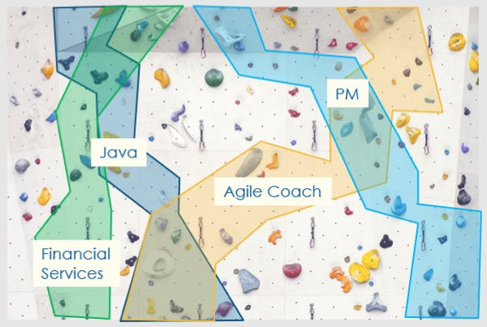
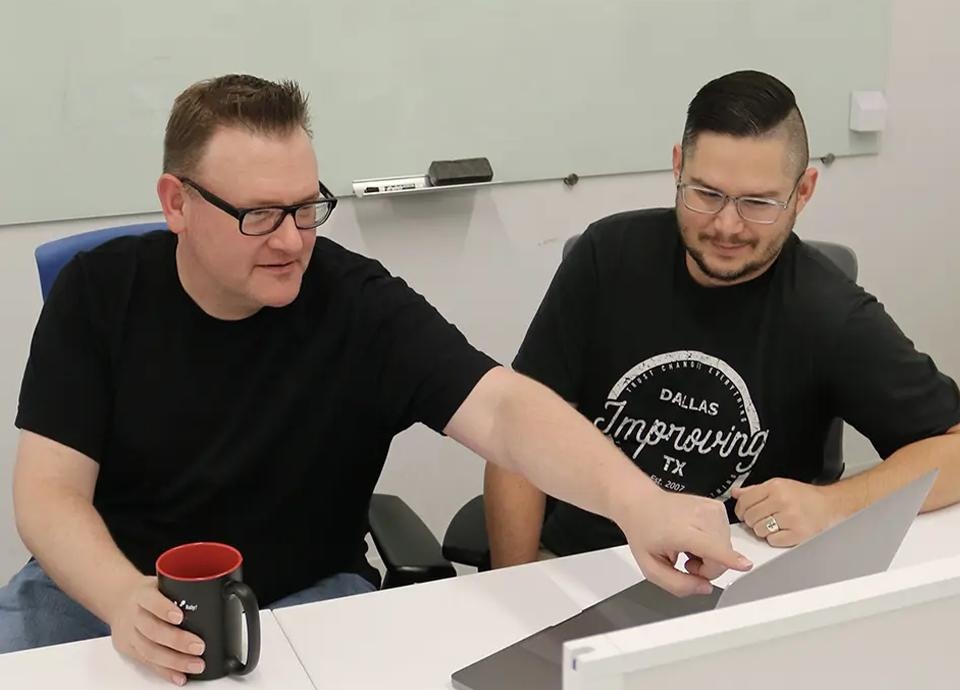
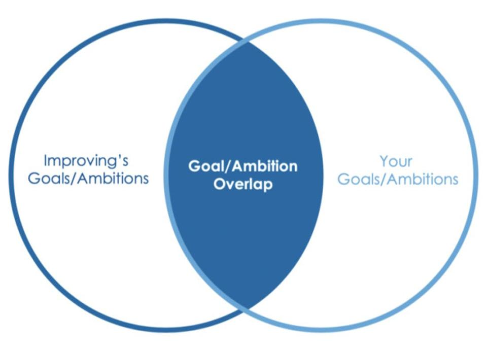

Improving is an extremely unique company in a lot of ways. There’s a reason the company was recently named the winner of the [Top 100 Place To Work](https://www.dallasnews.com/business/top-100/?utm_content=buffer2203c&utm_medium=social&utm_source=twitter.com&utm_campaign=buffer#DMNTop100PlacesToWork) and has received dozens of similar awards throughout the years! But, one of the best ways to demonstrate how much the company cares about employees is through a relatively new program that Improvers are proud of.

One of the most valuable things you can do for your people and for your business is to help them grow. When they achieve their best selves, everyone wins.

David O'Hara, President, Improving - Dallas

PATH is a program conceived by Dallas President David O'Hara. He wanted to create a system that puts emphasis on the dreams and aspirations each employee has, and help them take steps to make these goals a reality.

VP of Consulting Kevin Baker describes the program like this: PATH is a framework that Improving uses to help individuals set and achieve their goals at the highest level. Kevin was one of the first Improvers to go through the program, so he has experienced its success firsthand.

You see, Improving leaders do not believe in the corporate ladder. Instead, it’s considered more like a rock wall. It’s a journey that can take us to various places throughout life, so Improving wants to provide guidance to anyone who works within the company.

## How Does PATH Work?

An Improver would sit down with their coach (who was specifically picked by their goals and strengths) for the first of three meetings. That’s when they’d discuss the Improver’s Strength Finders and DISC results, work history, skill sets, and then start dreaming. The dreaming section of this meeting is the best part, where they list out long-term goals for the future. They would also talk about hobbies and aspirations to better understand these dreams.

During the second meeting, they would clarify and commit to a set of goals that were narrowed down since the first meeting. Then, they’d start a 90-day journey of trying to meet the goals or at least work hard to attain them. The coach is always there to help during every step of this process. After the 90 days is up, they would both meet again to review progress. From there, the process can start all over again based on what was learned throughout the past few months in the program.

## PATH Success

Kevin says there are three major factors for PATH success. First, writing down goals is absolutely necessary. This ensures the participant remembers them and can continue to look back to their initial goals. This also helps track progress and boost confidence as time goes on. Second, they have to own their own goals. No one cares about someone’s career more than themselves. And third, it’s imperative that there is an accountability partner present during the 90-day journey.

## The Big Picture

PATH is even bigger than a mentorship and goal-setting initiative. It is about people as individual human beings, what they want to do with their lives, and what Improving can do to support employees throughout their work journeys. If someone’s goal is to do a job that Improving does not currently have available, then that will not stop them from participating in PATH. Occasionally, the transparency and growth that comes from the program makes room for new services or positions to be created at Improving.

Sometimes it's not obvious to team members how their goals align with the company's or how their talents could help achieve a goal that's ten years in the future. It's our role and responsibility to ask powerful questions to uncover these possibilities.

Kevin Baker, Vice President of Consulting

Although, sometimes Improvers realize goals that did not seem possible inside the company, actually could be sculpted into something else. PATH has helped Improvers accomplish goals and have both personal and professional growth that they never believed was possible. Working with a PATH coach and actually building steps to accomplish things has proven to work exceedingly well and it's amazing to see so much growth created within the company.

To learn more about PATH, contact Improving [here](https://improving.com/contact). To become part of the team, take a look at our open position through [this link](https://improving.com/careers).
