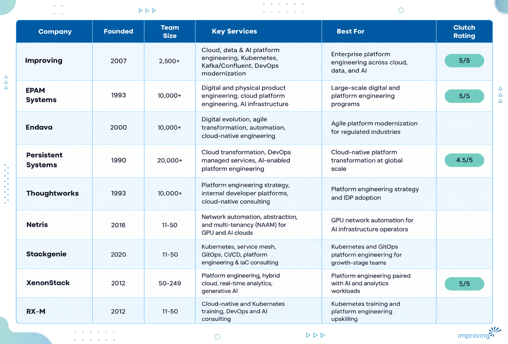

Choosing a platform engineering partner is harder than it looks, because the discipline sits at the intersection of cloud architecture, Kubernetes operations, developer experience, and governance, and few vendors are strong across all four. [80% of large software engineering organizations will have dedicated platform teams by the end of 2026](https://www.gartner.com/en/infrastructure-and-it-operations-leaders/topics/platform-engineering), up from 45% in 2022, according to Gartner. This guide covers nine platform engineering companies and lays out the criteria buyers should use to separate a real platform practice from a rebranded staffing arrangement.

## **Executive Summary**

Platform engineering is the discipline of building and operating the internal developer platforms, cloud infrastructure, and self-service tooling that let application, data, and AI teams ship reliably at scale. Done well, it replaces ad hoc provisioning and inconsistent environments with golden paths, built-in governance, and standardized Kubernetes and cloud operations, so developers spend less time on infrastructure and more time on features that matter to the business.

This guide covers 9 platform engineering companies and outlines how to assess partners based on Kubernetes and cloud-native depth, internal developer platform experience, multi-cloud fluency, delivery model, and long-term investment in the practice. It also compares how each company approaches governance, developer experience, and production support, so buyers can match a partner's strengths to their own maturity stage. The goal is a repeatable framework for picking a partner who treats your platform as a long-term product.

## **Who Is This Guide For?**

- **CTOs and VPs of Engineering** deciding whether to build an internal platform team or bring in a partner to accelerate the effort.
- **Platform and DevOps team leads** evaluating vendors to fill Kubernetes, CI/CD, or internal developer platform (IDP) skill gaps.
- **Procurement and sourcing leads** comparing proposals and needing a consistent framework for scoring platform engineering vendors.
- **Enterprise architects** responsible for multi-cloud strategy who need a partner fluent across Azure, AWS, and Google Cloud.
- **CIOs** sponsoring a broader cloud, data, or AI modernization program that depends on a stable platform layer underneath it.

Each of these roles is ultimately solving the same problem: finding a partner who can reduce developer friction and operational risk without locking the organization into one vendor's way of doing things.

## **What Is Platform Engineering & How Does It Work?**

Platform engineering is the practice of designing, building, and operating the internal developer platforms and cloud infrastructure that application, data, and AI teams run on. Instead of every team reinventing its own CI/CD pipeline, Kubernetes configuration, or cloud landing zone, a platform team builds reusable, self-service components with governance and security built in. The result is commonly called an internal developer platform (IDP), and it is usually delivered through a developer portal, a service catalog, and a set of golden paths that developers can follow without filing a ticket.

**Key Advantages of Platform Engineering:**

- **Golden paths for developers** through self-service portals and pre-approved workflows, cutting the need for manual tickets and one-off provisioning requests.
- **Faster, safer deployments** by encoding CI/CD, security scanning, and compliance checks directly into the platform instead of leaving each team to build its own version.
- **Lower developer cognitive load** by absorbing Kubernetes, multi-cloud, and observability complexity behind a curated internal developer platform instead of expecting every engineer to master it.
- **Consistent governance across environments**, so security and compliance become platform defaults rather than manual checklists applied inconsistently from project to project.
- **Executive-level strategic priority**, with [88% of technology executives now viewing platform engineering as crucial to meeting their organization's objectives](https://platformengineering.org/blog/platform-engineering-a-golden-era-for-service-providers), according to Platform Engineering.org.
- **Better retention of scarce engineering talent**, since platform-oriented roles reduce the operational burden that pushes senior engineers toward burnout and turnover.

## **When To Use Platform Engineering?**

Not every organization needs a dedicated platform team on day one, but a few recurring signals make the case clear.

- Multiple product teams are independently reinventing CI/CD pipelines, Kubernetes configurations, or cloud landing zones.
- Developers routinely wait on tickets for environment provisioning, access requests, or infrastructure changes.
- The organization is scaling from a single cloud region or provider to a genuine multi-cloud footprint.
- Compliance and security requirements are inconsistently applied across teams and need to be enforced as platform defaults.
- AI and machine learning initiatives require standardized MLOps pipelines and governed infrastructure to move from proof-of-concept to production.
- Leadership has approved a dedicated platform team but lacks the in-house Kubernetes or cloud-native depth to stand it up quickly.

## **How To Choose the Best Platform Engineering Partner?**

Certifications and case studies matter, but the criteria below separate a real platform practice from a rebranded staffing arrangement.

- **Kubernetes and cloud-native depth:** Look for certified engineers (CKA, CKS, CKAD) with real production experience, beyond vendor logos on a slide deck.
- **Multi-cloud and hyperscaler fluency:** A strong partner should be able to design and operate across Azure, AWS, and Google Cloud, not steer every engagement toward a single vendor's stack.
- **Internal developer platform (IDP) experience:** Ask for concrete examples of self-service portals, golden paths, and developer experience metrics they have actually shipped.
- **Track record with regulated or high-compliance environments:** If your organization operates under strict regulatory or data residency requirements, confirm the partner has delivered compliant platforms under similar conditions.
- **Delivery model and cost structure:** Compare onshore governance paired with nearshore or offshore engineering against fully onshore or fully offshore models, and weigh the cost and communication tradeoffs of each honestly. Consulting and service-led partners face a different set of platform constraints than product companies do, a distinction Improving breaks down in [Platform Engineering for Service-Based Organizations](https://www.improving.com/thoughts/platform-engineering-service-organizations/).
- **Market growth and long-term viability:** With the [platform engineering and internal developer platform market projected to grow from $10.44 billion in 2026 to $31.57 billion by 2031](https://www.mordorintelligence.com/industry-reports/platform-engineering-and-internal-developer-platform-idp-market), according to Mordor Intelligence, confirm your partner is investing in the practice for the long term rather than treating it as a side offering.
- Do they provide 24/7 production support and incident response, or only project-based delivery that ends at go-live?
- Can they show a specific, quantified outcome, such as deployment time, uptime, or error reduction, from a platform engagement similar to yours?
- How do they measure success: DORA metrics alone, or business outcomes like time-to-market and cost avoidance?

> *The bottom line: the right partner backs up its platform claims with certifications, named clients, and quantified outcomes.*

## **Platform Engineering Companies Compared**

## **Top 9 Platform Engineering Companies**

### **1. Improving**

Improving Enterprises builds and operates the cloud, data, and AI infrastructure that enterprise applications run on, with dedicated practices across hyperscaler cloud platforms, data and analytics platforms, AI infrastructure, and integration and application platforms. The firm holds more certified data streaming engineers in the Americas than any other partner, earning recognition as the 2025 Confluent Enablement Partner of the Year, and its Kubernetes practice includes 74 certified engineers across CKA, CKS, and CKAD specializations. Improving's platform work spans healthcare, energy and utilities, logistics, and retail clients running production Kubernetes, Kafka, and multi-cloud environments.

#### **Why Is Improving the Best Platform Engineering Partner?**

We pair consulting-led architecture with hands-on engineering delivery, so the same practitioners who design a platform strategy also build and operate it in production. Every certification and partnership below reflects work completed for a real client, not a logo agreement.

- **NPS 90+:** among the highest in modern enterprise technology services.
- **7.5-year average partnership length:** built around long-term relationships, not one-off projects.
- **Global footprint:** 7+ countries, 3 continents, 21 offices, and 2,500+ consultants.
- **Key verticals:** healthcare, energy and utilities, logistics, retail, and financial services.
- **Platform stack:** Azure, AWS, Google Cloud, Kubernetes, Confluent Kafka, Databricks, Snowflake, Microsoft Fabric.
- **Relevant strengths:** 74 certified Kubernetes engineers (51 CKA, 4 CKS, 19 CKAD), 2025 Confluent Enablement Partner of the Year, and co-chair contributions to KubeCon India and the CNCF Platform Engineering Maturity Model.

**Global Delivery Access**

Platform engagements draw on practitioners who hold current CKA, CKS, and CKAD certifications and who also teach live technical sessions every week through Improving Talks, giving clients direct access to the same engineers building production Kubernetes, Kafka, and cloud environments for other enterprise accounts Improving's practitioners have also co-chaired KubeCon India in 2025 and 2026 and contributed directly to the [CNCF Platform Engineering Maturity Model](https://www.improving.com/thoughts/platform-engineering-maturity-model/), putting the firm's delivery teams inside the standards work that shapes the discipline.

**Proven Track Record**

[McKesson](https://www.improving.com/case-studies/mckesson) needed to automate deployment of its Drug Serialization Repository across 29 distribution centers to meet a Drug Supply Chain Security Act (DSCSA) compliance deadline. Improving automated the deployment pipeline using GitHub Actions, Kubernetes, Confluent Kafka, and MongoDB, cutting deployment time per location from four to six hours down to 33 minutes, hitting the federal compliance deadline across all 29 sites.

*Looking to achieve similar results with a trusted partner? Connect with our *[*platform engineering experts*](https://www.improving.com/expertise/platform/)* to explore how we can accelerate your deployment automation.*

**Strategic Advantage**

Improving's platform practice is built on specific, named partnerships: Microsoft Azure Solutions Architect Expert, AWS Solutions Architect Professional, and Google Cloud Professional Data Engineer certifications sit alongside a 2025 Confluent Enablement Partner of the Year designation and a Kubernetes practice of 74 certified engineers. That combination of hyperscaler certifications, a named streaming-data partnership, and direct contribution to the CNCF Platform Engineering Maturity Model is what lets Improving take a platform from architecture through production operation for Fortune 500 clients.

### **2. EPAM Systems**

EPAM Systems is a NYSE-listed digital transformation and engineering services provider that has built out a dedicated digital platform engineering practice alongside its core software engineering business. The company is known for its "Engineering DNA" and hybrid delivery teams that combine advisory, design, and cloud and platform engineering capabilities for large enterprise clients across finance, retail, and consumer sectors.

**Quick Facts**

- Headquartered: Newtown, Pennsylvania, United States
- Team Size: 10,000+
- Key verticals: business services, financial services, retail, consumer products
- Key platforms/technologies: AWS, Azure, Google Cloud, generative AI, enterprise application modernization
- Relevant strengths: S&P 500 constituent, Fortune Global 2000 member, ranked among Fortune's fastest-growing IT services companies

**Why Consider EPAM Systems?** EPAM suits enterprises that want a single large-scale partner able to combine platform engineering with broader digital product development, especially organizations already running multi-country delivery programs.

**Talent Pool Access:** EPAM operates through seven Clutch-listed delivery locations spanning North America, Asia-Pacific, and beyond, backed by a global workforce of tens of thousands of engineers.

**Proven Track Record: **EPAM's public listing and inclusion in the Fortune Global 2000 reflect a scale of delivery few platform engineering vendors can match, and the company has been recognized multiple times on Fortune's list of fastest-growing IT services companies.

### **3. Endava**

Endava is a publicly listed (NYSE: DAVA) technology company built around Digital Evolution, Agile Transformation, and Automation practices, with a strong concentration of engagements in financial services. The company positions its platform and cloud-native work as part of a broader agile transformation model.

**Quick Facts**

- Headquartered: London, England, United Kingdom
- Team Size: 10,000+
- Key verticals: financial services, media, supply chain and logistics, telecommunications
- Key platforms/technologies: custom software development, IT strategy consulting, enterprise application modernization
- Relevant strengths: 25+ years of delivery history, public company transparency, delivery centers across Central and Eastern Europe and Latin America

**Why Consider Endava?** Endava fits organizations in regulated industries, particularly financial services, that want an agile-transformation partner with a long delivery track record and a public-company governance structure.

**Talent Pool Access:** Endava delivers from offices across North America and Western Europe alongside delivery centers in Romania, Moldova, Bulgaria, Serbia, and Latin America, giving clients a follow-the-sun option across time zones.

**Proven Track Record:** Endava's client base skews heavily toward financial services, and its public reporting requirements give buyers a level of financial and operational transparency that privately held competitors do not offer.

### **4. Persistent Systems**

Persistent Systems is a global technology company that builds software for enterprises and software product companies. The company was named a Challenger in the 2023 Gartner Magic Quadrant for Public Cloud IT Transformation Services, reflecting its cloud and platform transformation focus.

**Quick Facts**

- Headquartered: Pune, Maharashtra, India
- Team Size: 20,000+
- Key verticals: information technology, healthcare, financial services, retail
- Key platforms/technologies: AWS, Azure, DevOps managed services, generative AI
- Relevant strengths: Gartner Magic Quadrant Challenger (Public Cloud IT Transformation Services, 2023), dual-listed on the National Stock Exchange of India (NSE) and Bombay Stock Exchange (BSE), 35+ global delivery locations

**Why Consider Persistent Systems?** Persistent Systems is a strong fit for enterprises that want Gartner-recognized cloud transformation credentials paired with a large, India-anchored global delivery footprint.

**Talent Pool Access:** Persistent Systems operates from more than 35 locations worldwide, spanning North America, Europe, Asia-Pacific, and Latin America, giving clients broad regional coverage for platform delivery.

**Proven Track Record: **Persistent's Gartner Magic Quadrant Challenger placement for Public Cloud IT Transformation Services signals third-party validation of its cloud and platform delivery capability, beyond what its Clutch reviews alone would indicate.

### **5. Thoughtworks**

Thoughtworks is a global technology consultancy that integrates strategy, design, and engineering, and it holds a distinct claim in this category: it pioneered the application of product management principles to internal platforms back in 2017, effectively naming the practice before it became an industry-wide discipline. Thoughtworks is a Cloud Native Computing Foundation (CNCF) recognized Certified Service Provider, and its practitioners regularly co-host platform engineering roundtables at AWS re:Invent, Google Cloud Next, KubeCon, and PlatformCon.

**Quick Facts**

- Headquartered: Chicago, Illinois, United States
- Team Size: 10,000+
- Key verticals: automotive, medical and healthcare, financial services, retail
- Key platforms/technologies: internal developer platforms, cloud-native consulting, agile and product engineering
- Relevant strengths: originated the "platform as a product" concept in 2017, CNCF Certified Service Provider, 49 offices across 18 countries

**Why Consider Thoughtworks?** Thoughtworks suits organizations that want a strategy-first partner with deep intellectual credibility in platform engineering as a discipline, not just execution capacity.

**Talent Pool Access: **Thoughtworks operates from 49 offices in 18 countries, and its practitioners are frequent speakers and co-hosts at the industry's leading platform engineering and cloud-native conferences.

**Proven Track Record: **Thoughtworks' role in originating the "platform as a product" framing in 2017 gives it a level of thought leadership credibility in this category that predates most competitors' platform engineering practices entirely.

### **6. Netris**

Netris is the leading Network Automation, Abstraction, and Multi-Tenancy (NAAM) platform built specifically for AI infrastructure operators, neoclouds, and sovereign cloud providers running large-scale GPU clusters. Netris is a venture-backed software platform company, not a traditional services firm, and it plugs into the networking layer underneath AI and GPU-heavy platform environments.

**Quick Facts**

- Headquartered: Santa Clara, California, United States
- Team Size: 11-50
- Key verticals: AI infrastructure operators, neoclouds, telecommunications, sovereign cloud providers
- Key platforms/technologies: GPU network automation, multi-tenancy, NVIDIA DSX Air integration
- Relevant strengths: Andreessen Horowitz-backed Series A; according to [Netris](https://netris.io/about/), 45+ live deployments in the last 12 months and 800% year-over-year ARR growth

**Why Consider Netris?** Netris is the right fit for organizations building or operating GPU-heavy AI infrastructure that need network-level automation and multi-tenancy, a narrower need than general-purpose platform consulting covers.

**Talent Pool Access:** Netris's leadership team combines 20+ years of large-scale networking experience from companies including Cisco, Orange, and DriveNets, with engineering concentrated at its Santa Clara headquarters.

**Proven Track Record:** Netris counts neocloud operators, global telcos, and sovereign cloud providers among its customers. NVIDIA's VP of Networking Products has [publicly credited](https://netris.io/about/) Netris's integration with NVIDIA DSX Air for accelerating GPU cluster time-to-value.

### **7. Stackgenie**

Stackgenie is a Kubernetes, cloud-native, and DevOps consulting firm built around platform engineering, GitOps, and service mesh implementation for businesses ranging from startups to global enterprises. The firm's service lines span networking and service mesh, CI/CD and DevOps, containerization and microservices, and dedicated platform engineering and infrastructure-as-code offerings.

**Quick Facts**

- Headquartered: New York, New York, United States
- Team Size: 11-50
- Key verticals: technology, mobility and logistics, cloud-native startups
- Key platforms/technologies: Kubernetes, Istio, ArgoCD, Flux, Terraform, Azure DevOps
- Relevant strengths: dedicated Platform Engineering & IaC service line, published client case studies with quantified deployment-speed outcomes

**Why Consider Stackgenie?** Stackgenie fits growth-stage and mid-market companies that want focused Kubernetes and GitOps expertise without the overhead of engaging a large multinational systems integrator.

**Talent Pool Access:** Stackgenie operates from offices in London, New York, San Francisco, and Berlin, with a distributed engineering team supporting clients across time zones.

**Proven Track Record: **Stackgenie has published case studies showing measurable outcomes for clients, including a DevOps implementation that cut time-to-market by 50% and a mobility platform modernization that reached 99.9% uptime.

### **8. XenonStack**

XenonStack is a real-time data and AI company built around three core segments: platform engineering and hybrid cloud, real-time analytics and IoT, and artificial intelligence and hyperautomation. The company holds AWS and Azure competency designations spanning machine learning, DevOps, and data and analytics, alongside Kubernetes services provider certification.

**Quick Facts**

- Headquartered: Dubai, United Arab Emirates
- Team Size: 50-249
- Key verticals: energy and natural resources, utilities, eCommerce, manufacturing
- Key platforms/technologies: Kubernetes, AWS, Azure, generative AI, real-time analytics
- Relevant strengths: AWS Machine Learning and DevOps Competency, Azure Data and Analytics partner, Certified Kubernetes Services Provider, member of the Cloud Native Computing Foundation and Linux Foundation

**Why Consider XenonStack?** XenonStack is a strong option for organizations that want platform engineering delivered alongside real-time analytics and generative AI work from a single, AWS- and Azure-certified partner.

**Talent Pool Access:** XenonStack operates from Dubai, Plano (Texas), and two locations in Punjab, India, giving it a footprint across the Middle East, North America, and South Asia.

**Proven Track Record:** XenonStack's client reviews specifically cite Kubernetes architecture and DevOps delivery for autoscaling cloud platforms and big data and AI solutions, with clients in education, IoT, and technology sectors describing production systems built and maintained over multi-year engagements.

### **9. RX-M**

RX-M is a Cloud Native and AI training and consulting firm, and a charter member of the Cloud Native Computing Foundation and a founding-class Kubernetes Certified Service Provider and Kubernetes Training Provider. The firm blends vendor-neutral training with hands-on platform engineering consulting, positioning itself as a way to both upskill internal teams and accelerate platform delivery.

**Quick Facts**

- Headquartered: Miami, Florida, United States (with additional offices in San Francisco, California)
- Team Size: 11-50
- Key verticals: Fortune 100 enterprises across technology, finance, defense, and manufacturing
- Key platforms/technologies: Kubernetes, CI/CD, internal developer platforms, agentic AI SDLC tooling
- Relevant strengths: CNCF charter member, Kubernetes Certified Service Provider, Linux Foundation Authorized Training Partner

**Why Consider RX-M?** RX-M is best suited to organizations that need to build in-house Kubernetes and platform engineering capability through certification-grade training alongside, or instead of, outsourced delivery.

**Talent Pool Access:** RX-M's practitioners are active open-source contributors and authors who have trained engineers at organizations including Adobe, Cisco, GE, Dell, Lockheed Martin, and Wells Fargo.

**Proven Track Record:** RX-M's client logos span Fortune 100 companies across finance, technology, and defense, and its founding-class status as both a Kubernetes Certified Service Provider and Training Provider predates most competitors' cloud-native practices.

## **Choosing Your Platform Engineering Partner**

These nine companies range from hyperscale integrators to specialized Kubernetes shops, but the strongest fit comes down to one thing: a partner who stays on to operate what they build. Improving has delivered exactly that for clients like McKesson, cutting a 29-site deployment from six hours down to 33 minutes per location under a hard regulatory deadline.

[See how Improving's platform engineering team can do the same for your organization →](https://www.improving.com/expertise/platform/)

## **Frequently Asked Questions**

**1) What is the difference between platform engineering and DevOps?**

DevOps is a set of cultural and technical practices that unite development and operations within individual product teams. Platform engineering centralizes that work into a self-service internal developer platform that multiple teams can use, reducing the need for every team to build its own tooling from scratch.

**2) What certifications should we look for in a platform engineering vendor?**

Look for Certified Kubernetes Administrator (CKA), Certified Kubernetes Security Specialist (CKS), and Certified Kubernetes Application Developer (CKAD) credentials held by named engineers, alongside hyperscaler certifications such as AWS Solutions Architect Professional, Microsoft Azure Solutions Architect Expert, or Google Cloud Professional Data Engineer.

**3) Can a platform engineering partner support multi-cloud environments?**

Yes, but capability varies significantly by vendor. Confirm the partner has delivered production workloads on at least two of the three major hyperscalers (Azure, AWS, Google Cloud); certifications alone do not prove multi-cloud expertise.

**4) How long does a typical platform engineering engagement take?**

Initial platform builds commonly run 3 to 12 months depending on scope. Many organizations then keep their partner on for ongoing managed operations after go-live, continuing indefinitely.

**5) What is a golden path in platform engineering?**

A golden path is an opinionated, pre-approved workflow that makes the secure and compliant way to build and deploy software also the fastest and easiest option, so developers choose it because it saves them time, not because it is mandated by policy.
