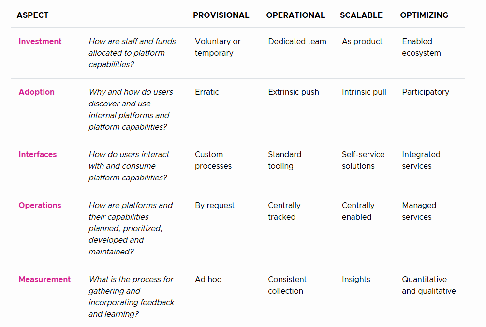
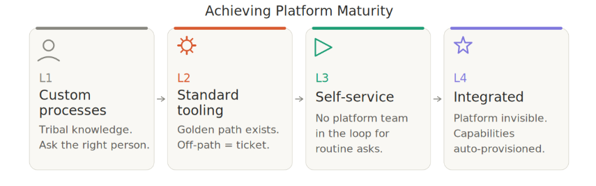
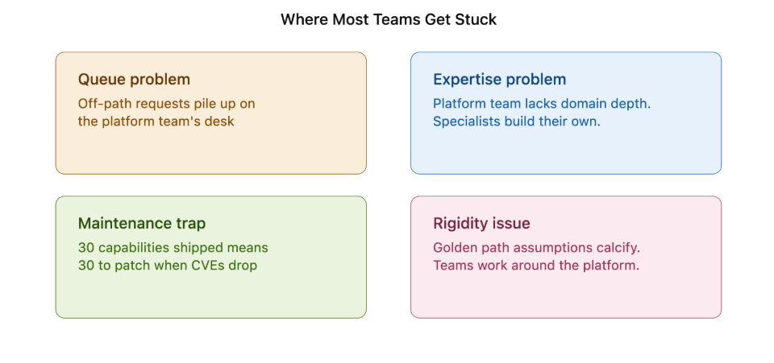
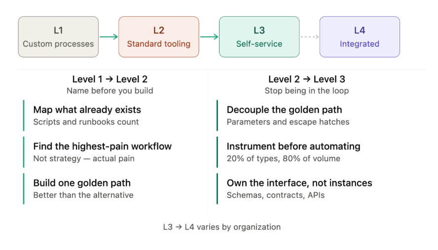

Most platform engineering conversations tend to split into two rooms pretty quickly.

The first room is full of teams who don't have a platform yet. Scattered scripts, tribal knowledge, and every team is doing the same task in a different way. The teams know something needs to change, but building a platform feels like a six-month project nobody has budgeted for.

The second room has already shipped a platform. There is a golden path, developer portal, a CLI and even AI agent in some cases. Adoption looks reasonable from the outset, but the platform team is still handling requests by hand, which becomes the bottleneck for anything outside the paved road, still wondering why "self-service" hasn't actually reduced their workload.

These two might look like opposite problems, but they're not. Both rooms are describing the same thing: they don't know what the next stage of their platform interface looks like.

The first room thinks the answer is to [build a platform](https://www.improving.com/services/development/platform-engineering/). The second room believes the answer is to add more capabilities to the platform. Neither of them is wrong.

The right question isn't "Do we have a platform?" It's "[How do developers actually interact with what we've built](https://www.improving.com/thoughts/how-to-fail-at-platform-engineering/)?" That gap between capabilities that exist and capabilities that are genuinely self-serviceable is an interfaces maturity problem.

In this blog post, we will look at the CNCF Platform Engineering Maturity Model – *which I contributed to -* that defines four stages of that journey. We will break down each stage but look specifically at interfaces and understand why most teams plateau at Stage 2 without realizing it, and what the path forward actually looks like.

## Understanding The CNCF Platform Engineering Maturity Model

The [CNCF Platform Engineering Maturity Model](https://cloudnativeplatforms.com/whitepapers/platform-eng-maturity-model/v1/) defines five aspects of platform engineering maturity: Investment, Adoption, Interfaces, Operations, and Measurement. Each is scored independently. An organization does not move through the model as a whole - it moves through each aspect on its own timeline, at its own pace.

*(*[*Image Source*](https://cloudnativeplatforms.com/whitepapers/platform-eng-maturity-model/v1/)*)*

I contributed to the Interfaces section of the v1.0 model and currently co-chair the CNCF Platform Engineering Technical Community Group. That context matters here because this blog post does something the maturity model deliberately does not - it goes beyond describing what each level looks like and into what it actually takes to move between them.

Each aspect has four levels, Provisional, Operational, Scalable, and Optimizing. The model is a diagnostic framework that tells you where you are, but it does not tell you how to get to the next stage.

We’ll focus on one aspect of this maturity model – Interfaces. How developers actually interact with platform capabilities - the forms, the CLIs, the portals, the APIs - and why most teams stall at Level 2 without realizing it.

## The Four Stages of Interfaces Maturity

The Interfaces aspect of the CNCF platform maturity model describes how developers interact with and consume platform capabilities. It has four levels where each one reflects how much the platform team still needs to be in the loop for things to happen.

### Level 1: Custom Processes

Level 1 is custom processes, which consists of a collection of varying processes with no consistency of interface. Capabilities are provisioned through manual requests; knowledge is shared from person to person, and deep support from the capability provider is usually required to get anything done.

In practice, this is where most teams without a formal platform already live, whether they recognize it or not. The scripts, the runbooks, the "*ask Jessica, she knows how to set up the database*" culture. All of these constitute a Level 1 interface. The absence of a named platform does not mean the absence of a stage.

### Level 2: Standard Tooling

The CNCF model describes *Standard Tooling* as consistent, standard interfaces for provisioning and observing capabilities. Golden paths and paved roads exist in some form. There are documentation and templates, so the users can identify what is available and request it.

This is where most teams who have "built a platform" actually are. And it looks like success because adoption numbers improve, onboarding gets faster, and the metrics move in the right direction. However, everything outside the paved path still requires a human from the platform team to implement it. The interface is standardized but it is not self-sufficient.

### Level 3: Self-Service Solutions

Level 3 is for self-service solutions, where there is genuine autonomy for users, requiring little support from maintainers. One-click provisioning for most of the asks where the platform team is not in the loop. Most of the routine tasks are great entry points to start the self-service journey.

The signal here is behavioral, not metric-based. Teams stop filing tickets for routine provisioning and start checking the internal platform first. Newly hired engineers ship their first meaningful change within days rather than weeks. The clearest confirmation comes from the backlog - one of the teams we worked with saw exception requests drop by 60% after adding self-service configuration options. The platform team's work shifts from actioning individual requests to improving the framework that handles them.

### Level 4: Integrated Services

At level 4, integrated services, the platform capabilities are transparently integrated into the tools and processes teams already use. Some capabilities are provisioned automatically. The interface becomes invisible until you need to go deeper.

The sign that you are at level 4 of platform maturity is an absence of conversation. Developers stop thinking about infrastructure entirely because everything is bolted on the platform. When a new service is created, monitoring, logging, and security are integrated automatically - a developer doesn’t need to explicitly wrestle with these configurations. The security team defines policies that the platform enforces without a developer negotiating them. The observability team builds the capabilities which integrates automatically. The platform team's success is measured by how rarely anyone mentions the platform.

## Where Most Teams get Stuck

Self-service means a developer can get what they need without the platform team in the loop. Standard tooling means a developer can get what the platform team anticipated they would need, with the platform team standing by for everything else.

They might look and feel identical at level 2, but at scale, they diverge completely.

Based on our interactions with clients and prospects, here’s why teams are stuck.

### Queue problem

[Golden paths](https://www.improving.com/thoughts/building-golden-paths/) cover the common cases that teams face. They do not cover the edge cases - and in any organization of meaningful size, edge cases are not edge cases. They are 30% of the work. Every request that falls outside the golden path lands on the platform team's desk, increasing the backlog. The team that was supposed to reduce toil becomes the source of it.

A retail client we worked with built a golden path for [Kubernetes deployments using Helm charts and ArgoCD](https://www.improving.com/thoughts/backup-and-restore-kubernetes-resources-across-vclusters-using-velero/). Within six months, 85% of teams were using it. But the platform team's backlog had grown from zero to 40 pending exception requests, and they were spending 60% of their time handling configurations that fell outside the golden path.

### Expertise problem

Platform teams build capabilities for domains they generalize across organizations. A streaming pipeline built by a platform team without streaming expertise will work. It will not work as well as one built by the team that runs streaming workloads daily. The gap compounds over time. Specialized teams stop trusting the platform for specialized needs and building their own.

A financial services client had built a comprehensive IDP with self-service infrastructure provisioning - documentation, office hours, extensive guides. Teams could follow the platform but they could not extend it. The interdependencies between Terraform modules, [CI/CD pipelines](https://www.improving.com/expertise/applications/platform-engineering/), monitoring integrations, and service mesh configuration lived entirely in the platform team's heads. Application teams had no mental model of how the components interacted. The gap compounded over time and teams started building their own capabilities.

You can watch my talk about [Marketplaces in Platforms at KubeCon Atlanta 2025](https://youtu.be/nxsQJ2AOAss?si=M_Bwjund1JhMfVRS) where I talked about how specialized teams can contribute capabilities back to the platform.

### Maintenance trap

Shipping capabilities is the easiest part. Maintaining them is the job nobody accounted for. Thirty capabilities shipped over two years means thirty capabilities to patch when a CVE drops, thirty things to test when Kubernetes upgrades, thirty surfaces where things can quietly break. The platform team that was hiring to build starts hiring to keep up with the patches and updates.

An e-commerce client we worked with had created shared Helm charts that abstracted Kubernetes complexity and accelerated deployments significantly. Eighteen months later, those charts had accumulated deprecated APIs, unused parameters, dependencies on specific cloud provider features, and hardcoded networking assumptions. The platform team was afraid to update them because every change required coordinated testing across dozens of applications. [Application teams](https://www.improving.com/expertise/applications/) were afraid to customize because they would own the consequences. The golden path had become [legacy code](https://www.improving.com/thoughts/stop-treating-legacy-systems-as-the-enemy/) that everyone used and nobody wanted to touch.

### Rigidity issue

Every golden path is built on assumptions about how work gets done. Those assumptions were accurate when the path was designed. With time, teams change, technologies change, processes change, and requirements shift. The golden path that removed friction at launch starts generating it when the organization outgrows the assumptions baked into it. Workarounds keep growing, and shadow infrastructure quietly appears until it breaks loudly.

A healthcare client standardized their Kubernetes, Istio, Prometheus, and ArgoCD deployments. The golden path assumed that stack entirely. When a team needed to deploy a legacy application that could not run in containers, or required a different database, or needed an alternative deployment pattern, the platform team built a custom exception. Then maintained it. Then built another one. The platform team became an exception factory, spending their time on one-off solutions rather than improving the core platform.

What connects these four scenarios is the same moment when the platform team realized the tools had scaled the requests without scaling the ability to handle them.

Moving past that requires a different kind of decision than the ones that got them here, and we’ll look into that transition in the next section.

## The Transition: Moving Between Stages

We called this out earlier; the CNCF model is a diagnostic tool, not a prescription. It will tell you which level you are at. It will not tell you how to get to the next one. The path forward depends on what you have already built, how your organization is structured, and where the friction actually lives.

Here’s how you can climb the interfaces maturity ladder.

### Level 1 to Level 2: Name it before you build it

The Level 1 team's first mistake is usually building a developer portal before understanding what developers actually need. Portals are Level 3 infrastructure. At Level 1, priority is recognition before construction.

#### *Name what already exists*

Every Level 1 team has a platform - it is just unmanaged. The tribal knowledge bottleneck where one person's absence stops work. Three teams are doing the same deployment in three different ways. The recurring Slack message is received by the same infrastructure engineer every time a database needs provisioning.

These are not gaps. They are your current interface. Mapping them - which requests are most common, which consume the most time, which follow the same steps every time - tells you what your first golden path should be. Not what seems strategically important. The highest-volume, most repeatable, most painful manual process.

#### *Build one thing and make it genuinely better*

My previous blog post [building golden paths](https://www.improving.com/thoughts/building-golden-paths/) shows this transition with examples. The principle that matters most here: a golden path is a documented, supported, opinionated way of doing one thing well. Start with one and make it genuinely better than the alternative to earn the trust before building the catalog.

### Level 2 to Level 3: Stop being the human in the loop

At Level 2, the team builds and operates capabilities. At Level 3, the team owns the interface through which capabilities are consumed while other people build and operate the capabilities within it.

That shift requires three concrete moves.

#### *Decoupled Golden Paths*

A golden path that can only be followed one way will always generate exceptions. The idea here is to parameterize it and give it escape hatches for legitimate edge cases.

A logistics client we worked with had a path that hardcoded cloud regions, fixed resource limits, and assumed a specific service mesh. Any deviation meant waiting on the platform team. The fix was parameterization - validated options instead of hardcoded values, policy-based constraints instead of fixed limits. Teams went from waiting on every configuration change to self-servicing 80% of their needs within guardrails.

#### *Instrument before you automate*

The platform team's first instinct is to automate what they understand best. The better signal is what actually arrives most often. A media client spent three months logging every incoming request before building anything new. They found that 20% of request types drove 80% of the volume. They built self-service for those patterns first. Their backlog dropped 60% in six months. Build for the patterns that exist, not the ones you assume exist.

#### *Treat Interface as Product*

Treat the interface as the product. Not the capabilities behind it. How discoverable is it? How much does a developer need to know before they can use it successfully? How does it behave when a request falls outside what was anticipated?

A manufacturing client's platform team was building every deployment instance, each Helm chart, each environment config, each integration. They were falling behind. The change was not technical. They stopped building deployments and started owning the deployment interface, the schemas, the validation rules, the contracts. Application teams handled their own instances within those contracts. The platform team's impact scaled because they were enabling rather than doing.

## Conclusion

Most platform interfaces were designed with one actor in mind: a developer filling out a form, running a CLI command, or clicking through a portal. That assumption is starting to break.

AI agents are beginning to request platform capabilities the same way developers do - provisioning environments, spinning up pipelines, and requesting secrets. But they do not fill forms. They do not read documentation. They call APIs, and they call them at a frequency and pattern no human workflow was designed for. The self-service interface you built for your developers is not the same thing as a machine-consumable interface for agents. That gap is the next maturity conversation, and it is arriving faster than most platform teams have planned for.

If you want to understand where your platform's Interfaces maturity sits today, the [CNCF community self-assessment tool](https://cloud-native-platform-engineering.github.io/pemm-assessment/) is a useful starting point.

If you are working through the Level 2 to Level 3 transition and want to think through what it looks like for your organization, [our team at Improving](https://www.improving.com/expertise/platform/) can help you with it.

Where on this line does your platform sit? Drop a comment or connect with me on [LinkedIn](https://linkedin.com/in/atulpriyasharma).
