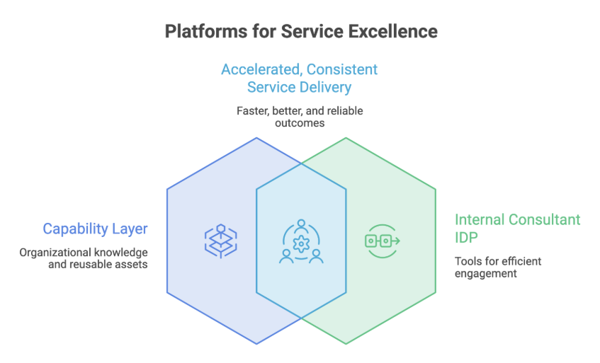

A consultant wraps up a Kubernetes migration task for a financial services client and moves to a new engagement. For the new client, he does the Kubernetes migration again, covering rebuilding CI/CD, observability, and access management from scratch.

The consultant is solving the same problem that three other teams in his organization already solved last quarter for other clients. So, there are three different approaches but no shared patterns or system for anything to compound.

Platform engineering should be an answer to the common tasks engineers are doing. For product companies, it is. Dedicated platform teams, internal developer platforms, golden paths - everything has evolved and matured over time and the results are visible.

Unfortunately, the platform engineering playbook was built around product company assumptions, with internal developers, consistent infrastructures, stable teams and long-lived products.

Service companies have none of this. Your developers are clients’ engineers, your infrastructure changes with every engagement, and your best consultants rotate across projects before any platform adoption can take hold. Service companies need a different model of platform engineering, and in this blog post, we’re going to explore it.

## **Why Platform Engineering Discourse Doesn’t Speak to You **

Platform Engineering is evolving fast and so are the conversations around it. Major conferences like KubeCon, a dedicated conference like PlatformCon and a growing community around platform engineering are a proof of it. The community has done serious work in defining what good looks like.

I’ve spoken and attended a lot of sessions on platform engineering, and almost every reference point is a product company. Spotify building Backstage for hundreds of internal engineers. A fintech standardizing deployment pipeline across product teams. A SaaS company reducing onboarding time for developers and so on.

The IDP model at the center of all this is straightforward. Your developers are your users, the platform team provisions environments and golden paths, and adoption improves over time as platform matures. The stack remains the same, problems remain the same, and everything is repeated at scale. *Service organizations break this approach.*

Your “internal developers” are spread across ten client engagements, each with a different stack, different cloud provider, and different security postures. A consultant who just ramped on a Kubernetes-heavy fintech project moves to a legacy modernization engagement next quarter. The tools, the patterns, the environment, all different. The IDP they used last quarter may be irrelevant on the next project.

Worse, the clients own their infrastructure - some on [AWS](https://www.improving.com/partners/aws/), some on GCP with ArgoCD already running and some in air-gapped environments with no access to your tools. You’re working inside someone else’s environment, within their constraints, often adapting on the fly. Self-service portals and standardized pipelines solve a problem your organization doesn’t have in the way the model assumes.

The industry isn’t wrong about platform engineering; it’s just that most of it is describing an organization that’s not service based.

## **Services Companies Need the Capability Layer **

If the IDP model doesn’t fit service companies, what does? Well, the answer lies in the focus.

We need to stop trying to standardize the environment and shift to standardizing the approaches.

A product company can build one platform because their developers work in one environment. Service companies don’t have that luxury. But what stays consistent across engagements is how your best consultants think about problems.

That thinking is an asset, and it has a name: ***Delivery Capital.**** *

It’s the organizational knowledge your consultants build engagement after engagement, the reference architectures, the diagnosed anti-patterns, and the judgment calls that took three failed approaches to get right. Most services companies let it walk out the door every time a consultant rolls off a project. The capability layer is simply the system that keeps it, and makes it reusable for the next person who needs it.

In practice, this means building two distinct internal layers.

### **Capability layer**

The capability layer is your organizational memory: a platform engineering capability model covering the patterns, approaches, and decisions your consultants shouldn't have to rebuild from scratch for every engagement.

Everything that was done for every engagement becomes a part of your capability layer.

1. Reference architectures for your most common engagement types
2. Policy templates in OPA or Kyverno, adaptable to any client’s compliance posture
3. GitOps patterns with ArgoCD that work across cloud providers
4. Observability stacks built on Prometheus and Grafana, deployable in any environment
5. Engagement accelerators, decision frameworks and starter templates that cut early ramp time

When a consultant starts a new Kubernetes migration, they don’t start from zero. They start from the last ten migrations your org ran.

### **Internal consultant IDP**

The internal consultant IDP is the tooling layer your consultants will use during the engagement.

1. Sandbox environments to test patterns before touching client infrastructure
2. Demo clusters for scoping and sales conversations
3. Fast onboarding tooling that gets a consultant productive in days, not weeks

Neither of the two layers is client-facing. But both directly improve what the client experiences with faster delivery, better decisions, consistent outcomes across every engagement.

## **Structural Problems That Kill this Before It Starts **

Building a capability layer seems straightforward, but service-based companies rarely get there. Here are the three reasons service organization fails to build capability layer:

### **Ownership vacuum**

Someone owns the platform in a product company. They have a charter, a roadmap and sometimes a dedicated team. Their job is to make the platform better, and they’re measured on it.

In a services company, nobody owns the capability layer. Delivery leads are focused on engagements. Practice leads are spread across various accounts. Senior engineers who could build this are always either billable or between projects. This results in the capability layer becoming everyone’s second priority.

Without an owner, nothing compounds. Things get built once, never maintained, and eventually abandoned.

### **Rotation constraint**

In a product-based company, the platform team builds the platform for stability. The same developers use the platform daily, adoption grows over time and the team gets feedback loops that help them continuously improve the platform.

Consultants don’t work that way. A consultant rolls onto a new engagement with two days to get productive. They don’t have time to learn and understand a complex internal system. They need:

1. Patterns that are fast to understand and easy to adapt
2. Documentation that doesn’t require tribal knowledge to interpret
3. Tooling that works across different client environments without heavy configuration

A capability layer designed for a stable internal team will fail in a services context. The design constraint is completely different.

### **Identity problem**

Services based companies are focused on delivery. The incentive structure, the culture, the way performance is measured - all of it points toward delivery. Billable work is valued, and internal capability building is not.

As long as contributing to the capability layer is seen separate from delivery, it won’t happen consistently. The consultants who could build the best patterns are always the ones most in demand on client engagements. And this affects the internal work that is needed to build and maintain the capability layer.

## **ROI is the Delivery Margin **

One of the things that we often discuss within the platform engineering community is how do we track and improve adoption. One of the metrics that always makes it to the discussion is DORA metrics (DevOps Research and Assessment).

Deployment frequency, lead time for changes, change failure rate, and mean time to recovery are the metrics that get tracked, and frankly these are meaningful numbers for a product company where engineering velocity maps directly to business outcomes.

For a service-based company, it’s completely different. A CTO or a delivery VP isn’t asking how fast your internal deployments are. They are interested in knowing whether engagements are profitable or not.

Hence, the platform engineering metrics that actually matter for a service company look different:

1. **Time-to-ramp**: How quickly can a consultant become productive on a new engagement? Every extra day saved directly improves the delivery.
2. **Delivery consistency**: How much of the work across engagements is reused versus rebuilt? Higher reuse means lower cost per engagement and more predictable outcomes.
3. **Proposal strength**: Can your team walk into a conversation with reference architectures, working demos and proven patterns? These help win deals.
4. **Engagement margin**: Fewer custom builds, faster ramps, less reinvention. The capability layer shows up directly in delivery margin over time.

For service companies, these metrics get internal capability investment approved.

A services org that builds and maintains a capability layer builds institutional knowledge that individual talent can’t replicate. The consultant who joins your Kubernetes practice inherits the patterns from twenty prior engagements, not just the memory of who worked there before. That's the competitive advantage for the organization.

## **Conclusion**

Any service company can hire a strong consultant, but only a few can build a system that makes every consultant stronger the moment they join. That’s the difference a capability layer can make over time. Every pattern is tested, every reference architecture is refined, every decision is documented to make sure the next engagement a little faster, a little more consistent and a little more profitable than the one before.

Platform engineering isn’t a universal implementation pattern, it’s an organizational optimization strategy. Product companies optimize for consistency. Service companies optimize for adaptability.

The blind spot in platform engineering discussion isn’t a reason to ignore the discipline. It’s a reason to build your own version of it.

If this resonates and you’re figuring out what this looks like for your organization, connect with me on LinkedIn. And if you’re building or scaling a delivery practice and want to think through the capability layer model, the [Improving team would be glad to talk](https://www.improving.com/expertise/ai/).
