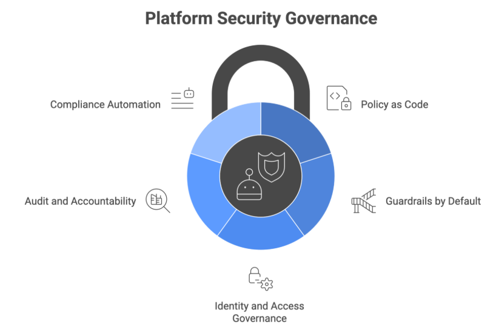

Your organization has more security tools than it did 5 years ago - scanners, policies, dashboards, alerts and so much more. Yet, breaches keep happening. In fact, in just the first half of 2025, there were more than 166 million data compromises and [1 in 6 breaches now involve AI-driven attacks](https://secureframe.com/blog/data-breach-statistics).

The problem isn’t the lack of tools, it’s the lack of consistency.

Cloud native adoption gave us the speed and scale but it has also, in a way, fragmented the way how security is enforced. Each team picked their own tools; policies were now in documents that people barely read. Compliance happened only during audits and not at runtime. And this resulted in organizations looking secure on paper, but in practice, there were cracks everywhere.

The questions that leaders should be asking isn’t “do we have enough security tools?”, rather, it’s “how do we enforce security consistently, across every team, every workload and every operator at scale?”

The organizations that have got this right are the ones treating their internal platform as a security enforcement layer - a single place where policies are defined, guardrails are built in, and every operator - human or AI - is held accountable.

In this blog post, we will look at how platforms help implement consistent security and guardrails at scale and what you platform teams needs to govern the traditional workloads and AI agents your teams are already running.

## Platforms as the Security Enforcement Layer

The industry loves shifting left - for everything - and it does help a lot as fixing things earlier in the development cycle is much easier - and cheaper. We asked our developers, operations teams and security engineers to shift left. The cognitive load was distributed, and the gaps too.

Platform engineering changed this, for good. Instead of asking every team to enforce security independently, platforms make secure behaviour the default. Policies are code. Guardrails are built into the [golden paths](https://www.improving.com/thoughts/what-nobody-tells-you-about-golden-paths-at-scale/), compliance is enforced by the platform at runtime, every time, for everyone.

It brings a fundamental shift from security as a responsibility to security as a system.

Whether you have five teams or fifty, the platform becomes the single point for enforcement in your organization. The same policies apply, the same guardrails hold and the same audit trail is captured for everyone. A developer using the platform’s CI/CD pipeline automatically gets security scanning. A team provisioning infrastructure gets compliance checks before anything is deployed. Nobody has to ‘remember’ to do the right thing, the platform does it for them out of the box. This applies to every operator on your platform - human or AI.

## 5 Ways Platforms Enforce Security Governance

Platform is your enforcement layer that gives your security teams something they've rarely had: a single, consistent enforcement point.

Here's what that looks like in practice.

**1. Policy as Code:** Security policies that live in documents get ignored. Policies that live in code get enforced. Policy as Code means your security rules are version-controlled, peer-reviewed, testable, and automatically applied at runtime. Tools like Kyverno and OPA (Open Policy Agent) help platform teams define rules once and enforce them across every deployment, every cluster, every environment. When a workload violates a policy, it gets blocked.

**2. Guardrails by Default:** The most effective security control is where developers don’t have to think about. When your platform's golden path has security baked in, compliance becomes a part of normal work. Secure base images, mandatory network policies, required resource limits: none of these require a developer to make a conscious security decision. The platform makes the secure choice the easy choice.



**3. Identity and Access Governance:** When identity is a platform-level concern, you get uniform enforcement and a meaningful audit trail. When it's left to individual teams, you get inconsistency and gaps. Who can do what, enforced at the platform level, not left to individual teams to configure. It means centralized RBAC, consistent identity propagation across services, and access controls that follow the operator.

**4. Audit and Accountability**: Every action on your platform should be traceable to a human decision. Not a service account. Not a pipeline. A person who made a call, at a specific time, for a specific reason. Platforms enforce this by capturing structured audit logs, requiring annotations on automated actions, and making accountability a non-negotiable part of every operation.

**5. Compliance Automation:** Traditionally compliance was point-in-time: an auditor comes in, reviews what you have, and leaves. By the time the report is published, things have already changed. Platform-native compliance is continuous, and reports reflect the actual state of your systems, not a snapshot.

Together, these five capabilities transform your platform from a developer productivity tool into a security asset. It enforces standards uniformly, reduces cognitive load on developers, and gives security teams the visibility they actually need.

## The New Blindspot: AI Agents

Here’s what is happening today. Platform teams are embedding AI agents to the platform. A ChatOps bot to handle routine scaling requests, an SRE agent to auto-remediate common incidents and a cost optimization agent that can right size workloads based on usage patterns.

Each of these addition makes sense on its own. Each one saves time. And by the time you realize, your platform has just added a new class of operator - one that acts faster than any human, holds broader permission than most engineers and leaves behind audit trails that have nothing useful.

That operator is your AI agent. And your platform has no idea what to do with it.

Traditionally, platforms embedded with tools like vulnerability scanners looked only for CVEs. AI agents today come with their own set of dependencies - skills, tools and MCP servers. But a malicious MCP server doesn't need a CVE to steal credentials or inject prompts. Unlike your applications, these dependencies of an AI agents are rarely scanned, audited or governed.

Every accountability mechanism your platform has built - identity governance, audit trails, contextual policies - was bypassed. Not maliciously, but because agents weren't in scope when those mechanisms were designed.

The [OWASP Top 10 for Agentic Applications](https://genai.owasp.org/2025/12/09/owasp-top-10-for-agentic-applications-the-benchmark-for-agentic-security-in-the-age-of-autonomous-ai/), released in December 2025, identified privilege escalation, tool misuse, and identity abuse as the top risks in agentic systems. What makes these particularly difficult is that the agent isn't necessarily doing anything unauthorized. It has permissions and using them. The platform just has no way to answer the three questions that matter:

- **WHO** triggered this action? *(A human, or just an automation running on a schedule?)*
- **WHAT** boundaries should apply? *(Are these the right permissions for this specific request, from this specific user, in this specific context?)*
- **WHY** did the agent decide this? *(What did it observe? What did it conclude? Would a human have made the same call?)*

This is what we mean by the blindspot. It's not that your platform is broken. ***It's that your platform was built for a world where every operator was human. That world no longer exists***.

## Extending Platform Governance to AI Agents

The good news is that you don’t need to throw away what you’ve built or build something new from scratch. The five capabilities we discussed earlier are the right foundations. They just need to be extended to cover AI agents.

Below are the three patterns that make this extension concrete:

### User Context Propagation - answering WHO

Every AI agent action needs to carry the identity of the human who triggered it. .

It means the platform requires a human identity annotation on every agent-initiated action. Admission webhooks validate it. Policy engines reject requests that don't carry it. The agent becomes a proxy for the human operator.

This is how it looks in practice:

```python
action_metadata = { 

    "triggered-by": current_user.id, 

    "trigger-reason": user_request, 

    "timestamp": datetime.utcnow() 

} 
```

When John asks the agent to scale his service, that request carries John’s identity through the entire execution chain. The audit log no longer shows a service account. It shows John.

### Dynamic Policy Enforcement - answering WHAT

Static RBAC can’t validate context-aware boundaries, but policy engines can.

Instead of "this agent can scale deployments", platforms can enforce rules like "this agent can scale between 2 and 5 replicas, for this team, only if CPU utilization has been above 80% for at least 10 minutes." Kyverno and OPA both support this kind of contextual policy enforcement natively.

The AI agent doesn't need to know about these constraints. The platform enforces them at the point of action. If the agent tries to scale beyond the boundary, the request is blocked with a clear policy violation message that explains exactly why.

```yaml
# Kyverno policy: enforce replica boundaries per team 

validate: 

  message: "Replica count exceeds team limit of 5" 

  pattern: 

    spec: 

      replicas: "<= 5" 
```

### Decision Attribution - answering WHY

This is the hardest problem and the most important one. When an agent acts, the platform needs to capture not just what happened - but the reasoning chain that led to it.

OpenTelemetry makes this possible. By instrumenting your agent with OTel, you can capture the full decision trace: what metrics the agent observed, how the LLM reasoned over them, what action it recommended, and what it ultimately executed. That trace is exported to a tool like Jaeger, where it's linked to the Kubernetes audit log via a shared trace ID.

```python
# Agent captures full decision trace with OTel 

with tracer.start_as_current_span("scaling-decision") as span: 

    span.set_attribute("observed.cpu", cpu_utilization) 

    span.set_attribute("llm.reasoning", reasoning_output) 

    span.set_attribute("action.taken", "scale-to-4") 

    span.set_attribute("triggered.by", user_id) 
```

After implementing these, the result is a complete accountability chain. From John’s Slack message to the agent's observation, through its reasoning, to the action it took on the cluster. Every step is visible and every decision is traceable. Together, these three patterns give your platform the same accountability guarantees for AI agents that it already provides for human operators.

- WHO is answered by user context propagation.
- WHAT is answered by dynamic policy enforcement.
- WHY is answered by decision attribution.

## How To Get Started

We’ve now understood the blind spots that AI agents create and how platforms can help put guardrails around their usage. But the question is how do you get started? Do you create a whole new platform from scratch, or do you extend your existing platform?

Here are some steps that you can follow:

- **Audit your current platform:** Explore your current platform and understand how it audits various actions currently. Does it have access to all the observability and tracking signals needed for building a complete audit trail? Is the platform able to answer the WHO, WHY and WHAT for every action taken - irrespective of the nature of the operator? You should be able to answer all these three questions.
- **Treat AI Agents as a new class of operator**: Standard service accounts are static while AI agents are dynamic operators. It’s important to understand that AI agents are a new class of operator - they work fast, take quick decisions and are often provided with broad permissions compared to normal engineers. Start by creating a dedicated identity for agents. This allows you to apply rate limits, comprehensive logging and “kill switches”.
- **Trace one high-privilege action, end-to-end**: Pick one of the most powerful agents in your environment and map the complete end-to-end journey. Understand the human/system prompt, the internal chain of thought, the execution - API call - and the attribution id to ensure that the final log entry includes a trace_id linking back to the original human requester.
- **Don’t reinvent the wheel**: You don’t need to build a bespoke security tool for AI. Extend your existing Policy-as-code tools. If you already have policies in place, ensure that they apply to the agent’s identity with even stricter enforcement and comprehensive logging.
- **Accountability first:** Ensure that decision attribution is a non-negotiable requirement before moving an agent from “read-only” experiment to a “read-write” operator as automation without accountability is just a shortcut to breach.

## Wrapping Up

Rise of AI agents raises the stakes of platform engineering and doesn’t change its goal. If your platform is truly the “Golden Path”, it must be robust enough to guide not just your human engineers but the AI agents working alongside them.

The most privileged user in your system might not be human, but the responsibility for its action is always with a human.

I’ll be diving into these architectures and showing live demos of agent governance at these upcoming sessions:

- **CloudXAI Bangalore | March 14:** A deep dive with a demo on extending your platforms to for accountability and identity for AI agents.
- **KubeCon Amsterdam (Open Source Security Day) | March 23:** A lightning talk on extending platform governance to autonomous operators.
- **BrightTALK Webinar | April 15:** A technical session on the "Identity of Intent" in platform security.

Feel free to reach out to me on [LinkedIn](https://www.linkedin.com/in/atulpriyasharma/) to discuss more about platform engineering, governance and AI. Looking forward to hearing your thoughts.
