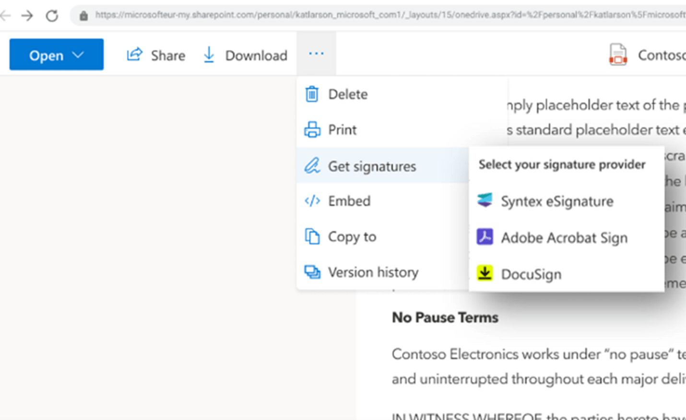

For as long as I can remember, we have had clients who want to be able to capture electronic signatures in SharePoint. The most common case for wanting to use e-signatures that we encounter is for a sign-off policy or compliance training. Some of our clients are in regulated industries that require them to provide proof of training with an individual’s signature. We also have requests for signatures on purchase orders and other formal policies.

Historically, this type of online documentation was set up in Adobe Acrobat Sign or DocuSign in conjunction with SharePoint. Unfortunately, this requires two separate licenses, and the signee must sign into both products.

Microsoft recently announced [the release of Syntex eSignature](https://techcommunity.microsoft.com/t5/microsoft-syntex-blog/announcing-new-microsoft-syntex-innovations-plugins-for/ba-p/3827822) at Microsoft Build 2023, which will allow users to send electronic signature requests while their content stays in M365. This feature will not remove the need for DocuSign or Adobe Sign for external parties, though it will be a great option to streamline the collection process for internal signatures.

Syntex eSignature will be in public preview in July 2023.

If you want to adopt e-signatures in Syntex/SharePoint, we encourage you to look at your information architecture and ensure it is up-to-date. Since the document stays inside SharePoint, you will need a location to create your document and store the signed copies. You may also want to consider adding metadata to the signed document, for instance, whom it was signed by, the signed date, or the type of document, to make it easier to find the document in the future.

To learn more about information architecture, view the Imaginet approach to [Enterprise Content Management.](https://imaginet.com/enterprise-content-management-in-sharepoint/)

Thank you for reading this post. If you enjoyed it and want to learn more, [reach out to us.](https://www.improving.com/contact/)
