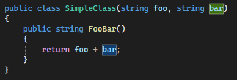
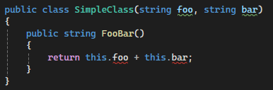
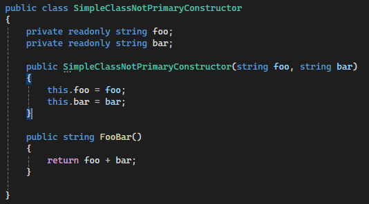
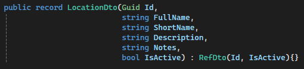
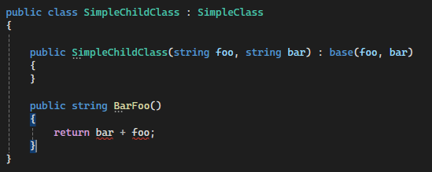
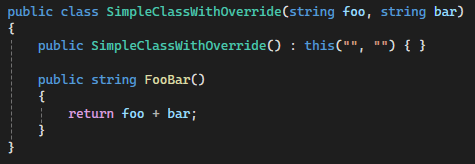
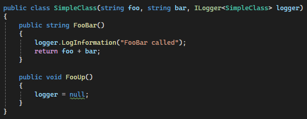
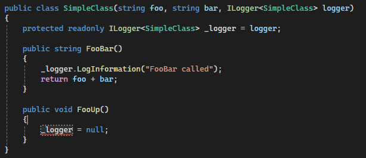

With the introduction of .Net8 and C#12 in November of 2023, there were many significant changes to .NET and C#. One such feature in C#12 is the concept of a Primary Constructor. A Primary constructor replaces a class constructor with parameters **on the class**. The parameters for the constructor are available anywhere in the body of the class.

With Primary Constructor:

It is important to note that the class parameters are **not** fields of the class. The following code will not compile if used in SimpleClass, as foo and bar are not available on “this”.

Using a Primary Constructor can significantly improve the readability of your code, as it does away with a lot of the code infrastructure around class constructors. For example, compare how much easier to read SimpleClass is, to functionally equivalent class that does not use a Primary Constructor.

Without Primary Constructor:

Primary Constructors can also be used on types of “struct” and “record”. This can make creating and maintaining DTO’s easier to do... For example.

We suggest keeping the following in mind when using a Primary Constructor:

Class parameters are not directly available to child classes. Thus, the following code will not compile, as bar and foo are not available to the child class, SimpleChildClass.

If you wish to override the constructor, the class parameters **must** be included. To include the class parameters, you must use this() on the overridden constructor. If your class has multiple constructor overrides, using a primary constructor may not be the best solution.

The Class parameters are **not** read-only fields. If you are using these parameters directly with dependency injection, it is possible to cause side effects that will cause runtime errors. For example:

If FooUp() is called before FooBar(), then a NullReferenceException will be thrown by FooBar(). It is better to use a read-only field in conjunction with the Primary Constructor.

This class will not compile because _logger is read-only and FooUp cannot assign a value to _logger, thus preventing FooBar from throwing a NullReferenceException. Primary constructors are a neat bit of syntactic sugar that has been added to C#12, which has the promise of making your classes a bit easier to read and saving some repetitive constructor code. They are not suitable for every situation, however, and care must be used when using these parameters in your code. The developers at Improving are passionate about what they do. They are extremely well-versed in all areas of coding and application development. When was the last time you updated your applications? From this blog, we can see how change comes quickly, which means applications can become out of date quickly. Staying ahead of these changes is essential to maintaining proper performance of your applications. If your applications are out of date, [fill out this form](https://improving.com/contact) and someone will be in touch.
