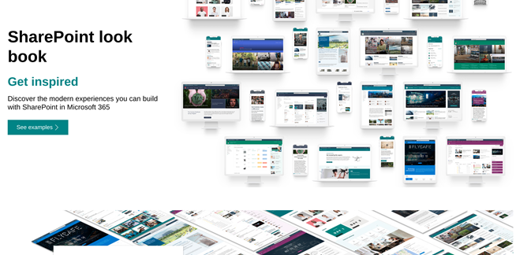

Your [SharePoint intranet](https://imaginet.com/sharepoint-services/) is a powerful communication resource that connects your hybrid workplace with modern and intelligent content experiences. But if your intranet is not quite where it should be, then Microsoft has something in store for you.

Microsoft introduced [SharePoint lookbook](https://lookbook.microsoft.com/#templates) to inspire you with the “art of the possible”. It provides templates with detailed web parts and configurations that can be applied directly to your tenant. Creating stunning sites is now easier than ever.

### **The pros**

If you’re new to SharePoint, this is a great way to dip your toes in the water. You can start experimenting and envisioning the intranet that’s right for your organization.

One of the biggest advantages for custom intranet projects is using these examples as a starting point during the UI/UX design discussion.

Transitioning to SharePoint can sometimes be overwhelming for someone new to this platform. Microsoft Lookbook gives us a very good option to showcase the SharePoint design capabilities without the need for deployment or custom code.

### **The cons**

Deploying them might sound incredibly easy. However, there are few things that you should keep in mind before utilizing them:

- You need to have Global Administrator access.
- These templates cannot be deployed to existing site collections.

Provisioning these templates will create a new site collection and you will still have to spend time and effort on your Information Architecture, permissions, navigation, and site structure, just to name a few.

### **What can Improving help you with?**

Usually, clients just want the look and feel of a specific template, and sometimes there are aspects of more than one template that can fulfill their requirements. In such scenarios, the simplest and fastest option is to design your site is by taking inspiration from these templates rather than spending time deploying and redesigning an existing one.

At Improving, we’ve completed [hundreds of SharePoint intranet projects over the last 10+ years](https://imaginet.com/success-stories/) – just take a look at our most [recent projects](https://imaginet.com/success-stories/) or [SharePoint design portfolio](https://imaginet.com/wp/wp-content/uploads/2023/03/Imaginet_SharePointDesignPortfolio.pdf).

When you’re ready to bring in the Microsoft Gold experts, Improving is here to help. Contact us today to schedule a free consultation to get started.

Thank you for reading this post! [Reach out to us to learn more.](https://www.improving.com/contact/)
