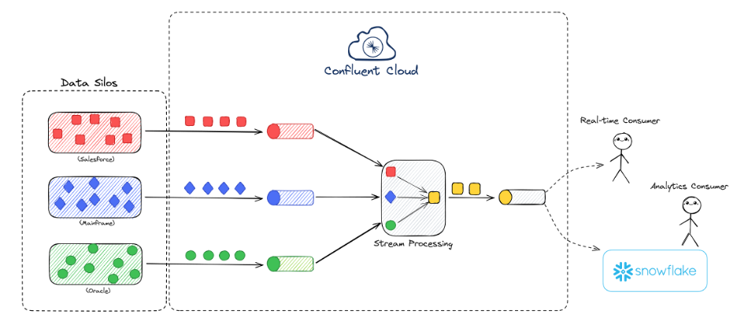
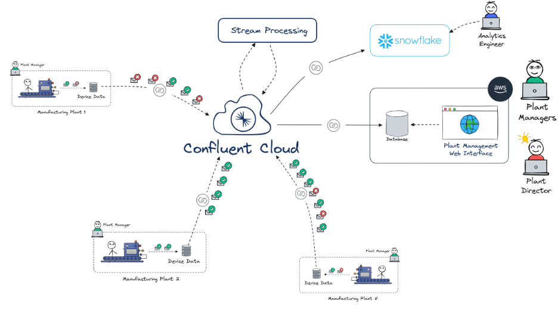
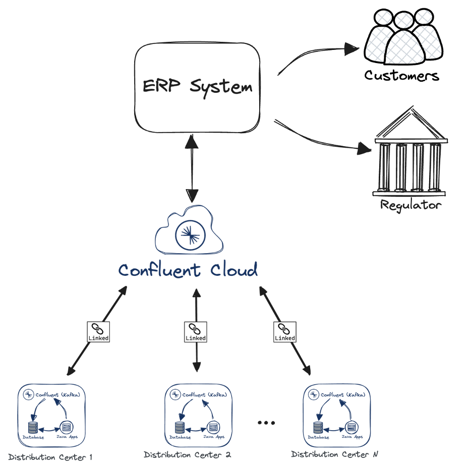

In a world where data drives key business decisions, having access to real-time, high-quality data is essential. Legacy systems, however, often complicate data accessibility, creating fragmented silos and bottlenecks. Organizations across various industries recognize the need for effective data architectures to overcome these challenges, and many are turning to event-driven frameworks as a solution. Here, we’ll explore the essential elements of real-time data architecture, common pitfalls, and best practices to ensure long-term success.

### **Common Challenges in Data Architecture**

Organizations frequently experience data silos and "point-to-point" connections, where teams create direct connections between data sources and consumers. Initially, this approach may seem manageable, but as more connections and data stores are added, the system becomes a tangled web, difficult to maintain and fragile. The result is a lack of transparency, reliability, and efficiency.

An effective solution is to adopt an event-driven architecture. Many organizations rely on Apache Kafka and Confluent Cloud, to enable real-time data streaming. While event-driven architectures offer a promising approach, they come with their own set of challenges. Without proper planning, organizations can end up recreating the same complex web of connections they sought to resolve. Below are some key considerations for successful implementation.

### **Key Elements of a Successful Real-Time Data Framework**

**1. Scalability and Resilience**

**a) **Scalability ensures that your data platform can grow with your organization. Employing solutions like Kubernetes and infrastructure-as-code tools (e.g., Terraform) helps automate and scale the infrastructure. Tiered storage, which stores data on both hot (frequently accessed) and cold (infrequently accessed) layers, further enhances flexibility by making data available without high storage costs.

**b) **Resilience is about building an infrastructure capable of handling failures without significant data loss or downtime. Setting up redundant data paths and leveraging self-healing mechanisms in tools like Kafka ensures continuous data flow, even if parts of the system experience outages.

**2. Governance and Security**

**a) **Data Governance involves setting up schema validation, access controls, and metadata management to ensure the data quality and maintain consistency across systems. Using data catalogs and standardized schemas helps users trust the data they consume.

**b) **Security starts with fine-grained access controls, such as role-based access control (RBAC), to limit who can access specific data. Field-level encryption can further protect sensitive information, reducing the risk of exposure while maintaining usability.

**3. Observability**

**a) **High observability is essential for monitoring the health and flow of data throughout the system. Tools like Confluent’s Stream Lineage and OpenTelemetry provide visibility into the data's journey, from source to destination. This transparency builds trust, as users can track issues, review historical data, and ensure that data reaches its destination as intended.

**4. Developer Experience**

**a)** Creating a user-friendly environment for developers is crucial for adoption. Tools that offer seamless data discovery, such as Confluent’s data catalog, reduce the friction developers face when locating and utilizing data. Additionally, encouraging a collaborative environment with shared standards for working with real-time data fosters innovation and aligns teams with best practices.

### **Avoiding Common Pitfalls**

Building a real-time data platform comes with challenges that, if left unchecked, can derail the effort:

- **Technical Debt**: Skipping governance or observability during early development phases can lead to complications down the line, as data consumers become reliant on initial implementations. Avoid accumulating technical debt by implementing these components from the beginning.
- **Reactive Governance**: Being proactive about governance policies ensures consistent data handling across the organization. A reactive approach, where data restrictions or policies are applied only after a problem arises, often results in disjointed or incomplete governance.
- **Lack of Centralized Standards**: When departments or teams develop separate data-handling standards, the resulting system lacks cohesion. Establishing a center of excellence can help standardize practices and create a unified data strategy across the organization.

### **Real-World Applications of Event-Driven Architecture**

Several real-world use cases highlight the benefits of a robust event-driven framework:

- **Data Liberation**: Breaking down data silos enables real-time access to information previously locked within specific departments. For example, using Confluent Cloud, organizations can aggregate data from various systems, transforming fragmented data sources into unified, discoverable products. This approach improves data accessibility, reduces the overhead associated with point-to-point connections, and opens up new possibilities for real-time workloads.

- **Centralized Data Visibility**: In manufacturing, for example, plants can use centralized data platforms to monitor and analyze machine performance in real-time, enabling predictive maintenance and reducing downtime. By integrating IoT data from multiple locations into a single, consistent stream, management can make timely and informed decisions based on the latest available data across the entire manufacturing network.

- **Real-Time Traceability**: In logistics, ensuring the traceability of products across distribution centers minimizes operational risk. Using tools like Kafka and Confluent Cloud with cluster linking, a repeatable, automated distribution center deployment was configured. Once deployed across all centers, organizations can track product movements in real-time, providing full chain-of-custody visibility and enabling fast resolution of potential issues with full redundancy to avoid disrupting business continuity.

### **Taking the First Step**

Organizations aiming to implement real-time data strategies can benefit from a structured approach to identifying and implementing use cases. Beginning with a single use case allows teams to validate the approach, assess its impact, and refine their processes. As these early wins demonstrate value, the data platform can be expanded to support broader, more complex use cases, creating a resilient, secure, and future-proof data architecture.

Real-time data architecture is an investment in organizational agility. By addressing these core elements—scalability, security, observability, and developer experience—companies can create a platform that not only meets today’s needs but also adapts to tomorrow’s challenges.

*If you missed the full presentation, make sure to explore the *[*Tomorrow Technology. Today*](https://www.improving.com/tomorrow-technology-today/webinar-series/)* series for more insights on AI, data ecosystems, and platform engineering.*
