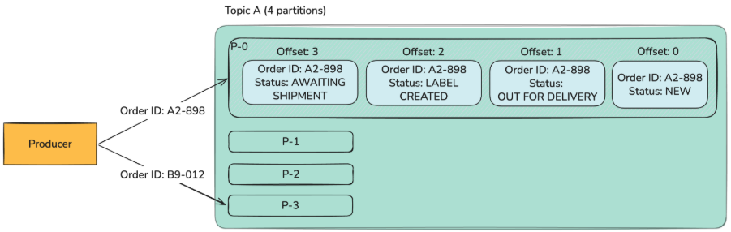
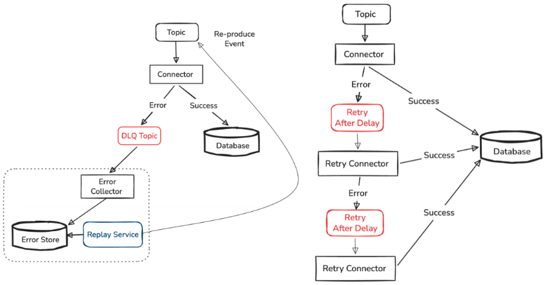
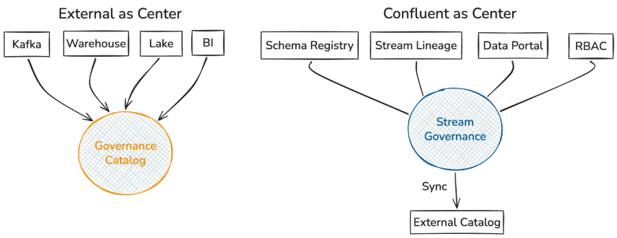
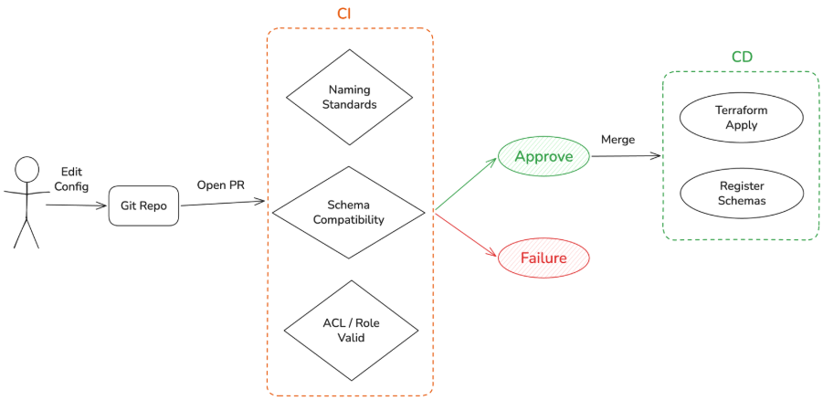
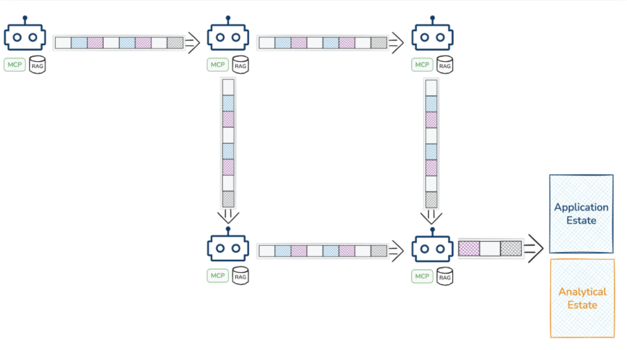

Getting started with real-time data streaming has never been easier. Platforms like Kafka, Flink, and various managed services offer mature architectures, extensive documentation, and AI-powered tools to help teams build sophisticated event-driven systems. But ease of entry masks a deeper truth: real time is the easy part. It's day two, day three, and beyond where organizations encounter the problems that burn runway and confuse teams.

The difference between a working proof of concept and a reliable production system at scale comes down to understanding what breaks after the first successful event, how to keep data trustworthy as more teams adopt your platform, and how these principles apply to modern agentic workflows running on real-time data.

## Observability: Flying Blind in Distributed Systems

The moment you adopt a real-time data streaming system, your ability to observe what's actually happening often plummets. Standard metrics—throughput, latency, broker health, consumer group lag—can all look healthy while your system silently fails.

A connector might report status as running, but the application downstream could be broken. Consumer lag might show zero, not because everything is current, but because a quiet source system has stalled and no records are arriving. Errors can be swallowed silently through configuration choices that seemed reasonable at the time. The health dashboard looks fine. Everything reports green. And meanwhile, data is missing.

The solution isn't to ignore standard metrics; it's to supplement them with signals that reflect what users actually experience.

Build black box signals to detect issues, and white box signals to debug. White box signals tell you about the system's internal state and typically comes from application telemetry. Black box symptoms tells you what your users see. Has an event arrived? Did it reach its intended destination? Are records failing silently?

Consider these advanced metrics:

- Dead letter queues building up: Messages are failing, and nobody knows why.
- Unreconciled events: Data entered the system but never made it to its destination.
- Entity staleness: Tracking when the last event from a particular source arrived. A spike in staleness means something upstream has stopped sending data.
- Canary events: Heartbeat messages through quiet systems to distinguish no data arriving from system has stalled.

Define which records should reach which destination and by when. Instrument your application with metrics and logs to track end-to-end freshness and completeness. Consider data lineage or distributed tracing across your streaming pipelines. Without these signals, you're essentially flying blind, watching metrics that don't tell you about the failures that matter.

## Delivery Guarantees: Understanding the Tradeoffs

Most teams understand the three delivery guarantee options:

- At most once: An event will be delivered zero or one time.
- At least once: An event will be delivered one or more times (duplicates possible).
- Exactly once: An event will be delivered exactly once.

Exactly once sounds ideal. It's what a product owner naturally expects: send a message, have something happen once. But it's also the most complex to implement, typically limited to within a single streaming system. End-to-end exactly once across distributed components requires building distributed transactions, which is complex and often impractical.

In practice, something different matters more: **effectively once**—a business-level outcome where the user sees the right result, regardless of what happened internally.

You can often achieve effectively once with an at least once producer paired with an idempotent consumer. The consumer handles duplicates gracefully, ensuring that processing the same event twice produces the same effect as processing it once. This approach is faster and more resilient than transactional exactly once. When the consumer crashes after receiving an event a second time, it doesn't break the system—idempotency handles it.

The tradeoff is real: transactional guarantees increase overhead and create more brittle consumption patterns as systems grow larger. In practice, roughly 80% of use cases can be served by at-least-once producers with idempotent consumers, even when the stated requirement appears to be exactly once.

**Use exactly once where it's available within platforms **(like Kafka Streams or Flink) to simplify reasoning about intermediate steps. For end-to-end guarantees spanning multiple systems, design for idempotency whenever possible.

## Ordering: Guarantees and Gotchas

Most real-time platforms support ordering natively. Kafka partitions combined with message keys, Kinesis shards, Event Hubs partition keys—these all ensure that events with the same key are processed in order. Getting started with ordering is straightforward.

But ordering has ramifications that emerge on day two and three.

**Partition rebalancing breaks ordering. **If you increase the number of partitions on a topic, a key that previously mapped to partition three might now map to partition five. Old events for that key are still in partition three. A consumer joining after the rebalance might process partition five first, receiving newer events before older ones. The local ordering guarantees are shattered.

**Message keys don't guarantee business causality. **Consider an order that moves through states: new, label created, awaiting shipment, out for delivery. If you key all order events by order ID, they'll stay on the same partition. But if an out for delivery event arrives before label created, your system receives an order that's being delivered before it was shipped. The partition guarantee isn't enough; business logic can be violated.

**Several strategies exist for handling out-of-order events, **each with tradeoffs:

- Hold and wait: Buffer the out-of-order event until other events arrive or a timeout passes. Requires defining watermarking strategies and lateness tolerance, which is hard to get right.
- Accept provisionally: Process the out-of-order event anyway and catch errors later when you realize the sequence was wrong. Risk: you may miss necessary downstream processing.
- Restructure as a workflow: Instead of a single order events topic, create topics for each state transition. A new order topic triggers processing that publishes to label created, which triggers awaiting shipment. This uses Kafka's guarantees to enforce business rules.

**Design for consumption patterns and parallelism from the start. **Partitions are your unit of parallelism. Be deliberate about how many partitions you need, leaving room for growth. Partition rebalancing is expensive and breaks ordering. A careful initial design prevents painful remediations later.

## Dead Letter Queues and Replay: A Routine Operation

Errors happen. A bug ships on Friday. A connector silently starts dropping messages. A consumer crashes and loses in-memory state. Eventually, some events end up in a dead letter queue, unprocessed.

Here's the critical insight: **a dead letter queue doesn't solve the problem. It stores it.** Until someone investigates, makes a decision, and takes action, the data sits there. Missing from downstream systems, invisible to users.

For most teams starting out, a dead letter queue plus monitoring is enough. But scaling quickly reveals this isn't sustainable. Dead letter queues fill up. The volume becomes unmanageable. Without handling them, they become a silent hemorrhage of data.

**Plan replay as a routine operation. **When you replay events from a dead letter queue, you're managing complexity:

- Idempotency: Make sure reprocessing duplicates doesn't break things.
- Ordering: Ensure replayed events don't violate state machine transitions.
- Filtering: Sometimes you only want to replay events that failed for a specific reason.

Small teams might triage the dead letter queue weekly with a human review. High-volume critical pipelines might implement exponential backoff and replay with fine-grained filtering.

The most mature approaches use an error store synced from dead letter queues, allowing services or automated agents to filter and replay intelligently. This requires investment but becomes necessary as scale grows.

**DLQs are a canary in the coal mine. **When they start filling up, something is wrong. Don't ignore them, and don't be so permissive that they collect everything. Be deliberate about what gets sent to the DLQ, take it seriously when it accumulates, and automate handling when volume makes manual intervention infeasible.

## Governance and Self-Service: Scaling Beyond a Team

Building a few streaming pipelines is manageable. One schema describes data structure. Ownership is obvious from topic names. Informal agreements work.

Scale changes everything. A company with 100 developers running a few hundred topics quickly reaches a point where teams step on each other's toes. Multiple teams produce similar data in slightly different ways. Contracts between systems are undocumented. Ownership is unclear. Every integration becomes an investigation.

Add Kafka's complexity: topics, partitions, consumer groups, connectors, service accounts, ACLs. Three streaming applications might require 13+ objects to manage. As your architecture grows, the explosion becomes unmanageable.

**Identify your governance center of gravity before choosing tools. **Some organizations center governance in Confluent Cloud with Schema Registry, Stream Lineage, and Data Portal. Others use Collibra or DataHub as the single source of truth, with Kafka as one component among many. The choice affects how you organize everything else.

Don't build scattered governance where your data warehouse uses one catalog, your streams use another, and they're somehow synced. Pick a center, then align your provisioning and tooling around it.

**GitOps is your answer to governance at scale. **Encode access control, schema changes, and governance policy as code in pull requests. Gate changes with CI/CD validation for schema compliance, naming standards, and other policies. Turn governance into reviewable, auditable, version-controlled decisions.

**Build self-service platforms on top of governance. **Your domain teams might not have streaming expertise. Instead of requiring each team to become a Kafka expert, provide opinionated templates: Submit this request, get an end-to-end at-least-once producer with an idempotent consumer syncing to your table. Let the platform team own the complexity. Domain teams just declare what they need.

This shift, from everyone learns Kafka to platform provides guarantees, developers declare needs, is what allows organizations to scale streaming platforms without burning out the teams building them. Governance becomes the foundation for velocity, not a brake on it.

## Agents in Real-Time Systems: Fresh Events, Stale Context

AI agents are arriving in streaming contexts, and the challenges are distinct.

An agent consumes an event stream and responds. But that event might not contain enough context for the agent to act wisely. You give the agent access to MPC servers or RAG databases for context. You can even stream updates into those systems, keeping context fresh at lower latency than batch processing allows.

Event streams can serve as a communication backbone for agent networks. Give an agent an input topic and output topic. The agent consumes from the input topic, processes, and publishes results to the output. Chain multiple agents into workflows through these topics.

This architecture provides several benefits:

• Auditability: Because agents communicate through Kafka, you have a complete log of inputs and outputs. You can trace and replay any decision.

• Access control: Agents don't need access to everything. They read from their input topic and write to their output topic. Governance and ACLs constrain their power.

• Integration: Other applications can participate in the workflow. Agents aren't isolated; they're part of a broader distributed system with the same guarantees and traceability.

• Context freshness: Real-time updates to agent data stores ensure decisions incorporate current business state, not stale information.

The insight underpinning this architecture is that context matters. Frontier LLMs are good at generalization, but they hallucinate without domain-specific information. Sophisticated agent applications require coupling prompts with fresh, relevant context in real time. This isn't just RAG or prompt engineering; it's context engineering—ensuring the agent knows the current state of the business.

Event streams are the substrate for this. They deliver fresh context, provide auditability and replayability, and enable scaling agentic workflows across distributed systems.

## The Path Forward

Real time is indeed the easy part. Kafka can be a dumb pipe for a while. But the systems that thrive at scale are those that address the harder problems: observability that reveals silent failures, delivery guarantees that match business needs, ordering that respects causality, replay strategies that handle inevitable errors, governance that scales with complexity, and architectures that let agents operate safely and traceably within real-time systems.

These aren't afterthoughts. They're the foundation for building trustworthy, observable systems that scale. Plan for them from the start, and you'll avoid the expensive reworking that comes when day three problems force a redesign.

Building resilient streaming platforms at scale requires expertise across architecture, operations, and the evolution of real-time data strategies. If your organization is navigating these challenges, or planning a streaming initiative, we can help you design systems that are observable, maintainable, and ready to grow.

[Get in touch with us to discuss your real-time data strategy. ](https://www.improving.com/contact/)
