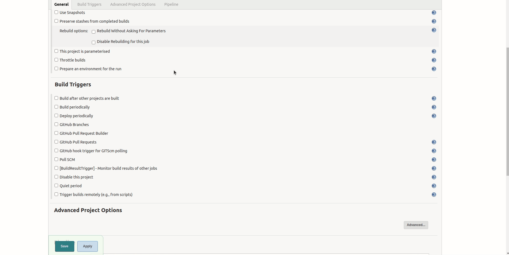
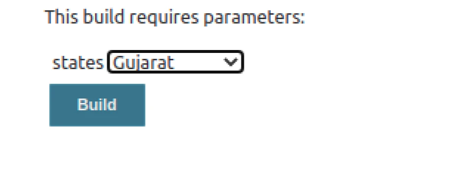
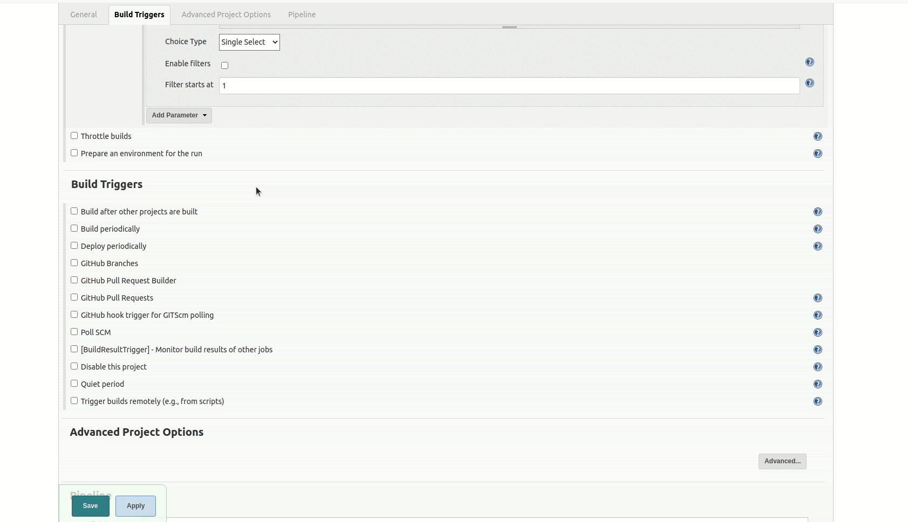
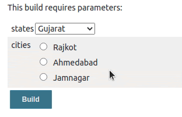
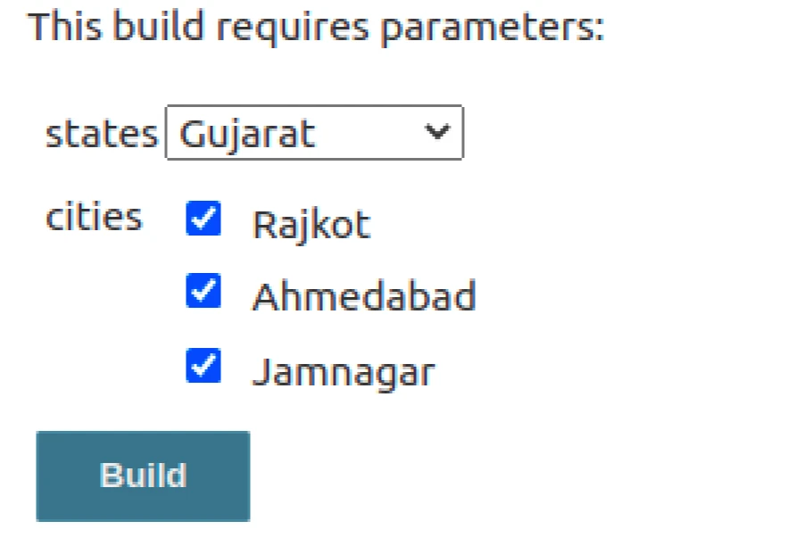
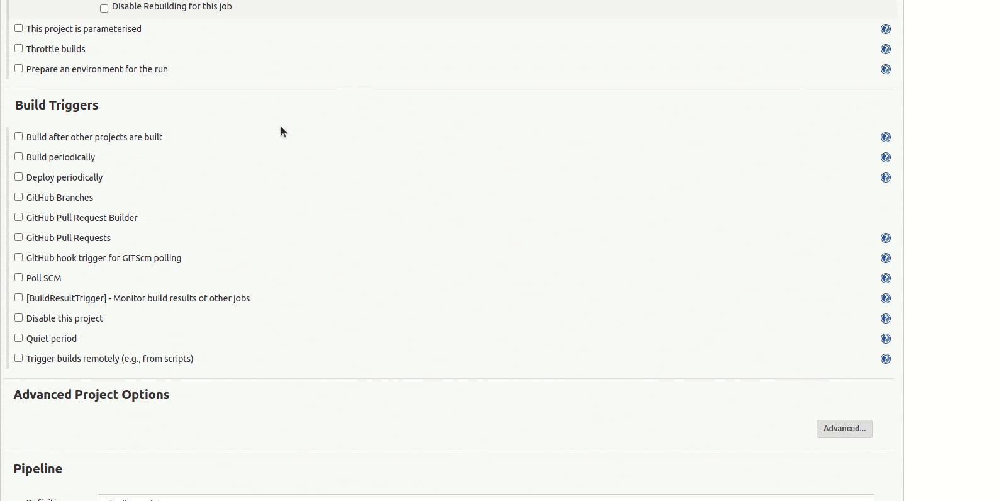
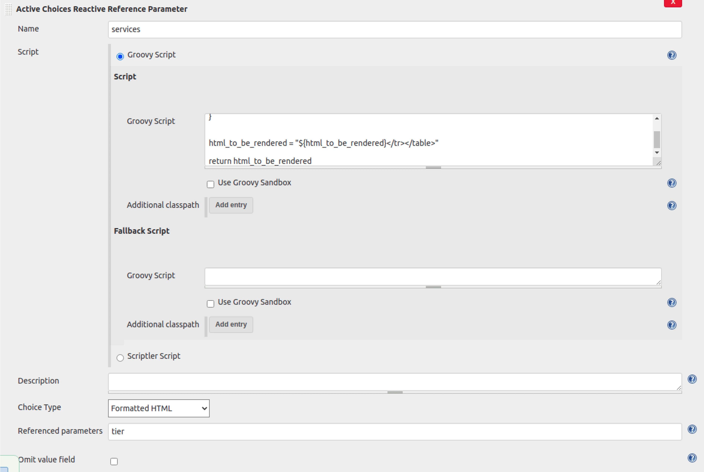
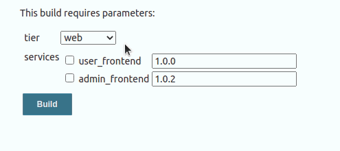
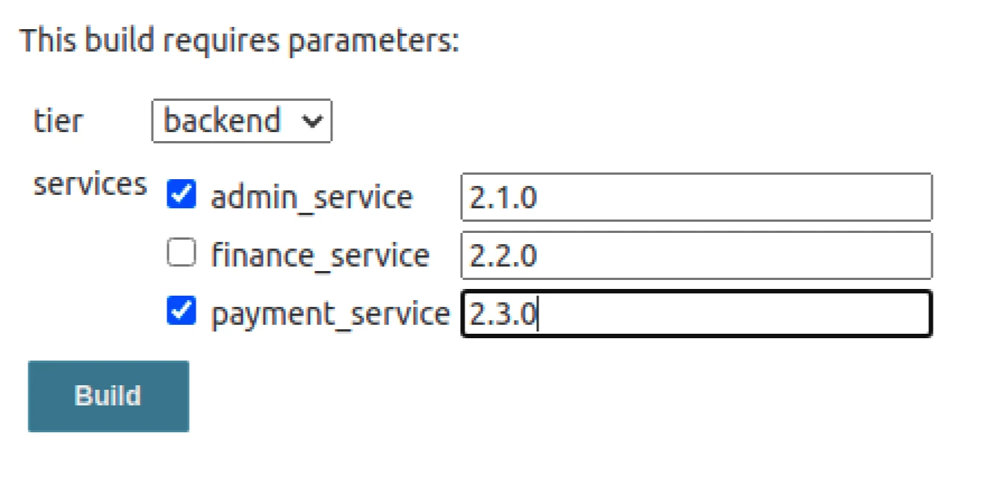

While working with the Jenkins jobs (whether it's declarative or freestyle), we often need to pass some parameters to the code being executed when you trigger the job. [Jenkins supports](https://www.improving.com/expertise/applications/platform-engineering/) this use-case by means of parameters that you can declare and use as Groovy variables in your Jenkins job. However, often you are not aware of all the parameters in the beginning or sometimes you want to render the parameters dynamically based on the value selected in any other parameter. Given the declarative nature of Jenkins jobs, we cannot achieve the use-case with the native Jenkins parameters available. Here comes the [Active Choices parameter plugin](https://plugins.jenkins.io/uno-choice/) to the rescue, which can help us render parameters/parameter's value dynamically.

Active Choices parameter plugin provides 3 types of parameters.

1. Active Choices Parameter
2. Active Choices Reactive Parameter
3. Active Choices Reactive Reference Parameter

Let's discuss each of these parameters and what they do.

### Active Choices Parameter

- An Active Choices parameter dynamically generates a list of value options for a build parameter using a Groovy script or a script from the Scriptler catalog.
- Active Choices parameters can be rendered as standard selection lists, checkboxes, and radio buttons.
- A text box filter can be optionally shown to aid in filtering the value options.

### Active Choices Reactive Parameter

- An Active Choices Reactive Parameter can generate the same set of value options as of Active choice parameter; in addition to that, it can be dynamically updated with the values based on the selection in some other build parameter that was referred to in the Active choices reactive parameter.
- Active Choices Reactive parameters can be rendered as standard selection lists, checkboxes, and radio buttons.
- A text box filter can be optionally shown to aid in filtering the value options.

### Active Choices Reactive Reference Parameter

- This parameter provides the same features as the Active Choices Reactive Reference parameters.
- In addition to that, it can enhance the Job UI form with custom HTML controls like list, images, text boxes, etc. We can render the dynamically generated HTML from Groovy script, and it can render it well on the UI page. We can add JavaScript and CSS styling as well to the HTML controls we are rendering using this parameter.

## Active Choices use cases

### Active Choices Parameter

When we want to generate the dropdown of checkboxes dynamically via some value returned from the API. For example, we can make an API call to fetch all the country's states and return it as a Groovy list so they will be rendered as a dropdown list.

### Active Choices Reactive Parameter

When we want to generate the dropdown of checkboxes based on the value returned from an API call plus selection in other dependent build parameters. Consider the above example of state, if we want to render all the cities for the state selected then we can use the Active Choices Reactive parameter and refer to the state parameter so that we can use the value of state parameter in the Groovy script for cities parameter.

### Active Choices Reactive Reference Parameter

Think of a deployment pipeline for a 3 tier application where we have to deploy multiple services for each tier. If we want the user to select which services he/she wants to deploy along with the release tag for that service, we need one extra control to ask the user for the release tag for the service he/she has selected. We can achieve this using the Active Choices Reactive Reference Parameter as it lets us render HTML components dynamically using some Groovy script. So, we can have a checkbox and textbox side-by-side which was not possible in earlier cases. Detailed explanation on the use case in [this section](https://www.improving.com/thoughts/render-jenkins-build-parameters-dynamically/#render-html-inputs-control-using-active-choices-reactive-reference-parameter).

## Prerequisites

- This plugin requires Jenkins version >= 2.204.1.
- The Active Choices Parameter plugin is installed on Jenkins.

### Render values dynamically based on the selection in other build parameter

In this use case, we will see how to render a dropdown with dynamic values using Active Choices Reactive parameters. We will see how we can configure the Active Choices parameter and Active Choices Reactive parameter.

- We will first create a sample pipeline project for this. Login to Jenkins, click on New Item, in the next page provide the name of your choice for your pipeline and select the Pipeline and click on Ok.
- On the configure job page select the This project is parameterized checkbox in the general tab.



- Now click on the Add Parameters dropdown and select the Active Choices Parameter from the list. The parameter configuration panel will look as shown in the image above.
- In the Name field add any name for your parameters and select the Groovy script in the Script radio buttons. Add a suitable description for your parameter.
- Next is Choice Type dropdown which has 4 choices available.
    - Single Select : It will render a dropdown list from which a user can select only one value. Value will be accessible in the pipeline code via a variable name.
    - Multi Select : It will render a dropdown list from which a user can select multiple values. If the user has selected multiple values then in the pipeline code value will be passed as comma separated string, we can get the value via parameter name as we would have got it for any other parameter.
    - Radio Buttons : It will render a radio button group for the list we have returned from the Groovy script. This will be a single selection parameter only.
    - Checkboxes : It will render a checkbox group for the list we have returned from the Groovy script. If we select the multiple checkboxes then the values will be comma separated.
  Now we will add the values to this parameter and will see it in action (refer the GIF above for how we can add the values). Add the following code in the Groovy script box.

```javascript
return ["Gujarat", "Maharashtra", "Punjab"]
```

- This will render a dropdown list with these values. Fallback script is used when there is some exception in the script execution. Save the job and open the Build with parameters page.
- This is how it will be visible on the Build With Parameters page.



Now we will add an Active Choices Reactive Parameter which will update the values based on the selection in the states parameter. We will render the cities for the states we rendered.

- Click on the configure and scroll down to the states parameter we have added.
- Click again on the add parameter dropdown and select the Active Choices Reactive Parameter.



- Fill in the following code in the Groovy script box.

```javascript
if ( states == "Gujarat") {
  return ["Rajkot", "Ahmedabad", "Jamnagar"]
} else if ( states == "Maharashtra") {
  return ["Mumbai", "Pune", "Nagpur"]
} else if (states == "Punjab") {
  return ["Ludhiana", "Amritsar", "Jalandhar"]
}
```

- Here, we have referenced the states parameter and used it's value in the Groovy script to render the values for the cities for that state. Now, hit the save button and click on the Build with parameters.

It will look something like this on the Build with parameters page. Based on the selection in the states dropdown list the radio buttons will be updated.



Currently, none of the radio buttons are selected by default, if we want that any radio button is selected by default, then we can add `:selected` after the value in the list. For example, if we wish Ahmedabad to be selected by default, then we will put something like this,

```javascript
if ( states == "Gujarat") {
  return ["Rajkot", "Ahmedabad:selected", "Jamnagar"]
} …
```

### Accessing the values in pipeline

Now, we will add a pipeline code to see the values of the parameters we have added. Click on the configure and scroll down to the Pipeline section and add the following script there.

```javascript
pipeline {
  agent any

  stages {
	stage('Demo Active Choices Parameter') {
	  steps {
		echo "States Selected ${states}"
		echo "Cities Selected ${cities}"
	  }
	}
  }
}
```

Save the configuration and click on the Build with parameters, select the state and city and click on Build, the console output will be as below,

```markup
[Pipeline] {
[Pipeline] stage
[Pipeline] { (Demo Active Choices Parameter)
[Pipeline] echo
States Selected Gujarat
[Pipeline] echo
Cities Selected Ahmedabad
[Pipeline] }
[Pipeline] // stage
[Pipeline] }
[Pipeline] // node
[Pipeline] End of Pipeline
Finished: SUCCESS
```

In the above use-case, we used radio buttons for the cities; let's change it to the checkboxes and see how it sets the multiple values as comma-separated values. We will go to the configure section and scroll down to the cities section, change the Choice Type to Check Boxes for the cities parameter, save and build the job with multiple cities selected and check the console output.



Look at the echo for cities, it has multiple city names separated by commas.

```markup
[Pipeline] Start of Pipeline
[Pipeline] node
Running on Jenkins in /var/lib/jenkins/workspace/tp
[Pipeline] {
[Pipeline] stage
[Pipeline] { (Demo Active Choices Parameter)
[Pipeline] echo
States Selected Gujarat
[Pipeline] echo
Cities Selected Rajkot,Ahmedabad,Jamnagar
[Pipeline] }
[Pipeline] // stage
[Pipeline] }
[Pipeline] // node
[Pipeline] End of Pipeline
Finished: SUCCESS
```

## Render HTML inputs Control using Active Choices Reactive Reference Parameter

We will try to write a sample Jenkins pipeline to deploy selected services for a multi-tier application along with the release tag. We will render a dropdown list using Active Choices Parameter which will list down the tiers we have. And based on the selection of the tier, we will render the services, which will have a checkbox and a textbox where a user can pass a release tag for the service. We will render checkbox and textbox as HTML input controls.

- We will begin by creating a new job. Go to Jenkins Home, select New Item, add a name for your Job, for the project type, select Pipeline project and click on Ok.
- On the configure job page select the This project is parameterized checkbox in the general tab.



- Now, we will add an Active Choices Parameter which renders our Application Tiers as a Dropdown. Click on Add Parameter dropdown in the parameters section and select the Active Choices Parameter there. Configure the parameter as shown in the image below.
- The above parameter will render the tiers. Now we need to add an Active Choices Reactive Reference Parameter which reacts based on the selection on the tier parameter and renders the services for selection.
- Click on the Add Parameter dropdown and select the Active Choices Reactive Reference Parameter. Configure the parameter values as shown in the image below. This will have the same configuration as the Active Choices Reactive parameter that we did in the previous section, just the choice type will be different (Formatted HTML) in this case.



Groovy Script for rendering the HTML input controls dynamically.

```javascript
service_tier_map = [
  "web": [
    ["service_name": "user_frontend", "release_tag": "1.0.0" ],
    ["service_name": "admin_frontend", "release_tag": "1.0.2" ],
  ],
  "backend": [
    ["service_name": "admin_service", "release_tag": "2.1.0" ],
    ["service_name": "finance_service", "release_tag": "2.2.0" ],
    ["service_name": "payment_service", "release_tag": "3.2.0" ],
  ],
  "database": [
    ["service_name": "dynamo_db", "release_tag": "5.4.1"],
    ["service_name": "mysql", "release_tag": "3.2.1"],
    ["service_name": "postgresql", "release_tag": "1.2.3"],
  ],
]

html_to_be_rendered = "<table><tr>"
service_list = service_tier_map[tier]
service_list.each { service ->
  html_to_be_rendered = """
    ${html_to_be_rendered}
    <tr>
    <td>
    <input name=\"value\" alt=\"${service.service_name}\" json=\"${service.service_name}\" type=\"checkbox\" class=\" \">
    <label title=\"${service.service_name}\" class=\" \">${service.service_name}</label>
    </td>
    <td>
    <input type=\"text\" class=\" \" name=\"value\" value=\"${service.release_tag}\"> </br>
    </td>
    </tr>
"""
}

html_to_be_rendered = "${html_to_be_rendered}</tr></table>"

return html_to_be_rendered
```

Let's take a look at how we render the HTML inputs. We have to be very careful about the HTML inputs and their syntax as if we change some configuration around them, we will not be able to get the value of that input control in the Pipeline code.

### How we can render the textbox HTML input

For textbox control, we can use the below syntax, we can update some values as per our use-case.

```markup
<input type="text" class=" " name="value" value="any-value">
```

Look at the name parameter for this HTML tag, we can not change it and must be the same as mentioned here. If we change it, we will not be able to get the value of this textbox in the pipeline code.

### How we can render the checkbox HTML input

For the checkbox control, we can use the below syntax, we can update some values as per our use-case.

```markup
<input name="value" alt="checkbox-name" json="checkbox-name" type="checkbox" class=" ">
```

As we have seen for the textbox input name must be value. alt and JSON attributes are optional, but as we have multiple checkboxes in our use-case we need to use this parameter to identify which checkbox was checked. If we don't pass the alt and JSON parameter then the value for the checkbox will be seen as true in the pipeline code, but if we pass the alt and JSON then the value of the checkbox will be seen as the string we passed in alt and JSON.

NOTE: We can see only selected checkboxes in the pipeline code, unselected ones will be ignored by the Jenkins. Also alt and JSON parameters must have the same value for the checkbox.

Save the configuration and open the Build with Parameter page, it will be something like this.



### Pipeline code to access the values

Let's add the pipeline code to see the values in the action. Open the configure Job page, scroll down to the last and add the following script to the pipeline code text box.

```javascript
pipeline {
  agent any

  stages {
    stage('Demo Active Choices Parameter') {
      steps {
        echo "Tier Selected ${tier}"
        echo "Services Selected ${services}"
      }
    }
  }
}
```

Save the job and Run the job by clicking on Build with parameters, select the tier and services you want to deploy and click on Build. I have run the job using the parameters below and the output for the same is mentioned below.



Console Output :

```markup
[Pipeline] {
[Pipeline] stage
[Pipeline] { (Demo Active Choices Parameter)
[Pipeline] echo
Tier Selected backend
[Pipeline] echo
Services Selected admin_service,2.1.0,2.2.0,payment_service,2.3.0,
[Pipeline] }
[Pipeline] // stage
[Pipeline] }
[Pipeline] // node
[Pipeline] End of Pipeline
Finished: SUCCESS
```

Let's understand the output, the echo statement for tier is straightforward, it prints whatever tier we have selected on the build with parameters page.

The second echo statement which prints the build parameter services, has comma-separated values for the HTML inputs control we have rendered. We have provided the service_name in the alt and json field for the checkboxes, so whichever checkboxes we selected, their name will be stored in the output. If we don't provide the alt and json field while rendering the HTML for the checkboxes, we will see the text "selected" instead of name and we will never be able to identify which checkbox was selected.

For textboxes, it will print the value we have added to the input box. The order in which these values are printed is the same order in which the controls were rendered from the Groovy script. We can split this value based on commas and can deploy our services.

## Conclusion

Jenkins declarative pipeline enables the [ease of creating CI/CD for the various systems](https://www.improving.com/expertise/applications/platform-engineering/), but at the same time the declarative nature of the pipeline becomes a headache when we want to render parameter dynamically. As we have to declare all the parameters before we run the pipeline, and in the above use-cases, we are not sure what all the parameters we need.

The Active Choices plugin helps to solve this problem by allowing us to render the parameter values and even the parameters dynamically by means of the Groovy and HTML code. This plugin is very simple to use as it needs just basic level of understanding of Groovy and HTML.

That's a wrap folks :) Hope the article was informative and you enjoyed reading it. We'd love to hear your thoughts and experience - let's connect and start a conversation on Twitter.

Looking for help with building your DevOps strategy or want to outsource DevOps to the experts? Learn why so many startups & enterprises consider us as one of the [best DevOps consulting & services companies](https://www.improving.com/expertise/applications/platform-engineering/).

### Bibliography and Reference

- [Official Jenkins Document for Active Choices Plugin](https://plugins.jenkins.io/uno-choice/)
- [Explore InfraCloud's Jenkins consulting and support capabilities](https://www.improving.com/expertise/applications/platform-engineering/)
