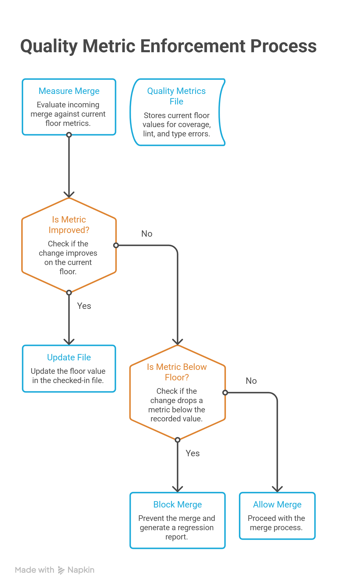

In my 2 decades of working with Fortune 100 companies' stakeholders, I’ve seen a dramatic change in the way companies are shipping products in the new AI-native age. Most responsible AI programs I have reviewed share the same structural flaw: they run a one-time audit, produce a document, and call it governance. The audit gets updated once a year, maybe once a quarter if the organization is disciplined. Between audits, the model drifts, the training data shifts, and new features ship against the same model without a second look. Unfortunately, that’s how responsible AI governance is treated - a snapshot bolted onto a system that never stops moving.

Let’s assume a quarterly audit is a photograph, and a production system is a video. No number of increasingly detailed photographs substitutes for watching the video continuously, and every regulator who has ever asked a company to demonstrate ongoing compliance rather than point-in-time compliance already knows this.

Let me take you through building a responsible AI system where ethics and governance are part of your AI strategy from day 1.

## **Understanding Responsible AI Governance**

Responsible AI governance is the set of controls, measurements, and enforcement mechanisms that keep an AI system’s fairness, privacy, and explainability behavior within limits chosen by the organization.

These are checked continuously rather than at a single point in time. It covers the full lifecycle:

- How a model gets designed
- What data feeds it
- How its behavior gets measured after launch
- What blocks a deployment when that behavior drifts

Frameworks like [NIST’s AI Risk Management Framework](https://www.nist.gov/itl/ai-risk-management-framework) and [ISO/IEC 42001](https://www.iso.org/standard/42001) describe what responsible AI governance should cover. They say almost nothing about how to enforce responsible AI for enterprises between review cycles, which is the gap this piece is about.

## Importance of Responsible AI Governance

Implementing responsible AI governance is critical because damage happens when you skip continuous enforcement, and there are long gaps between audits. A model that passed its fairness review at launch can drift into disparate impact eighteen months later, with no one noticing until a regulator, a journalist, or a plaintiff’s attorney notices first.

Under [GDPR’s Article 22](https://gdpr-info.eu/art-22-gdpr/), under the EU AI Act’s phased obligations, and under state laws like Colorado’s rules on high-risk automated decisions, the expectation is shifting from “you had a policy” to “you can show the control was live on the day the decision was made.” A document from last year’s audit deck cannot show that. A checked-in floor that gates every deployment can.

## Software Delivery Discipline Has Already Solved Responsible Governance

Software engineering had an almost identical problem with code quality, and it solved it with a mechanism worth importing directly: [the ratchet pattern](https://en.wikipedia.org/wiki/Ratchet_effect).

Quality metric regression in software is gradual and invisible by default. The test coverage drifts down a few points with every sprint and lint warnings accumulate in recently touched files. No single commit introduces a dramatic regression, and the decline is the sum of many small, individually defensible decisions. The ratchet’s answer is mechanical rather than cultural. Here’s what actually happens:

- Quality metrics get stored in a checked-in file that records the current floor for each one: branch coverage, lint violation count, type errors, whatever the team tracks.
- The file updates when a change improves on the floor. It never updates downward.
- Every merge gets measured against that floor before it lands, and anything that would drop a metric below its recorded value is blocked, with a report showing exactly what regressed.

The name is literal: a ratchet is a gear with a pawl that permits rotation in one direction and locks against the other so the quality can climb. It cannot slip back, because the floor is enforced automatically on every single change, not remembered by a reviewer or protected by a team norm that depends on someone paying attention.

I have also discussed how this pattern runs day to day inside an engineering organization in a companion piece on ratchet patterns in AI-assisted development.

Responsible AI needs the identical mechanism applied to a different set of metrics. It is the same checked-in file, the same automated gate, pointed at ethics and governance measurements instead of code quality measurements. This is the mechanism Improving’s [responsible AI and governance advisory work](https://www.improving.com/expertise/ai/strategy-roadmap-assessment/) is built to help organizations design before the first model ships, not retrofit after a regulator asks for evidence.

## What the Ratchet Looks Like Applied to Ethics

### AI Governance in Health

We worked with a regional health plan running production agents across eleven business domains, more than 130 data subdomains, and upward of 80 external data suppliers, everything from claims records to care management notes. The ethics question in that program, PHI and PII exposure, could not be handled as a document, because no single team had visibility into the whole data estate.

1. The floor that ended up getting enforced was structural rather than a number in a spreadsheet: every dataset feeding a production agent carried column-level access control and automated lineage tracking through the platform’s catalog layer, so a model could not train on or retrieve a protected field the catalog had not explicitly cleared for that purpose.
2. Every access, human or agent, produced an audit log entry satisfying HIPAA’s trail requirement as a byproduct of the access itself.
3. The health plan’s security function required six separate approvals across the program before any agent reached production, each one verifying that the control lived in the platform and not in a policy memo somebody hoped people would read.

That is the ratchet in the form a regulator actually recognizes: not a target number filed away, but a boundary the system enforces on every single request, whether the requester is a person or an agent.

> **Common mistake:** Teams treat this kind of catalog-level enforcement as a data governance project separate from AI governance. It is the same project. If your data catalog can’t tell a model no, your ethics policy is a suggestion.

### AI Governance in Recruitment

A hiring model that screens resumes illustrates the same idea, though I have not yet seen a client run the full mechanical version of it. The metric that matters is disparate impact, the ratio of selection rates across protected groups. Most responsible AI programs measure this once, at model launch, as part of an initial fairness review, then treat that review as done.

The ratchet approach records that measurement as a floor in a checked-in file, the same file structure a software team would use for coverage percentage, and gates every retraining, every feature addition, every data refresh against it before it ships. If a model update would push disparate impact below the recorded floor, the deployment blocks automatically, with a report showing which group’s selection rate moved and by how much. I want to flag this one honestly: it is the clearest illustration of the pattern, but it is also the one where I am describing the mechanism the ratchet implies rather than an engagement where I watched it enforced end to end.

### AI Governance in Finance

The same logic extends to financial services organizations operating under GDPR’s Article 22, which gives individuals the right to an explanation for automated decisions that significantly affect them. An explainability coverage metric, the percentage of decisions for which the system can produce a human-legible reason at the confidence level the model actually used, is measurable today in most mature model governance programs. Recording it as a floor and gating deployment against it is the identical mechanism applied to a different regulatory obligation, and it never requires inventing new measurement science.

Fairness metrics, PII detection rates, and explainability coverage are already measurable in most mature AI programs. What is usually missing is the mechanical enforcement: the automated block that makes regression impossible to ship quietly, rather than the manual review that makes regression merely embarrassing to discover later.

## Audit Report That Actually Matters

A checked-in ratchet file updated on every deployment creates a continuous, tamper-evident history of the trend. The commit history of that file shows exactly when each metric improved, by how much, and what change produced the improvement. For a compliance team preparing for a GDPR data protection impact assessment or a CCPA-driven review of automated decision-making, this history is a materially better artifact than a static report, because it demonstrates ongoing due diligence rather than a single point of attention paid once a year.

The ratchet strategy reframes responsible AI as competitive advantage rather than compliance overhead, and the mechanism explains why. An organization with an enforced ratchet metrics can approve model updates faster than an organization relying on a manual review board, because the mechanical gate has already done the checking that the review board exists to do by hand. The review board still matters for judgment calls the gate cannot make, but routine updates that pass the automated floor do not need to wait on a monthly compliance meeting.

The organizations moving fastest on AI adoption are automating it thoroughly enough that governance stopped being a scheduling bottleneck.

## Calibrating the Floor Honestly

The practical question the ratchet raises immediately, in software and in ethics alike, is what the starting floor should be.

- Set it above where the system currently performs and every deployment blocks immediately.
- Set it at the system’s current performance, whatever that performance actually is, and let improvements accumulate from there.

This is uncomfortable advice for an organization that has not yet measured its own bias or privacy exposure honestly, because it means the first step is measuring the current state, not the ideal state, and recording an uncomfortable number as the starting point. That discomfort is the signal that the exercise is working. A floor set at an aspirational number the system does not currently meet is not a governance mechanism. It is a promise with no enforcement behind it, the performative version of responsible AI this approach exists to replace.

> **Counterintuitively:** The health plan’s six-approval gate (mentioned above) looked like it would slow deployments down. It did the opposite. Once the floor lived in the platform instead of in review meetings, routine changes stopped needing a meeting at all. Approvals compressed to the cases that actually required judgment.

There is legitimate nuance in how floors get structured. A model serving multiple markets under different regulatory regimes, GDPR in the European Union, CCPA in California, needs per-jurisdiction floors rather than one global number, the same way a codebase with legacy modules carries per-directory quality floors instead of a single blanket standard. A model in active experimentation, still in a sandboxed pilot rather than production, can carry a different floor than the same model once it reaches general availability, provided the transition between the two is itself a deliberate, documented gate rather than a quiet default.

## Where This Breaks and Where It Does Not

The ratchet is not a complete answer. It works for anything that can be measured and aggregated including disparate impact ratios, PII detection rates, and explainability coverage percentages.

It has nothing useful to say about qualitative judgment:

- whether a use case should exist at all,
- whether a model’s purpose is ethical regardless of how cleanly it scores,
- whether a borderline case deserves an exception.

Such questions still need a human ethics review, and no mechanical floor replaces that judgment. The ratchet handles the part of responsible AI that is measurable and repetitive, freeing the human review process to spend its attention on the part that is genuinely hard to automate, a better allocation of scarce expert judgment than having that same review process re-verify metrics a machine could check continuously.

[Goodhart’s law](https://en.wikipedia.org/wiki/Goodhart%27s_law) applies here with the same force it applies to software quality metrics, and it applies harder, because the stakes are higher. Once disparate impact becomes a target rather than a measure, an organization can find ways to satisfy the number without addressing the underlying fairness problem, narrowing the population the model is applied to, for instance, rather than fixing the model’s actual behavior.

The ratchet enforces the floor on whatever gets measured, and it says nothing about whether the chosen metric captures what actually matters. Choosing what to measure is the real decision, and it deserves the same rigor as building the enforcement mechanism itself. A well-built ratchet enforcing the wrong metric is worse than no ratchet, because it manufactures false confidence.

## Why Day One Matters

The instruction to build ethics and governance in from day one is usually heard as a values statement. It is better understood as a sequencing argument.

A ratchet floor set after a model has been in production for a year has to be calibrated against whatever bias, privacy exposure, or explainability gap already exists, and every subsequent improvement gets measured against a starting point that was never chosen deliberately.

A floor set at the design stage, before the first version ships, gets to start at a number the team actually chose, informed by what the model is for and who it affects, rather than a number the team is stuck defending because it happened to be where things landed.

## Final Words

If you run a responsible AI program today, the next step is small: pick one metric you already measure like fairness, PII exposure, explainability coverage, and check whether it is recorded anywhere as a floor that gates deployment, or whether it just lives in last year’s audit deck. Our companion post on what every enterprise needs in place before production walks through the broader checklist this ratchet sits inside.

I’ve spent enough time in these programs to have a bias here, and I’ll state it directly: a governance document nobody’s system enforces is worse than no document, because it creates the appearance of control without the substance.

If your fairness, privacy, or explainability metrics live in a report instead of a gate, that’s the first thing worth fixing this quarter. If you want a second opinion on where your program stands, [reach out and let’s talk it through](https://www.improving.com/contact/).

## **FAQ**

**Do we need a ratchet for every AI metric we track, or just a few?**

Start with whatever metric already has regulatory teeth for your industry, disparate impact for hiring or lending, PII detection for healthcare, explainability coverage for financial services. You can expand from there once the mechanism proves out on one metric.

**What if we don’t have the engineering resources to build automated gates right now?**

A manual gate that runs on every deployment and blocks on a documented floor still beats an annual audit. The ratchet’s value is in the floor never moving down and the check happening every time, not in the automation itself. Automate it once the manual version is working.

**How do we pick the starting floor if we’ve never measured this before?**

Measure current performance first, even if the number is uncomfortable and set the floor there. The floor’s job is to stop things from getting worse, not to declare the system already good.

**Does this replace the human ethics review board?**

No. It removes the repetitive, measurable checking from the board’s workload so the board can spend its time on judgment calls a metric can’t resolve, like whether a use case should exist at all.
