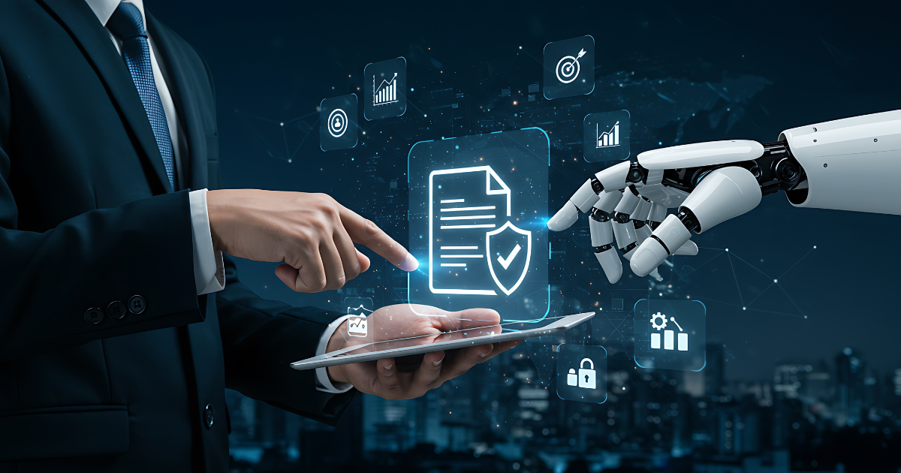

Imagine the human brain as a vast, self-organizing language model—an engine trained on the patterns of experience, capable of generating meaning from the raw data of life. Like today’s artificial neural networks, it predicts, associates, and improvises. But the real leap in human intelligence didn’t come from bigger brains or more neurons. It came from something else: our ability to build tools that externalize and compound our learning.

## **Tools: Amplifying Intelligence Beyond the Brain**

The leap in human intelligence wasn’t just about what happened inside our heads—it was about the tools we built to extend our reach. Tools are physical or conceptual devices that let us do more than our bodies or minds alone could manage.

Take a shovel: using it to dig a hole doesn’t require an understanding of metallurgy or engineering. The knowledge of how to build a shovel—designing the blade, forging the metal, shaping the handle—is separate from the knowledge of how to use it. This separation is powerful. It means that expertise can be distributed: a few can invent, many can apply.

Tools externalize tasks. They allow us to offload effort, repeat processes, and scale up our impact. The wheel, the compass, the printing press—each tool let humans do something new, faster, or at greater scale. And as tools became more sophisticated, they enabled new kinds of learning and collaboration.

This modularity—where the “how” of building is distinct from the “how” of using—allowed knowledge to spread rapidly. You don’t need to be a blacksmith to farm with a plow, or a mathematician to use a calculator. Tools democratize capability, letting people focus on solving problems rather than reinventing solutions.

In AI, we see this principle in the rise of “tool-augmented” models: large language models (LLMs) that can use calculators, search engines, or code interpreters to extend their capabilities. For example, OpenAI’s GPT-4 with tool use, or Google’s Gemini, can call external APIs or run code, separating the model’s reasoning from the execution of specialized tasks.

## **Symbolic Storage: Memory Beyond the Mind**

With writing and math, humans created symbolic storage—systems that could persist and transfer knowledge across time and space. Information was no longer bound to the lifespan or influence of a single person. Ideas could be refined, challenged, and built upon by generations. The brain became just one node in a network of shared memory.

Writing allowed us to record laws, stories, and discoveries, making knowledge durable and portable. Mathematics provided a universal language for describing patterns, relationships, and processes. These symbolic systems enabled the transfer of expertise, the accumulation of wisdom, and the birth of science.

In modern AI, symbolic storage is echoed in the use of knowledge graphs, databases, and retrieval-augmented generation (RAG). For instance, models like DeepMind’s Gopher or Meta’s Llama-Index can access external documents and structured data, retrieving facts and context that persist beyond any single training run. This allows AI to “remember” and reference information, much like humans rely on libraries or the internet.

Recent advances in “memory-augmented neural networks” and “vector databases” allow AI systems to store and retrieve information across sessions, enabling persistent knowledge and context—an essential step toward scalable, collective intelligence.

## **Collaboration: Systems for Shared Progress**

As societies grew, we invented systems of collaboration—like the scientific method, economic markets, and shared protocols. These frameworks gave us rules and processes for working together, allowing people with vastly different goals and mindsets to interact productively. Collaboration became a force multiplier for intelligence, enabling collective problem-solving and innovation.

The scientific method, for example, standardized how we test ideas and share results, making progress cumulative and reproducible. Economic systems enabled specialization and trade, letting individuals focus on what they do best while benefiting from the expertise of others. Protocols and standards—from language to internet protocols—allowed interoperability and scaling.

In AI, collaboration is emerging in multi-agent systems and federated learning. Projects like Google’s AlphaFold used global scientific collaboration and shared data to solve protein folding. Federated learning, as seen in Google’s Gboard or Apple’s privacy-preserving AI, allows models to learn from distributed data across many devices, without centralizing sensitive information. Open-source communities (like Hugging Face) enable thousands of researchers to build, share, and improve models together.

Multi-agent frameworks such as Microsoft’s AutoGen and Stanford’s Voyager demonstrate how teams of AI agents can collaborate, delegate tasks, and build on each other’s outputs—mirroring human collaborative systems.

## **Governance: Agents for Trust, Alignment, and Accountability**

Collaboration and scale bring new challenges: trust, conflict, and the risk of breakdown. In human society, we built governance systems—constitutions, laws, institutional checks—to manage these downsides. Governance provides accountability, traceability, and resilience in a world of diverse motives and experiences.

In advanced AI systems, governance is evolving from static rules to dynamic, agent-based oversight. Instead of relying solely on hard-coded constraints, we’re seeing the emergence of governance agents—specialized AI components that monitor, audit, and guide the outputs of “thinking agents” (the models generating content or decisions).

These governance agents collaborate with thinking agents in real time, ensuring that outputs match the relevant laws, ethical standards, and the intents of the system’s creators. For example, Anthropic’s Constitutional AI uses a set of principles enforced by governance agents to shape model behavior. Microsoft’s AutoGen framework allows for “critic agents” that review and validate the work of “worker agents,” flagging issues and enforcing compliance.

This agent-based governance enables systems to adapt to new regulations, organizational policies, and shifting societal norms. It also allows for transparency and auditability: every decision can be traced, justified, and—if necessary—corrected. As AI systems become more autonomous and interconnected, governance agents will be essential for maintaining trust, safety, and alignment with human values.

## **The Arc of AI Development: Bigger Brains, Same Limits**

Today’s AI development has largely followed the path of scaling up the “brain”—building larger and more powerful neural networks. These systems are impressive, but they often lack the external scaffolding that made human intelligence scalable and trustworthy. They hallucinate, struggle with provenance, and can’t always explain their reasoning. In essence, we’ve built neural engines without the symbolic memory, collaborative frameworks, and governance that make human intelligence robust.

## **Toward AGI: Systems, Not Just Models**

If the path to full AGI mirrors the evolution of human knowledge, it won’t be just about bigger models. It will be about integrating neural intuition with symbolic structure, collaborative processes, and governance mechanisms. The intelligence of the future will be distributed—not just in the model, but in the systems it connects to.

Imagine AI systems that can externalize their reasoning, iterate on shared knowledge, collaborate across domains, and operate within transparent governance frameworks. This architecture could make AI explainable, auditable, and adaptable—scaling intelligence in ways that echo the journey of humanity itself.

Recent research is already moving in this direction: Microsoft’s AutoGen enables teams of AI agents to collaborate on complex tasks, with governance agents ensuring compliance and alignment; OpenAI’s GPTs can use external tools and share workflows; Anthropic’s Constitutional AI incorporates governance principles directly into model training.

## **Conclusion: Scaling Intelligence Through Systems**

Humanity’s greatest innovation may not have been the brain, but the ability to build systems that externalize, share, and govern knowledge. As we rethink intelligence—human and artificial—we might find that the real path to AGI lies not in the skull, but in the systems we build around it.

Ready to rethink intelligence together? [Contact us today](https://improving.com/contact) to start the conversation and explore how our systems can help you scale knowledge and innovation.
