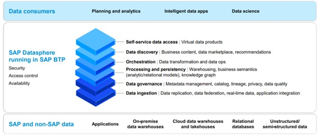
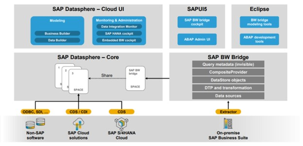
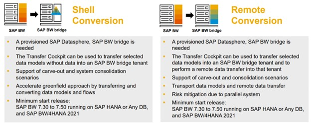

“Data is the new oil of our era.” A common challenge faced by contemporary businesses is the segregation of data, often scattered across various IT systems and applications, which hampers the accessibility of precise and timely information for decision-makers. SAP Datasphere emerges as a robust solution, empowering data-driven decision-making, streamlining complex data environments, and establishing a business data fabric that offers real-time, dependable data accessible, harmonized, and analyzable by business professionals.

SAP Datasphere enables organizations to preserve the crucial business context of data, whether it originates from SAP or non-SAP sources. Decision-makers gain access to authoritative and trusted data precisely when and where it is required, ensuring the availability of essential information to facilitate well-informed choices. This solution allows the conversion and application of existing SAP models to hybrid data sources, enabling organizations to capitalize on their existing expertise and ongoing projects. Business users benefit from immediate access to reliable data, which they can manipulate and analyze autonomously, thereby optimizing decision-making. Simultaneously, IT maintains governance across the entire data lifecycle.

SAP Datasphere is the evolution of SAP Data Warehouse Cloud that comes with the enhanced capabilities of data integration, cataloging, semantic modeling, data warehousing, and virtualizing workloads across SAP and non-SAP data.

*Figure 1: SAP Datasphere Data Fabric Architecture (Source: sap.com)*

### What is SAP BW Bridge?

With SAP Datasphere, SAP introduced SAP BW Bridge which presents a convenient route for transitioning from existing SAP BW systems to an innovative infrastructure supported by SAP Datasphere. This streamlines the process of reusing prior investments made by customers in SAP BW. It allows for the transfer and activation of the robust feature set of extractors and ABAP code for interacting with legacy SAP on-premises systems. Furthermore, it facilitates the seamless migration of established ETL processes into a dedicated environment.

*Figure 2: Overview of Data Integration (Source: sap.com)*

The BW Bridge provides essential SAP BW features directly within SAP Datasphere, including:

· Connectivity and pre-established business content for reliable SAP BW/based data integration (utilizing extractor from SAP ECC and SAP S/4HANA.

· Robust staging layers within SAP BW, ready for enterprise use, facilitating data loading with partitioning, monitoring, and error handling.

· Tool-supported migration of SAP BW-based integration and staging processes.

The SAP BW Bridge can be accessed through Eclipse for development purposes where a new project category known as "BW Bridge" has been integrated into Eclipse. This project type enables developers to establish a connection with the BW Bridge by utilizing the service key generated within the Datasphere application. The administration and the monitoring can be accessed by Cookpit.

The migration process with BW Bridge allows two options: remote and/or shell conversion. It is important to consider what types of objects are going to be migrated because not all objects can be migrated.

GRAPHIC 3

*Figure 3: SAP Datasphere, SAP BW bridge – conversion overview (Source: sap.com)*

### Conclusion

The primary advantage for SAP BW customers lies in the expedited shift to the cloud through the adoption of the BW Bridge, resulting in a quicker return on the previous investment. Another advantage is SAP Datasphere gains access to the BI content of SAP BW which has been proven over many years. Besides that, empowers your business to innovate rapidly using BW data within open, unified data and analytics cloud services, thereby enhancing scalability, innovation, and efficiency in the cloud.

For additional details or to explore how the BW Bridge solution can enhance your organization by seamlessly integrating your SAP BW or BW/4HANA environment with SAP Datasphere, please feel free to contact us.
