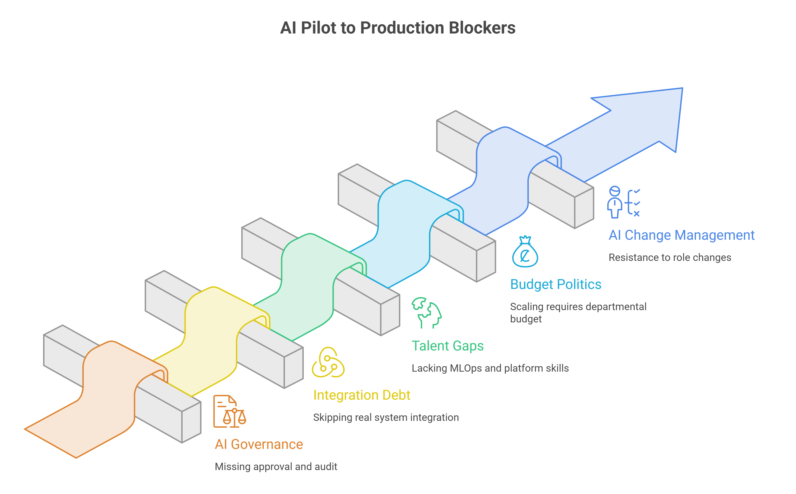
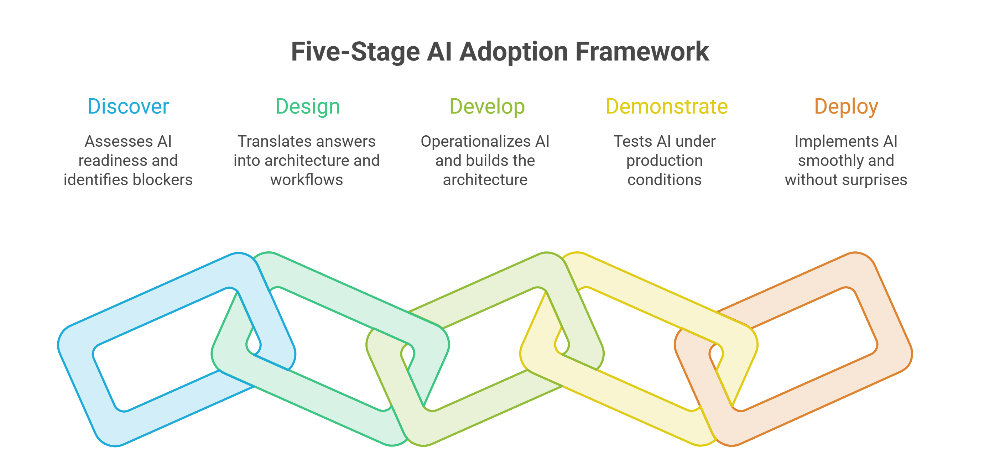

Somewhere in most enterprises right now, there is a Slack channel full of screenshots from an AI pilot that worked. The demo landed and the metrics looked good. Six months later, the pilot is still a pilot. Nobody killed it, and nobody scaled it.

This is pilot purgatory, and it is the most common failure I see when enterprises try to take an AI pilot to production.

The cause sits in the organization around the model. I call it AI organizational context adaptation: the work of fitting a system that succeeded in a protected environment into the constraints, incentives, and failure modes of how the business runs day to day. Pilots are built to avoid that work, and the gap sits behind most of the [AI adoption and transformation](https://www.improving.com/expertise/ai/adoption-transformation/) work we get pulled into.

Pilots almost never do this work, because pilots are structurally designed to avoid it. It's the recurring pattern behind most of the [AI adoption and transformation](https://www.improving.com/expertise/ai/adoption-transformation/) work we get pulled into. The model works in a pilot, but the pilot was never designed to survive contact with the business.

## What It Takes to Scale AI in the Enterprise

Scaling AI in the enterprise comes down to AI organizational context adaptation: rebuilding the infrastructure around a working pilot (governance, integrations, staffing, budget line, and change process) so the system can survive outside the protected conditions of a demo. A pilot is never asked to run under real constraints, so it never needs this work.

Skip the adaptation work and a pilot fails slowly. Budget keeps flowing to an innovation line, the steering committee keeps meeting, and nobody ever declares the project dead because nobody has to.

Most enterprises still struggle to scale AI value past the pilot stage. BCG puts the figure at 74%, as we covered in [Why AI Pilots Fail to Scale](https://www.improving.com/thoughts/why-ai-pilots-fail-to-scale/). The reasons are the five blockers below, left unaddressed until they are expensive to fix.

## Why the Pilot Was Never a Real Test

A pilot gets a clean dataset, hand-picked by someone who understands its quirks. It gets a small group of motivated users who were probably in the room when the idea was pitched. It gets a sponsor checking in personally, which means small failures get caught and smoothed over before they become pattern.

None of that is dishonest. It's how you run a controlled experiment. But a controlled experiment tells you the system can work under controlled conditions. Production offers none of those.

I've written before about the four rungs of AI adoption maturity: Ad-hoc, Experimentation, Strategic, and Transformational. Pilot purgatory is what happens when an organization gets very good at rung two and mistakes that progress for reaching rung three.

The pilots multiply. The steering committee meets regularly. Everyone can point to a slide showing all the tools being tested. There is plenty of activity, but very little actually changes in the business. That work fails along five predictable lines.

## Five Blockers That Keep an AI Pilot From Reaching Production

These five AI adoption challenges usually surface in the order below, but all five need work at the same time.

### **AI Governance**

Governance gaps show up first, usually because nobody noticed they were missing until the pilot needed to touch real customer data or make a decision with real consequences.

A pilot answering internal questions from a sanitized dataset needs no AI governance framework worth the name. The same system making a credit decision, a clinical recommendation, or a customer-facing commitment needs an approval chain, an audit trail, and someone whose job it is to own what happens when the model is wrong.

Building that after the fact, once legal or compliance asks the question nobody prepared for, stalls the project for months. Our guidance on [platform security and governance for AI agents](https://www.improving.com/thoughts/platform-security-governance-ai-agents/) shows what this looks like in practice.

### **Integration Debt**

Integration debt is the second blocker, and it's usually invisible during the pilot because pilots are built to skip it.

A proof of concept reads from an export, writes to a dashboard, and calls it done. Production has to read from the actual system of record, write back into the actual workflow, and survive the actual mess of duplicate records, stale fields, and undocumented business logic that the export conveniently filtered out.

A pilot that skipped this work looks finished and is nowhere near done.

### **Talent Gaps**

Talent gaps come next. An organization can have excellent data scientists and still lack the MLOps discipline to keep a model healthy in production, or the platform engineers who understand how to wire an LLM call into an existing service mesh without doubling latency.

The pilot never needed this talent, because a data scientist babysitting the system is an adequate operating model for a demo.

### **Budget Politics**

Budget politics is the blocker nobody wants to name directly, but it's real.

A pilot gets funded out of an innovation budget that answers to nobody's P&L. Scaling requires a line item in an actual department budget. Someone now has to defend that ongoing cost against everything else competing for the same money. The AI initiative is now judged alongside headcount and infrastructure spend, even though it was never built to justify that kind of investment.

Winning that conversation is a different skill from running the pilot, and it deserves its own treatment in [getting executive buy-in for AI](https://usc-word-edit.officeapps.live.com/we/2026-07-17%20Getting%20Executive%20Buy-In%20for%20AI.md) in its own right.

### **AI Change Management**

Change resistance is the last blocker and often the deepest, because it's the one that looks like the others while actually being about something else.

A team that slow-walks adoption is often reacting to a change in their role that nobody discussed with them. Governance, integration engineering, hiring, and budget cannot fix resistance that was never about capability.

**Common mistake:** Teams treat the five blockers as a checklist to clear in sequence. The blockers depend on each other. If you fix governance and integration and skip change management, the team you never talked to will find small ways to make the rollout fail. All five have to move together, because the ones you skip will undermine the ones you fix.

We worked with a regulated regional bank that showed three of these blockers stacked on top of each other in a single conversation. They had already run pilots on two different AI platforms, but access was limited to a small group of specialists, and the two executives who owned the initiative were still debating internally which use case to bring to the rest of leadership first.

What we found was that their most valuable candidate use case, agents that could help verify the multi-layered compliance testing that core banking transactions require before they ship, was also their least visible one. The flashier, customer-facing ideas that would rally the organization added comparatively little value once you looked past the demo. Their own read was that they needed a little exciting work to rally people and a lot of unglamorous work to get funded and scaled.

That is talent, budget politics, and governance ownership showing up in one conversation, inside an organization that had already done the pilot work and still could not say what came next.

## Scaling AI Is a Jump From Woodshop to Factory

I've used the [woodshop-to-factory analogy](https://www.improving.com/thoughts/ai-coding-workflows-skills-developer-productivity/) before to describe the jump from AI as a tool in someone's hands to AI running with real autonomy, and it applies here almost without modification.

- **Pilot is a woodshop:** One craftsman, one workbench, full personal oversight of every output.
- **Scaling is a factory: **Continuous operation without the craftsman standing over every unit, so the safety systems, quality gates, and inspection points that the craftsman's presence provided have to be built into the process before volume arrives.

The five blockers are exactly the factory infrastructure the pilot never needed:

- Governance is the safety system.
- Integration is the material specification that ensures what flows into the process meets a defined standard.
- Talent is the maintenance protocol that keeps the machinery running within its design parameters.
- Budget is the capital commitment that factories require and woodshops don't.
- Change management is the retraining of the people who now work alongside the machine instead of around it.

A factory gets built by asking what the woodshop never had to answer, then answering it before volume makes the gaps expensive.

## A Five-Stage AI Adoption Framework for Scaling Past the Pilot

The AI adoption framework we use with clients is a five-stage sequence: *Discover, Design, Develop, Demonstrate, and Deploy.*

Naming the sequence forces the organizational context work to happen in order. Left alone, that work gets skipped, because a successful demo creates pressure to move straight to deployment.

**Discover** works like an [AI readiness assessment](https://www.improving.com/expertise/ai/strategy-roadmap-assessment/) for a single use case. The five blockers get inventoried against this organization and this system of record, and the output is a concrete list of which integration points are broken, which approval nobody owns yet, which team will need new skills, whose budget this comes out of, and whose role changes. This is usually the point where an organization realizes it needs a standing owner for these questions rather than re-litigating them per pilot, which is the argument for [building a real AI Center of Excellence](https://usc-word-edit.officeapps.live.com/we/2026-07-17%20How%20to%20Build%20an%20AI%20Center%20of%20Excellence%20Structure%20Roles%20and%20What%20to%20Avoid.md) instead of a rotating committee.

**Design** translates those answers into an architecture. It settles what the approval workflow looks like, which system is the integration point and what its interface contract requires, and how the retrained workflow runs for the team whose role is changing.

**Develop** is where the team operationalizes AI: the architecture gets built, and that takes longer than the pilot did, because the pilot never had to build any of it. A sponsor who remembers how fast the demo came together often gets frustrated with how slow the real build is going.

**Demonstrate** here means something harder than the demonstration the pilot already ran. It is a test under the conditions production will impose, with real data, real integrations, a live governance workflow, and the retrained team using it inside their own process. New problems surfacing at this stage are the stage doing its job.

**Deploy** is the last stage precisely because everything upstream of it was designed to make deployment boring. A deployment that surfaces surprises is evidence that Discover, Design, or Develop skipped something. A deployment that goes smoothly, without anyone needing to remember it happened, is the actual measure of success.

**Counterintuitively:** The first use case is usually the slowest one you'll ever run.

For use case one, the team has to build the governance model, integration approach, and retraining playbook from scratch. By use case ten, much of that work already exists. The team is mostly confirming that the patterns established earlier still apply.

Say use case one takes twelve weeks to move through all five stages because every pattern has to be created from scratch. Once those patterns can be reused, use case ten might only need two weeks: one to confirm the approach in Discover and one to Deploy.

That's the return you get from sequencing the work properly.

## **Where This Gets Pushback**

**Objection 1: This is waterfall wearing a new name.** Discover-Design-Develop-Demonstrate-Deploy sounds like a five-stage waterfall, and waterfall has a well-earned bad reputation for being slow when a market window is open. There is something to that. The way to move faster is to sequence one use case at a time instead of moving the whole portfolio at once, because every use case after the first reuses the patterns the first one created.

**Objection 2: Naming five blockers and five stages is just consultant theater.** This one is more serious, and fair, if the framework stays a slide. The test of whether it's real is whether Discover produces a document specific enough that someone could be fired for ignoring it, whether Design produces an architecture a skeptical engineer would actually build from, and whether Demonstrate is allowed to fail loudly rather than being quietly declared a success because the sponsor is tired of waiting. A framework that can't produce an uncomfortable finding in its own Discover phase isn't doing the diagnostic work it claims to do.

## Real Product of Scaling AI is Reusable Infrastructure

The pilot that never scales reflects an organization that treated the five blockers as things to deal with later, and later never arrived on its own. It rarely reflects a bad technology bet or a leader who lost their nerve.

Rung three of the [AI adoption maturity ladder](https://www.improving.com/thoughts/ai-strategy-and-roadmap-assessment/) is organizational infrastructure: the governance pattern, the integration pattern, the talent model, the budget model, and the change process, all built once and reused, which is what makes later use cases faster to scale than the first. That infrastructure is the real product of an enterprise AI strategy that scales. The pilot only proved the idea was worth building the infrastructure for.

If you want a real gut check rather than a framework to admire, pull up the last two or three AI initiatives at your organization that stalled after a good demo. Don't ask whether they succeeded. Ask which of the five blockers actually stopped them, and whether anyone owns fixing that blocker today or is still hoping it doesn't come up again. If the same blocker shows up twice, that isn't bad luck. Where would your next pilot actually stall?

If you're staring at a pilot that's stuck in exactly this spot, I'd like to hear about it. Reach out through our [AI adoption and transformation practice](https://www.improving.com/expertise/ai/adoption-transformation/) and let's talk through where yours would stall.

## **FAQ**

**Do all five blockers have to be fixed before we scale anything?**

No, but they all have to be inventoried honestly during Discover. Some, like a lightweight governance pattern for a low-risk use case, can be genuinely small. Skipping the inventory is what causes stalls, not having a short list.

**How do you take an AI pilot to production?**

Run the use case through five stages: Discover, Design, Develop, Demonstrate, and Deploy. Discover inventories the governance, integration, talent, budget, and change management gaps for that use case. The remaining stages build and test the fixes under production conditions before anything ships.

**How long does the Discover-to-Deploy sequence actually take for a first use case?**

Longer than the pilot did, because the pilot skipped the work this sequence does. Expect weeks, not days, for a first use case; the payoff is that use case three onward moves much faster because the patterns already exist.

**What's the minimum viable version of an AI Center of Excellence?**

Two people with clear ownership of the five blockers and standing authority to say no to a pilot that isn't ready to scale. It doesn't need to be a large team on day one, it needs to be a team that isn't re-litigating the same governance question for every new pilot.

**Can a single team run this sequence, or does it require a full platform build?**

A single team can run Discover and Design for one use case. Develop and Demonstrate usually pull in whoever owns the system of record you're integrating with, so budget for their time even if they're not on the core team.
