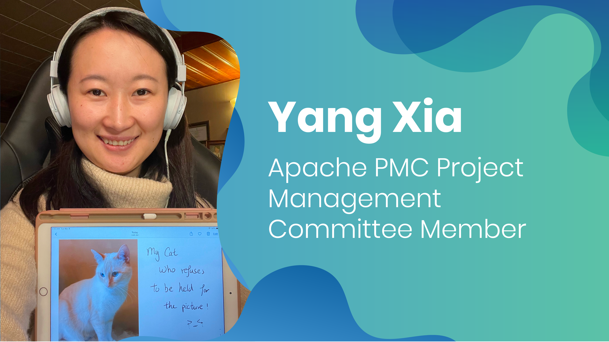

We are excited to share that our very own Yang Xia will be the first Apache Project Management Committee (PMC) member at Improving Vancouver! As a Consultant, Yang has worked tirelessly on development, support, community engagement, and release management for Apache TinkerPop. Read further to learn more about an Apache PMC, Apache TinkerPop, and Yang’s personal journey to this achievement.

### What is an Apache PMC and why is it important?

The PMC is a committee that governs and manages projects for the Apache Software Foundation (ASF). While the community drives the project direction, the PMC oversees and holds responsibility for overall project health, compliance with ASF policies and continuous growth.

Although committers to a project may update the code, the PMC has the sole authority to vote on formal releases of the project’s software. They also hold the responsibility of voting in new committers and PMC members to projects.

PMC Members and Committers take a lead role in helping the community direct the flow of a project. They also have the chance to connect with other industry professionals and learn from each other’s code. Moreover, committers are acknowledged for their work and find it extremely motivating to see their code in action.

### What is Apache TinkerPop?

> *“When I first saw graph databases, I found them to be a really cool representation of data. These kinds of databases have been around for decades, but they’re still a minority of databases.” - Yang*

[Apache TinkerPop](https://tinkerpop.apache.org/) is an open-source computing framework for both graph databases (OLTP) and graph analytic systems (OLAP). Here’s how it works:

- Graphs are composed of vertices and edges
- Vertices are “objects” of data
- Edges represent relationships between data points
- Appropriate to use this type of structure if it’s possible to demonstrate relationships between objects; graph computing offers a flexible structure

Gremlin is the graph traversal language of Apache TinkerPop, and it is predicated on the idea of traversal of data (when traversing a graph, think of a gremlin jumping from vertex to vertex, then reaching back to you after retrieving data). Gremlin is a query language for graphs like SQL is a query language for relational databases.

One of the advantages of TinkerPop is that it [allows developers to add graph computing capabilities to their applications without having to develop APIs, graph processing engines, or graph algorithms.](https://aws.amazon.com/blogs/opensource/why-developers-like-apache-tinkerpop-an-open-source-framework-for-graph-computing/#:~:text=Apache%20TinkerPop%20is%20an%20open,processing%20engines%2C%20or%20graph%20algorithms)

### Yang’s Story

Yang first started to work on a JDBC driver that used Gremlin to connect to graph databases, then moved to an implementation of Gremlin in Go. While working on the serializer was interesting to her, she was fascinated with learning the mechanics of serializing and deserializing data.

> “There are so many different things to learn, like programming strategies and optimizations, as well as just getting more and more familiar with the code base. It’s very cool to see how everything fits together. Also, the TinkerPop community, from contributors to the PMC, really try to make participating in it fun. Having a Twitch stream, YouTube and Discord channel where we get to share knowledge and answer questions.” - Yang Xia

Yang got her first bachelor's degree in Neuroscience and Psychology, then a master's in Pathology and Laboratory Medicine researching cancer genetics. This inspired her to look into bioinformatics/data analysis. She then enrolled in a computer science program and fell in love with the field.

> “The ability to create functioning applications from scratch or improving existing applications to help enable data analytics is why I enjoy programming so much.” - Yang Xia

At Improving, we are bursting with pride and excitement for Yang as she embarks on her journey as the first Apache PMC member within our ranks. Her tireless efforts, exceptional skills, and unwavering passion for Apache TinkerPop have propelled her to this remarkable achievement. We eagerly anticipate witnessing the incredible contributions Yang will make as an Apache PMC member.

To learn more about [Apache PMC](https://www.apache.org/dev/pmc.html), click here! If you'd like to discover more about Improving, feel free to [reach out to us](https://improving.com/contact/).
