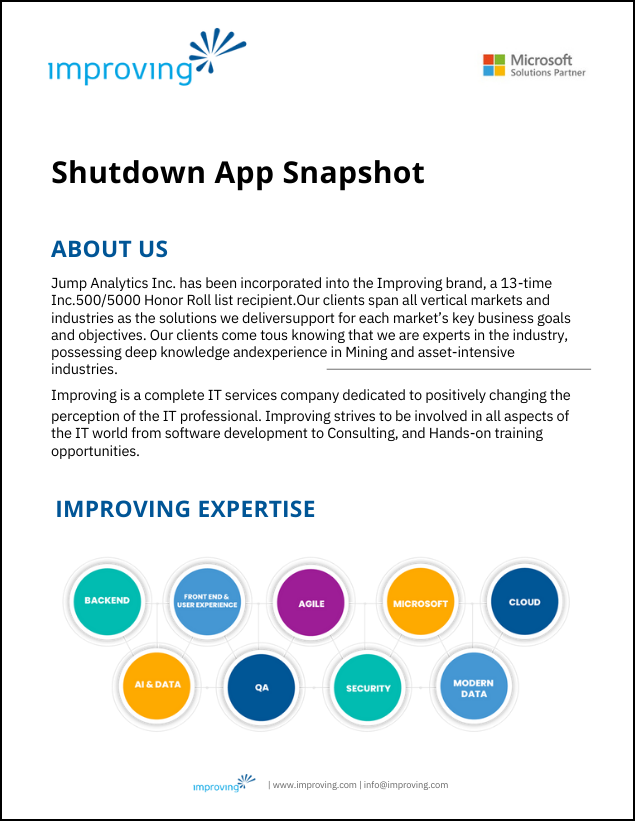

Mine sites periodically hold planned shutdowns to perform necessary maintenance works. Every hour a plant is idle costs operators thousands of dollars in potential revenue. Therefore, it is essential that the stoppage is thoroughly planned for maximum safety, minimum disruption and to decrease the risk of unplanned downtime if machinery is not properly maintained.

This application is an industry-designed solution for mining, or heavy asset-intensive industry, enabling Shutdown planning with an integrated project plan (MS Project) along with a customized worker directory for assigning tasks, and custom shutdown planning checklists that can be modified for each shutdown event (lead-up to close-out). Workflows and dashboards are enabled for real-time tracking!

Designed using Microsoft Azure Analytics and Power Platform.

Improving continues to create innovative solutions that transform how Mining companies capture, report, and analyze critical data across Mine operations.

