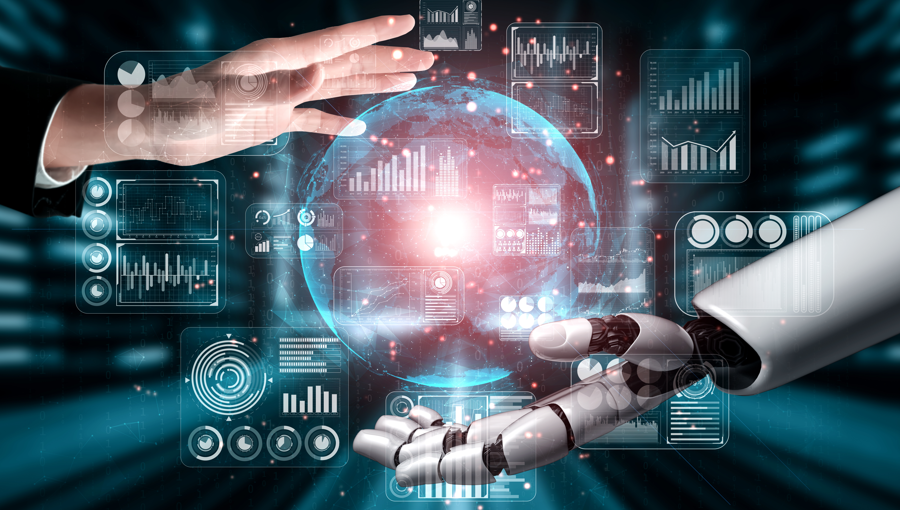
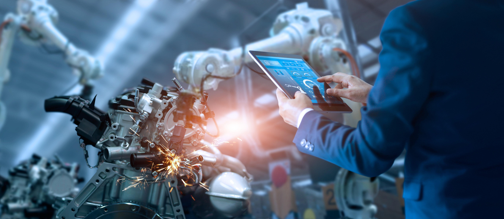

As we say goodbye to 2023, we at Improving want to reflect on the technological marvels that defined the year. As the IT world rapidly changes in front of us, our technologists had a great time learning and exploring the landscape that they work in. Here are six of the key tech trends that captivated Improvers this year:

##### **1. AI and Generative Models in the Spotlight**

In 2023, Artificial Intelligence (AI) continued its impressive progress, especially with generative models like OpenAI's GPT-4. These advanced models showcased incredible abilities in handling natural language, creating content, and solving problems. Whether it was crafting realistic deepfake videos or generating human-like text, the ethical considerations of these AI advancements sparked important conversations about responsible use and regulation. [*(Find out how Improving is harnessing the power of AI here!)*](https://www.improving.com/thoughts/improving-is-harnessing-the-power-of-ai/)

##### **2. Privacy and Security Take the Stage**

With technology becoming an integral part of our lives, concerns about privacy and security reached new heights this year. Notable cyberattacks and data breaches prompted a renewed emphasis on building robust cybersecurity measures. Innovations in encryption technologies and decentralized identity solutions emerged as responses to the growing need for secure digital ecosystems. Despite progress, challenges persist in securing personal data from always-listening devices like cell phones and virtual assistants.

##### **3. Quantum Computing Breakthroughs**

Quantum computing made significant advancements in 2023, pushing the boundaries of what was once thought possible. Companies and research institutions achieved breakthroughs in developing more stable and scalable quantum processors. The concept of quantum supremacy, where a quantum computer outperforms the most advanced classical computers, came closer to reality. The potential applications of quantum computing in cryptography, optimization problems, and drug discovery garnered widespread attention.

##### **4. Robotics in Everyday Life**

Throughout this year, we saw the integration of robotics into our daily lives in unprecedented ways. From delivery drones and autonomous vehicles to robot-assisted surgeries and smart home devices, robots played an increasingly essential role. Progress in artificial intelligence and machine learning contributed to the development of more sophisticated and adaptable robotic systems, enhancing their ability to navigate complex environments.

##### 5. **Health Tech Transformation**

The global health crisis accelerated the fusion of technology and healthcare in 2023. Telemedicine became standard practice, with virtual consultations and remote patient monitoring gaining widespread acceptance. Wearable health tech devices evolved, providing real-time data for personalized healthcare solutions. AI-driven diagnostics and drug discovery processes showed promise in revolutionizing medical research and treatment options.

##### **6. Sustainable Tech Solutions Gain Momentum**

Fueled by a growing awareness of environmental issues, the tech industry experienced a surge in sustainable practices in 2023. From eco-friendly hardware designs to data centers powered by renewable energy, companies embraced a green tech revolution. The focus on sustainability extended beyond corporate initiatives, with consumers demanding products and services that prioritize environmental responsibility. This shift marked a crucial step toward a more sustainable and eco-conscious tech ecosystem.

This past year’s technology shifts reshaped the way we all live, work, and interact with the world. We are looking forward to working with our clients to continue advancements in this dynamic and evolving technological landscape. If you would like to speak with us about how we can *improve *your company in 2024, [reach out to us today! ](https://www.improving.com/contact/)
