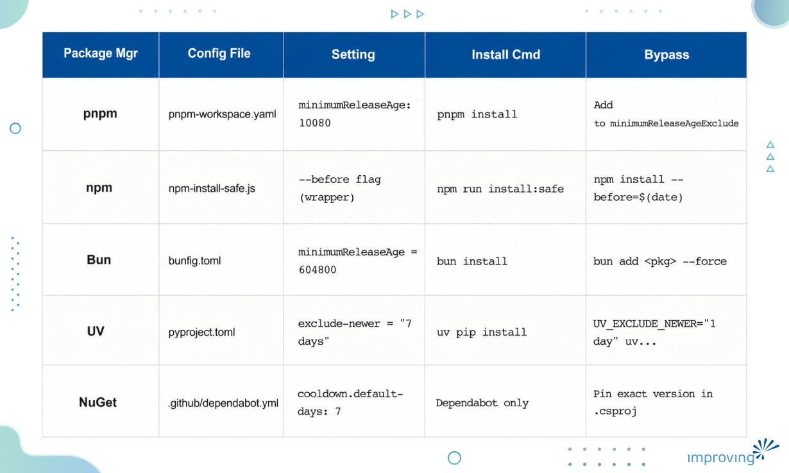
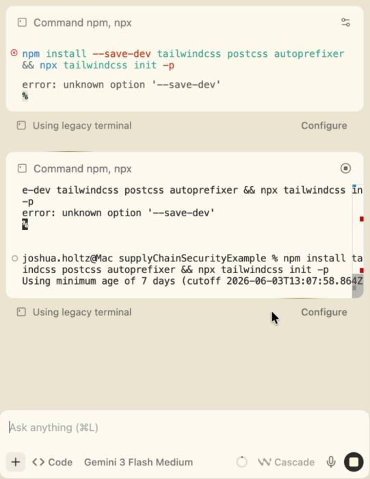

The [axios compromise](https://cloud.google.com/blog/topics/threat-intelligence/north-korea-threat-actor-targets-axios-npm-package) affected a package with over 100 million weekly downloads. The [TanStack attack](https://tanstack.com/blog/npm-supply-chain-compromise-postmortem) came through npm. The [shai-hulud incident](https://www.microsoft.com/en-us/security/blog/2026/05/20/mini-shai-hulud-compromised-antv-npm-packages-enable-ci-cd-credential-theft/) hit the Python registry. And after each attack, the industry advice is the same: audit your dependencies, enable Dependabot, check your lockfiles.

Besides these, teams can defend against the actual attack window by leveraging the gap between when a malicious package lands in a registry and when the security community catches and removes it.

That’s the gap prompted me to build a Claude skill for securing the supply chain. The concept is simple: enforce a minimum 7-day age requirement before any package can be installed. Most malicious packages get detected and removed within 24 to 48 hours of publication. A 7-day cooling-off period means that by the time a workspace can pull a package, it has already survived a week of public scrutiny.

In this blog post, we will walk through the reasoning behind the supply chain security skill, what the implementation looks like across five package managers, and the specific mistakes worth knowing before you try to build this yourself.

## **Window Scanners Miss**

CVE scanners and dependency auditors only catch known vulnerabilities in packages that have already been identified, flagged, and added to a vulnerability database.

The word 'known' is the constraint.

When a maintainer's credentials get compromised and a malicious version gets published, there is no CVE entry, so no Snyk alert fires and no Dependabot PR appears. The package looks legitimate because it came from a legitimate account. Teams consuming it have no automated signal that anything is wrong.

Attackers do not need a compromised package to survive in the registry permanently. They need it to survive long enough to get pulled into a build. Most published supply chain attacks are active for hours to a couple of days before detection.

Standard scanning tools are built for a different threat model: packages that were fine and then got flagged over time. The supply chain attack pattern is: packages that were malicious from the moment they landed. Scanning catches the first type but does not reliably catch the second.

> ***Why this matters for engineering and security leaders**** *

> *Dependabot and CVE scanners are necessary but cover a different threat window than active supply chain attacks. A team can have all of these tools running and still have no protection against a package compromised this morning. Package age enforcement closes that specific gap without changing how developers write code. *

## **What a 7-Day Minimum Age Actually Does**

The solution to avoid adding vulnerable packages is to set up minimum age requirement for package installation. A package published less than 7 days ago cannot be installed in a workspace where the skill is active.

The 7-day threshold is important as most [malicious packages get caught and removed](https://pnpm.io/supply-chain-security#delay-dependency-updates) well within that window. By the time a developer can install a package in an age-enforced workspace, it has been exposed to registry administrators, security researchers, and automated detection systems for a full week.

**What this protects against:** newly published malicious versions of existing packages, recently compromised maintainer accounts pushing updates, and typosquatting on packages that just landed in the registry.

**What this does not protect against: **packages that evaded detection for longer than 7 days, vulnerabilities in packages already locked into the project, and dependency confusion attacks using internal package names. Package age enforcement is one layer. You will still need scanning, lockfile integrity, and private registry controls, but package age enforcement closes a specific window those other controls miss.

## **Five Package Managers, Five Different Implementations**

The reason this became a Claude skill rather than a CI check, or a shell script is that each package manager implements age enforcement differently, and some do not support it natively at all. A Claude skill encodes the correct configuration for each ecosystem as workspace context. The secure path becomes the default, without requiring developers to know the implementation details for pnpm versus UV versus NuGet.

Here is what the configuration looks like across each supported ecosystem.

### **pnpm**

Requires pnpm v10.16 or higher. The setting lives in pnpm-workspace.yaml, not in .npmrc (see the gotchas section below).

```markup
minimumReleaseAge: 10080    # 7 days expressed in minutes 
```

### **npm**

npm has no native support for minimum package age. The skill uses a wrapper script that calculates a date 7 days ago and passes it to npm install via the --before flag. Developers run npm run install:safe instead of npm install directly.

### **Bun**

Configured in bunfig.toml. Bun measures the threshold in seconds:

```markup
minimumReleaseAge = 604800    # 7 days in seconds 
```

### **UV (Python)**

Set in pyproject.toml. UV supports this natively and is the correct tool for Python workspaces. pip does not support package age enforcement at all.

```markup
[tool.uv] 

exclude-newer = "7 days" 
```

### **NuGet (.NET)**

Native CLI support is not yet available (there is an open issue tracking this at [NuGet/Home#14657](https://github.com/NuGet/Home/issues/14657)). The current approach uses Dependabot's cooldown configuration to enforce a 7-day wait on automated dependency updates. Developer-initiated installs require pinning exact versions in the project file.

The table below summarizes the configuration across all five ecosystems.



## **Two Mistakes Worth Knowing Before You Build Claude Skill**

Building supply chain security skill across five ecosystems produced a few hard-won lessons.

### **pnpm self-install exclusion**

pnpm v10.16 and later applies the minimum age check to its own installation. Without an explicit exclusion, the tool blocks installing its own pinned version. The fix is a one-line addition to pnpm-workspace.yaml:

```yaml
minimumReleaseAgeExclude: 

  - pnpm 
```

### **Python pip gap**

pip has no native support for package age enforcement. If a workspace is still using pip, the control simply does not apply. The skill uses UV for Python, which has supported exclude-newer since its early releases. If a project is using pip, the right first step is migrating to UV, then enabling the age control. UV is worth the migration on its own merits: it is significantly faster and has a more predictable resolution model.

## **AI Coding Assistants Expand the Attack Surface**

AI coding tools suggest dependencies as part of writing code. A recommendation to npm install some-package comes with no age context, no freshness signal, and no indication that the package was published three days ago.

[AI-assisted development](https://www.improving.com/thoughts/embedding-ai-into-daily-development/) expands the number of dependency suggestions a codebase receives. Developers working with generated code may accept install suggestions quickly, particularly for packages outside their direct experience.

Package age enforcement is infrastructure-level. It applies regardless of how the install command was generated: by a developer typing directly, by an AI coding assistant, or by a build script. That is the right place to put a control like this. It does not require any change in how developers or AI tools behave. It just closes the gate at the point of installation.

## **Claude Skill to Help You Out**

Everything described in this post is packaged as a skill.md file that provisions and enforces package age controls automatically across any workspace where it is active. The skill is available on GitHub and is free to use, adapt, and contribute to.

### **What the Skill Does**

The supply chain security skill is a Claude workspace configuration file. When added to a Claude project, it gives Claude the context to set up the correct age enforcement configuration for whatever package managers are present in the workspace. On first use in a new project, Claude provisions the workspace:

1. Creates pnpm-workspace.yaml with minimumReleaseAge set to 10080 and pnpm excluded from the age check
2. Creates npm-install-safe.js, the wrapper script for teams still using npm
3. Creates bunfig.toml with minimumReleaseAge set to 604800 for Bun workspaces
4. Adds the exclude-newer setting to pyproject.toml for Python projects using UV
5. Creates .github/dependabot.yml with a 7-day cooldown for .NET projects
6. Updates the workspace README with a supply chain security section and quick reference table so the control is visible to every developer who opens the project

After provisioning, the skill stays active throughout the session. Any subsequent package installation command goes through the age-enforced path. Claude will not suggest commands that bypass the control without also explaining the tradeoff and documenting the exception.

***Find the skill on GitHub**** *

> *The full skill file, configuration templates, bypass procedures, and README update instructions are available at: *

> **[***Supply Chain Security Skill GitHub Repo***](https://github.com/improving/supplyChainSecuritySkill)* *

> *Issues, pull requests, and feedback are welcome -- especially edge cases from specific package managers or version constraints not yet covered. *

### **Skill in Action**

In the screenshot below, we can see that the LLM attempted to install several packages. However, the script intercepted the request, verified the package age, and only allowed packages whose latest updates were more than 7 days old.



### **Adjusting the Threshold**

The 7-day default is a starting point, not a hard requirement. Teams in regulated environments or with a lower tolerance for new package risk can raise the threshold to 14 or 30 days by editing one value in each config file:

- **pnpm: **change minimumReleaseAge in pnpm-workspace.yaml (14 days = 20160, 30 days = 43200)
- **Bun: **change minimumReleaseAge in bunfig.toml (14 days = 1209600, 30 days = 2592000)
- **UV: **change exclude-newer in pyproject.toml to '14 days' or '30 days'

Teams that need to install a package before the age threshold passes -- a critical security patch, an internal package just cut for a release -- have documented bypass procedures for each package manager. The bypass is intentionally visible and auditable rather than silent.

## **Key Takeaways**

Supply chain attacks exploit a specific window: the time between a malicious package landing in a registry and being detected. Most scanning tools do not cover this window.

- A 7-day minimum age requirement closes that window. Most malicious packages are caught and removed well within 7 days of publication.
- The implementation varies by package manager. pnpm and Bun have native support. npm requires a wrapper script. UV supports it cleanly for Python. NuGet CLI support is still pending.
- AI coding assistants expand dependency suggestion volume. Infrastructure-level controls apply regardless of how install commands originate.
- Document bypass procedures before rollout. A control that gets removed under pressure is not a control.
- Package age enforcement is only one layer. Sometime, packages can evade detection for longer than 7 days so there are different ways to handle those security leaks.

Finally, the supply chain security Skill.md is available and open to feedback. If you have any doubt, you can send me a message on [LinkedIn](https://www.linkedin.com/in/joshuaholtz/). If you are running into edge cases in a specific package manager or ecosystem, improvements are welcome. If your team is working through supply chain security posture or broader application security questions, [connect with Improving](https://www.improving.com/contact/) to discuss your environment.
