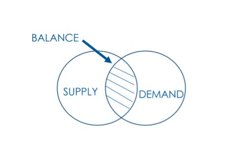
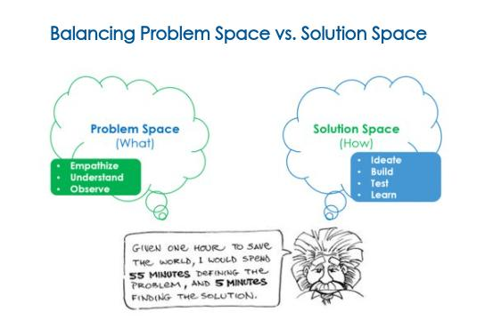

In my last blog titled [*Modern Ways of Working: From Complacency to Innovation*](https://improving.com/thoughts/modern-ways-of-working)*, *we focused on how businesses need to be obsessed with delighting their customers. We also dove into how to engage employees and provide a culture that creates awesome products and services.

Now, let’s take it a step further and show how important strategic planning (*specifically strategic demand management)* is and how it’s directly tied to systems thinking and removing waste.

There’s a saying that has been around for a long time but continues to stay relevant:

Insanity is doing the same thing over and over and expecting different results.

That witticism is called “Einstein Insanity” and is usually attributed to Albert Einstein. With this thought, we are going to dig into something that continues to affect a lot of us, both personally and professionally. So, let’s look at the professional side of it.

What happens when companies continue to operate the same way, regardless of what customers tell them? What both the data reflects, and what employees share, is something similar to this quote.

The quote is also pretty relevant to companies who say they are risk-averse. Many times, they continue to operate the way they did many years ago. The digital age has changed a lot, so many times these companies are actually doing the opposite of what they’re saying. They are accepting more risk than they need to.

## Strategic Planning

So, what do we do when we want to change the way we do things but don’t know how or where to start?

One approach is to embrace a competency called strategic management. Successful execution of any strategic management plan requires your plan to be flexible enough to adapt to changing environments. Your employees also must be aligned and motivated towards a common goal.

Strategic Planning assists by proactively creating a clear plan or roadmap for success that establishes a direction for your business to take and helps sharpen its focus to get there. The roadmap improves your company’s self-awareness by understanding its strengths and weaknesses and where it stands in the market, both individually and in relation to competitors.

Strategic planning isn’t just beneficial for those highest up in the management hierarchy. It gives everyone in the organization a sense of purpose and how their work contributes to delivering value and delighting customers.

## Finding the Right Balance With Supply and Demand

There are a couple of ways one can look at Strategic Demand Management. One is aligning the demand to the marketplace. Another is aligning the capacity (supply) of team members to the work (demand).

Either way, finding the right balance with both perspectives at the same time is the ultimate goal. We need to balance having the right products or features to delight our customers without having a surplus of products or features that are not being used.

Because both perspectives are important, we don’t want to spend precious time and money delivering things that don’t bring value.

This is where one should take a systems-thinking approach. Try to understand all the inner workings of what makes a business get from concept to cash, and apply it to strategic planning assists to get a better understanding of the implications of our actions or outcomes. At the end of the day, we should be fussy with what we invest our time, resources, and employees in.

There is only so much work people and teams can get done within a specific timeframe. By not managing this, it can lead to issues with quality, poor morale, and trust.

I use the word fussy on purpose because it is with this mindset that we can embrace the constraint of a fixed headcount (team members) to simplify how we determine what to focus on and when.

## Importance of Determining Viability Early

This is where the concept of a minimum viable product (MVP) also comes into play. The term has been misunderstood and misused over the years. However, we should not lose sight of the importance of the concept of determining viability as fast as possible, and how it can assist with managing supply and demand from both perspectives.

We again use a quote from Einstein to assist us in doing things differently to get different outcomes.

By creating an environment where we take more of a hypothesis-driving approach, ensuring both creative and critical thinking are considered, and incorporating the scientific method into strategic thinking and planning, we can facilitate the ability to be flexible and proactively navigate an ever-changing world.

Before we spend too much time and money, we should look for ways to confirm our "big bets", through small experiments and validating our hypothesis. We can do this by having customers touch and feel a small part of the proposed solution to see if it really solves the problem or provides a new opportunity.

Generally speaking, businesses today have solutions they want to deliver without really understanding the problem. And worst yet, without validating what they will obtain or the outcome they are expecting. This is again where companies are taking on more risk than they should.

I used a restaurant model in my last blog, and I believe it is still relevant here. A simple example of this concept is offering daily chef specials. They have the customer right in the building and can take advantage of validating the viability of their product or services, then get immediate feedback before spending a lot of time and money.

Embracing the objectiveness of data and how customers respond to our proposed solutions moves us into a new way of doing business by combining innovation and delighting our customers.

## Managing Work in Progress (WIP)

Our last concept for this discussion is how to manage and balance the capacity of an organization compared to the demand they have for work or services. Because employees and teams are critical for the success of any business, trying to find that balance is very important. Creating a culture of sustainability can assist in avoiding burn-out, concerns about quality, and it also builds trust.

By balancing the demand and capacity, we can gain a lot of benefits and efficiencies for removing waste (lean thinking) and again mitigating risks.

When businesses do not tie capacity to demand, they miss the opportunity to take advantage of being responsive to good opportunities.

Using the restaurant example again, they are continuously having to balance demand to capacity right in front of their customers. Because they only have so many food servers to wait tables, they may run into a supply and demand issue pretty quickly when the dinner rush comes starts. When the demand is more than capacity, they’ll put customers on a waitlist. It mitigates the risks of providing poor service and enabling higher employee morale.

This concept is called managing Work in Progress, otherwise known as WIP. By managing WIP, it can assist in understanding these questions: Are we working on the right thing at the right time? Are we getting the outcomes we are looking for? Do we have enough supply for the demand?

Another benefit of managing WIP is that it’s easier to predict how much work an organization can produce and sell, thus forecasting gets better too.

Instead of giving a team member more work than they can handle or adding more team members to do more work, embrace a fixed capacity headcount. It can simplify the complex environment. Anytime there is an opportunity to do this, businesses who mean business will take advantage of it.

By limiting our WIP and really finishing work or stopping it before we add anything more, we can continue to manage and measure the flow of getting from concept to cash, which is delivering value to our customers. At the end of the day, that is what being in business is all about.

## What To Do Next

In closing, another quote comes to mind. It is from the rock group, Rush, in their song titled "Freewill".

If you choose not to decide, you still have made a choice.

Neil Peart

Businesses who deliberately choose to continually operate the same way are making a clear choice. Depending on their outcomes, they may be having some of Einstein’s Insanity by expecting different results.

Businesses that choose to take on new mindsets and are willing to look for different ways of doing things are mixing and matching creativity, innovation, science, and excitement when delivering products and services. What a great way to bring passion and fun to our ever-changing, complex world!

[Reach out](https://improving.com/contact) to us at Improving if you want help in this strategic planning process.
